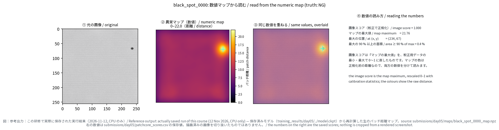

# 固定・最終評価後だけ：保存済みTEST / After freeze and final assessment only: archived TEST

これは過去の保存出力で、今回の推論結果ではありません。最初の未使用試験を終える前に見せないでください。
この結果を見て設定を選び直した場合、同じデータでの以後の成績は「再利用データの説明用評価」です。

This is historical saved output, not the current inference. Do not show it before the first
untouched assessment. If it informs a later setting change, subsequent results on the same data
are illustrative reused-data assessments, not a fresh untouched-test estimate.

## 保存済みTESTの数値マップ / Archived TEST numeric map

**出典 / Provenance:** 2026-11-12 CPU reference run;
`predictions_by_partition["test"]` → `submissions/day05/maps/black_spot_0000_map.npz`
(`image = test/black_spot/black_spot_0000.png`) plus the matching row in
`submissions/day05/patchcore_scores.csv`. Builder: `generate_reference_outputs.ref_anomaly_panels`.
The original PNG is preserved unchanged. Source checkpoint/numeric records are unavailable locally;
these historical values have not been independently rerun.

元画像・生の数値マップ・同じ数値の重ね表示・読み方の4列です。正解NGもTEST情報です。
較正統計で正規化されていても、元画像の役割はTESTのままです。較正例と呼んではいけません。

Four columns show the original, raw numeric map, overlay of those values and reading guide.
Truth NG is also TEST information. Normalizing with calibration statistics does not make the
underlying TEST image a calibration example.

| 入力 → 操作 → 値 / Input → operation → value | 用途 / Use |
|---|---|
| 画像 → 特徴 → 生の画像スコア21.439 / image → features → raw image score 21.439 | 正規化へ / goes to normalization |
| 特徴 → 空間化・平滑化 → マップ最大21.762 / features → spatial map, smoothing → max 21.762 | 場所の手がかり / location clue |
| 生の画像スコア → 較正統計 → 保存値1.000 / raw scalar → calibration statistics → saved scalar 1.000 | 同尺度の画像しきい値0.50と比較：NG / compare with image threshold 0.50: NG |

生の画像スコアは最大パッチ距離に近傍9点の重みを掛けた値です。マップは補間・平滑化後です。
1.000は100%正しいという意味ではなく、生の値を0.50と比べてもいけません。

The raw image score weights the largest patch distance using nine nearest memory features.
The map is interpolated and smoothed; its maximum need not equal the raw image score.
1.000 is not 100% certainty. Never compare the unprocessed raw value with 0.50.

問い：画像の合否を決めるのはどの行ですか。表示のvmaxだけを変えると判定は変わりますか。

Question: which row determines image acceptance? Does changing display vmax alone change it?

この図とカードはDay05_01/02の固定前の説明から移しました。ノートブック03の既存の任意ゲート
（固定記録と評価結果が必要）を通した後だけ表示します。学習者PDFには含めません。

Moved out of the pre-freeze Day05_01/02 narrative. Show only through Notebook 03's existing
opt-in gate after a freeze record and assessment exist. Excluded from learner PDFs.

## 実際の5列比較 / Actual five-column comparison

同じ3枚の試験画像を、元画像・YOLOの四角・PatchCoreの数値マップ・正解マスク・画像単位の判定の
5列で並べています。この図の実行では、しきい値は固定済みでした。今回の実行の期待値ではありません。

Three test images appear in five aligned columns: original, YOLO boxes, PatchCore numeric map,
ground-truth mask and image-level decision. Thresholds were frozen in the run that produced this
figure. It does not prescribe the current run's expected values.

1行目はYOLO NG・PatchCore OK・正解NGで、2・3行目は一致です。
保存例 `streak_0005` のPatchCoreスコアは0.464 < 0.50で、画像単位の見逃し1件です。
これは履歴の説明で、新たなモデル結果を作ったものではありません。正解マスクを推論入力に使ってはいけません。

Row 1 is YOLO NG / PatchCore OK / truth NG; rows 2 and 3 agree.
In this archive, PatchCore's score for `streak_0005` is 0.464 < 0.50: one missed abnormal image.
This explains the historical record; it is not newly generated model evidence. Never feed the
ground-truth mask into inference.

問い：行1で失敗した方法と、失敗の種類は何ですか。画像単位と四角単位を区別して答えます。

Question: which method failed in row 1, and how? State the counting unit explicitly.

## 読み取れることと限界 / Interpretation and limits

ヒートマップは「どこ」、YOLOは学習したクラスの「何」の手がかりです。
組合せが常に補完する保証はなく、計算時間・運用負担・新しい誤りも増えます。
速度と誤りのバランスを測って設計します。

A heatmap suggests where; YOLO suggests which learned class. Combining them is not guaranteed to
help: it adds computation, operational effort and new combinations of errors. Measure the speed/error tradeoff.

1. 合成画像と実画像の差：実物で同じ数値になるとは限りません。
2. 少数データ：較正用・試験用とも保存例は正常6枚・異常20枚で、1枚が率を大きく動かします。
3. 学習・ラベル予算の差：YOLOはラベル付き欠陥、PatchCoreは正常画像でfitしており、同条件の勝負ではありません。
4. 解像度・前処理・運用しきい値への依存：設定が変われば失敗の分布も変わります。

1. Synthetic-to-real gap: real surfaces need not reproduce these numbers.
2. Small samples: the saved calibration and test sets each have six normals and twenty anomalies;
   one image moves a rate substantially.
3. Different training/label budgets: YOLO fits labelled defects, PatchCore normal images.
   This is not a like-for-like contest.
4. Dependence on resolution, preprocessing and operating threshold: changed settings change errors.

順位付けではなく、同じ画像でどこがどう違うかを説明する資料です。保存済み画像は変更していません。

Use this to explain differences on the same images, not to rank the methods. The saved image is unchanged.
