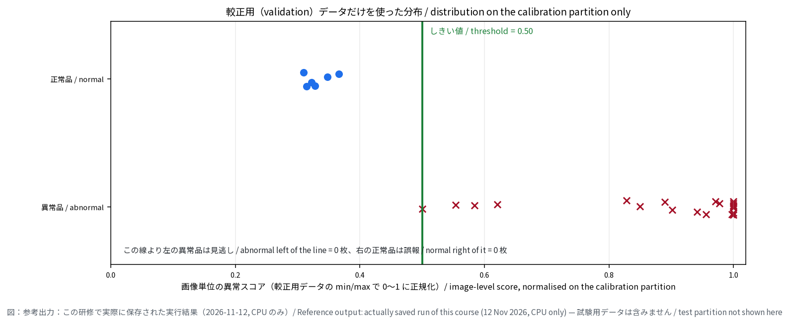

# Day 5 三言語レイアウト見直し / Day 5 three-language layout review

**Date:** 2026-11-20
**Scope:** `notebooks/Day05_PatchCore/` (3 notebooks), the Day 5 Tamang catalogs, the localization
tools, the Day 5 PDF material and the tests that pin them. Days 1–4 are byte-identical.

---

## 1. Starting and final main commits

| Item | Value |
|---|---|
| Starting `main` | `357a89c` (local), fast-forwarded to `origin/main` `1f87c1b` "Record Day 5 and Tamang stabilization evidence" |
| Branch used | `main` (no feature branch was created) |
| Working tree before the work | clean; `stabilize/day5-tamang-final` was the same commit as `origin/main` |
| Final commit | the commit that carries this report on `main` (`git log -1 --format='%h %s'`); its parent is `1f87c1b` |
| Pushed? | no — nothing was pushed or force-pushed |

`git fetch origin main` reported no new commits, so `main` was updated with `git merge --ff-only`
from `357a89c` to `1f87c1b`; no user change was reset or discarded.

## 2. Modified files and notebook cell IDs

| File | Change |
|---|---|
| `notebooks/Day05_PatchCore/Day05_01_Anomaly_Detection_Concepts.ipynb` | 45 markdown cells regrouped; 65 legacy Nepali regions removed |
| `notebooks/Day05_PatchCore/Day05_02_PatchCore_Training.ipynb` | 49 markdown cells regrouped; 73 legacy Nepali regions removed |
| `notebooks/Day05_PatchCore/Day05_03_YOLO_vs_PatchCore.ipynb` | 43 markdown cells regrouped; 66 legacy Nepali regions removed |
| `assets/i18n/taj/notebooks/Day05_*.taj.md` | regenerated as **concept-level** pending catalogs |
| `assets/i18n/taj/coverage_inventory.json` | regenerated inventory |
| `assets/i18n/taj/README.md` | documents the concept anchors and the Day 5 status |
| `assets/i18n/ne/notebooks/Day05_*.ne.md` | **deleted** (legacy Nepali sidecars, recoverable from history) |
| `assets/i18n/ne/docs/README.ne.md`, `assets/i18n/ne/docs/pdf_README.ne.md` | the PDF range in the Nepali region now stops at Day 4 |
| `assets/scripts/apply_translations.py` | `unit:` / `row:` anchors, inline regions, idempotent rewrite |
| `assets/scripts/check_localization_coverage.py` | per-concept classification and pending emission |
| `assets/scripts/check_nepali_coverage.py` | Day 5 is reported as migrated to Tamang, not as missing Nepali |
| `assets/scripts/i18n_locales.py` | catalog keys accept `cell/unit:slug` |
| `assets/scripts/export_trilingual_pdf.py` | inline concept regions, anchor filtering, Day 5 excluded from the `ne` build |
| `docs/pdf/Day05_explanation_ja_en.pdf` | **rebuilt** from the regrouped notebooks (68 pages) |
| `docs/pdf/Day05_explanation_ja_en_ne.pdf` | **withdrawn** from the distribution (legacy Nepali, 92 pages) |
| `docs/pdf/README.md`, `README.md` | Day 5 no longer advertised as a trilingual booklet |
| `assets/tests/test_tamang_localization.py`, `test_trilingual_layout.py`, `test_nepali_localization.py`, `test_pdf_exports.py`, `test_tamang_pdf_renderer.py` | new Day 5 contract, grouped-layout and PDF fixture tests |

**Cell IDs.** Every cell ID, `metadata`, output and execution count is preserved; only the
markdown `source` of the 137 markdown cells changed. Code cells were not touched.

* Day05_01 (45): `a62c030b, b071950f, audit-learning-loop, 5652aeea, 73b2d2a4, 331c3ff1, 68ece906,
  154bde87, fig-teach_normal_variation, ef2014d3, d863bda3, d5d90ce4, fig-VisA_samples,
  clarity-patch-data-roles, 5e60e191, 40ea8a9b, cf09f7d8, clarity-patch-overlap, 429f99e1,
  f6726637, 33f893ee, a85f80ca, c4d6ab80, 61c7189b, 47e11e57, e9df232d, c474e947,
  fig-teach_memory_bank, 8c15705b, 1aba9655, 5c642a4a, fig-teach_score_levels, 1f601e75, 1784ecb1,
  b17afb8a, 2b8faacc, 074c9203, 0cf76dd2, 3c808d08, d7c5629a, 93412cb6, 106f3ad3, 2fb637f4,
  f1c0d7cd, ea343d35`
* Day05_02 (49): `43cbc7ba, 01bf2bc9, audit-learning-loop, a89ea3f4, 75d078b0, 2fa75b5a, 8f419564,
  15fc94d1, 08e2ac7d, bc41a079, afbdd116, c7f73514, 255b5b83, 9e971153, f6b40399,
  audit-teach_patchcore_stages, ec1d7f54, 90a03498, bf3d12fb, fig-teach_backbone_vs_memory,
  f5f00936, clarity-fit-state, 29df63e7, 0555a3e3, 9aac8b7e, c452bff7, ba5da1ef, f4d5f377,
  e23369f4, 28cb22c6, 8cfeab62, clarity-score-card, fig-ref_anomaly_panels, cefba6c0, 11a17ecf,
  748dffdf, b8ec6f1a, clarity-sealed-test, d5182901, d5e2bc6d, 09b10a38, 93a1ccd3, 1fd52dc9,
  40d18179, c81c8cac, 9ea9f264, 2da75241, 483ecbb0, d02d8a44`
* Day05_03 (43): `ba87b991, 1e496b72, audit-learning-loop, cfe0f93b, b1dbfcbd, 5bf55559, c92bae7e,
  404278ad, 7dbe36d4, c1bfc258, fig-teach_evaluation_sequence, be4aa133, 415b6d88, ff4aa9d1,
  a0a1bf15, 38cb927e, 904252da, d8230d25, fig-ref_score_distribution,
  audit-teach_frozen_threshold_pipeline, c818bf0a, fig-teach_threshold_freeze, clarity-freeze-prompt,
  clarity-slider-before-freeze, clarity-sealed-test-read, 3d343aab, ec601269, aa3a7737, bf9157ac,
  fig-ref_comparison_5col, clarity-calibration-boundary, 29824f9c, 5f26ab71, bb4b29d3, 38937c33,
  b9498efe, 09fc3b55, a4328131, 9a48e17c, e885cf03, 30e783b7, dca7b3f3, e39fff93`

## 3. Old layout versus new layout

### 3.1 A concept cell

Old (`Day05_03/404278ad`): a Japanese heading, a Japanese table, a **second** English heading, a
second English table, and a Romanized Nepali copy of the whole section inside `ne:begin end`.

New: one heading, one table, one place for Tamang.

```markdown
#### 同じにできないものは、同じに扱う / Do not pretend different things are the same

2 つの手法は、**返すものが違います**。

The two methods **return different things**:

|  | YOLO | PatchCore |
| --- | --- | --- |
| 主な出力<br>main output | 四角 + クラス + confidence<br>box + class + confidence | 異常スコア + ヒートマップ<br>anomaly score + heatmap <!-- taj-row: main-output --> |
| 「何の欠陥か」<br>"which defect" | **分かる**<br>**yes** | 分からない<br>no <!-- taj-row: which-defect --> |

したがって、**mAP と AUROC を直接比べてはいけません**。…

Therefore **mAP and AUROC must not be compared directly** — they measure different things.

<!-- taj-unit: do-not-pretend-different-things-are-the-same -->
```

The heading carries both languages, the table exists once, every row stacks Japanese over English,
and the anchor holds the slot where the reviewed Tamang text will be inserted — directly below the
concept's Japanese and English.

### 3.2 Objectives and deliverables

`| 日本語 | English |` (one table per language in effect) became a single numbered list where every
item holds both languages and its own slot:

```markdown
1. 異常検知が何をするのか説明できる<br>Explain what anomaly detection does <!-- taj-unit: explain-what-anomaly-detection-d -->
```

### 3.3 The six-step workflow (`Day05_02/clarity-sealed-test`)

Old: a Japanese six-step table **and** an English six-step table under a separate
`### The order has six steps` heading, plus a Japanese and an English copy of the recovery steps.

New: one table (`手順 / Step`, `ノートブック（環境） / Notebook (env)`, `すること / What to do`)
with every row holding Japanese over English, the ASCII flow diagram once, one "common situations"
table with Japanese over English, and one numbered recovery list whose steps hold both languages.

### 3.4 Figures

Old: image, Japanese caption, English caption, then (often much later, sometimes after a heading)
the Nepali caption inside an `after-image:` block.

New: image, Japanese caption, English caption, then the caption slot, then the "what to notice" and
"try to answer" blocks, each with its own slot:

```markdown


図：較正用（validation）データだけのスコア分布…

Figure: the score distribution on the calibration (validation) partition only…

<!-- taj-unit: the-distribution-on-calibration-data-caption -->
```

## 4. Removed Day 5 legacy Nepali regions

| Notebook | Legacy `ne:begin` / `ne:end` pairs removed | Romanized Nepali characters removed |
|---|---|---|
| Day05_01 | 65 | markdown 49,784 → 30,868 chars (−38 %) |
| Day05_02 | 73 | markdown 67,563 → 43,681 chars (−35 %) |
| Day05_03 | 66 | markdown 49,236 → 31,763 chars (−35 %) |

The three `ne` sidecars (`assets/i18n/ne/notebooks/Day05_*.ne.md`) and the legacy
`Day05_explanation_ja_en_ne.pdf` were removed from the active distribution; both remain in git
history. `assets/i18n/ne/` itself, every Day 1–4 sidecar and every Day 1–4 region are untouched, and
`check_nepali_coverage.py` still reports 543 translated cells, 0 missing (Day 5 is reported as
"migrated to Tamang").

## 5. Tamang translation inventory and review status

| Notebook | Concept slots (`unit:` + `row:`) | approved | draft | pending | missing |
|---|---|---|---|---|---|
| Day05_01 | 86 | 0 | 0 | 86 | 0 |
| Day05_02 | 125 | 0 | 0 | 125 | 0 |
| Day05_03 | 97 | 0 | 0 | 97 | 0 |
| **Day 5 total** | **308** | **0** | **0** | **308** | **0** |

* No Tamang text exists in the repository, so nothing is claimed as translated, reviewed or
  approved. The catalogs record every slot as `pending` with the reason, and the catalogs' provenance
  header still says `review: pending-native-review`.
* The variety (Eastern Tamang) and script (Devanagari) stay **unconfirmed**; the production gate is
  still **BLOCKED** (`check_localization_coverage.py --locale taj --strict` → exit 1).
* The pending counts in this report are *inventory* counts, not translation progress.

## 6. Translation anchoring implementation

* **Stable unit anchors.** Every concept block in a Day 5 markdown cell ends with an invisible
  `<!-- taj-unit: <slug> -->` comment; every translated table item carries
  `<!-- taj-row: <slug> -->` at the end of its row. The slug is derived from the concept's own
  English heading or row label, so it survives re-ordering and is human-readable. Positional indexes
  are never the identity of a unit; the Jupyter cell ID is preserved and namespaces the slugs.
* **Catalog form.** `<!-- taj-cell: <cell id> | unit:<slug> -->` and
  `<!-- taj-cell: <cell id> | row:<slug> -->`, with review state keyed the same way
  (`<!-- taj-status: <cell id>/unit:<slug> approved -->`,
  `<!-- taj-pending: <cell id>/unit:<slug> | reason -->`).
* **Insertion.** `apply_translations.py` finds the anchor, writes
  `<!-- taj:begin unit:<slug> --> … <!-- taj:end -->` beneath it (a paragraph of its own), or, for a
  `row:` slot, appends `<!-- taj:begin row:<slug> --><br>…<!-- taj:end -->` inside the same table
  cell. Re-running rewrites only the inside of the region, so the second run is a no-op; a catalog
  entry that names an anchor the notebook no longer has is refused; removing a catalog block removes
  only that region.
* **Coverage.** `check_localization_coverage.py` classifies a cell per concept when it carries
  anchors (Day 5) and per cell otherwise (Days 1–4), so the Day 1–4 numbers and gates are unchanged.
* **PDF.** `export_trilingual_pdf.py` strips the anchor comments, renders `unit:` regions as
  third-language paragraphs and `row:` regions as `<br>`-separated third-language spans inside the
  row, with `lang="taj-Deva"`.

## 7. PDF layout checks

| Check | Result |
|---|---|
| Grouped reading order (JA → EN → Tamang in one concept) | `test_the_grouped_day5_layout_keeps_one_concept_in_one_reading_order` (rendered PDF text order) |
| Table item holds all three languages in the same row | `test_the_grouped_day5_layout_puts_the_row_text_inside_its_row` (charbox: under the Japanese, same column) |
| Caption under its picture, Tamang caption directly after the English one | `test_the_grouped_day5_layout_keeps_the_tamang_caption_under_its_image` |
| One figure and one table per concept, no per-language duplicate | same test module (`html.count("` once) |
| No legacy Nepali in the exported fixture | same test module (`Hapta`/`Pahile`/`ne:begin` absent) |
| Devanagari renders and is searchable | `test_tamang_pdf_renderer.py` fixture; `\ufffd` absent |
| Bilingual Day 5 booklet rebuilt from the regrouped notebooks | `export_explanations_pdf.py --only Day05` → 68 pages, 21,607 Japanese characters |
| No Day 5 Tamang booklet released | gate returns exit 2; `test_no_day5_trilingual_booklet_is_distributed_yet` |

The Week 1 booklet was **not** rebuilt and the Day 1–4 booklets were not touched. Because the Week 1
and the withdrawn Day 5 booklets were typeset before this regroup, the distributed-TOC/page-number
test now covers `Day01`–`Day04` only, with the reason recorded in the test.

## 8. Test execution results

Commands (from `AI_Vision_Training/assets`, Windows, Python 3.12 conda environment):

```cmd
python -m pytest tests -q
python assets\scripts\validate_notebooks.py
python assets\scripts\check_localization_coverage.py --locale taj --strict
python assets\scripts\check_nepali_coverage.py
```

| Command | Result |
|---|---|
| `pytest tests` | **625 passed, 10 skipped, 0 failed** (baseline before this change: 605 passed, 10 skipped) |
| `validate_notebooks.py` | `passed=194 failed=0` — `RESULT: OK` (structure, banners, kernels, figures, code compiles) |
| `check_localization_coverage.py --locale taj --strict` | exit **1**: 851 notebook units pending, none approved, variety unconfirmed — the gate is correctly **BLOCKED** |
| `check_nepali_coverage.py` | exit **0**: 543 cells with Nepali, 0 missing, 12/12 documents, Day 5 reported as migrated |
| `python -c "nbformat.validate(...)"` | the three notebooks are valid `nbformat 4.5`, 57 / 71 / 64 cells |
| `git diff --check` | clean |

The 10 skips are unchanged from the baseline (optional heavy tests that need a GPU/fixture).

New and updated tests:

* `test_tamang_localization.py`: concept anchors are discovered in source order; a concept block
  lands under its own anchor; a table row keeps its text inside its row; an anchor that no longer
  exists is refused; re-applying updates instead of duplicating; a synthetic approved catalog reaches
  every Day 5 slot exactly once; Day 5 is unit-level while Days 1–4 stay cell-level.
* `test_trilingual_layout.py`: Day 5 has no language chapters and no Nepali; one table per concept;
  caption anchor under its image; JA → EN → Tamang reading order in the rendered HTML; Japanese and
  English share one table cell.
* `test_tamang_pdf_renderer.py`: the three grouped-layout PDF fixtures above.
* `test_nepali_localization.py`: 13 Nepali notebook catalogs, Day 5 reported as migrated, the Day 5
  trilingual booklet must not ship.

## 9. Remaining blockers

1. **No Tamang text.** 308 Day 5 slots are pending. Until a native/advanced Eastern Tamang speaker
   supplies and signs off the text, the Tamang booklet cannot be built and the Day 5 learner sees
   Japanese + English only.
2. **Variety and script unconfirmed** (Eastern Tamang, Devanagari). This keeps the production gate
   closed even if a translator approves every slot.
3. **`README.md` / `docs/pdf/README.md`** now say the trilingual range stops at Day 4; the Week 1
   booklet still embeds the pre-regroup Day 5 pages and was intentionally not rebuilt (out of scope).
4. **Day 5 bilingual booklet** is rebuilt and current; a future change to the notebooks needs
   `export_explanations_pdf.py --only Day05` re-run.

## 10. Final Day 5 readability assessment

A learner now reads one concept at a time: a bilingual heading, the Japanese explanation, the English
explanation, and — as soon as it is approved — the Tamang text in the same column, immediately
beneath. Tables exist once and stack the languages inside their own cells. Figures keep their
captions directly underneath and their Tamang slot right there. There is no Nepali appendix, no
second Tamang summary at the bottom of a cell, no duplicated table and no repeated section header.
The markdown is about a third shorter than before, and the arithmetic has not changed: no code cell,
dataset, threshold, fingerprint, seal or exercise was modified.
