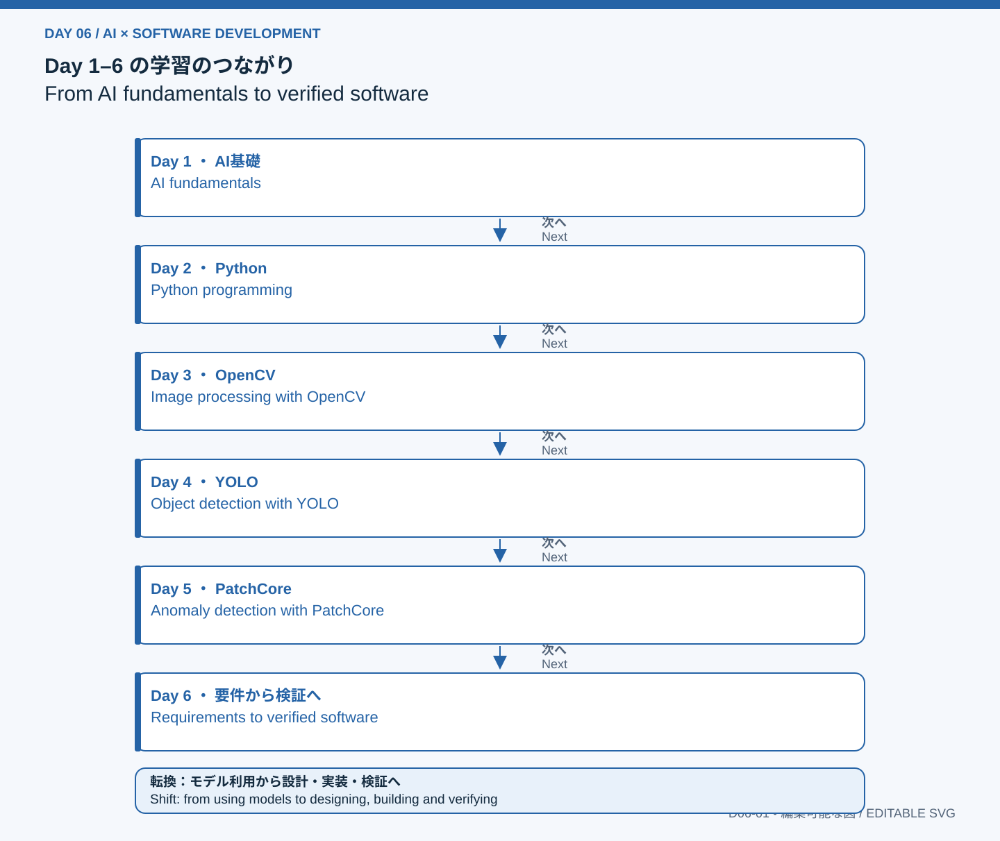
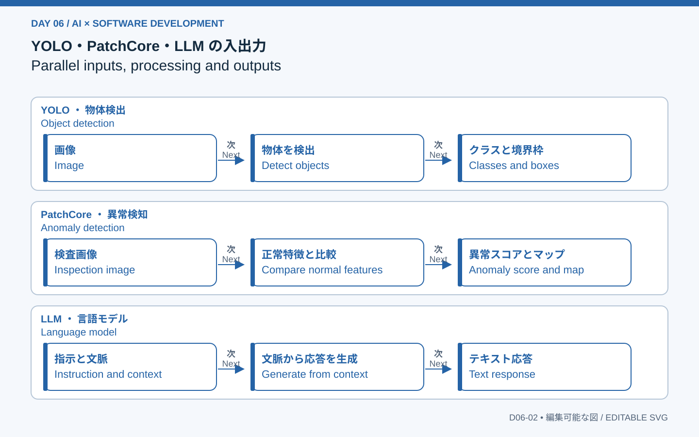
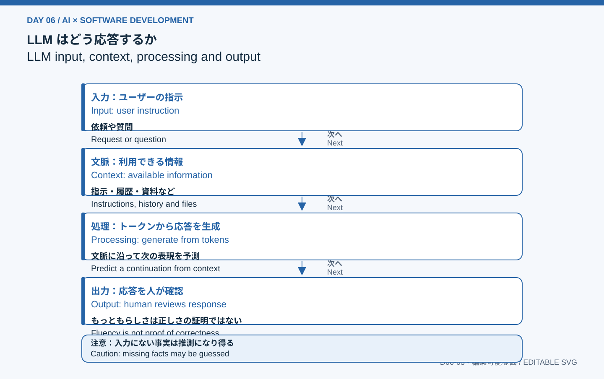
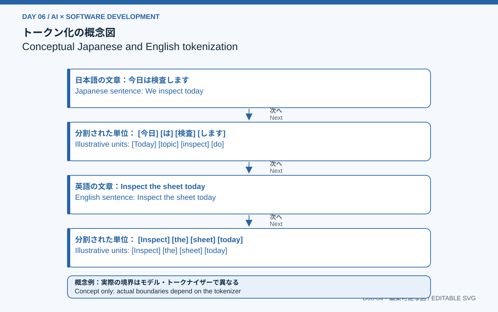
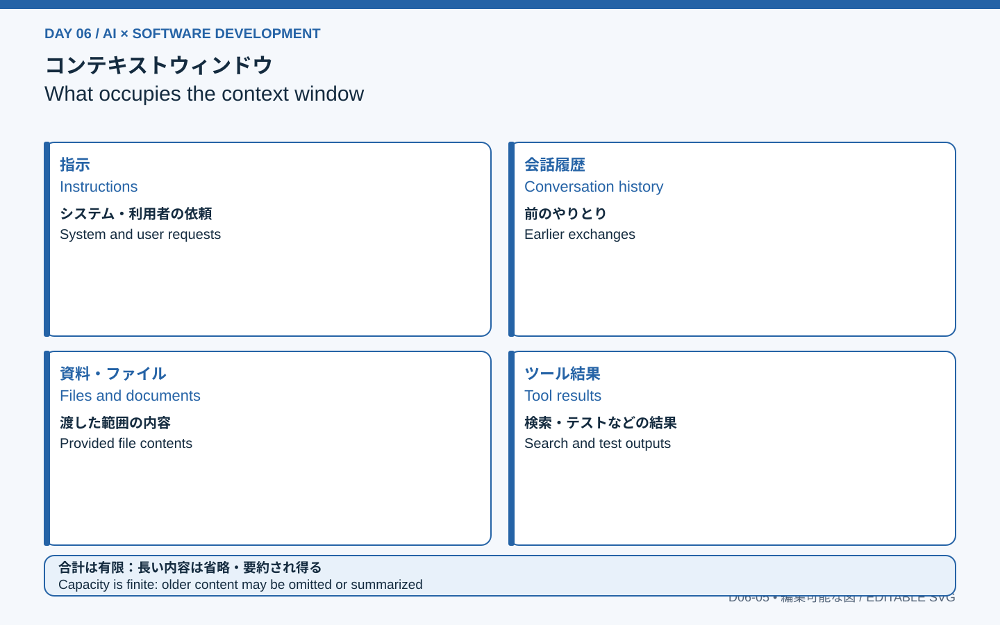
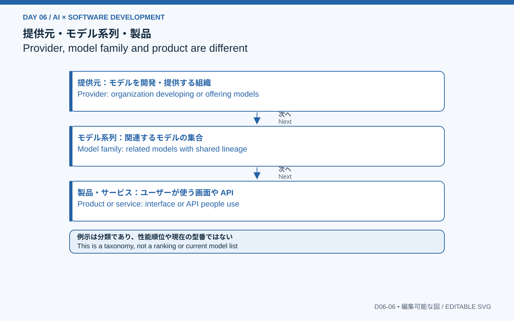

# 第6日 01：LLMの基礎 / Day 6 01: LLM Fundamentals

**所要時間：50分（説明35分、活動15分）/ Duration: 50 minutes (35 minutes of explanation, 15 minutes of activities).** [更新された第6日シラバス / Updated Day 6 syllabus](../../COURSE_SYLLABUS_DAY06.md)

この教材は読む・話す・紙に書くだけで学べます。アカウント、有料ツール、コード、工場の実データは不要です。架空の製造現場の例を使い、後続のエージェントの授業で必要になる「モデルの能力と限界」をつかみます。

This lesson works through reading, discussion and writing on paper. No account, paid tool, code or real factory data is needed. Fictional manufacturing examples establish the capabilities and limits of a model needed for the next lesson about agents.

**到達目標 / Objectives:** AI・機械学習・深層学習・画像AI・LLMの関係を説明し、入力と出力を比較する。プロンプト、学習、推論、トークン、文脈窓と不確実性を区別し、目的に合うモデルを安全に選ぶ。

**Objectives:** Explain how AI, machine learning, deep learning, vision AI and LLMs relate and compare their inputs and outputs. Distinguish prompts, training, inference, tokens, context windows and uncertainty, then select a model safely for a stated purpose.

## 1. 画像AIから言語AIへ（6分）/ From vision AI to language AI (6 min)

人工知能（AI）は知的な作業を機械で支援する広い分野です。機械学習（machine learning, ML）は例から規則性を学ぶ方法、深層学習（deep learning, DL）は多層のニューラルネットワークを使うMLの一群です。YOLOやPatchCoreなどの画像AIと大規模言語モデル（large language model, LLM）は、この階層の中で異なる仕事をする例です。「LLMがAIのすべて」でも「画像AIが旧式」でもありません。

Artificial intelligence (AI) is the broad field of supporting intelligent work with machines. Machine learning (ML) learns patterns from examples; deep learning (DL) is a group of ML methods using multilayer neural networks. Vision systems such as YOLO and PatchCore and large language models (LLMs) do different jobs within this broad hierarchy. LLMs are not all of AI, and vision AI is not obsolete.

**図 D06-01 / Figure D06-01 — 振り返り / Reflection:** 画像の欠陥を検出することと、「どの欠陥を記録すべきか」を決めることはどう違いますか？ / How does detecting a defect differ from deciding which defects should be recorded?

YOLOは学習した対象の画像内での種類と位置を囲み枠などで示す物体検出の方式です。PatchCoreは主に正常画像の特徴とのずれを利用し、異常スコアや位置の目安を示す異常検知の方式です。LLMは指示と与えられた文脈から文章などを生成します。例えば架空の工場では、YOLOが箱を見つけ、PatchCoreが表面の違和感を示し、LLMが人の確認用の説明文を下書きできます。しかしLLMの説明だけでは、画像上の欠陥が実在する証拠にはなりません。

YOLO is an object-detection approach that identifies learned classes and locations in images, often with boxes. PatchCore is an anomaly-detection approach that mainly compares image features with normal examples and returns an anomaly score and possible location. An LLM generates text or other output from instructions and supplied context. In a fictional factory, YOLO might locate boxes, PatchCore flag an unusual surface, and an LLM draft a note for human review. The LLM's prose alone does not prove a defect exists in the image.

| 方式 / Approach | 主な入力 / Typical input | 主な出力 / Typical output | 注意 / Caution |
|---|---|---|---|
| YOLO / YOLO | 画像 / image | 対象の種類・位置 / classes and locations | 対応クラスと学習条件に依存 / depends on supported classes and training |
| PatchCore / PatchCore | 画像と学習済みの正常特徴 / image and learned normal features | 異常スコア・目安となる領域 / anomaly score and indicative region | スコアだけで原因は確定しない / score alone does not establish cause |
| LLM / LLM | 指示と渡された文脈 / instructions and supplied context | 文章・表・コード案など / prose, tables or draft code | 流暢さは正確さの証明ではない / fluency is not evidence of accuracy |

**図 D06-02 / Figure D06-02 — 振り返り / Reflection:** 異常スコアと説明文のどちらを現物確認なしで合否の最終判断に使えますか？ / Which, if either, can determine final acceptance without checking the actual part?

## 2. 学習・指示・推論と「知らない」こと（7分）/ Training, prompts, inference and unknowns (7 min)

学習（training）は大量の例からモデルの内部パラメータを調整する工程です。プロンプト（prompt）は利用時に人が送る依頼で、通常は一回の依頼を書くだけでモデルの学習済みパラメータを更新しません。推論（inference）は学習済みモデルが入力に応じて次の表現を予測し、応答を作る利用時の処理です。例えば「架空の検査記録を三行に要約して」は指示であり、実際の検査データを新しく学習させる操作ではありません。

Training adjusts a model's internal parameters using many examples. A prompt is a user's request at use time; writing one request does not normally update the trained parameters. Inference is the use-time process in which a trained model predicts successive pieces of output in response to input. “Summarize this fictional inspection record in three lines” is an instruction, not a way to train on new inspection data.

モデルは誤った内容も自信ありげに書けます。根拠がないのにもっともらしい値や出典を作ることを、ここではハルシネーション（hallucination）と呼びます。ただし「必要情報が渡されていない」場合と「渡された情報を読み違えた」場合は別です。製造番号も実測値もないのに「このロットの不良率は何％？」と聞かれたら、正しい対応は数字を推測せず、母数と不良数を求めることです。検索やファイル参照が許可されていないなら、今の現場情報を自分で見たかのように話してはいけません。

A model can state errors confidently. We call plausible invented values or citations without evidence hallucinations here. But missing input is different from misreading supplied input. Asked “What is this lot's defect rate?” with no lot count or defect count, the right response is to request both numbers, not invent a percentage. Without authorized search or file access, it must not claim to have seen current factory records.

**図 D06-03 / Figure D06-03 — 振り返り / Reflection:** 依頼にない検査表の数値をモデルはどこから得られますか？ / Where would a model get inspection figures that were not supplied in the request?

**短い確認 / Quick check:** 「昨日の検査表を読んだ」という返答に検査表が入力されていなければ、まず何を確認しますか？ / If a response says “I read yesterday's inspection sheet” but none was supplied, what would you check first?

## 3. トークンと文脈窓（7分）/ Tokens and the context window (7 min)

トークン（token）はモデルが入力と出力を処理するための単位です。単語そのものとは限らず、文字の一部、単語の一部、記号などに分かれます。「inspection report」と「検査報告」のどちらも、モデルに届く前に処理単位へ変換されます。**この二つの文字列は概念例であり、ここには実際のトークン境界やトークン数を示していません。**分割はモデルのトークナイザー、表記、空白などによって異なり、日本語は常に一文字一トークン、英語は常に一単語一トークン、とは言えません。

A token is a unit used to process input and output; it need not be a whole word and can be part of a word, characters or punctuation. Both “inspection report” and “検査報告” are converted to processing units before reaching a model. **These strings are conceptual examples, NOT exact token boundaries or token counts.** Segmentation depends on the model's tokenizer, spelling and spacing; Japanese is not always one character per token, nor English one word per token.

**図 D06-04 / Figure D06-04 — 振り返り / Reflection:** 図の分割を別のモデルの正確なトークン数として使えますか？ / Can you use the diagram's split as an exact token count for another model?

文脈窓（context window）は一度の処理でモデルが参照できる入力と生成中の出力の容量上限です。現在の依頼だけでなく、含まれている会話履歴、貼り付けた文書、ツールが返した結果、対応する場合は画像などの入力も容量を使います。古い履歴は省略・要約されることがあり、長いファイルを指定しても全文が実際に渡ったとは限りません。履歴に書いたことをモデルが永久に覚えるわけでもなく、文脈に入った情報が必ず正しく使われるわけでもありません。重要な規格番号や検査条件は必要な場面で再提示し、実際に参照した箇所を確認します。

The context window limits how much input and generated output a model can consider in one processing pass. The current request, included conversation history, pasted documents, tool results and, where supported, images all consume capacity. Old history may be omitted or summarized; naming a long file does not prove its full contents were passed in. A model does not permanently remember every past turn, and information inside the window may still be used incorrectly. Restate critical specification numbers and inspection conditions when needed, and check which passages were actually consulted.

**図 D06-05 / Figure D06-05 — 振り返り / Reflection:** 200ページの手順書を「添付した」と言うだけで、モデルが全ページを読んだと判断できますか？ / Does saying you attached a 200-page procedure prove the model read every page?

## 4. できることと限界（6分）/ Capabilities and limitations (6 min)

文章や表の整理に加え、対応するモデルや製品は画像と文章を組み合わせるマルチモーダル（multimodal）入力、コードの下書き、複数段階の推論（reasoning）を支援します。例えば欠陥写真と検査表から確認事項を列挙したり、架空のCSVをまとめる処理案を作ったりできます。ただし画像の取り違え、実行できないコード、途中の論理の飛躍は起こります。多段階の説明が書けることは、その推論が正しい証明ではありません。実ファイルを読んだりプログラムを実行したりできるかは、モデルそのものではなく製品の入力方法・ツール・権限にも依存します。

Besides organizing prose and tables, supported models or products can help with multimodal inputs combining images and text, draft code and multistep reasoning. They might list checks from a defect photo and inspection sheet or propose a process for a fictional CSV. They can still misread images, write code that fails, or skip a logical step. A detailed chain of explanation is not proof of correct reasoning. Reading actual files or running programs also depends on the product's inputs, tools and permissions, not the model alone.

公開重み（open weights）とは、利用条件の下でモデルの重みを入手できる形態です。必ずしも学習データ・学習コードが公開された「完全なオープンソース（open source）」を意味しません。自前で動かせる場合も、計算機、ライセンス、更新、安全性、機密データ管理が必要です。クラウド型ならデータ送信先、契約、保持設定を確認します。どちらも「安全」や「無料」を名前だけで断定できません。

Open weights means model weights are available under stated terms; it does not necessarily mean the training data and code are available as fully open source. Self-hosting, where feasible, still needs compute, license review, updates, safety controls and confidential-data handling. For cloud use, check where data is sent, contractual terms and retention settings. Neither route is automatically safe or free.

**振り返り / Reflection:** 写真を扱えるモデルでも、実測値を写真から確定してよいでしょうか？ / Can a model that accepts photos establish a measured value from a photo alone?

## 5. 提供元と選び方（9分）/ Publishers and choosing a model (9 min)

次は**2026年11月22日時点の各社公式案内にあるモデル系列と例**です。同じ企業のすべての製品・版に同じ機能があるという表ではありません。例は「最新・最良」の推奨ではなく、製品名や画面名とも異なります。利用前にリンク先で対象の版、対応入力、提供形態と条件を再確認してください。価格や性能順位は扱いません。

These are **model families and examples from publisher information as of 22 November 2026**, not a claim that every release or product from a company has the same capabilities. Examples are not recommendations of the “latest or best”; they also differ from products and interfaces. Recheck the linked sources for the exact release, supported inputs, delivery mode and terms before use. No prices or performance rankings are given.

| 提供元 / Publisher | 系列と公式掲載例 / Family and officially listed examples | 公式案内 / Official information |
|---|---|---|
| OpenAI | GPT系列 / GPT family: `gpt-6.2-astra`, `gpt-6-luna` | [OpenAI API pricing（モデル一覧の確認用・価格は扱わない / model listing only; no prices discussed）](https://openai.com/api/pricing/) |
| Google DeepMind | Gemini系列 / Gemini family: Gemini 4 Hydrogen, Gemini 4 Carbon | [Gemini models](https://ai.google.dev/gemini-api/docs/models) |
| Anthropic | Claude系列 / Claude family: `claude-haiku-5-5`, `claude-fable-5-2` | [Claude models overview](https://platform.claude.com/docs/en/models/overview) |
| DeepSeek | DeepSeek系列 / DeepSeek family: `deepseek-v4-flash`, `deepseek-v4-pro` | [DeepSeek API documentation](https://api-docs.deepseek.com/) |
| Mistral AI | Mistral系列 / Mistral family: Mistral Large 4, Ministral 3 | [Mistral models](https://docs.mistral.ai/models/) |
| xAI | Grok系列 / Grok family: `grok-4.7` | [xAI models](https://docs.x.ai/developers/models) |
| Alibaba Qwen | Qwen系列 / Qwen family: `qwen3.8-flash`, `qwen3.8-max` | [Alibaba Cloud Model Studio model list](https://help.aliyun.com/zh/model-studio/models) |
| Meta | 現行のMetaホスト型Muse系列 / Current Meta-hosted Muse family: Muse Ember, Muse Spark, Muse Wonder。Llamaは別の歴史ある公開重み系列で、現行のMeta Model APIのホスト型モデルと同一ではない。/ Llama is a separate historical open-weight family, **not** the current Meta-hosted API family. | [Meta models](https://dev.meta.ai/docs/models.md) |

**図 D06-06 / Figure D06-06 — 振り返り / Reflection:** 同じ提供元のモデル系列名と会話製品名を同一視できますか？ / Is a publisher's model family the same as its conversation product?

選択は人気投票ではありません。①何を出したいか（説明文、画像の確認補助、コード案）、②機密情報を送ってよいか・利用条件は何か、③必要な入力形式・言語・文脈量をその**版と提供形態**が支えるか、④許容できる時間・費用・運用負荷は何か、⑤小さな架空または許可済みの例で精度と誤答を比較できるか、の順で考えます。どれかが不明なら実データを入れずに条件を確認します。画像上の位置を確かめたいならまず画像AIを検討し、説明文が必要ならLLMを検討し、両方必要なら人による照合を設計します。

Do not choose by popularity. Ask in order: (1) What output is needed—prose, assistance with images, or draft code? (2) May confidential information be transmitted, and under what terms? (3) Does the **specific release and delivery mode** support the required input, language and context size? (4) What time, cost and operational effort are acceptable? (5) Can you compare accuracy and errors on a small fictional or authorized example? If any answer is unknown, withhold real data and check the conditions. For locating something in an image, consider vision AI first; for drafting an explanation, consider an LLM; when both are needed, plan human cross-checking.

**振り返り / Reflection:** 機密図面がある場合、比較テストの前に確認する条件は何ですか？ / With a confidential drawing, what must be checked before a comparison test?

## 6. 理解確認：机上演習（5問・15分）/ Comprehension checks: offline activities (5 questions, 15 min)

実際のAIは使いません。二人で話すか、一人で紙に答えてから下の「自己確認」と比べてください。数字は架空です。

Do not use a live AI. Discuss in pairs or answer on paper and then compare with the self-check below. All numbers are fictional.

1. **分類（3分）/ Classify (3 min):** 「人工知能」「機械学習」「深層学習」を広い順に並べ、YOLOとLLMの主な出力を各一つ挙げる。/ Order AI, ML and DL from broadest to narrowest, and name one typical output each for YOLO and an LLM.
2. **不足情報（3分）/ Missing information (3 min):** 「このロットの不良率は？」という質問に、検査総数も不良数もない場合、返すべき一文を書く。/ Write one sentence answering “What is the lot defect rate?” when neither inspected count nor defect count is provided.
3. **トークンと履歴（3分）/ Tokens and history (3 min):** 「検査報告」は必ず4トークンか、古い会話が必ず残るかを、それぞれ理由とともに答える。/ Say whether “検査報告” is necessarily four tokens and whether old conversation always remains available; give a reason for each.
4. **能力と証拠（3分）/ Capability and evidence (3 min):** AIが「写真に傷がある、検査表も確認済み」と述べたが写真しか渡していない。何を信じず、何を確認するか。/ An AI says “The photo shows a scratch; I also checked the inspection sheet,” but only a photo was supplied. What claim should not be trusted, and what should be checked?
5. **選択（3分）/ Choice (3 min):** 架空の箱の位置検出と、検査員向け説明文の下書きに、それぞれ最初に検討する方式を挙げ、実データ投入前の条件を一つ書く。/ Name the first approach to consider for locating fictional boxes and for drafting an inspector note, plus one condition to check before using real data.

**自己確認（活動の後に読む）/ Self-check (read after the activities):** 1. AI ⊃ ML ⊃ DL、YOLOは種類と位置、LLMは文章など。2. 検査総数と不良数を尋ねる。3. どちらも「必ず」ではない。分割はトークナイザーによって異なり、履歴は省略・要約されうる。4. 表を確認したという主張は未確認。写真の読み取りも人が照合する。5. 位置はYOLOなどの画像AI、文案はLLM。機密・送信先・利用条件を先に確認する。

**Self-check (read after the activities):** 1. AI ⊃ ML ⊃ DL; YOLO returns classes and locations, an LLM prose or similar output. 2. Request inspected and defect counts. 3. Neither is guaranteed: tokenization varies and history may be dropped or summarized. 4. The claim about the sheet is unsupported; a human should also check the photo interpretation. 5. Consider vision AI such as YOLO for location and an LLM for a draft; first check confidentiality, transmission and terms.

**最後の振り返り / Final reflection:** 「モデルの回答」と「現物・記録による証拠」を分けて言えますか？ / Can you distinguish a model's answer from evidence in the part or record?

**次の授業 / Next lesson:** モデルが単独でファイルを読んだり設備を動かしたりするわけではありません。次はアシスタント、エージェント、ハーネス、権限の関係を学びます。/ A model alone does not read files or operate equipment. Next we examine assistants, agents, harnesses and permissions.

**追加資料（任意）/ Optional further reading:** [出典とライセンス / Sources and licenses](../../day06_support/SOURCES_AND_LICENSES.md). / [Sources and licenses](../../day06_support/SOURCES_AND_LICENSES.md).
