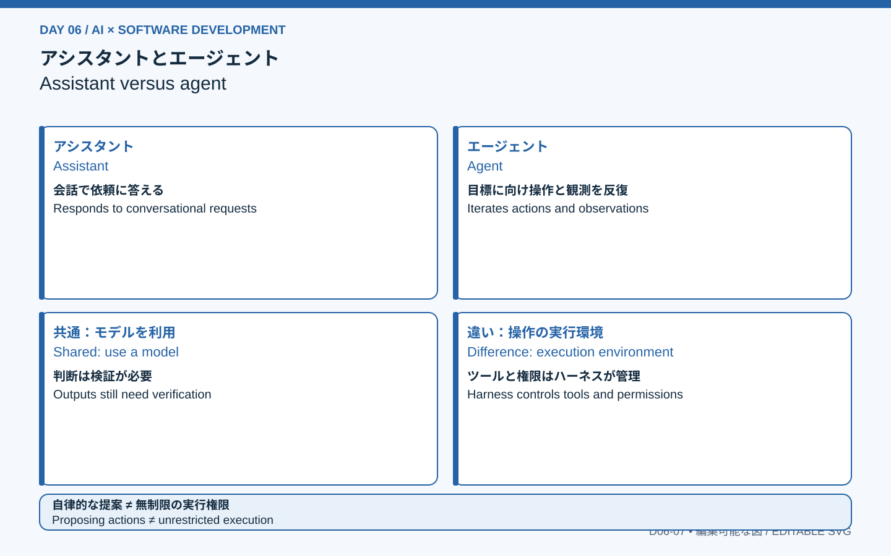
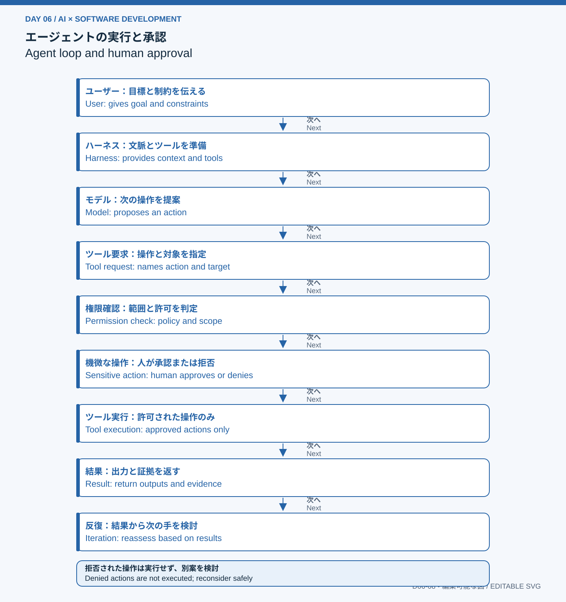
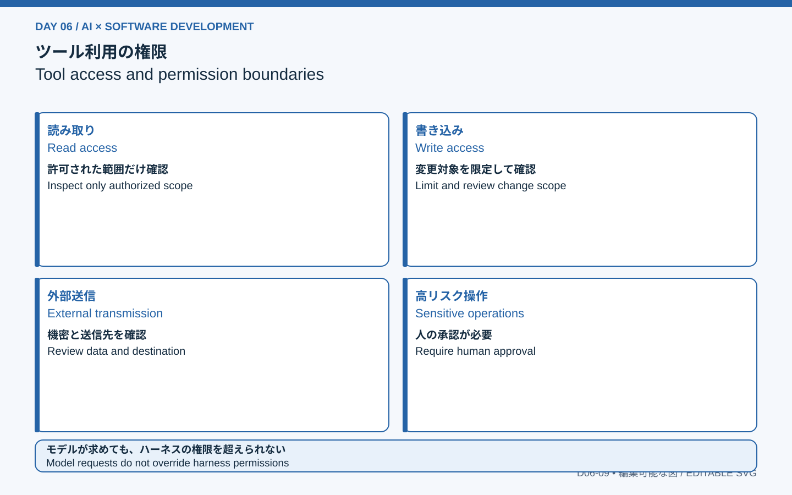

# 第6日 02：エージェントとハーネス / Day 6 02: Agents and Harnesses

**所要時間：55分（説明40分、理解確認15分）/ Duration: 55 minutes (40 minutes of explanation, 15 minutes of comprehension checks).** [更新された第6日シラバス / Updated Day 6 syllabus](../../COURSE_SYLLABUS_DAY06.md)

この教材は架空の製造現場を使った机上学習です。コードを書く必要も、実際のエージェントに登録する必要もありません。実設備・機密ファイル・ネットワークへの広いアクセスを与えないでください。

This is an offline lesson using a fictional manufacturing site. There is no need to write code or sign up for an agent. Never grant broad access to real equipment, confidential files or networks.

**到達目標 / Objectives:** モデル、アシスタント、エージェント、コーディングエージェント、ハーネス、ツール、実行環境を区別する。提案・承認・実行・観察・検証の流れを説明し、誤った完了報告と証拠を分ける。

**Objectives:** Distinguish model, assistant, agent, coding agent, harness, tool and execution environment. Explain proposal, approval, execution, observation and verification, and separate an unsupported completion claim from evidence.

## 1. 何が何をするか（9分）/ What does what (9 min)

モデル（model）は渡された文脈から応答や次の操作案を生成します。アシスタント（assistant）は人が会話するための製品や画面で、モデルを利用し、場合によってはツールも使います。エージェント（agent）は目標に向けて計画・操作・結果確認を繰り返す作業の形で、独立した責任を持つ人間ではありません。コーディングエージェント（coding agent）はコードや関連ファイルの調査・変更・確認に特化したエージェントです。これらは排他的な製品分類ではなく、同じ製品に複数の役割が重なります。

A model generates responses or proposed next actions from supplied context. An assistant is a conversational product or interface using a model and sometimes tools. An agent is a pattern of planning, acting and checking toward a goal, not a human with independent accountability. A coding agent specializes in investigating, changing and checking code and related files. These are overlapping roles, not mutually exclusive product classes.

ハーネス（agent harness）はモデルに指示や履歴を渡し、ツールの呼び出し、権限確認、結果の返却と作業の継続を管理するソフトウェア側の仕組みです。ツール（tool）は許可されたファイル読取、編集、コマンド実行、検索などの具体的な操作です。実行環境（execution environment）はツールが動く場所とその境界で、例えば指定フォルダー、隔離された作業領域、アクセス可能なネットワークの範囲が含まれます。モデルが「編集したい」と言うことと、ハーネスが権限を確認し、ツールが実際に編集することは別です。

An agent harness is software that supplies instructions and history to a model and manages tool calls, permission checks, returned results and continuation. A tool performs a concrete authorized action such as reading or editing a file, running a command, or searching. The execution environment is where the tool runs and what it can access—for example a designated folder, isolated workspace or permitted network. A model proposing “edit this” is different from the harness checking permission and a tool actually making an edit.

**図 D06-07 / Figure D06-07 — 振り返り / Reflection:** 「会話画面」と「ファイルを変更する操作」は同じ部品ですか？ / Are a conversation interface and an operation that changes a file the same component?

## 2. 一周の作業：人が止められる場所（11分）/ One operation loop: where a human can stop it (11 min)

架空の工場で「公開可能な練習用検査表の列名をそろえる案を作って」と頼む場面を考えます。①人が対象と成功条件を示す、②ハーネスが許可された文脈をモデルへ渡す、③モデルが作業計画やツール操作を**提案**する、④ハーネスが許可範囲を確認し必要なら人に承認を求める、⑤許可されたツールが読み取りや変更を**実行**する、⑥ツールの実際の結果がモデルへ戻る、⑦必要なら小さく繰り返し、⑧人が元資料と成果物を照合する、という流れです。ツールに失敗したら「実行できなかった」と報告し、未確認の結果を成功として扱いません。

Imagine asking for a proposal to standardize column names in a shareable fictional inspection sheet. (1) A human states the scope and success criteria; (2) the harness passes authorized context to the model; (3) the model **proposes** a plan or tool action; (4) the harness checks scope and asks a human for approval where needed; (5) an allowed tool **performs** a read or change; (6) the actual tool result returns to the model; (7) small steps may repeat; (8) the human compares the artifact with the original and the criteria. If a tool fails, report failure instead of claiming an unverified success.

「まず読み取りだけ」「変更前に差分を見せる」「コマンドや送信は別途承認」といった停止点を先に決めます。承認（human approval）は目標・対象・影響を理解した人が個々の危険な操作を許すことで、最初に一度「何でもしてよい」と言うことではありません。承認した操作であっても結果の検証（verification）は必要です。設備制御や本番データ更新はこの練習の範囲外です。

Set stopping points in advance: “read only first,” “show a diff before changes,” and “separate approval for commands or transmission.” Human approval means an informed person authorizes a particular consequential action with understood scope and effect, not a blanket “do anything.” Even approved actions require verification. Equipment control and production-data updates are outside this exercise.

**図 D06-08 / Figure D06-08 — 振り返り / Reflection:** 「保存しました」と言われたとき、どの実行結果とファイルを確かめますか？ / When told “Saved,” which execution result and file would you inspect?

## 3. 四つの権限を別々に考える（8分）/ Treat four permissions separately (8 min)

読み取り（read）は指定された資料を見る許可です。編集（edit）は指定ファイルを書き換える許可で、読み取りと同じではありません。コマンド実行（command）はプログラムを走らせる許可で、削除や外部通信など意図しない副作用もあり得ます。ネットワーク（network）は外部から取得したり外部へ送ったりできる範囲で、機密流出にも関わります。「フォルダー内の練習表を読む」許可から「全PCを編集する」「任意のコマンドを実行する」「外部へ送信する」許可を推論してはいけません。ツールがない・拒否された操作をモデル自身が実行することもできません。

Read permission allows inspection of specified material. Edit permission allows changes to specified files and is not equivalent to read. Command permission permits programs to run and may have unintended effects such as deletion or external communication. Network permission controls what can be fetched or transmitted and matters for confidentiality. Permission to read a practice sheet in one folder does not imply permission to edit the whole computer, run arbitrary commands or send data outside. A model cannot itself perform an operation for which no tool exists or permission is denied.

| 操作 / Operation | 机上の例 / Paper example | 最小限の境界 / Minimal boundary |
|---|---|---|
| 読取 / Read | 架空の検査表を見る / inspect fictional sheet | 指定資料だけ / only named material |
| 編集 / Edit | 列見出しの案を直す / revise proposed headings | 練習用のコピーだけ、差分を確認 / practice copy only; inspect diff |
| コマンド / Command | 検証処理を走らせる / run a check | 内容・対象・副作用を先に確認 / check command, target and effects first |
| ネットワーク / Network | 公開仕様を調べる / look up public specification | 送信先と送信内容を確認 / check destination and transmitted content |

権限は製品の設定、環境、組織の規則で異なります。実習で操作するとしても読み取り専用の架空データから始め、必要な範囲だけを一時的に許可します。この授業では操作そのものは不要です。

Permissions vary with the product, environment and organization rules. If a practical exercise is ever conducted, start with read-only fictional data and grant only the narrow, temporary scope required. This lesson needs no such operations.

**図 D06-09 / Figure D06-09 — 振り返り / Reflection:** 読取権限だけでネットワーク送信も可能だと推測できますか？ / Does read permission imply network transmission permission?

## 4. モデルの交換と製品名（6分）/ Swapping models and reading product names (6 min)

同じハーネスが対応する別のモデルを選べる場合、回答の傾向や品質は変わっても、ハーネスのツール・承認規則・実行環境が自動的に広がるわけではありません。逆に同じモデルでも別のハーネスや設定なら使える操作は異なります。利用できるモデルの組み合わせは製品・設定・契約次第で、すべての製品で自由に交換できるという意味ではありません。指示を変更することも、モデルや権限を変更することとは別です。

Where a harness supports choosing another model, answer style or quality may change, but its tools, approval rules and execution environment do not automatically expand. Conversely, the same model can have different actions available under another harness or configuration. Supported model combinations depend on the product, settings and terms; not every product permits arbitrary swapping. Changing instructions is also distinct from changing a model or its permissions.

製品の種類を考える際、OpenAIのCodexはコーディングエージェントの提供形態、GitHub Copilotは複数の画面や作業形態を持つ開発支援製品、AnthropicのClaude Codeはコード作業用のエージェント型ツールの例です。いずれもモデルの名前そのものではありません。「Copilot」とだけ言っても会話、編集支援、エージェント作業のどれかは決まりません。具体的な操作や承認は製品の提供形態と設定で変わります。公式の [Codex](https://openai.com/codex/)、[GitHub Copilot](https://docs.github.com/en/copilot)、[Claude Code](https://code.claude.com/docs/en/overview) の説明を確認する場合も、本授業で登録や購入は必要ありません。

For product categories, OpenAI's Codex is offered for coding-agent work, GitHub Copilot is a developer-assistance product spanning multiple interfaces and workflows, and Anthropic's Claude Code is an agentic coding tool. None is itself the name of a model. “Copilot” alone does not specify whether a person means chat, editing assistance or an agent workflow. Actual actions and approvals depend on the product surface and configuration. See the official descriptions of [Codex](https://openai.com/codex/), [GitHub Copilot](https://docs.github.com/en/copilot) and [Claude Code](https://code.claude.com/docs/en/overview) if desired; no account or purchase is required for this lesson.

## 5. 失敗の兆候と人の確認（6分）/ Failure signs and human checks (6 min)

危険は「悪意のある指示」だけではありません。長い会話で古い制約が文脈から落ちる（lost context）、取り違えたファイルを編集する、操作が失敗したのに「完了」と言う（false claim）、実行結果を見ずにもっともらしい報告をすることがあります。架空の例で、対象を「練習用の検査表のコピーのみ」と指定したのに「元の記録も更新しました」と報告されたら、成功ではなく停止の合図です。対象、差分、ツール結果を確かめ、不明なら作業を止めて人が範囲を再設定します。

Risks are not limited to malicious instructions. A long conversation may lose an earlier constraint from context; an agent may edit the wrong file, say “done” after a failed action, or offer a plausible report without observing the result. In a fictional example, if the scope was “only a copy of the practice inspection sheet” but the report says “I updated the original records too,” treat that as a stop signal, not success. Check the target, diff and tool result; if uncertain, stop and have a human restate the scope.

「完了」の証拠は、許可された対象が意図どおり変わったことを人が確かめられる資料です。例えば練習用コピーの変更前後と、指定した列名が残り数値が変わっていないという照合結果です。AIの自己申告だけでは足りません。変更してはいけないファイルが変わっていないことも確認します。実際の生産判断は人と現場の正式な手順に残します。

Evidence of completion is something a human can check showing the authorized target changed as intended: for example, before/after versions of the practice copy and a check that named columns are present while numeric entries are unchanged. The AI's self-report is insufficient. Check that prohibited files were not changed too. Real production decisions remain with people and the site's formal procedures.

**振り返り / Reflection:** 「モデルを交換したから全ファイルを読める」はなぜ誤りですか？ / Why is “I switched models, so it can read every file” wrong?

## 6. 理解確認（15分）/ Comprehension checks (15 min)

各問をまず紙に書き、二人なら答えを比べてください。実際のツールは使いません。答えは下にあり、先に隠して考えます。

Answer on paper first and compare with a partner if available. Use no live tool. The suggested answers follow; cover them until you have tried.

1. **役割（3分）/ Roles (3 min):** 「次の操作を提案する」「権限を確認して結果を返す」「指定したファイルを書き換える」は、それぞれモデル、ハーネス、ツールのどれか。/ Match “proposes the next action,” “checks permission and returns results,” and “changes a specified file” to model, harness and tool.
2. **承認（3分）/ Approval (3 min):** 架空の練習表を読み、コピーの列名を修正する提案です。「このフォルダー内なら何でも実行してよい」か、「まず読取、差分を見せ、コピーの編集だけ個別承認」か。理由も書く。/ For reading a fictional sheet and proposing changes to a copy, choose “run anything in this folder” or “read first, show a diff, then separately approve only editing the copy.” Explain why.
3. **四つの権限（3分）/ Four permissions (3 min):** 読取を許可した相手が、コマンドで元表を削除し外部へ内容を送ろうとした。追加で必要な権限と止める場所は？ / Given read access, an agent proposes a command deleting the original and transmitting its contents. Which further permissions are implicated, and where should it stop?
4. **交換（3分）/ Swap (3 min):** 同じハーネスでモデルを交換したら、利用可能なファイルとネットワークは自動的に増えますか？何を確かめますか？ / If the model changes in the same harness, do available files and network access automatically expand? What should you check?
5. **完了報告（3分）/ Completion claim (3 min):** 「修正済み」と報告されたがツールは失敗し、古い対象制限も履歴から抜けていた。次に人が行う二つの確認は？ / An agent reports “fixed,” but the tool failed and an earlier scope restriction was lost from history. Name two checks the human should make next.

**自己確認 / Suggested answers:** 1. モデル、ハーネス、ツールの順。2. 後者。対象と編集を限定し、人が差分を見て承認する。3. 編集・コマンド・ネットワークは読取と別であり、危険な提案は実行前の権限確認・人の承認で止める。4. 増えない。ハーネスの設定、実行環境と実際の許可を確認する。5. ツールの失敗結果と対象ファイルの実物・差分を確認し、元の制限を再提示する（このうち二つを明示できればよい）。

**Suggested answers:** 1. Model, harness, tool, in that order. 2. The latter: restrict the target and edit, then have a human inspect the diff before approval. 3. Edit, command and network access are distinct from read; stop the dangerous proposal at the pre-execution permission/human approval gate. 4. No; check harness settings, execution environment and actual permissions. 5. Inspect the failed tool result and the actual target/diff; restate the original scope restriction (any two clearly stated checks suffice).

**完了チェック / Completion:** 提案と実行を区別し、権限を一つずつ限定し、成功宣言の代わりに証拠を要求できる。/ Distinguish proposal from execution, bound each permission separately and demand evidence rather than a success claim.

**追加資料（任意）/ Optional further reading:** [出典とライセンス / Sources and licenses](../../day06_support/SOURCES_AND_LICENSES.md). / [Sources and licenses](../../day06_support/SOURCES_AND_LICENSES.md).
