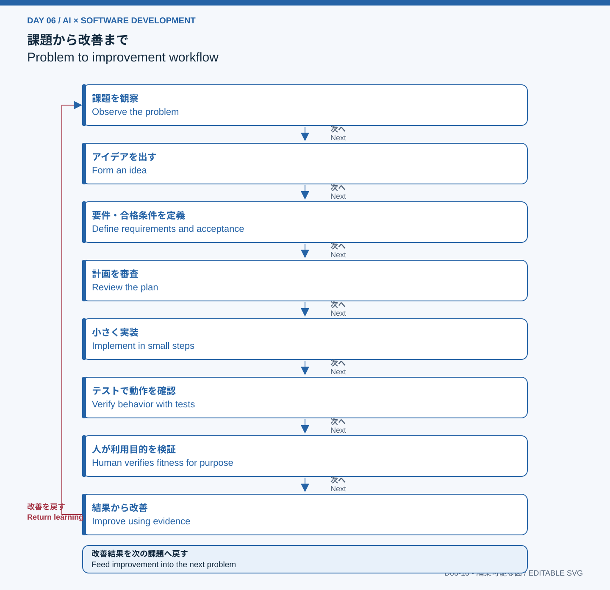
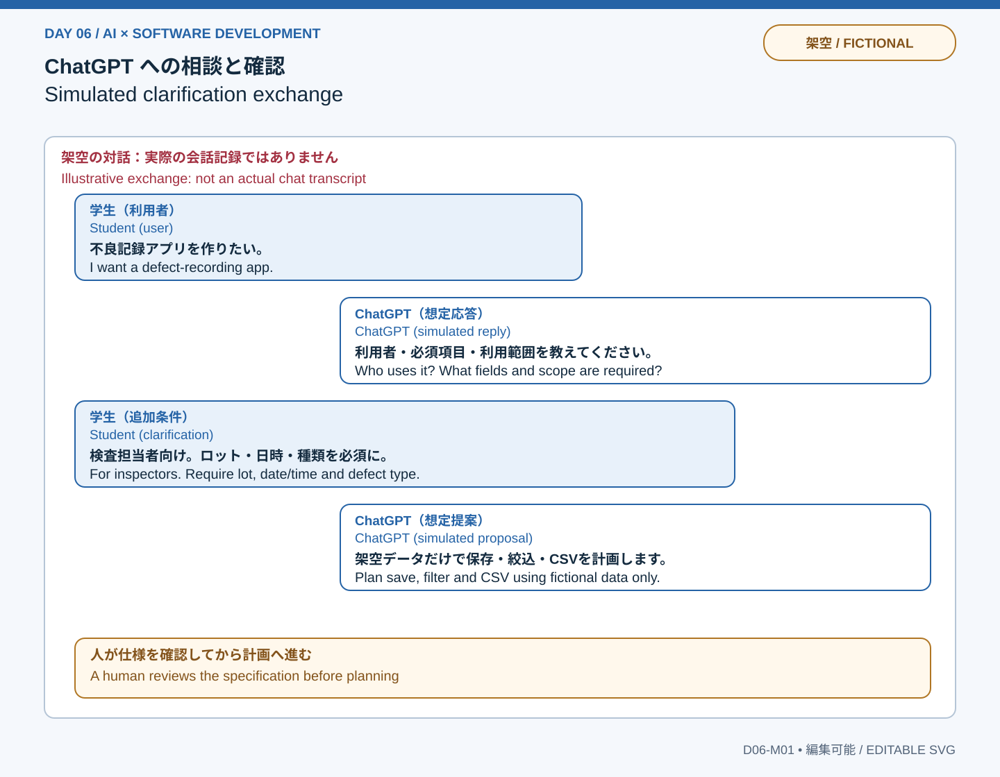
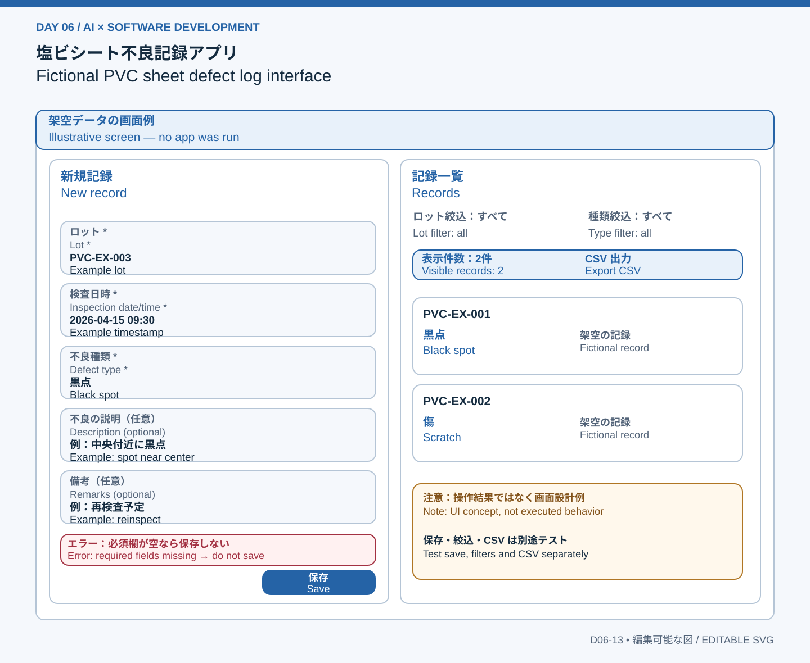
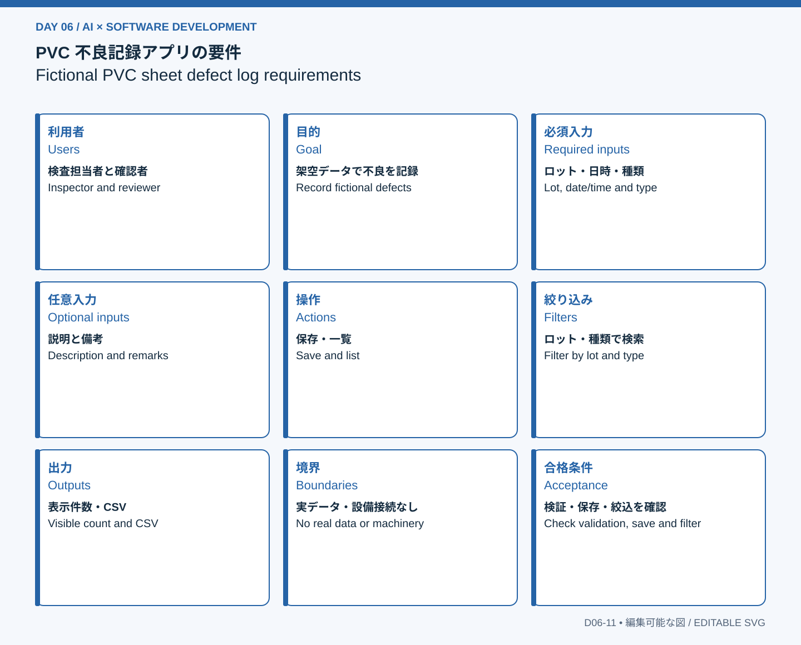
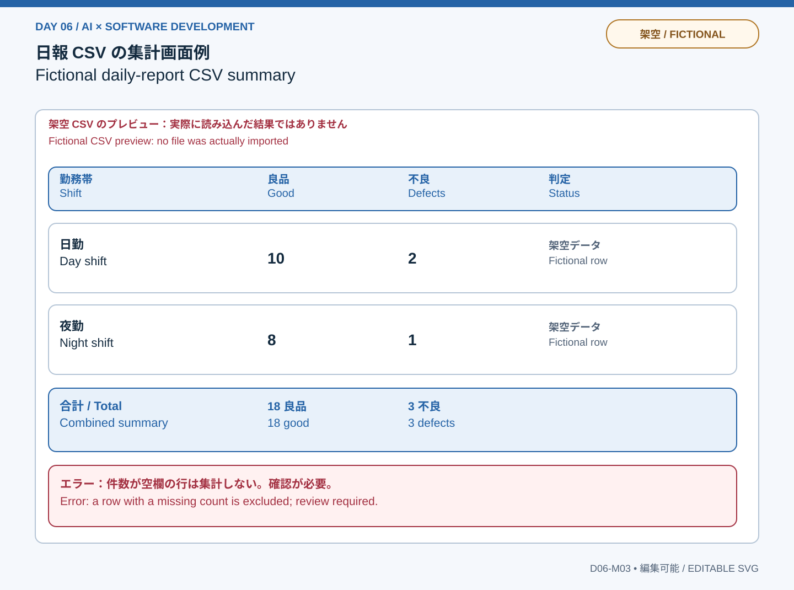

# 第6日 03：アイデアを仕様にする / Day 6 03: From idea to specification

**目安80分 / Estimated duration: 80 min.** 全体の[第6日時間割](../../COURSE_SYLLABUS_DAY06.md)を参照。コードを書いたり動かしたりしません。/ See the [sole Day 6 timetable](../../COURSE_SYLLABUS_DAY06.md). No coding or code execution is required.

**目標 / Objectives:** 現場の困りごと、原因、望む結果と機能を区別し、検査員が実際に確認できる要件を作る。/ Distinguish problems, causes, desired outcomes and features; define requirements an inspection operator can check.

## 1. 解決策を決める前に問題を聞く / Hear the problem before choosing software

紙の検査記録を探すのに時間がかかります。「記録が整理されていない」は原因かもしれません。「過去の不良をすぐ調べたい」が望む結果です。「絞り込み画面」はその結果を実現するための機能であり、問題そのものではありません。まず、誰が、いつ、どの作業で困るか聞きます。

Finding old paper inspection notes takes time. Disorganized records may be a cause. The desired outcome is finding past defects quickly. A filter screen is a feature that might achieve that outcome, not the problem itself. First ask who struggles, when and during which task.

| 区別 / Distinction | 検査記録の例 / Inspection example | 調べる質問 / Question |
|---|---|---|
| 問題 / Problem | 過去の記録が探しにくい / old records are hard to find | 何に時間がかかる？ / What takes time? |
| 原因の仮説 / Possible cause | 紙の記録が整理されていない / paper notes are unorganized | 確認できる？ / Can we confirm it? |
| 望む結果 / Desired outcome | 1件と件数を確認できる / retrieve entries and counts | どう確かめる？ / How will we check? |
| 解決案 / Possible solution | ローカルの記録アプリ / local record app | 紙の改善では足りない？ / Would better paper suffice? |
| 機能 / Feature | ロットで絞り込む / filter by lot | 誰がどの画面で使う？ / Who uses it and where? |

日報の転記、治具の棚卸し、保全チェックなどもソフトウェアの候補です。ただし現場のルールを少し変えるだけで解決するなら、複雑なAIを導入する必要はありません。

Daily reporting, jig inventory and maintenance checklists are other candidates. If a small process change solves the problem, there is no need to introduce complex AI.

**図 D06-10 / Figure D06-10:** 実装より先に問題と合否を決めます。/ Define the problem and success before implementing. **問い / Reflect:** 「CSVボタン」は問題、結果、機能のどれですか？ / Is a CSV button a problem, outcome or feature?

## 2. ChatGPTで複数の道を比べる / Compare approaches with ChatGPT

最初から「アプリを作って」と頼む代わりに、架空の状況を伝えて三つの方法を比べます。例：「紙の不良メモが探しにくい。用紙を改善する、表計算を使う、ローカルアプリを作る案について、利用者・利点・欠点・安全上の注意・成功の測り方を比べて。コードは不要」。現場を知る人が結果を読んで選びます。

Instead of immediately saying “Build an app,” describe a fictional situation and compare three approaches: improved paper forms, a spreadsheet and a local app. Ask for users, advantages, disadvantages, safety concerns and success measures. No code. The person who knows the workflow selects the approach.

**架空の会話1 / Fictional conversation 1 — explore:** 受講者「紙の記録が探しにくい。3案を比べて。」/ Learner: “Paper notes are hard to search. Compare three options.” ChatGPT（想定）「用紙を統一する方法は安価だが集計は手作業。表計算はすぐ試せるが同時編集に注意。アプリは入力確認ができるが作成と保守が必要。」/ ChatGPT (simulated): “Standardized forms are inexpensive but counting remains manual. A spreadsheet is quick to try but simultaneous editing needs care. An app can validate input but needs creation and maintenance.” 受講者「まず架空データの小さなアプリ案を検討します。」/ Learner: “Let's consider a small app with fictional data.”

他人の案を全部採用しません。「画像から不良を自動判定する」提案は今回の課題と異なり、検査・設備・安全上の別の検討が必要です。/ Do not accept every suggestion. Automated image judgment is outside this record-keeping task and requires separate inspection and safety work.

**問い / Reflect:** 最も小さい方法でも望む結果を得られますか？ / Could the smallest approach deliver the desired outcome?

## 3. 継続例：塩ビシート不良記録アプリ / Continuous case: PVC Sheet Defect Recording Application

以下は**架空のローカル学習用案**です。検査担当者が手書きの塩ビシート不良メモを探す負担を減らします。本番カメラ・PLC・社内DBには接続しません。指定された値を読むだけでなく、何も入力しなかった場合とアプリを終了した後も考えます。

This is a **fictional local teaching example**. An inspection operator needs to find PVC-sheet defect notes more easily. It does not connect to production cameras, PLCs or internal databases. Consider missing input and application restart as well as successful entries.

**架空の会話2 / Fictional conversation 2 — clarify:** 学習者「記録アプリを作りたい。まず質問して、コードは書かないで。」/ Learner: “I want a record app. Ask questions first; no code.” ChatGPT（想定）「誰が使いますか。必須の欄は何ですか。再起動後にも記録は必要ですか。CSVは必要ですか。」/ ChatGPT (simulated): “Who uses it? What fields are required? Must records survive restart? Is CSV required?” 学習者「検査員が使います。ロット・日時・不良種別が必須。再起動後も残し、一覧・絞り込み・表示件数・CSVが必要です。」/ Learner: “Inspection operators. Lot, date/time and defect type are required. Keep records after restart; provide list, filters, visible count and CSV.”

**図 M01 / Figure M01:** 本物の製品画面ではありません。質問に答えてから要件を確定します。/ This is not a real product screenshot. Answer the questions before approving requirements. **問い / Reflect:** 質問されていない重要な条件はありますか？ / Which condition still needs clarification?

| 要件 / Requirement | 今回の合意 / Agreed example |
|---|---|
| 目的と利用者 / Purpose and user | 検査員が過去の不良を探し件数を調べる / operator retrieves records and counts |
| 現在と希望 / Current and desired workflow | 紙のメモ → 日本語画面で1件ずつ入力・検索 / handwritten notes → Japanese form and list |
| 入力 / Inputs | 必須：ロット番号、検査日時、黒点・傷・すじの種別。任意：説明、備考 / required lot ID, timestamp, black spot/scratch/streak; optional description, remarks |
| 処理 / Processing | 必須欄を確認し、1件ずつ保存。重複は別の記録として残す / validate and save each submission, retain duplicates as distinct entries |
| 出力と画面 / Output and UI | 日本語の入力欄・一覧・ロット/種別フィルター・表示件数・CSV出力 / Japanese fields, list, filters, visible count and CSV |
| 保存 / Storage | ローカルに保存し、終了・再起動後も残す。削除機能は作らない / local persistence; no deletion feature |
| エラー / Errors | 必須欄が空なら保存せず日本語のメッセージ。CSV失敗も通知し記録を残す / missing fields reject save with Japanese message; export errors preserve records |
| 制約 / Restrictions | 架空データのみ。クラウド、画像判定、設備、本番DBの接続なし / fictional only; no cloud, image inference or production connections |
| 合否 / Acceptance | 架空の2件を保存・再起動・絞り込み・CSVで確認 / check two example records through restart, filter and CSV |

すべての事例で `PVC-EX-001` は黒点、`PVC-EX-002` は傷。表示件数はフィルター後の**表示中の記録数**。CSV列順は `lot_id,inspected_at,defect_type,description,remarks` です。日時は架空のものを使います。技術と保存形式は既存プロジェクトを調べてから決めます。

Throughout the case, `PVC-EX-001` is black spot and `PVC-EX-002` is scratch. The count is the **number of visible records after filtering**. CSV columns are `lot_id,inspected_at,defect_type,description,remarks` in that order. Use fictional timestamps. Choose technology and storage format only after inspecting the project.

詳しい[承認用仕様](../../day06_support/examples/inspection_app_spec_ja_en.md)と[架空の会話](../../day06_support/examples/example_agent_conversation_ja_en.md)はオフラインで読めます。/ The [approved sample specification](../../day06_support/examples/inspection_app_spec_ja_en.md) and [simulated conversation](../../day06_support/examples/example_agent_conversation_ja_en.md) are available offline.

**図 D06-13 / Figure D06-13:** 動作する製品や実記録の写真ではありません。入力、エラー表示、絞り込み、CSVを探してください。/ Not a working product or real record. Locate fields, errors, filters and CSV. **問い / Reflect:** 空欄のロットを保存したら仕様と合いますか？ / Would saving an empty lot meet the specification?

## 4. 書かれていない条件を質問する / Ask about missing conditions

「検査アプリを作って」では、誰が使うか、何を保存するか、失敗時にどうなるか不明です。「日本語画面、必須項目、終了後の保存、一覧、CSV」を追加しても、重複入力や絞り込み後の件数はまだ曖昧です。仕様（specification）は願いの長さではなく、検査できる約束の集合です。

“Build an inspection app” leaves users, fields and failure behavior unknown. Adding Japanese UI, required fields, persistence, list and CSV still leaves duplicates and filtered counts ambiguous. A specification is a set of checkable commitments, not merely a long wish list.

**架空の会話3 / Fictional conversation 3 — reject scope creep:** ChatGPT（想定）「画像による自動判定とクラウド同期も追加しますか？」/ ChatGPT (simulated): “Add image classification and cloud sync?” 学習者「いいえ。記録とCSVだけを承認します。その他は範囲外と明記してください。」/ Learner: “No. Approve only recording and CSV. Mark the rest out of scope.”

**図 D06-11 / Figure D06-11:** 「何が起きたら失敗か」も要件です。/ Error behavior is a requirement too. **問い / Reflect:** CSV保存失敗の扱いは何の欄に書きますか？ / Where would you specify failed export?

## 5. 最初の版を小さくする / Keep the first version small

最小実用版（Minimum Viable Product: MVP）は、目的を検証するための最小の製品です。必須（must）はこれがないと承認した仕事ができないもの、推奨（should）は役立つが次回でもよいもの、余裕があれば（could）は必須でないもの、範囲外（out of scope）は今回作らないものです。CSVは今回の合意では**必須**で、見た目の装飾は違います。

A Minimum Viable Product (MVP) is the smallest version that can test the intended value. Must-have features are essential to the approved task; should-haves are useful but can wait; could-haves are optional; out-of-scope work is explicitly excluded. CSV is **required** here; decorative styling is not.

| 優先 / Priority | 機能例 / Example | 判断 / Reason |
|---|---|---|
| 必須 / Must | 日本語入力、確認、保存・再起動、一覧・絞り込み、CSV / Japanese form, validation, persistence, list, filters, CSV | 合意した記録業務を満たす / meets approved workflow |
| 推奨 / Should | 印刷用レイアウト / print layout | 後から検討 / can wait |
| 余裕 / Could | 色を選べる画面 / selectable colors | 初版の合否に不要 / not needed for acceptance |
| 範囲外 / Out of scope | 画像判定、クラウド、本番設備 / image inference, cloud, production equipment | 別の安全・承認が必要 / needs separate safety and approval |

**問い / Reflect:** エージェントが写真アップロードを提案しても必須になりますか？ / Does an agent suggestion make photo upload a requirement?

## 6. 画面を言葉で説明する / Describe a UI without writing code

画面（screen）は利用者の作業場所、フォーム（form）は入力欄、選択欄（dropdown）は値を選ぶ場所、表（table）は保存結果の一覧です。「ロット番号を空にして保存を押すと、同じ画面に日本語のエラーを出し、行を増やさない」のように、ボタンを押した後も書きます。受講者にプログラムの書き方を説明する必要はありません。

A screen is where the user works; a form collects entries, a dropdown selects a value, and a table shows saved rows. Describe what happens after an action: “Pressing Save with an empty lot shows a Japanese error on the same screen and does not add a row.” The learner need not specify code.

**架空の会話4 / Fictional conversation 4 — UI review:** 学習者「一覧の上にロットと種別の絞り込み、右に表示件数とCSV出力を置いてください。」/ Learner: “Place lot/type filters above the list, with visible count and CSV export on the right.” エージェント（想定）「一覧と保存ボタンを示しますが、CSVは後回しにします。」/ Agent (simulated): “I will show the list and save button, but defer CSV.” 学習者「CSVは必須です。計画に戻して配置を示し、承認まで実装しないでください。」/ Learner: “CSV is required. Revise the plan and wait for approval before implementation.”

**問い / Reflect:** 画面にCSVボタンがあるだけで出力の値を証明できますか？ / Does a visible CSV button prove the contents?

## 7. 別の例：日報自動作成アプリ / Second example: Daily Production Report Generator

架空のCSV `report-demo.csv` に `date,shift,good_count,defect_count` の列があります。担当者が架空の1日分を選び、合計良品数と不良数を確認する日報案です。数字が欠けた行は黙って0にせず、何行目が読めないか通知します。元のCSVは変更しません。要約や計算だけならAI画像判定は不要です。

A fictional CSV named `report-demo.csv` has columns `date,shift,good_count,defect_count`. A reporting clerk selects a fictional day and reviews total good and defect counts. If a count is missing, the app reports the affected row rather than silently using zero. It never rewrites the input CSV. This calculation needs no vision AI.

**架空の会話5 / Fictional conversation 5 — make it testable:** 学習者「架空の昼勤で良品10、不良2、夜勤で良品8、不良1なら、日報は良品18・不良3と表示してください。欠けた数字はエラーを出してください。」/ Learner: “With fictional day shift 10 good/2 defects and night shift 8 good/1 defect, display 18 good/3 defects; show an error for missing numbers.” ChatGPT（想定）「その値を受入例にし、元データを変更しない制約を加えます。」/ ChatGPT (simulated): “Use those values as acceptance examples and add a no-input-modification constraint.”

**図 M03 / Figure M03:** 入力2行と合計、欠けた数字のエラーを読みます。/ Read the two input rows, totals and missing-value error. **問い / Reflect:** この日報に画像AIは必要ですか？ / Does this daily report need vision AI?

**問い / Reflect:** 欠損値を0とみなすと何が起こりますか？ / What happens if a missing count is silently treated as zero?

## 8. 自分の仕様を短く点検する / Check your draft

「誰が何を入れるか」「有効な場合に何が残るか」「空欄・失敗時はどうなるか」「今回は何をしないか」「合格と判断する値は何か」の五つを声に出して確認します。利用者が「正しい画面」に見えても、再起動後に記録が消えたら不合格です。要件はエージェントに書かせても、人が承認します。

Ask aloud: Who enters what? What remains after a valid submission? What happens on missing input or failure? What is excluded? What observable results count as acceptance? A screen that looks correct fails if records vanish after restart. An agent may draft requirements; the human approves them.

**問い / Reflect:** 「きちんと保存される」をどう観察可能な文に変えますか？ / How would you make “saves correctly” observable?

## 9. 演習（合計25分）/ Practice (25 min total)

**A / Activity A (5 min):** 架空の現場問題を一つ書き、問題・原因の仮説・望む結果に分けます。例：紙の日報が見つからない→保管方法が一定でないかも→日付で探せる。**出力 / Output:** 3行。**注意 / Pitfall:** 解決案を問題と呼ばない。/ Separate problem, possible cause and desired outcome in three lines. Do not call a product the problem.

**B / Activity B (5 min):** ChatGPTに3案の比較を依頼するか、会話1を紙で読んで比べます。**出力 / Output:** 3案と一つの選択理由。**注意 / Pitfall:** AIが加えた機能を全部採用しない。/ Compare three options using ChatGPT or conversation 1 offline, then choose one and explain why.

**C / Activity C (6 min):** 塩ビ例または自分の架空例で利用者、入力・出力、必須3件、空欄の対応を書く。**出力 / Output:** 4欄の短い仕様。**注意 / Pitfall:** 保存失敗・CSVの出力忘れ。/ Draft four requirement fields with three essentials and missing-input behavior.

**D / Activity D (5 min):** 図 D06-13 を見て、要件と違う架空の画面案（CSVを消したもの）を講師から受け取り、欠けた箇所を見つける。講師不在なら会話4を読みます。**出力 / Output:** 不足と理由。**注意 / Pitfall:** 見た目で完成を判断しない。/ Find missing CSV in the covered mockup, or read conversation 4 offline; explain why it violates the spec.

**E / Activity E (4 min):** 「黒点を絞ると前者だけ」「再起動後も2件」のような、観察できる合格条件を2つ書きます。**出力 / Output:** 値を含む2文。**注意 / Pitfall:** 「ちゃんと動く」では判定できない。/ Write two measurable acceptance checks with expected values.

**完了チェック / Completion:** 少なくとも一つの問題、三つの必須機能、入力・出力・エラー・範囲外・二つの合格条件がある。/ You have a problem, three essentials, inputs, outputs, errors, exclusions and two acceptance checks.
