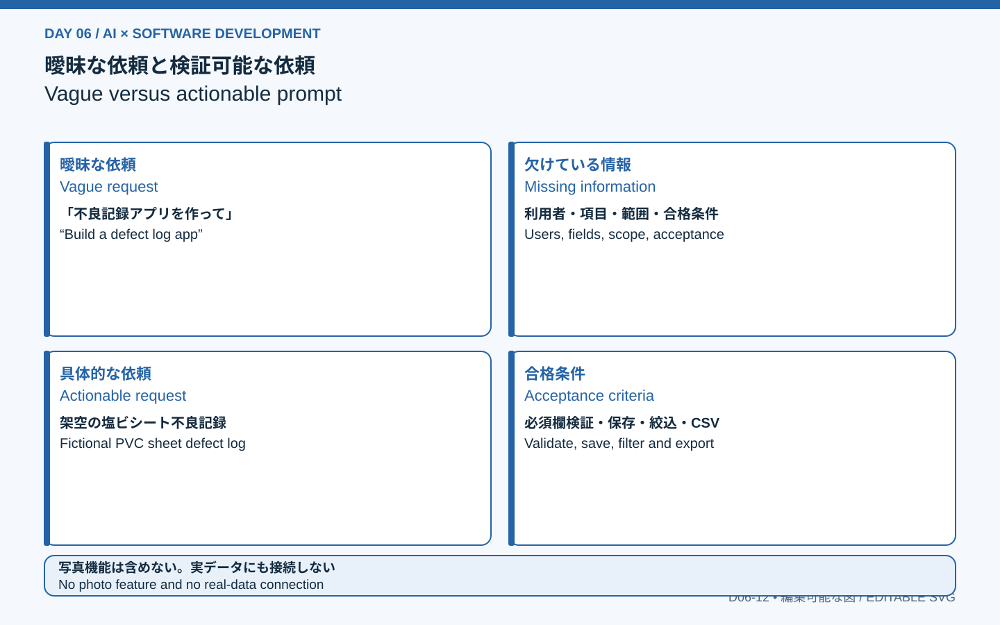
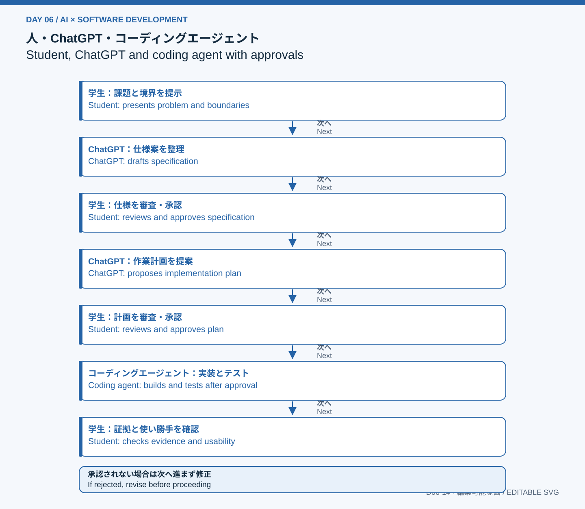
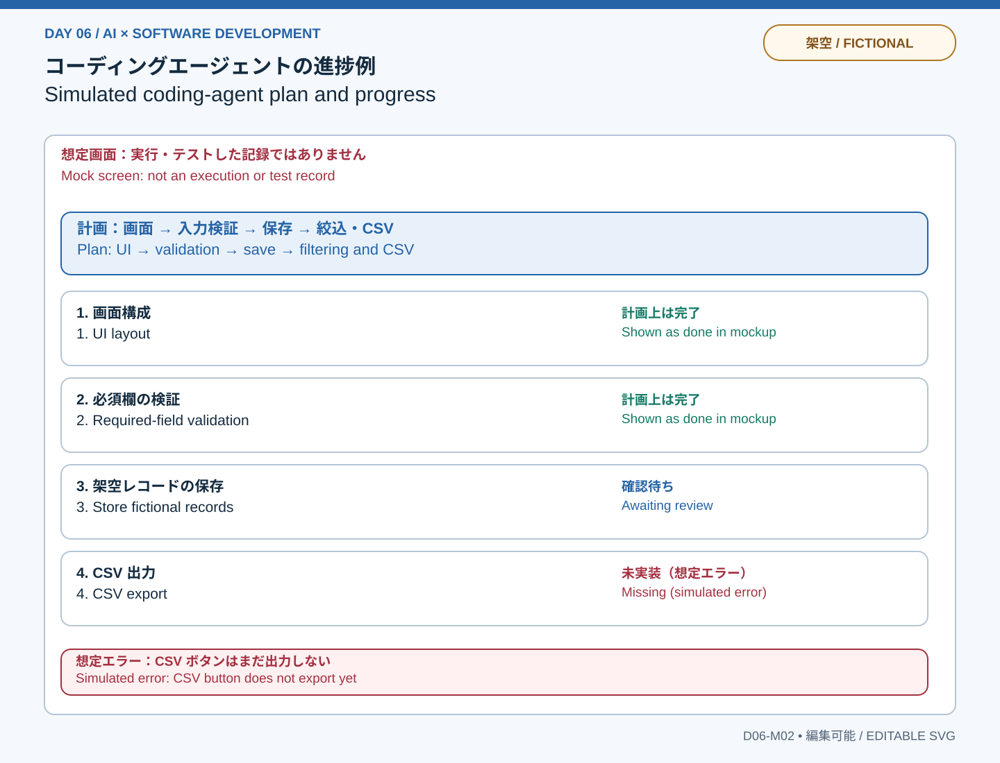
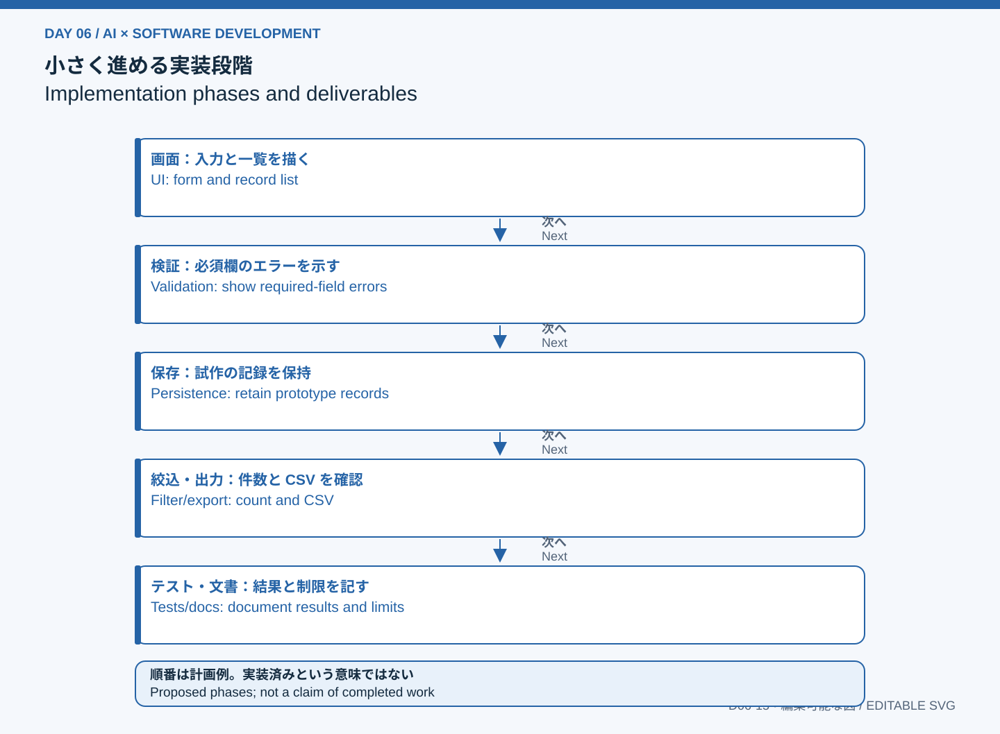
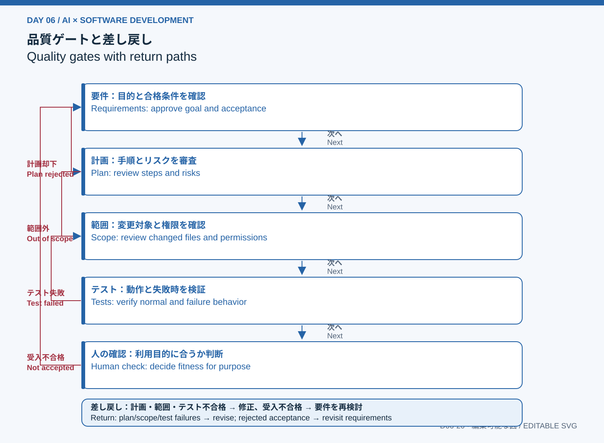
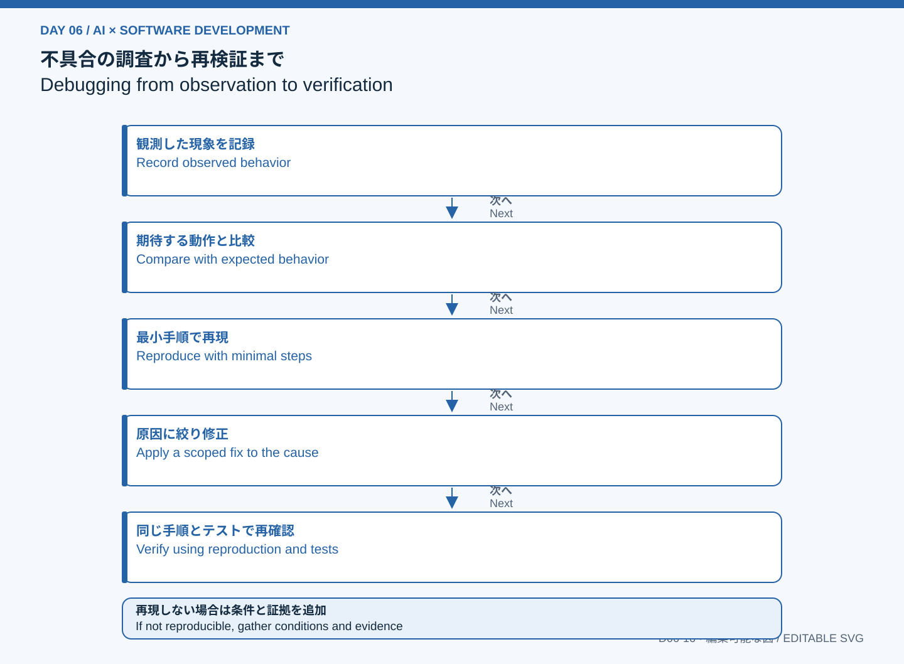

# 第6日 04：エージェントへの指示と実行の監督 / Day 6 04: Prompting and supervised execution

**目安65分 / Estimated duration: 65 min.** [第6日時間割](../../COURSE_SYLLABUS_DAY06.md)を参照。コードを書いたり、アプリを動かしたりする必要はありません。/ See the [sole Day 6 timetable](../../COURSE_SYLLABUS_DAY06.md). No student coding or live app is needed.

**目標 / Objectives:** 人・ChatGPT・実装担当エージェントの役割を分け、仕様から範囲の狭い指示を作り、計画を承認してから実装を監督する。/ Separate human, ChatGPT and coding-agent roles; draft scoped instructions from a specification; approve a plan before execution.

## 1. 頼み方によって仕事が変わる / Different requests produce different work

「案を三つ教えて」は探索。「なぜCSVが必要？」は説明。「入力とエラーを書き出して」は仕様。「変更せず予定を示して」は計画。「承認した範囲を作って」は実装。「期待値と照合して」は検証。「観察した不具合だけ直して」は修正です。実装と検証を同じ「作って」で済ませず、目的を明示します。

“Suggest three options” explores. “Why CSV?” asks for an explanation. “List fields and errors” drafts a specification. “Show a plan without editing” plans. “Build the approved scope” implements. “Compare with expected outcomes” verifies. “Fix this observed failure only” corrects. Make the requested stage explicit.

| 段階 / Stage | 適した依頼 / Appropriate request | 避けること / Avoid |
|---|---|---|
| 探索 / Explore | 別案の利点・欠点 / compare trade-offs | すぐ実装 / immediate implementation |
| 仕様 / Specify | 不明点を質問し要件案を作る / ask questions and draft requirements | 推測を事実扱い / assumptions as facts |
| 計画 / Plan | ファイルを変えず変更候補と試験を提示 / propose files and tests without edits | 承認前の変更 / editing before approval |
| 実装 / Implement | 承認した小さな段階を作る / build approved small stage | 無関係な変更 / unrelated changes |
| 検証 / Verify | 観察できる期待値と実際を比較 / compare observed vs expected | 「実行できた」だけ / claiming execution is acceptance |
| 修正 / Correct | 観察・期待・再現・範囲・再確認 / observed, expected, steps, scope, recheck | 全部やり直す / wholesale rewrite |

**図 D06-12 / Figure D06-12:** 項目を増やすだけでなく、人が意味を確認します。/ More words do not replace human review. **問い / Reflect:** 「検査アプリを作る」に最初に足す質問は？ / What question should come first for “Make an inspection app”?

## 2. ChatGPTから実装担当へ / From ChatGPT to the coding agent

学習者が現場の問題を説明します。ChatGPTに不足条件を質問させて仕様案を作ります。**人が仕様を承認**してから、ChatGPTに実装担当への指示案を作らせます。人がその案から不要な機能と過大な権限を消します。実装担当はプロジェクトを確認して**変更しない計画**を出します。人が計画を承認した後だけ、エージェントが小さな範囲を実装します。人が結果を観察し、不足があれば具体的に直すよう求めます。

The learner explains the operational problem. ChatGPT asks missing questions and drafts a specification. A **human approves the specification**, then asks for a coding-agent instruction. The human removes unapproved features and broad permissions. The coding agent inspects the project and presents a **plan without edits**. Only after human approval does it implement a small scope. The human observes results and requests focused corrections.

**図 D06-14 / Figure D06-14:** ChatGPTの草案は人の承認が必要です。/ A ChatGPT draft requires human review. **問い / Reflect:** コーディングエージェントが最初に行うのは編集ですか？ / Should the coding agent edit first?

## 3. 良い指示の11項目 / Eleven parts of a useful instruction

以下は魔法の呪文ではなく、誤解を減らすための確認表です。短くても、合意した内容と禁止事項を正しく伝えます。

These are not magic words; they are a checklist to reduce ambiguity. Even a short request should state agreed behavior and exclusions accurately.

| 項目 / Part | 塩ビシート例 / PVC record example | 必要な理由 / Why it matters |
|---|---|---|
| 1 役割 / Role | 既存作業を守る実装担当 / developer who preserves existing work | 保護範囲を意識 / respect existing work |
| 2 目的 / Goal | 不良記録を検索できるようにする / find defect records | 機能ではなく結果を見る / focus on outcome |
| 3 背景 / Context | 検査員の学習用・架空・ローカル / fictional local tool for operators | 使う人を想定 / know the users |
| 4 要件 / Requirements | 必須入力、保存、絞り込み、CSV / fields, persistence, filters, CSV | 合意した挙動 / agreed behavior |
| 5 制約 / Constraints | 実データ・画像判定・設備接続は禁止 / no live data, image inference or equipment | 過大な変更を防ぐ / prevent scope creep |
| 6 許可範囲 / Allowed files | 新しいアプリの指定フォルダーのみ / proposed app folder only | 他の教材に触れない / protect unrelated files |
| 7 手順 / Stages | 調査→計画→承認→実装→試験 / inspect, plan, approval, build, test | 途中で止められる / allow checkpoints |
| 8 試験 / Tests | 有効・空欄・再起動・CSV / valid, missing, restart, CSV | 失敗も見つける / find failures |
| 9 合否 / Acceptance | 架空2件、絞り込み1件、CSV2行 / two saves, one filtered row, two CSV rows | 結果を観察 / observable results |
| 10 成果物 / Deliverables | アプリ・使い方・試験記録 / app, guide, test record | 引き継げる / make transferable |
| 11 報告 / Report | 変更ファイル・試験結果・未確認項目 / files, evidence, unverified items | 主張と根拠を区別 / distinguish claims from evidence |

**架空の会話6 / Fictional conversation 6 — command draft:** 学習者「承認済みの仕様から、実装担当への指示を作って。ただし他の教材・実データを触らせず、最初は計画だけ。」/ Learner: “Draft a coding-agent command from the approved specification. Protect other lessons and real data. Plan first.” ChatGPT（想定）「アプリ全体の作成と本番接続を指示します。」/ ChatGPT (simulated): “I will instruct it to build the full app and connect production.” 学習者「本番接続は承認していません。削除して、ローカルの架空記録だけに直してください。」/ Learner: “Production access was not approved. Remove it; keep only fictional local records.”

**図 M02 / Figure M02:** 「完成」の言葉、残るCSV作業、試験の証拠を別々に見ます。/ Separate completion claims, missing CSV and actual test evidence. **問い / Reflect:** どこがまだ未確認ですか？ / What has not been verified yet?

詳細は[承認用仕様](../../day06_support/examples/inspection_app_spec_ja_en.md)と[対訳指示集](../../day06_support/examples/example_agent_prompts_ja_en.md)にあります。/ See the [approved sample specification](../../day06_support/examples/inspection_app_spec_ja_en.md) and [bilingual prompt library](../../day06_support/examples/example_agent_prompts_ja_en.md).

**問い / Reflect:** 長い指示なら範囲外の機能を足してもよいですか？ / Does a long prompt justify extra features?

## 4. 計画だけを出させる / Plan without editing

実装担当への第一声は「プロジェクトを確認し、予定するファイル、既存機能、簡単な実装方法、危険、試験方法と不明点を示してください。**まだファイルを変更しないでください**」です。計画の良し悪しは機能の多さではなく、必要な範囲、確認方法、無関係な作業の回避で判断します。説明だけの計画と、ファイル変更やツール操作の許可は別です。

First ask: “Inspect the project. State existing features, files you would change, a simple approach, risks, tests and open questions. **Do not edit files yet.**” A good plan limits changes, explains verification and avoids unrelated work; many features are not inherently better. Approving a plan is separate from permission to perform a sensitive operation.

**悪い架空計画 / Poor fictional plan:** 「本番データベースをつなぎ、カメラ画像を取得し、旧教材も一度作り直します。試験は後で。」/ “Connect a live database, fetch camera images, rebuild older lessons and test later.” **問題 / Problem:** 記録アプリに不要、許可されていない、試験が曖昧。/ Unneeded, unauthorized and untestable.

**良い架空計画 / Better fictional plan:** 「新しいローカルアプリ用フォルダーだけで、入力→保存→表示/絞り込み→CSVを段階実装します。架空2件と空欄、再起動、出力失敗を調べ、第1〜5日のファイルには触れません。保存形式は既存環境の確認後に提案します。」/ “Use only the new local app folder; implement form → save → list/filter → CSV in stages. Check two fictional entries, missing fields, restart and export failure. Do not touch Days 1–5. Propose storage format after inspection.”

**問い / Reflect:** 危険な計画を見つけたら「まず作って」か「計画を戻して」か？ / If the plan is unsafe, should you implement or revise the plan?

## 5. 小さな段階とチェックゲート / Small stages and checkgates

第1段階：画面案。第2段階：必須欄の確認。第3段階：保存と再起動。第4段階：絞り込みとCSV。第5段階：試験と説明。段階が終わるたびに、変更されたファイル、実際に確認した結果、残る仕事を短く報告してもらいます。予想外の変更があれば止めて理由を聞きます。

Phase 1: UI concept. Phase 2: required-field validation. Phase 3: save and restart. Phase 4: filters and CSV. Phase 5: tests and instructions. After each phase, request a short list of changed files, actual checks and remaining work. Pause on unexpected changes and ask why.

**図 D06-15 / Figure D06-15:** 先の段階に進む前に前の結果を見る。/ Inspect a stage before proceeding. **問い / Reflect:** 第4段階でCSVだけ欠けたら、何をやり直しますか？ / What needs revisiting if only CSV is missing?

**図 D06-20 / Figure D06-20:** 合格できなければ該当の段階に戻る。/ If a gate fails, return to that stage. **問い / Reflect:** 自動試験が通っただけで人が受け入れますか？ / Are passing tests alone human acceptance?

## 6. 修正は「観察→期待→再現→制約→確認」/ Correct with evidence and boundaries

「アプリが変。全部直して」は観察も期待も曖昧です。結果を見た人が、どの操作で何が起き、何を期待したかを示します。再現手順を添え、動いている部分を壊さず、修正後に両方を再確認するよう求めます。

“The app is wrong; fix everything” does not tell an agent what happened or what should happen. The observer states the action, actual result and expectation; provides reproduction steps; protects working behavior; and asks for both the failure and a valid case to be rechecked.

| 例 / Case | 観察と期待 / Observed versus expected | 絞った修正 / Focused request |
|---|---|---|
| 1 CSVがない / Missing CSV | 仕様ではCSV必須だがボタンがない / required export button absent | 既存の保存・絞り込みを保ち、列順と架空2件を確認 / add export only; preserve save/filter and check columns/two rows |
| 2 日本語の表示 / Japanese label | 「Save」のみ表示、仕様は「保存」 / UI shows only “Save,” requirement says “保存” | 表示文だけ直し、日本語のエラー表示と保存を再確認 / fix label only, recheck errors/save |
| 3 新機能で故障 / Regression | CSV追加後、再起動で2件が消える / two entries vanish after adding CSV | 保存を調べ、CSVと再起動の両方を再確認 / investigate persistence; verify both export and restart |

**完全な修正指示1 / Complete correction 1:** 「観察：2件を入力し一覧を開いてもCSV出力ボタンがありません。期待：仕様どおり2件を `lot_id,inspected_at,defect_type,description,remarks` で保存できる。再現：架空の2件を保存し一覧を見る。制約：既存の保存・絞り込み、他の教材は変えない。確認：CSVのヘッダー・2行と既存の絞り込み結果を示してください。」/ “Observed: no CSV button after saving two rows. Expected: export two rows with agreed columns. Reproduce: save the two fictional entries and open the list. Preserve saving, filters and other lessons. Verify the header, two data rows and existing filter outcome.”

**完全な修正指示2 / Complete correction 2:** 「観察：ロット空欄のエラーで『Save failed』と出ます。期待：『ロット番号を入力してください』と日本語で表示し記録を増やさない。再現：ロットを空にして保存。制約：ラベルと該当エラーだけ直す。確認：空欄の拒否と有効なロットの保存を確認。」/ “Observed: an empty lot shows ‘Save failed.’ Expected: Japanese ‘Please enter the lot number,’ with no new row. Reproduce with empty lot; adjust only the relevant label/error. Verify rejection and valid saving.”

**完全な修正指示3 / Complete correction 3:** 「観察：CSVを追加した後、再起動で2件が消えます。期待：2件が残り、CSVにも出力される。再現：架空2件を登録→終了→再起動。制約：既存の項目と絞り込みを維持。確認：再起動後の2件・黒点絞り込み1件・CSV2行を示してください。」/ “Observed: after CSV was added, two records disappear on restart. Expected: both persist and export. Reproduce: enter two fictional records, exit and restart. Preserve fields and filters. Verify two rows, one black-spot filter result and two CSV data rows.”

**図 D06-16 / Figure D06-16:** 修正後は正常な例ももう一度試します。/ Recheck a valid path after any fix. **問い / Reflect:** 「ボタンがない」だけでは何を補うべきですか？ / What is missing from “the button is absent”?

## 7. 長い作業でも目的を保つ / Maintain scope over a long task

長いやりとりでは前の条件が会話の外へ出たり、エージェントが同じ失敗を繰り返したりします。承認した仕様、途中の変更ファイル、未解決の問題を文書に残します。同じ操作を何度も失敗するなら一時停止し、失敗した操作と原因を説明させてから次へ進みます。破壊的な削除や外部送信には人の承認が必要です。

In a long task, earlier constraints may fall outside working context or the agent may repeat a failure. Save approved requirements, changed files and unresolved issues. If a step repeatedly fails, pause and ask for the failing action and cause before proceeding. Destructive deletion or external transfer needs human approval.

新しい担当への引き継ぎでは「完了したと報告された内容」と「実際に確かめた内容」を分けます。[引き継ぎの例](../../day06_support/examples/example_handover_ja_en.md)は架空の報告であり、実際の試験記録ではありません。

For a receiving agent, distinguish reported completion from actually verified work. The [sample handover](../../day06_support/examples/example_handover_ja_en.md) is fictional and is not real test evidence.

**問い / Reflect:** 意図しないファイルが変更されたら、次の段階を許可しますか？ / Would you approve the next stage after an unexpected file change?

## 8. 演習（合計18分）/ Practice (18 min total)

**A / Activity A (4 min):** 「いいアプリを作って」を、利用者・必須入力・CSV・変更範囲・計画の確認・試験が入る指示に直します。**出力 / Output:** 4〜5文の指示。**間違い / Pitfall:** 「完璧に」だけ足す。/ Rewrite the vague request as four or five sentences. “Make it perfect” is not a requirement.

**B / Activity B (3 min):** 指示「全部のファイルを直して、実データを使って、今すぐ完成させて」から、危険または不足を3つ見つけます。**出力 / Output:** 3点と計画だけの代案。**間違い / Pitfall:** 変更範囲を無制限にする。/ Find three risks/omissions and request a plan-only alternative.

**C / Activity C (4 min):** 上の悪い計画の範囲外の内容を線で消し、よい計画から確認したい点を二つ書きます。**出力 / Output:** 修正依頼と質問2つ。**間違い / Pitfall:** 先に実装させる。/ Reject unsafe steps and ask two questions before approving.

**D / Activity D (4 min):** 1〜3の失敗から一つ選び、観察→期待→再現→制約→確認の順で修正を頼みます。**出力 / Output:** 短い修正指示。**間違い / Pitfall:** 関係のない機能も作り直す。/ Write one scoped corrective request; do not rewrite unrelated work.

**E / Activity E (3 min):** [指示集](../../day06_support/examples/example_agent_prompts_ja_en.md)を紙で見て、実行前に人が確認する点を3つ挙げます。**出力 / Output:** 仕様との一致、許可範囲、合否基準など3点。**間違い / Pitfall:** AIが作った指示をそのまま実行。/ List three checks before running an AI-drafted prompt.

**完了チェック / Completion:** 計画を先に求め、余計な機能を却下し、観察した不具合を限定して修正依頼できる。/ Ask for a plan first, reject scope creep and request a focused correction from observations.

## 任意資料：コピーして調整する指示集 / Optional reference: adaptable prompt templates

この先は時間内にすべて読む必要はありません。使うときに必要な型だけ選び、必ず人が確認します。/ This is optional reference material, not required within the 65-minute lesson. Select a relevant template and review it before use.

<!-- DAY06_PROMPT_LIBRARY -->
