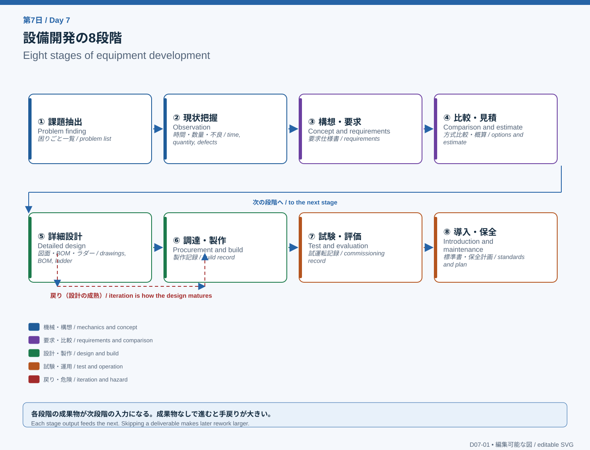
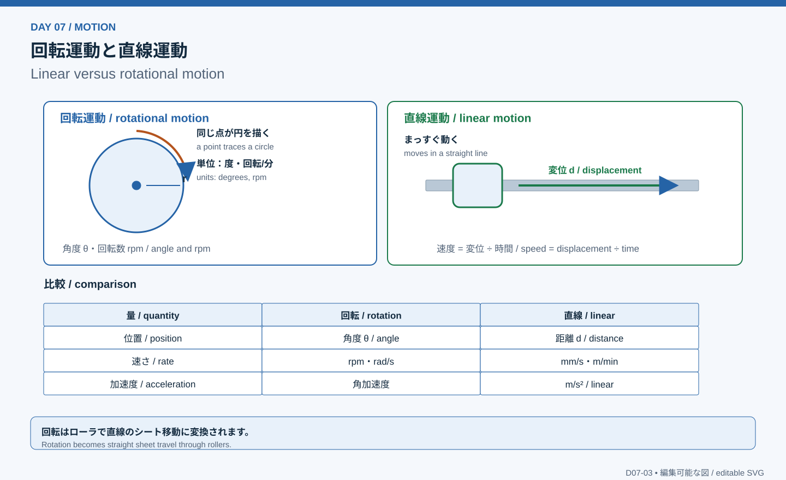
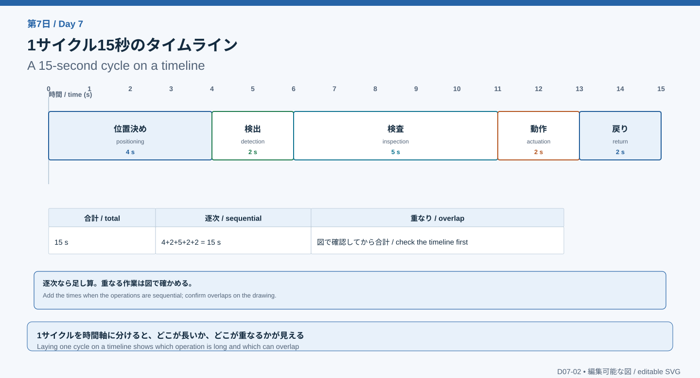
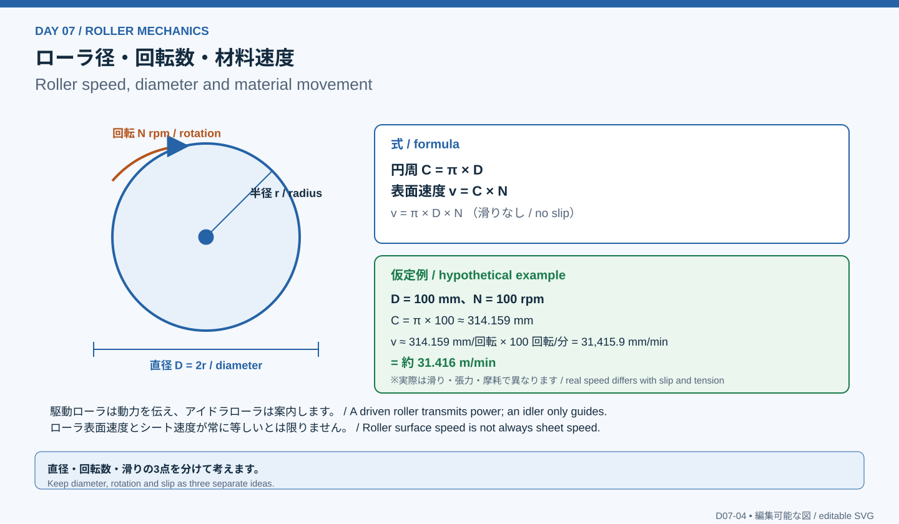
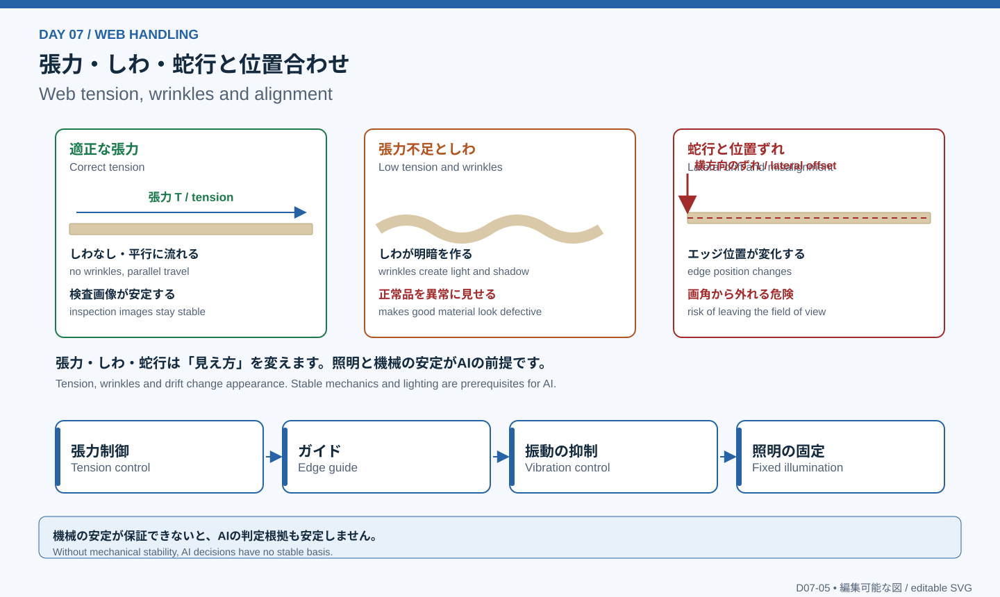

# 第7日 01 自動化の目的・生産能力・効果金額の計算 / Day 7-01 Automation Objectives, Production Capacity and Economic Effect

> 所要時間 / Duration: **80分 / 80 minutes**
> 元PDF / Source pages: 6, 9
> 共通例 / Running example: 小さな製品を検査して仕分ける設備 / a small product-inspection and sorting machine

## 1. 概要 / Overview

このノートブックでは、自動化を「部品の話」より先に「目的と数字の話」として扱います。何を自動化するのか、どれだけの速さが必要なのか、いくらの効果が見込めるのかを、単位をそろえて説明できるようになります。計算はすべて紙と電卓で行います。**このノートブックに実行するプログラムはありません。**

This notebook treats automation as a question of purpose and numbers before hardware. You will learn to state what is being automated, how fast the line must run, and what the improvement is worth, with consistent units. Every calculation is done on paper or with a calculator. **This notebook contains no code to execute.**

**安全に関する前提 / Safety boundary.** 本資料は机上の学習用です。実機の配線、通電、圧縮空気の供給、シリンダの動作、安全機能の検証は行いません。実機作業は、リスクアセスメント、事前承認、電気的・空圧的隔離、残留エネルギー確認、有資格者の監督がそろった場合にだけ、別の機会に行います。 / This material is for desk study. It does not involve real wiring, energisation, compressed air, cylinder motion or safety-function validation. Real work is a separate activity with a risk assessment, prior approval, isolation, stored-energy verification and qualified supervision.

## 2. 学習目標 / Learning objectives

このノートブックを終えると、次のことができるようになります。

1. 自動化設備が何で構成されているかを説明できる。
2. アクチュエータが何をする部品かを説明できる。
3. 空圧・油圧・電気の動力の違いを説明できる。
4. シリンダ・モーター・その他のアクチュエータの使い道を説明できる。
5. タクトタイムとサイクルタイムを区別し、生産能力を計算できる。
6. 改善の効果金額と簡易回収期間を計算できる。
7. 選定に必要な仕様項目を挙げられる。
8. 計算値がそのまま部品選定の答えにならない理由を説明できる。

By the end of this notebook you can:

1. Explain what an automation machine consists of.
2. Explain what an actuator does.
3. Explain the difference between pneumatic, hydraulic and electrical power.
4. Explain how cylinders, motors and other actuators are used.
5. Distinguish takt time from cycle time and calculate production capacity.
6. Calculate the economic effect of an improvement and a simple payback period.
7. List the specifications needed for equipment selection.
8. Explain why a calculated value does not by itself determine component selection.

## 3. 前提 / Prerequisites

第1日〜第6日の内容（画像、Python、AI検査の考え方）を学んでいることを前提にします。第7日では新しい用語が多いので、初めて出る用語はその場で説明します。電卓と筆記用具を用意してください。

Days 1-6 (images, Python and the idea of AI inspection) are assumed. Day 7 introduces many new terms; each new term is explained where it first appears. Bring a calculator and something to write with.

## 4. 自動化とは何か / What automation is

工場でよく見る作業を例にします。

- 作業者が製品を目で確認している。
- 作業者が製品を運んでいる。
- シリンダが不良品を押し出している。
- コンベヤが材料を運んでいる。
- モーターがローラーを回している。
- カメラが流れるシートを検査している。

Everyday factory work is the starting point: a worker checking a product by eye, a worker carrying a product, a cylinder pushing out a rejected product, a conveyor moving material, a motor turning a roller, a camera inspecting a moving sheet.



*図 D07-01：入力 → 機械的な取扱い → 加工・検査 → 出力の流れと、構造・動力・アクチュエータ・センサー・制御装置・ワークの関係。 / Figure D07-01: input, mechanical handling, process or inspection, output, and the relationship between structure, power source, actuator, sensor, controller and workpiece.*

自動化で期待できる効果は、次のようなものです。ただし、**自動化すれば必ずすべてが得られるわけではありません**。設備の設計と使い方によって、得られる効果は変わります。

- 手作業を減らす。
- 生産能力を上げる。
- 品質のばらつきを減らす。
- 検査漏れを減らす。
- 手直しを減らす。
- 作業姿勢を楽にする。
- 単純繰り返し作業への負担を減らす。

Possible benefits are reduced manual work, higher capacity, more consistent quality, fewer missed inspections, less rework, better ergonomics and less exposure to repetitive work. **Automation does not automatically deliver all of these**; the design and the way the machine is used decide which benefits appear.

### 4.1 機械の基本的な構成 / basic machine architecture

機械は、大きく次の6つの要素で説明できます。

| 要素 / Element | 役割 / Role | 例 / Example |
|---|---|---|
| 構造 / structure | 部品を支え、位置を決める / supports and positions parts | フレーム、ブラケット、ガイド / frame, bracket, guide |
| 動力 / power source | 動きの元になるエネルギー / energy for motion | 圧縮空気、油圧、電気 / compressed air, oil pressure, electricity |
| アクチュエータ / actuator | エネルギーを動きに変える / converts energy into motion | シリンダ、モーター、グリッパ / cylinder, motor, gripper |
| センサー / sensor | 状態を検出する / detects a state | 光電センサー、近接センサー / photoelectric, proximity |
| 制御装置 / controller | 信号を判断して指令を出す / decides and commands | PLC、PC / PLC, PC |
| ワーク / workpiece | 対象物 / the object being handled | 製品、材料、シート / product, material, sheet |

ここでは概要だけを示します。電気の詳しい話は第8日で行います。 / This is only an overview; electrical detail belongs to Day 8.

## 5. タクトタイムとサイクルタイム / Takt time and cycle time

似た言葉ですが、意味が違います。単位を必ず書いてください。

- **タクトタイム / Takt time**：必要数量を生産時間内にこなすための「必要な速さ」。単位は秒/個。
- **サイクルタイム / Cycle time**：機械が1サイクルを終えるのにかかる「決められた時間」。単位は秒/サイクル。
- **生産能力 / Production capacity**：単位時間あたりに作れる数。ここでは個/時。
- **必要生産能力 / Required production capacity**：必要数量を時間で割った必要な数。個/時。

| 量 / Quantity | 式 / Formula | 例 / Example |
|---|---|---|
| 必要生産能力 / required rate | 必要数量 ÷ 生産時間[h] / pieces ÷ hours | 600 ÷ 7 ≈ **85.71 個/時** |
| タクトタイム / takt time | 生産時間[秒] ÷ 必要数量 / available seconds ÷ required pieces | 420×60 ÷ 600 = **42 秒/個** |
| 理論サイクル能力 / theoretical cycle capacity | 3600 ÷ サイクルタイム[秒] / 3600 ÷ cycle time | 3600 ÷ 15 = **240 サイクル/時** |
| 理論個数能力 / theoretical piece capacity | 3600 ÷ サイクルタイム[秒] × 1サイクルあたり個数 / 3600 ÷ cycle × pieces per cycle | 240 × 1 = **240 個/時** |

共通例の数値：生産時間 420分、必要数量 600個、機械サイクル 15秒、1サイクル1個。 / Running example: 420 minutes available, 600 pieces required, 15 s machine cycle, one piece per cycle.



*図 D07-03：タクトタイム（必要ペース）とサイクルタイム（機械の時間）は別物です。能力は「1サイクルあたり何個か」を言わないと決まりません。 / Figure D07-03: takt time (required pace) and cycle time (machine time) are different quantities; capacity is undefined unless pieces per cycle are stated.*

### 5.1 15秒のサイクルを分解する / breaking a 15-second cycle down

1サイクル15秒を、次の5つの作業に分けてみます。

| 作業 / Operation | 時間 / Time |
|---|---|
| 製品の位置決め / product positioning | 4 秒 / s |
| 検出 / detection | 2 秒 / s |
| 検査 / inspection | 5 秒 / s |
| 動作（押出し）/ actuation | 2 秒 / s |
| 戻り・準備 / return or preparation | 2 秒 / s |
| 合計 / total | 15 秒 / s |

すべてが順番に行われるなら、時間は足し算になります。4 + 2 + 5 + 2 + 2 = 15秒です。もし検査と押出しの準備が同時に進められるなら、合計は15秒より短くなります。**重なる作業は、図で確かめてから足し算してください。**複雑なスケジュール計算はこの研修の範囲外です。

If every operation happens in sequence, the times add up: 4 + 2 + 5 + 2 + 2 = 15 s. If inspection and the preparation for pushing can overlap, the total is shorter than 15 s. **Check overlapping work on a timeline before adding numbers.** Detailed scheduling models are outside this course.



*図 D07-02：1サイクルを時間軸に並べた例。逐次なら合計、重なりがあれば図で確認します。 / Figure D07-02: one cycle laid out on a timeline. Add the times if the operations are sequential; confirm overlaps on the drawing.*

### 5.2 ボトルネック / bottlenecks

ライン全体の生産能力は、**一番遅い工程**で決まります。あるアクチュエータを速くしても、別の工程が律速していれば、ライン全体の生産数は増えません。まず「どこが一番遅いか」を測ります。

The capacity of a line is set by its **slowest step**. Making one actuator faster does not raise line output while another operation remains the limit. Measure which step is slowest first.



*図 D07-04：工程A・B・Cのうち一番遅い工程が全体の速さを決めます。 / Figure D07-04: of processes A, B and C, the slowest one sets the pace of the whole line.*

### 5.3 計算値の限界 / limits of the calculated value

- 理論能力は「止まらない・不良が出ない」という上限です。
- 実際の生産数は、停止、段取り、立上げ、不良で下がります。
- 検査の速さと、設備全体のサイクルタイムは同じとは限りません。
- 並列の工程は、順番の工程のように単純に足せません。

The theoretical capacity is an upper bound with no stoppage and no defects. Real output is lower because of stops, changeovers, ramp-up and defects. Inspection speed is not necessarily the machine cycle time. Parallel operations cannot simply be added as if they were sequential. 稼働率やOEEの計算は、この研修の必須内容から外しています。 / Availability and OEE calculations are outside the required content of this course.

## 6. 効果金額の計算 / calculating the economic effect

改善の効果は、金額に直すと比較しやすくなります。ただし「計算した金額＝必ず手に入る現金」ではありません。

- **削減時間 / time saved**：1回あたり何秒短くなるか。
- **年間削減工数 / annual labour hours saved**：1日と年間で何時間短くなるか。
- **労務費換算額 / labour-time monetary equivalent**：削減時間を時給で金額にしたもの。
- **年間効果金額 / annual economic effect**：年間の効果。
- **設備導入費 / equipment investment**：設備にかかる費用。
- **年間運用費 / annual operating cost**：電気代、消耗品、保守など毎年かかる費用。
- **年間純効果 / annual net benefit**：年間効果金額から年間運用費を引いた額。
- **投資回収期間 / simple payback period**：導入費を年間純効果で割った年数。



*図 D07-05：削減時間 → 年間工数 → 金額 → 回収期間の順に計算し、最後に改善前後を比較します。数値は教材の仮定です。 / Figure D07-05: time saved, annual hours, money, then payback, with a before-and-after comparison. Values are training assumptions.*

### 6.1 例1：運用費が0の場合 / example 1: no operating cost

- 1回あたりの削減時間 / time saved per operation：12秒
- 1日の回数 / operations per day：180回
- 年間稼働日数 / working days per year：220日
- 労務費の評価額 / labour valuation：2,400円/時
- 設備導入費 / equipment investment：450,000円

```text
1日の削減時間 = 12 × 180 ÷ 3600 = 0.6 時間/日
年間削減工数   = 0.6 × 220      = 132 時間/年
労務費換算額   = 132 × 2400     = 316,800 円/年
簡易回収期間   = 450,000 ÷ 316,800 ≈ 1.42 年
```

### 6.2 例2：年間運用費が50,000円の場合 / example 2: 50,000 JPY annual operating cost

```text
年間純効果   = 316,800 − 50,000 = 266,800 円/年
簡易回収期間 = 450,000 ÷ 266,800 ≈ 1.69 年
```

### 6.3 金額を見るときの注意 / cautions about the money

- 削減した時間が、そのまま人件費の削減になるとは限りません。
- 別の仕事に移れば、人件費は減らなくても生産的な価値が生まれます。
- 残業が減れば、実際の支払いが減る場合があります。
- 生産能力が上がっても、その分を売る・使う見込みがなければ経済的価値になりません。
- 売上と利益は別物です。
- 同じ改善を「労務費削減」と「生産性向上」で二重に数えないでください。
- 年間純効果が0以下のとき、回収期間は意味を持ちません。
- 簡易回収期間は、投資判断の全体を表す指標ではありません。

Saved time is not automatically a payroll reduction. Redeployed time can create value without reducing payroll. Reduced overtime can produce real cash savings. Extra capacity has economic value only if the output can be used or sold. Revenue and profit differ. Do not count the same improvement twice. Payback is meaningless at zero or negative net benefit, and simple payback is not a complete investment evaluation.

## 7. 演習 / Exercises

演習は2問だけです。答えは問題のすぐ下にあります。まず自分で計算してから確認してください。 / There are only two exercises. The answers follow each question; calculate first, then check.

### 演習1 生産能力 / exercise 1: capacity

生産時間 480分、必要数量 800個、機械サイクル 20秒、1サイクル1個のとき、タクトタイムと理論生産能力を求めてください。 / With 480 minutes available, 800 pieces required, a 20 s cycle and one piece per cycle, find the takt time and the theoretical capacity.

```text
タクトタイム = 480 × 60 ÷ 800 = 36 秒/個
理論能力     = 3600 ÷ 20 = 180 個/時
必要能力     = 800 ÷ (480 ÷ 60) = 800 ÷ 8 = 100 個/時
```

**答え / answer**：タクトタイム 36秒/個、理論能力 180個/時。必要能力100個/時より理論能力が大きいので、速度だけを見れば足りています。ただし停止や不良は別に考えます。 / Takt 36 s/piece, theoretical capacity 180 pieces/hour. The capacity exceeds the required 100 pieces/hour, but stoppages and defects still need separate thought.

### 演習2 効果金額 / exercise 2: economic effect

1回あたり8秒の削減、1日240回、年230日、時給2,000円、設備導入費400,000円、年間運用費40,000円のとき、年間純効果と簡易回収期間を求めてください。 / With 8 s saved per operation, 240 operations per day, 230 days per year, 2,000 JPY/hour, a 400,000 JPY investment and 40,000 JPY annual operating cost, find the annual net benefit and the simple payback.

```text
1日の削減時間 = 8 × 240 ÷ 3600 = 0.5333… 時間/日
年間削減工数   = 0.5333… × 230 ≈ 122.67 時間/年
労務費換算額   = 122.67 × 2000 ≈ 245,333 円/年
年間純効果     = 245,333 − 40,000 = 205,333 円/年
簡易回収期間   = 400,000 ÷ 205,333 ≈ 1.95 年
```

**答え / answer**：年間純効果 約205,000円、簡易回収期間 約1.95年。端数は計算の途中で丸めず、最後に丸めます。 / Annual net benefit about 205,000 JPY; payback about 1.95 years. Do not round in the middle of a calculation.

## 8. まとめ / Summary

- 自動化は「何をするか」「どれだけの速さか」「いくらの効果か」を数字で説明できると強い。
- タクトタイムは必要ペース、サイクルタイムは機械の時間。単位を必ず書く。
- 理論能力は上限。実際の生産数は停止や不良で下がる。
- 能力は「1サイクルあたりの個数」を言わないと決まらない。
- 効果金額は、削減時間 → 年間工数 → 金額 → 純効果 → 回収期間の順に計算する。
- 金額の前提（現金化できるか、売れるか）を必ず添える。

Automation is easier to discuss with numbers: what, how fast, how much. Takt is the required pace; cycle time is the machine's time. Theoretical capacity is an upper bound. Capacity needs pieces per cycle. Calculate effect as time, hours, money, net benefit and payback, and state whether the value becomes cash.

## 9. 完了チェックリスト / Completion checklist

- [ ] タクトタイムとサイクルタイムを言葉で区別できる。
- [ ] 42秒/個と240個/時を、式と単位付きで説明できる。
- [ ] 1サイクルあたりの個数が変わると能力が変わることを説明できる。
- [ ] 316,800円/年と1.42年を、式から再現できる。
- [ ] 年間運用費がある場合の1.69年を再現できる。
- [ ] 削減時間が必ず現金になるわけではないと説明できる。
- [ ] 演習2問を、途中式を残して解いた。

- [ ] I can distinguish takt time and cycle time in words.
- [ ] I can reproduce 42 s/piece and 240 pieces/hour with formulas and units.
- [ ] I can explain how pieces per cycle changes capacity.
- [ ] I can reproduce 316,800 JPY/year and 1.42 years.
- [ ] I can reproduce 1.69 years when an operating cost exists.
- [ ] I can explain why saved time is not automatically cash.
- [ ] I solved both exercises with intermediate working.

## 10. よくある間違い / Troubleshooting and common misunderstandings

| よくある間違い / Common mistake | 正しい考え方 / Correct view |
|---|---|
| タクトタイムとサイクルタイムを同じものとして扱う / treating takt and cycle as the same | タクトは「必要なペース」、サイクルは「機械の時間」 / takt is required pace, cycle is machine time |
| 3600 ÷ 15 を「個/時」とだけ書く / calling 3600 ÷ 15 pieces/hour without qualification | 1サイクルあたりの個数を確認する / confirm pieces per cycle |
| 稼働率を掛けて「実際の能力」とする / multiplying by availability as "actual capacity" | この研修では扱わない。停止・不良は別に考える / not part of this course; treat stops and defects separately |
| 削減時間×時給をそのまま「利益」と呼ぶ / calling saved time × rate "profit" | 労務費換算額であり、現金化には条件がある / it is a monetary equivalent, not cash |
| 回収期間だけで投資を決める / deciding investment on payback alone | 回収期間は簡易指標 / payback is a simple indicator only |
| 途中で四捨五入して合計が合わない / rounding mid-calculation | 最後に丸める / round at the end |

## 11. 安全と次の学習 / safety and what comes next

生産能力の計算は、設備を速くする話につながります。しかし、速くするほど、はさまれ、飛来、残留エネルギーの危険が増える場合があります。速度の変更は、安全確認とセットで考えます。

Capacity work leads to speed. Higher speed can increase trapping, ejection and stored-energy hazards. Speed changes always go together with a safety review.

次は 07-02 で、実際に動きを作る「動力」と「アクチュエータ」を学びます。 / Next, 07-02 covers the power sources and actuators that produce motion.
