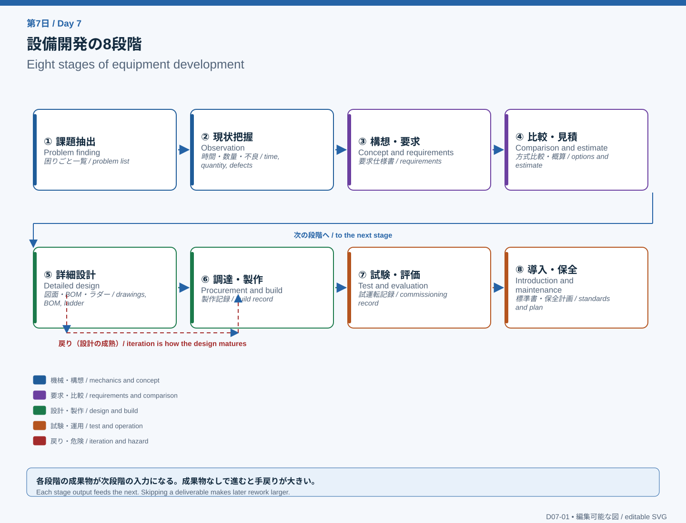
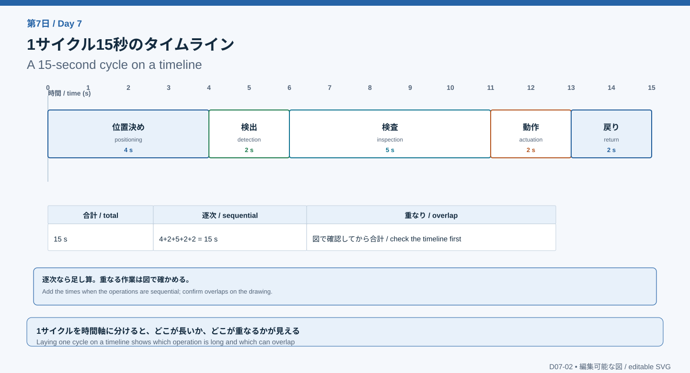
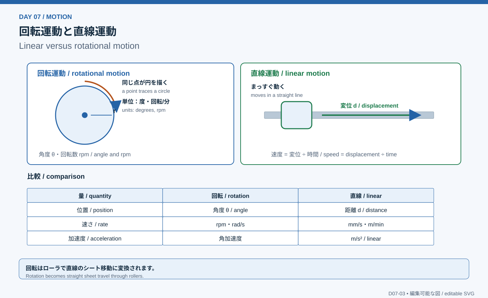
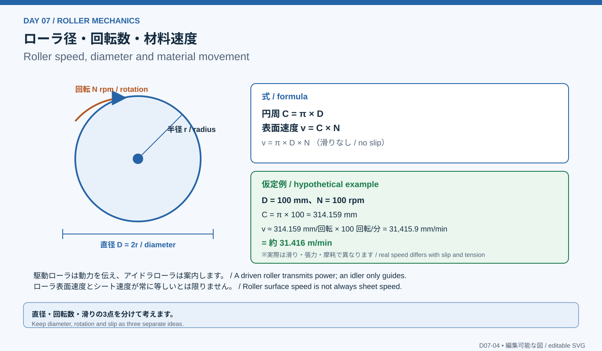
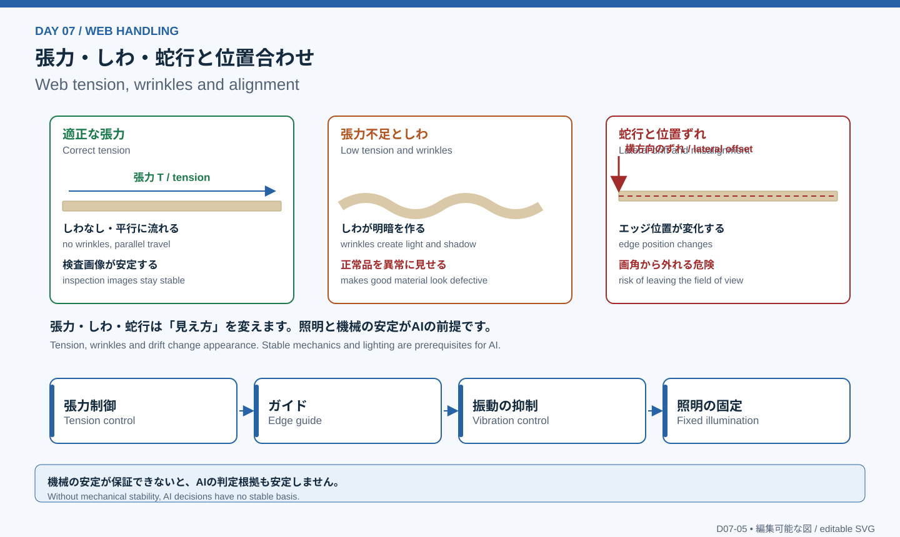

# 第7日 01 要求仕様と構想の作り方 / Day 7-01 Requirements and Concept Development

> 所要時間 / Duration: **80分 / 80 minutes**
> 元資料 / Source pages: 4–11
> 共通題材 / Running example: 小型ワーク押出し装置 / small workpiece-pushing machine

## 1. 概要 / Overview

このノートブックでは、自動化設備を作る最初の仕事を学びます。最初に決めるのはシリンダの径でもPLCの機種でもありません。**何を改善したいのか、どのくらいの能力が必要なのか、何ができたら合格なのか**を決めます。その結果を「要求仕様」として残します。

This notebook covers the first job in building automation equipment. The first decisions are **not** the cylinder bore or the PLC model. They are: **what problem are we solving, what capacity do we need, and what counts as acceptance?** The result is recorded as a requirements specification.

なぜ要求から始めるのでしょうか。装置を先に選ぶと、後から「この装置は何のために作ったのか」「本当に必要な能力は何か」が分からなくなります。要求が曖昧なままでは、機械・電気・PLCの設計判断を検証できません。

Why start from requirements? If the machine is chosen first, the team later loses sight of why it exists and what capacity is actually required. With vague requirements there is no basis for checking mechanical, electrical or PLC design decisions.

**このノートの位置づけ / Role of this notebook**

- 第7日の出発点です。ここで作った要求仕様を、07-02（機械）、07-03（機器選定）、第8日（電気・PLC）、第9日（試運転・提案）で使い続けます。
- This is the starting point of Day 7. The requirements written here are reused in 07-02 (mechanics), 07-03 (equipment selection), Day 8 (electrical and PLC) and Day 9 (commissioning and proposal).

**安全に関する前提 / Safety boundary**

本研修は教育用です。実機の配線、通電、空圧供給、シリンダ動作、安全回路の調整は行いません。実機作業は、リスクアセスメント、事前承認、隔離手順、有資格者の監督のもとで別に行うものです。

This is a training course. It does not authorise real wiring, energisation, compressed-air supply, cylinder motion or safety-circuit adjustment. Any real work requires a risk assessment, prior approval, isolation procedures and qualified supervision.

## 2. 学習目標 / Learning objectives

このノートを終えると、次のことができるようになります。

1. 自動化と機械化の違いを説明できる。
2. 設備開発の8段階を、成果物とともに説明できる。
3. 現場の困りごとを、事実と推測に分けて記録できる。
4. ECRSを使って、設備を買う前に作業を減らす案を考えられる。
5. タクトタイム、サイクルタイム、実力能力を計算できる。
6. 手動・空圧・電動の3案を、同じ評価軸で比較できる。
7. 測定可能な要求仕様と受入基準を書ける。
8. 構想段階で危険源を挙げ、保護方策の方向性を書ける。

By the end of this notebook you can:

1. Explain the difference between mechanisation and automation.
2. Describe the eight stages of equipment development and their deliverables.
3. Record shop-floor problems separately from assumptions.
4. Use ECRS to remove work before buying equipment.
5. Calculate takt time, cycle time and effective capacity.
6. Compare manual, pneumatic and electric concepts on the same criteria.
7. Write measurable requirements and acceptance criteria.
8. List hazards at the concept stage and propose a direction for protective measures.

## 3. 前提知識 / Prerequisites

特別な知識は必要ありません。次の用語だけ、先に確認します。

- **生産時間 / production time**: 実際に生産に使える時間。休憩・昼休み・計画停止を除きます。
- **タクトタイム / takt time**: 必要数量をこなすための目標ペース。時間÷個数。
- **サイクルタイム / cycle time**: 設備が1個を処理する実時間。
- **稼働率 / availability**: 計画した時間のうち、設備が実際に動けた割合。
- **良品率 / good yield**: 作った数のうち、良品だった割合。

No specialist knowledge is required. Five terms are introduced first: production time, takt time (the target pace), cycle time (the machine's actual time per piece), availability (the share of planned time the machine can run) and good yield (the share of output that is good).

## 4. 自動化とは / What automation means

**機械化 / mechanisation** は、人が行っていた動作を機械で置き換えることです。たとえば、人が押していたワークをシリンダで押すだけでも機械化です。

**自動化 / automation** は、さらに進んで、機械が状態を検知し、判断し、次の動作を決められるようにすることです。STARTを押したら1回動くだけでは、まだ半自動です。位置センサーで「押し切った」ことを確認し、異常なら止まり、次サイクルへ進む条件を自分で判断できて、初めて自動化に近づきます。

**Mechanisation** replaces a human motion with a machine. Pushing a workpiece with a cylinder instead of by hand is mechanisation. **Automation** goes further: the machine senses state, makes a decision and determines the next action. A machine that moves once when START is pressed is semi-automatic. Automation begins when it confirms "the push is complete" from a position sensor, stops on an abnormal condition and decides the conditions for the next cycle.

| 段階 / Level | 例 / Example | 人の役割 / Human role |
|---|---|---|
| 手作業 / Manual | 人がワークを押す / a person pushes the workpiece | 全動作 / all motion |
| 機械化 / Mechanised | シリンダで押すが、人が毎回ボタンを押す / cylinder pushes, operator presses each time | 判断と起動 / decisions and start |
| 半自動 / Semi-automatic | 1サイクルは自動。投入は人 / one automatic cycle; loading by hand | 投入と異常対応 / loading and recovery |
| 自動 / Automatic | 供給・押出し・確認・戻り・異常処理 / feed, push, confirm, return, fault handling | 監視と保全 / monitoring and maintenance |

> 重要 / Important: 自動化の目的は「高機能な装置を作ること」ではありません。必要な範囲だけを自動化し、安全・品質・能力・費用のバランスを取ることです。
> The goal is not to build the most sophisticated machine. Automate only the necessary scope and balance safety, quality, capacity and cost.

## 5. 設備開発の全体工程 / Equipment development workflow

設備づくりは「最初に図面を描く仕事」ではありません。現場の困りごとから要求を決め、機械・電気・制御で実現し、試験して使える状態まで仕上げる仕事です。次の8段階で進みます。各段階の間では必ず「戻り」が発生します。戻ることは失敗ではなく、設計を成熟させる作業です。

Equipment development is not "draw the drawing first". It starts from a shop-floor problem, defines requirements, realises them with mechanics, electrical design and control, and proves the result through testing. The eight stages below are iterative: going back is not failure, it is how the design matures.



*図 D07-01：各段階で「誰が何を決めるか」を確認してください。右側の成果物が無いまま次へ進むと、後の変更が大きくなります。 / Figure D07-01: confirm who decides what at each stage. Moving on without the deliverable on the right makes later changes larger.*

| 段階 / Stage | 主な活動 / Activity | 成果物の例 / Deliverable |
|---|---|---|
| ① 課題抽出 / problem finding | 何が困っているか、なぜ自動化したいか / what hurts and why automate | 困りごと一覧 / problem list |
| ② 現状把握 / observation | 数量・時間・不良・人の動きを測る / measure quantity, time, defects, motion | 現状分析表 / current-state sheet |
| ③ 構想・要求 / concept and requirements | 自動化範囲、能力、品質、安全条件を決める / scope, capacity, quality, safety | 構想図・要求仕様書 / concept and requirements |
| ④ 比較・見積 / comparison and estimate | 複数方式を比べ、概算費用と効果を見る / compare options and estimate | 方式比較表・概算 / comparison and estimate |
| ⑤ 詳細設計 / detailed design | 機構・I/O・回路・制御を具体化する / mechanics, I/O, circuits, control | 図面・部品表・ラダー / drawings, BOM, ladder |
| ⑥ 調達・製作 / procurement and build | 注文、組立、配線、ソフト作成 / order, assemble, wire, program | 製作記録 / build record |
| ⑦ 試験・評価 / test and evaluation | 安全、動作、品質、能力、異常時を検証する / verify safety, motion, quality, capacity, faults | 試運転・受入記録 / commissioning records |
| ⑧ 導入・保全 / introduction and maintenance | 教育、手順書、予備品、改善 / training, procedures, spares, improvement | 標準書・保全計画 / standards and plan |

**この研修で扱う範囲 / Scope of this course**

第7〜9日では、①〜⑤の「机上の設計」と、⑦の「試験計画」までを扱います。実際の製作・配線・通電・空圧試験は、この研修だけでは行いません。

Days 7–9 cover stages ①–⑤ on paper and the stage-⑦ test plan. Actual build, wiring, energisation and pneumatic testing are outside this course.

## 6. 改善の見つけ方とECRS / Finding improvements with ECRS

設備を買う前に、作業そのものを無くせないかを考えます。基本は **ECRS** です。

Before buying equipment, ask whether the work can be removed. The basic sequence is **ECRS**.

- **Eliminate（なくす）/ eliminate**: その作業をそもそも不要にできないか。
- **Combine（まとめる）/ combine**: 別の作業と同時にできないか。
- **Rearrange（順序・配置を変える）/ rearrange**: 順番や置き場所を変えられないか。
- **Simplify（簡単にする）/ simplify**: 治具やガイドで、難しい動きを簡単にできないか。



*図 D07-02：同じ「押す」作業でも、レイアウト変更で押す必要自体を消せる場合があります。設備投資の前にE・C・Rを検討します。 / Figure D07-02: even for the same "push" task, a layout change may remove the need to push at all. Check E, C and R before capital investment.*

| 観察する対象 / What to observe | よくある課題 / Typical problem | 最初に試す問い / First question |
|---|---|---|
| 手作業の繰返し / repeated manual work | 同じ部品を何度も移動・位置決め / repeated handling and positioning | 治具・半自動化で減らせないか / can a fixture reduce it? |
| 検査 / inspection | 目視のばらつき、記録漏れ / visual variation, missing records | 基準と手順は明確か / are criteria and procedure clear? |
| 運搬・供給 / transport and feeding | 材料待ち、部品の持ち替え / waiting and re-handling | 置き場と供給方法を変えられないか / change location or feeding? |
| 危険・負担 / hazard and ergonomics | 重量物、挟まれ、高頻度姿勢変更 / heavy parts, pinch points, repetitive posture | 人を危険源から離せないか / can the person be separated? |
| 情報 / information | 紙の転記、二重入力 / paper transfer, duplicate entry | データ連携で減らせないか / connect the data? |

**ECRSの前に事実を測る / Measure before applying ECRS**

「大変そう」は推測です。「1サイクル平均14秒」は事実です。作業者、品種、時間帯、段取りの違いで値は変わるため、測定回数と条件を残します。

"That looks hard" is an assumption. "14 seconds per cycle on average" is a fact. Values change with operator, product, time of day and changeover, so record how many times you measured and under what conditions.

## 7. 現状観察と症状・原因の分離 / Observation: separating symptoms from causes

改善対象を決める前に、現状を観察します。観察では、**症状（見えている困りごと）** と **原因（なぜ起きるか）** を分けます。

Observe the current process before choosing a target. Separate the **symptom** (what is visibly wrong) from the **cause** (why it happens).

| 症状 / Symptom | 仮の原因 / Possible cause | 確認方法 / How to check |
|---|---|---|
| ワークが時々詰まる / workpiece jams occasionally | ガイドの摩耗、ワーク寸法ばらつき / guide wear, workpiece variation | 詰まった時刻・品種・寸法を記録 / record time, product and dimension |
| 押し込み位置がばらつく / push position varies | ストッパの緩み、速度・衝撃 / loose stopper, speed and impact | 位置を10回測る / measure the position ten times |
| 作業者が疲れる / operator fatigue | 重量物、姿勢、頻度 / weight, posture, frequency | 重量と回数を測る / measure mass and repetitions |
| 検査漏れが出る / missed inspection | 手順が曖昧、時間不足 / unclear procedure, insufficient time | 手順書と実際の動作を比較 / compare procedure with practice |

原因が分からないまま設備を作ると、症状だけを隠す装置になります。まず測り、次に要求を決めます。

If equipment is built before the cause is understood, it only hides the symptom. Measure first, then define requirements.

## 8. タクトタイム・サイクルタイム・必要能力 / Takt time, cycle time and required capacity

### 8.1 3つの時間と能力 / Three time measures and capacity

**タクトタイム / takt time** は、使える生産時間を必要数量で割った「目標ペース」です。

**Takt time** is the target pace: available production time divided by the required quantity.

**サイクルタイム / cycle time** は、設備が1個を処理する実時間です。段取り・停止・待ち時間があると、実力は理論サイクルより低くなります。

**Cycle time** is the actual time the machine needs per piece. Changeover, downtime and waiting make effective output lower than the theoretical cycle.

| 用語 / Term | 式 / Formula | 例 / Example |
|---|---|---|
| タクトタイム / takt time | 生産時間 ÷ 必要数量 / available time ÷ required quantity | 420分 ÷ 600個 = 0.7分/個 = **42秒/個** |
| 理論能力 / theoretical capacity | 3600 ÷ サイクルタイム[秒] / 3600 ÷ cycle time (s) | 15秒/個 → 240個/時 |
| 実力能力 / effective capacity | 理論能力 × 稼働率 × 良品率 / theoretical × availability × yield | 240 × 0.85 × 0.98 = **199.92個/時** |



*図 D07-03：タクトは「目標」、サイクルは「設備の実力」、実力能力は「停止と不良を考えた現実的な出力」です。3つを混ぜないでください。 / Figure D07-03: takt is the target, cycle is the machine's capability, and effective capacity is realistic output after downtime and defects. Keep the three separate.*

### 8.2 計算してみる / Worked calculation

- 生産時間 / available production time: **420分**
- 必要数量 / required quantity: **600個**
- タクトタイム / takt time: 420 × 60 ÷ 600 = **42秒/個**
- 設備サイクル / machine cycle: **15秒/個**
- 理論能力 / theoretical capacity: 3600 ÷ 15 = **240個/時**
- 稼働率 / availability: **0.85**
- 良品率 / good yield: **0.98**
- 実力能力 / effective capacity: 240 × 0.85 × 0.98 = **199.92個/時**
- 必要能力 / required rate: 600 ÷ (420 ÷ 60) = **85.71個/時**

この例では、実力能力199.92個/時が必要能力85.71個/時を上回ります。したがって能力上の余裕は大きいと言えます。ただし、これは**仮定した数値**での話です。実際の稼働率と良品率は現場で測る必要があります。

In this example the effective capacity of 199.92 pieces/hour exceeds the required 85.71 pieces/hour, so there is substantial capacity margin. These are **assumed** values; real availability and yield must be measured on site.

```python exec id="capacity"
import sys, pathlib
import matplotlib
import matplotlib.pyplot as plt
plt.rcParams["font.family"] = ["Meiryo", "Yu Gothic", "DejaVu Sans"]
plt.rcParams["axes.unicode_minus"] = False

def find_support(start):
    for base in [start, *start.parents]:
        if (base / "day07_09_support" / "examples" / "automation_models.py").is_file():
            return base / "day07_09_support"
    raise FileNotFoundError("Open this notebook inside the Training_Automation repository.")

SUPPORT = find_support(pathlib.Path.cwd())
sys.path.insert(0, str(SUPPORT / "examples"))
import automation_models as am

report = am.capacity_report(
    available_min=420, required_pieces=600, cycle_s=15, availability=0.85, good_yield=0.98
)
print(f"takt time            : {report['takt_s']:.2f} s/piece")
print(f"required rate        : {report['required_pieces_per_h']:.2f} pieces/h")
print(f"theoretical capacity : {report['theoretical_per_h']:.2f} pieces/h")
print(f"effective capacity   : {report['effective_per_h']:.2f} good pieces/h")
print(f"cycle meets takt?    : {report['cycle_meets_takt']}")
print(f"capacity sufficient? : {report['effective_meets_required']}")
```

**期待される出力 / Expected output**

```text
takt time            : 42.00 s/piece
required rate        : 85.71 pieces/h
theoretical capacity : 240.00 pieces/h
effective capacity   : 199.92 good pieces/h
cycle meets takt?    : True
capacity sufficient? : True
```

### 8.3 値を変えてみる / Change the values

下のセルは、サイクルタイムを変えながら実力能力を計算し、表とグラフで示します。`cycle_values`、`availability`、`good_yield` を書き換えて、結果がどう変わるか観察してください。

The next cell sweeps cycle time and shows effective capacity as a table and chart. Edit `cycle_values`, `availability` and `good_yield`, then observe the change.

```python exec id="capacity-sweep"
cycle_values = list(range(10, 56, 5))
availability = 0.85
good_yield = 0.98
required_per_h = 600 / (420 / 60)

rows = am.capacity_table(cycle_values, availability, good_yield)
print(f"{'cycle [s]':>10} {'theoretical [pcs/h]':>22} {'effective [pcs/h]':>20}")
for row in rows:
    print(f"{row['cycle_s']:>10.0f} {row['theoretical_per_h']:>22.2f} {row['effective_per_h']:>20.2f}")

fig, ax = plt.subplots(figsize=(8, 4.2))
ax.plot([r["cycle_s"] for r in rows], [r["theoretical_per_h"] for r in rows],
        marker="o", label="theoretical / 理論能力")
ax.plot([r["cycle_s"] for r in rows], [r["effective_per_h"] for r in rows],
        marker="s", label="effective / 実力能力")
ax.axhline(required_per_h, color="firebrick", linestyle="--",
           label=f"required {required_per_h:.1f} pcs/h / 必要能力")
ax.set_xlabel("cycle time [s/piece] / サイクルタイム [秒/個]")
ax.set_ylabel("capacity [good pieces/h] / 能力 [個/時]")
ax.set_title("Cycle time versus capacity (assumptions: availability 0.85, yield 0.98)")
ax.grid(alpha=0.3)
ax.legend(fontsize=8)
fig.tight_layout()
plt.show()

breakeven = [r["cycle_s"] for r in rows if r["effective_per_h"] >= required_per_h]
print("effective capacity meets the requirement up to cycle time:", max(breakeven), "s")
```

**考えてみる / Think about it**

1. サイクルタイムを2倍にすると、実力能力はどうなるか。
2. 稼働率を0.85から0.70に下げると、実力能力は何個/時になるか。必要能力を満たすか。
3. 「サイクルタイムだけ速くする」改善と「稼働率を上げる」改善は、どちらが効くか。数字で説明してください。

1. What happens to effective capacity if cycle time doubles?
2. If availability falls from 0.85 to 0.70, what is the effective capacity? Does it still meet the requirement?
3. Which helps more here — a faster cycle or higher availability? Explain with numbers.

> **注意 / Caution**: 実力能力の式は概算です。立上げ損失、品種切替、材料待ち、検査時間、停止の復旧時間は、別に評価してください。
> The effective-capacity formula is an estimate. Ramp-up loss, changeover, material waiting, inspection time and recovery time must be evaluated separately.

## 9. 自動化方式の比較 / Comparing automation concepts

同じ作業でも、解決策は複数あります。押出し装置なら、次の3案を同じ評価軸で比べます。

The same task has several solutions. For the pusher, compare three concepts on the same criteria.



*図 D07-04：方式名ではなく「何を人に残すか」で比べます。A案は人を残し、B案は押出しだけ自動化し、C案は供給から排出まで自動化します。 / Figure D07-04: compare what remains with the human, not the technology label. Option A keeps the person, B automates only the push, C automates feed to discharge.*

| 観点 / Criterion | A 手動治具 / manual fixture | B 空圧半自動 / pneumatic semi-auto | C 電動全自動 / electric full-auto |
|---|---|---|---|
| 構成 / composition | ガイド・ストッパ・レバー | シリンダ・弁・センサー・PLC | 電動アクチュエータ・供給・検査・PLC |
| 初期費用 / initial cost | 低 / low | 中 / medium | 高 / high |
| 省人効果 / labour saving | 小 / small | 中 / medium | 大 / large |
| 品種変更 / product change | 治具交換 / fixture change | 位置・圧力調整 / position and pressure | プログラム変更 / program change |
| 停止時の復旧 / recovery | 簡単 / easy | 中 / medium | 難しい / harder |
| 安全上の論点 / safety | 手と工具 / hands and tools | 手と可動部の分離 / hand–motion separation | 危険源が増える / more hazards |
| 向く場面 / best fit | 少量・多品種 / low volume, high mix | 2点間の反復 / repeated two-position motion | 多点・高能力 / many positions, high rate |

**評価の仕方 / How to score**

初期費用、年間保守費、品種対応、設置スペース、故障復旧性、部品入手性、既存ラインとの接続、導入工期、安全リスクを点数化します。点数の高低より、**どの評価軸を重視したか、なぜか**を説明できることが大切です。

Score initial cost, annual maintenance, product flexibility, floor space, recoverability, parts availability, line integration, lead time and safety risk. More important than the total score is explaining **which criteria you weighted and why**.

```python exec id="option-score"
# 架空の教育用スコアです。実機の評価ではありません。
# Fictional training scores, not a real equipment evaluation.
weights = {
    "initial_cost": 0.20,
    "labour_saving": 0.25,
    "change_flexibility": 0.15,
    "recovery": 0.15,
    "safety": 0.25,
}
# 5 = favourable, 1 = unfavourable, under the stated weighting only.
options = {
    "A manual fixture / 手動治具": {"initial_cost": 5, "labour_saving": 1, "change_flexibility": 3, "recovery": 5, "safety": 4},
    "B pneumatic semi-auto / 空圧半自動": {"initial_cost": 3, "labour_saving": 4, "change_flexibility": 3, "recovery": 4, "safety": 2},
    "C electric full-auto / 電動全自動": {"initial_cost": 1, "labour_saving": 5, "change_flexibility": 4, "recovery": 2, "safety": 1},
}
if abs(sum(weights.values()) - 1.0) > 1e-9:
    raise ValueError("weights must sum to 1.0")
print(f"{'option':<36} {'weighted score':>14}")
for name, scores in options.items():
    total = sum(weights[key] * scores[key] for key in weights)
    print(f"{name:<36} {total:>14.2f}")
print("\nChange the weights and explain why the ranking changes.")
```

**期待される出力 / Expected output**（重みを変えると変わります / changes when weights change）

```text
option                                 weighted score
A manual fixture / 手動治具                       3.45
B pneumatic semi-auto / 空圧半自動                 3.15
C electric full-auto / 電動全自動                  2.60
```

> スコアは判断を助ける道具であり、決定そのものではありません。安全要求を満たさない案は、点数が高くても採用しません。
> A score supports judgement; it is not the decision. An option that fails a mandatory safety requirement is not selected even if it scores well.

## 10. 要求仕様と受入基準 / Requirements and acceptance criteria

要求仕様は「動けばよい」から「何ができれば合格か」へ変換する作業です。「速く動かす」「安全な装置」「簡単に交換」は曖昧すぎます。誰が見ても合否を判断できる形にします。

Requirements turn "it should work" into "what must be true to accept it". "Fast", "safe" and "easy to change" are too vague; write something a different person can judge.



*図 D07-05：要求は、測定方法と合格条件が決まって初めて検証できます。「測れない要求」は、設計が進む前に具体化します。 / Figure D07-05: a requirement is verifiable only when the measurement method and pass condition are defined. Make unmeasurable requirements concrete before design proceeds.*

| 分類 / Category | 決める事項 / What to define | 記入例（仮） / Example (hypothetical) |
|---|---|---|
| ワーク / workpiece | 形状・質量・材質・傷つきやすさ / shape, mass, material, fragility | 樹脂箱 8 kg、幅70〜90 mm |
| 能力 / capacity | 個数/時、繰返し速度、停止率 / pieces/h, rate, downtime | 600個/日以上、実力能力85個/時以上 |
| 品質 / quality | 位置精度、傷、誤選別 / position, damage, mis-sorting | 押出し後の位置ずれ ±2 mm |
| 運転 / operation | 人の操作、起動停止、復旧 / operator actions, start/stop, recovery | STARTで1サイクル、停止後は再押下で再開 |
| 設置 / installation | 寸法、電源、エア、環境 / dimensions, power, air, environment | 制御DC24V、エア0.4 MPa（要確認） |
| 安全 / safety | 危険源と要求安全機能 / hazards and required safety functions | 可動部への接近防止を設計。安全機能は別途リスクアセスメント |
| 保全 / maintenance | 清掃、交換、予備品 / cleaning, replacement, spares | 交換部品一覧、点検間隔 |

**受入基準の書き方 / Writing acceptance criteria**

悪い例 / Bad: 「位置決めが正確なこと」 / "positioning must be accurate"

良い例 / Good: 「後退端で停止したとき、押出し面の位置が基準面から±2 mm以内。10回連続で測定し、10回すべて合格」 / "With the pusher retracted, the pusher face is within ±2 mm of the datum. Measure ten consecutive cycles; all ten must pass."

良い例には、**測定量 / measurand**、**条件 / condition**、**合格範囲 / pass range**、**測定回数 / sample size** が入っています。

A good criterion states the measurand, the condition, the pass range and the sample size.

## 11. 構想段階の安全 / Preliminary safety at the concept stage

安全対策は、装置が完成してからカバーを付ける作業ではありません。動力源、可動部、人の接近を整理し、危険な動きそのものを減らします。

Safety is not a cover added after completion. Identify energy sources, moving parts and human access, and reduce the hazardous motion itself.


*図 D07-05（再掲）：要求仕様の「安全」欄は、危険源と保護方策の方向性を書く欄です。具体的な安全回路の設計ではありません。 / Figure D07-05 (repeated): the safety row records hazards and the direction of protective measures, not a safety-circuit design.*

| 危険源 / Hazard | 想定する事故 / Possible harm | 対策を考える順序 / Order of reduction |
|---|---|---|
| 押出し部 / pusher | 手指の挟まれ / finger pinch | 機構で接近を防ぐ → ガード → 監視・停止 / prevent access by design → guard → monitoring/stop |
| エア源 / compressed air | 予期せぬ可動、残圧 / unexpected motion, stored pressure | 遮断・排気・隔離・手順 / isolate, exhaust, lock, procedure |
| 電気 / electricity | 感電、短絡、発熱 / shock, short circuit, heat | 保護・絶縁・接地・配線 / protection, insulation, earthing, wiring |
| 再起動 / restart | 復電で突然動作 / unexpected start after power return | 再起動条件と停止状態を設計 / design restart conditions |
| 保全 / maintenance | 工具巻込み、誤操作 / tool entanglement, error | 保全姿勢、アクセス、ロックアウト / access, posture, lockout |

**重要な区別 / Essential distinction**

通常のPLCのSTOPラダーは、人身安全を保証する安全機能ではありません。安全機能は、リスクアセスメントに基づいて、必要な性能水準を決め、適切な安全関連機器と検証方法で実現します。参考規格として ISO 12100（リスクアセスメント）、ISO 13849-1（安全関連制御システム）、IEC 60204-1（機械の電気設備）、ISO 13850（非常停止）があります。本研修の図は概念図であり、規格適合を証明するものではありません。

Ordinary PLC STOP logic is not a safety function that guarantees personal safety. Safety functions require a risk assessment, a required performance level, suitable safety-related devices and validation. Reference standards include ISO 12100 (risk assessment), ISO 13849-1 (safety-related control systems), IEC 60204-1 (electrical equipment of machines) and ISO 13850 (emergency stop). The diagrams in this course are conceptual and do not prove compliance.

## 12. 演習 / Exercises

### 演習 A：現状の課題文を書く / Exercise A: write the current-state problem

自部署の作業を1つ選び、次の形で書いてください。

Choose one task in your department and write it in this form.

```text
作業名 / task:
現在の手順 / current steps (3–6 steps):
回数/日 / repetitions per day:
1回の時間 / time per occurrence:
困りごと（事実）/ problem (fact):
推測している原因 / suspected cause:
測っていない項目 / not yet measured:
```

### 演習 B：能力を計算する / Exercise B: calculate capacity

次の条件で、タクトタイムと実力能力を計算してください。計算過程と単位を必ず書きます。

Calculate takt time and effective capacity for the conditions below. Show the working and units.

- 生産時間 / available time: 450分 / 450 min
- 必要数量 / required quantity: 900個 / 900 pieces
- サイクルタイム / cycle time: 20秒/個 / 20 s per piece
- 稼働率 / availability: 0.80
- 良品率 / good yield: 0.97

上のコードセルの数値を書き換えて、自分の計算と一致するか確認してください。

Change the values in the code cell above and check that the result matches your hand calculation.

### 演習 C：3案比較 / Exercise C: compare three concepts

押出し装置について、A手動治具、B空圧半自動、C電動全自動を、次の5軸で5点満点に採点してください。重みも自分で決め、合計が1.0になるようにします。最後に「どの案を採用するか」と「採用しない案の理由」を200字以内で書きます。

Score the three concepts from 1 to 5 on five criteria. Choose your own weights that sum to 1.0. Then state which option you select and why you reject the others, in under 200 words.

### 演習 D：要求仕様と受入基準 / Exercise D: requirements and acceptance

能力・品質・停止・異常・保全から1つずつ、合否判定できる条件を作ってください。未確定の数値には「仮値」と書きます。

Write one acceptance criterion each for capacity, quality, stopping, abnormal conditions and maintenance. Mark unconfirmed values as "provisional".

### 演習 E：初期リスクリスト / Exercise E: initial risk list

構想スケッチの周囲に、人が触れそうな箇所を3か所以上書き、各箇所について「なくす・離す・守る・知らせる」のどの方向で考えるかを書いてください。

Mark at least three places where a person could be exposed. For each, state whether the direction is eliminate, separate, guard or inform.

**提出物 / Deliverables**

1. 現状の課題文 / current-state problem statement
2. 能力計算 / capacity calculation
3. 改善目標（測定可能）/ measurable improvement target
4. 3案比較 / three-option comparison
5. 初期リスクリスト / initial risk list
6. 要求仕様（初版）/ preliminary requirements specification

## 13. 期待される結果 / Expected result

- タクトタイムが **42秒/個**（420分・600個）と説明できる。
- 実力能力が **199.92個/時**（240 × 0.85 × 0.98）と計算できる。
- 要求仕様の各項目に、測定方法と合格条件がある。
- 安全欄に、危険源と保護方策の方向性が書かれている。ただし安全設計の完成ではない。
- 3案比較に、採用理由と却下理由の両方がある。

- You can explain the takt time of **42 s/piece** for 420 min and 600 pieces.
- You can calculate the effective capacity of **199.92 good pieces/h** (240 × 0.85 × 0.98).
- Each requirement has a measurement method and a pass condition.
- The safety row lists hazards and the direction of protective measures, not a completed safety design.
- The three-option comparison records both why the chosen option was selected and why the others were rejected.

## 14. トラブルシューティング / Troubleshooting

| 症状 / Symptom | 確認すること / Check | よくある原因 / Typical cause |
|---|---|---|
| 必要能力を満たさない / capacity short | タクトと実力能力を別々に計算したか / separate takt from effective capacity | 理論能力だけを見ている / looking only at theoretical capacity |
| 数値が現場と合わない / numbers do not match the shop floor | 生産時間に休憩・段取りを含めていないか / breaks and changeover included? | 定義の混同 / mixed definitions |
| 要求が「速く」「安全に」のまま / vague requirements | 測定方法・条件・回数があるか / measurand, condition, sample size? | 受入基準になっていない / not acceptance criteria |
| 方式比較の結論が説明できない / cannot justify the concept | 重みと必須条件を分けたか / weights separated from mandatory requirements? | 点数だけで決めている / deciding on score alone |

## 15. まとめ / Summary

- 設備開発は要求から始まる。図面や機器選定から始めない。
- ECRSで、設備を買う前に作業を減らせないか考える。
- タクトタイムは目標、サイクルタイムは設備の実力、実力能力は停止と不良を含む現実的な出力。
- 420分・600個ならタクト42秒/個。15秒サイクル、稼働率0.85、良品率0.98なら実力能力199.92個/時。
- 3案は同じ評価軸で比較し、採用理由と却下理由を残す。
- 要求は測定可能な受入基準にする。
- 構想段階で危険源を挙げる。通常のPLC制御と安全機能は別である。

- Development starts from requirements, not drawings or component selection.
- Use ECRS to remove work before buying equipment.
- Takt is the target, cycle time is machine capability, and effective capacity includes downtime and defects.
- For 420 min and 600 pieces the takt is 42 s/piece. A 15 s cycle with 0.85 availability and 0.98 yield gives 199.92 good pieces/h.
- Compare concepts on the same criteria and record why each was accepted or rejected.
- Write requirements as measurable acceptance criteria.
- Identify hazards at the concept stage. Ordinary PLC control is not a safety function.

## 16. 完了チェックリスト / Completion checklist

- [ ] 自動化と機械化の違いを、自分の言葉で説明した / explained mechanisation versus automation in my own words
- [ ] 設備開発の8段階と成果物を対応づけた / matched the eight stages to their deliverables
- [ ] 事実と推測を分けた現状課題を書いた / wrote a current-state problem separating fact from assumption
- [ ] ECRSの4視点で改善案を考えた / applied all four ECRS lenses
- [ ] タクト42秒/個を計算した / calculated the 42 s takt
- [ ] 実力能力199.92個/時を計算した / calculated 199.92 good pieces/h
- [ ] 3案比較を作り、採用理由と却下理由を書いた / built the comparison with accept and reject reasons
- [ ] 受入基準を5つ以上書いた / wrote at least five acceptance criteria
- [ ] 初期リスクリストを作った / produced the initial risk list
- [ ] 要求仕様（初版）を提出できる / the preliminary requirements specification is ready to submit
