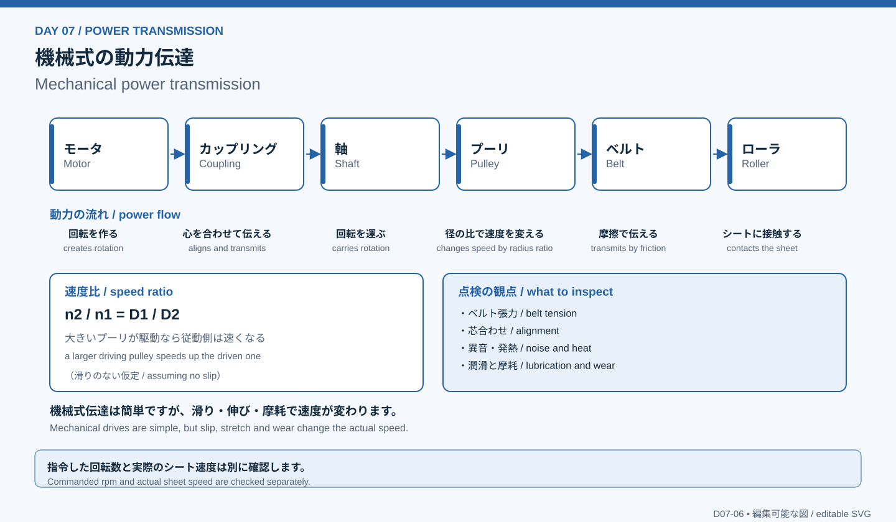
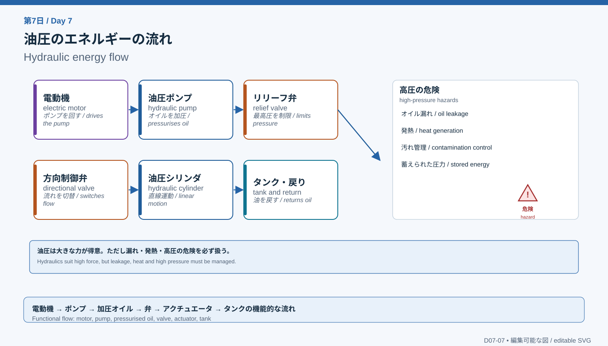
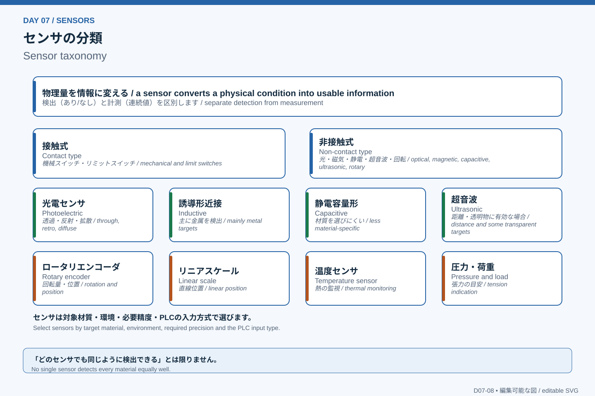

# 第7日 02 機械構成と空圧システム / Day 7-02 Mechanical Architecture and Pneumatics

> 所要時間 / Duration: **85分 / 85 minutes**
> 元資料 / Source pages: 12–14, 16
> 共通題材 / Running example: 小型ワーク押出し装置 / small workpiece-pushing machine

## 1. 概要 / Overview

このノートブックでは、押出し装置を「機械の全体像」として捉え、運動・案内・支持・固定・保護の5つの役割に分けます。そのうえで、空圧シリンダを動かすために必要な周辺機器を、機能的な空圧回路として理解します。

This notebook treats the pusher as a complete machine and divides it into five functions: move, guide, support, fix and protect. It then explains the peripheral equipment needed to move a pneumatic cylinder as a functional pneumatic circuit.

**重要な姿勢 / Essential attitude**

カタログを開く前に、「どんな動作を、どんな条件で行うか」を数字で決めます。移動距離、必要力、時間、精度、取付場所、安全上の制約が変わるだけで、候補は変わります。

Before opening a catalogue, define the motion and its conditions numerically. Changing the stroke, required force, time, accuracy, mounting space or safety constraint changes the candidate.

## 2. 学習目標 / Learning objectives

1. 機械を5つの機能（動かす・案内する・支える・固定する・保護する）に分けて説明できる。
2. 空圧シリンダと電動アクチュエータの向き・不向きを説明できる。
3. 空圧回路の主要機器と役割を説明できる。
4. 圧力・受圧面積・推力の関係を説明できる。
5. 複動シリンダの押し側と戻り側で推力が違う理由を説明できる。
6. 速度制御（メータイン・メータアウト）の違いを説明できる。
7. シリンダの位置検出方法を説明できる。
8. ガイドと側荷重の必要性を説明できる。
9. 停電・エア喪失・残圧の危険を説明できる。

By the end of this notebook you can:

1. Divide a machine into move, guide, support, fix and protect functions.
2. Explain when pneumatic and electric actuation fit.
3. Explain the main pneumatic components and their roles.
4. Explain the relation between pressure, effective area and force.
5. Explain why a double-acting cylinder produces different push and pull forces.
6. Explain meter-in versus meter-out speed control.
7. Explain how cylinder position can be detected.
8. Explain why guides are needed and what side load does.
9. Explain the hazards of power loss, air loss and stored pressure.

## 3. 前提知識 / Prerequisites

第7日01を終えていること。特に「要求仕様」と「タクトタイム」の用語を確認してください。圧力の単位は MPa（メガパスカル）を使います。1 MPa = 1,000,000 Pa です。空気の圧力は、大気圧を基準にした**ゲージ圧**で表示されるのが普通です。

Complete Day 7-01 first, especially the meaning of requirements and takt time. Pressure is expressed in MPa (1 MPa = 1,000,000 Pa). Compressed-air gauges normally show **gauge pressure**, relative to atmosphere.

### 実行環境 / executable environment

このノートのコードは、リポジトリ内の `day07_09_support/examples/automation_models.py` を使います。最初のセルを実行してから、後のセルを順に実行してください。インターネット接続は不要です。

The code uses `day07_09_support/examples/automation_models.py` in this repository. Run the first cell, then the following cells in order. No internet connection is required.

```python exec id="setup"
import sys, pathlib
import matplotlib.pyplot as plt

plt.rcParams["font.family"] = ["Meiryo", "Yu Gothic", "DejaVu Sans"]
plt.rcParams["axes.unicode_minus"] = False

def find_support(start):
    for base in [start, *start.parents]:
        if (base / "day07_09_support" / "examples" / "automation_models.py").is_file():
            return base / "day07_09_support"
    raise FileNotFoundError("Open this notebook inside the Training_Automation repository.")

SUPPORT = find_support(pathlib.Path.cwd())
sys.path.insert(0, str(SUPPORT / "examples"))
import automation_models as am
print("automation_models loaded from", SUPPORT.name)
print("No internet, hardware, PLC software or compressed air is used.")
```

**期待される出力 / Expected output**

```text
automation_models loaded from day07_09_support
No internet, hardware, PLC software or compressed air is used.
```

## 4. 機械の全体像 / Machine architecture

機械は、次の5つの機能に分けると理解しやすくなります。

A machine is easier to understand when divided into five functions.

| 役割 / Function | 使われる機器 / Devices | 先に決めること / Decide first |
|---|---|---|
| 動かす / move | シリンダ、モーター、電動アクチュエータ / cylinder, motor, electric actuator | 力、速度、距離、停止位置 / force, speed, distance, stop position |
| 案内する / guide | リニアガイド、ブッシュ、ベアリング / linear guide, bush, bearing | 荷重、モーメント、精度 / load, moment, accuracy |
| 支える / support | フレーム、ブラケット、ベース / frame, bracket, base | 剛性、設置寸法、振動 / stiffness, dimensions, vibration |
| 固定する / fix | ボルト、クランプ、位置決めピン / bolt, clamp, dowel | 外力、組立・分解、調整 / loads, assembly, adjustment |
| 保護する / protect | ストッパ、カバー、緩衝材 / stopper, cover, bumper | 挟まれ・衝撃・飛出し / pinch, impact, ejection |



*図 D07-06：色は役割を示します。機械（青系）、センサー・信号（緑系）、制御（紫系）、エネルギー（橙系）、危険（赤）を区別して見てください。 / Figure D07-06: colours show roles. Distinguish mechanical parts (blue), sensors and signals (green), control (purple), energy (orange) and hazards (red).*

**この図で確認すること / What to notice in this figure**

- シリンダは「動かす」役割。ワークを直接押すと、ロッドに横荷重がかかります。
- ガイドは「案内する」役割。押し板の向きと位置を保ち、ロッドを守ります。
- 位置センサーは「状態を測る」役割。指令を出したことと、動いたことを区別します。
- 電磁弁は「エネルギーを切り替える」役割。PLCの出力は、弁のコイルを動かす信号です。
- フレームは「支える」、カバーは「保護する」役割です。
- 危険源は、挟まれ（押し板とワーク）、飛出し、残圧、不意動作です。

- The cylinder moves the load. Pushing the workpiece directly puts a side load on the rod.
- The guide keeps the pusher plate aligned and protects the rod.
- Position sensors measure state. A command and a confirmed movement are different facts.
- The solenoid valve switches energy. The PLC output drives the valve coil; it does not supply the air power.
- The frame supports; the cover protects.
- Hazards include pinch between pusher and workpiece, ejection, stored pressure and unexpected motion.

## 5. 空圧と電動の使い分け / Pneumatic versus electric actuation

「直線に動かすからエアシリンダ」とすぐ決めないことが重要です。2点間の反復は空圧が候補になりますが、多点停止や細かい速度制御は電動が有力です。

Do not decide "it moves in a straight line, so use a cylinder". Pneumatics fit repeated two-position motion; electric actuation is stronger for multiple stop positions and fine motion profiles.

| 比較軸 / Criterion | 空圧シリンダ / pneumatic cylinder | 電動アクチュエータ / electric actuator |
|---|---|---|
| 移動位置 / positions | 一般的には端点中心 / mostly end positions | 多点位置決めが得意 / multiple positions |
| 制御 / control | 弁の切替が中心、回路は比較的単純 / valve switching, simpler circuit | ドライバ・位置指令が必要 / driver and position command |
| 推力・速度 / force and speed | 圧力・径・回路・負荷で決まる / pressure, bore, circuit, load | モーター・減速機・ねじ等に依存 / motor, reducer, screw |
| 保持 / holding | エア喪失時の挙動を要確認 / check behaviour on air loss | ブレーキの有無で変わる / depends on brake |
| 設備条件 / infrastructure | 清浄な圧縮空気と配管 / clean air and piping | 電源・ドライバ・配線 / power, driver, wiring |
| 保守 / maintenance | 漏れ、パッキン、配管、エア品質 / leaks, seals, piping, air quality | ねじ、ガイド、ベルト、ドライバ / screw, guide, belt, driver |
| 速度調整 / speed adjustment | 流量制御弁 / flow control valve | パラメータ設定 / parameter setting |
| 停止時の保持 / holding at stop | 弁・負荷・回路に依存 / valve, load and circuit | ブレーキ・サーボ保持に依存 / brake or servo hold |

**方式選定のコツ / Selection tip**

候補ごとに「できる / 条件付きでできる / 不向き」を判断します。重要な要求が1つでも満たせない方式は、単価が安くても採用しません。

For each candidate, judge "can do / can do with conditions / unsuitable". If an important requirement cannot be met, do not select the option even if it is cheaper.

## 6. 空圧システムの構成 / Pneumatic system components

コンプレッサがあるだけでは、シリンダを安全に動かせません。圧縮空気を整え、圧力と流量を管理し、進行方向を切り替え、必要なら位置を検出します。設備を構想するときは、駆動機器だけでなく「周辺機器一式」を部品表に入れます。

A compressor alone cannot move a cylinder safely. The air must be conditioned, pressure and flow managed, direction switched, and position detected where needed. Include the complete peripheral set in the bill of materials, not just the actuator.

| 機器 / Device | 役割・選定時の確認 / Role and checks |
|---|---|
| コンプレッサ / compressor | 供給圧力、流量、同時使用台数、エア品質 / supply pressure, flow, simultaneous use, air quality |
| フィルタ／レギュレータ / filter-regulator (FRL) | 異物・水分対策、供給圧の設定 / filtration, water removal, pressure setting |
| 圧力計 / pressure gauge | 実際の供給圧を確認 / verify actual supply pressure |
| 方向切替弁 / directional valve | 単動/複動、ポート数、電圧、無通電時の状態 / single/double acting, ports, voltage, de-energised state |
| 速度制御弁 / flow control valve | 供給絞り・排気絞り、負荷に応じた速度調整 / meter-in or meter-out |
| 継手・チューブ / fittings and tubing | 外径、圧力・温度、曲げ半径、抜け止め / diameter, rating, bend radius, retention |
| シリンダ / cylinder | 内径、ストローク、取付、速度、荷重方向 / bore, stroke, mounting, speed, load direction |
| 位置センサー / position sensor | 前進端・後退端の検出、取付位置、出力方式 / end detection, mounting, output type |
| 遮断・排気手段 / isolation and exhaust | 安全な隔離・残圧処理。危険性評価に基づき選定 / isolation, bleed, based on risk assessment |

### 6.1 機能的な空圧回路図 / Functional pneumatic schematic



*図 D07-07：空気源からシリンダまでの機能を示す概念図です。実際の配管・継手・弁型式・安全設計を確定するものではありません。 / Figure D07-07: a conceptual diagram of functions from air source to cylinder. It does not define actual piping, fittings, valve model or safety design.*

**この図で確認すること / What to notice**

- 空気は「発生 → 遮断 → 清浄・調圧 → 方向切替 → 速度制御 → シリンダ」の順に流れます。
- 遮断弁の下流に排気（ブリード）手段を置き、残圧を抜けるようにします。圧力計で零を確認できると、作業前に状態を確かめられます。
- 5ポート2位置の単一ソレノイド弁は、無通電でばね側に戻るタイプの例です。ただし、**無通電だから安全とは限りません**。負荷、弁の種類、配管、トラップされた空気によって動き方が変わります。
- 複動シリンダは2つのポートを持ち、押し側と戻り側で受圧面積が異なります。
- 速度制御は一般に排気絞り（メータアウト）が使われますが、負荷・回路・メーカー推奨で決めます。
- 位置検出はシリンダの磁気センサーなどで行います。センサーは「動いたこと」を確認するために使います。

- Air flows source → isolation → filtration/regulation → directional valve → flow control → cylinder.
- A bleed downstream of the isolation valve allows stored pressure to be released. A gauge helps verify zero pressure before work.
- A 5/2 single-solenoid valve with spring return is one example of a de-energised position. **De-energised does not automatically mean safe**: the load, valve type, piping and trapped air all affect motion.
- A double-acting cylinder has two ports and different effective areas on the push and pull sides.
- Meter-out flow control is common, but the load, circuit and manufacturer guidance decide.
- Position is often detected with magnetic switches on the cylinder; sensors confirm that motion occurred.

> **重要な安全境界 / Essential safety boundary**
> この回路図は教育用の概念図です。遮断・排気・ロックアウト、残留エネルギーの確認、ガード、インターロック、再起動防止、安全機能の検証は、リスクアセスメントに基づいて別に設計・承認・検証する必要があります。電磁弁のコイルを切っただけでは、シリンダが安全な状態になる保証はありません。
> This circuit is a training concept. Isolation, exhaust, lockout, stored-energy verification, guards, interlocks, restart prevention and safety-function validation must be designed, approved and verified separately from a risk assessment. De-energising a solenoid does not guarantee a safe cylinder state.

## 7. 圧力・受圧面積・推力 / Pressure, effective area and force

シリンダの理論推力は、圧力と受圧面積の積です。

The theoretical cylinder force is pressure multiplied by effective area.

```text
押し側 / push side : F_push = P × A_bore = P × π × D² / 4
戻り側 / pull side : F_pull = P × (A_bore − A_rod) = P × π × (D² − d²) / 4
```

- **P**: シリンダに実際にかかるゲージ圧 [Pa] / gauge pressure at the cylinder [Pa]
- **D**: シリンダ内径（ボア）[m] / cylinder bore [m]
- **d**: ロッド径 [m] / rod diameter [m]
- **F**: 理論推力 [N] / theoretical force [N]

**注意 / Caution**

- 配管・継手・速度制御弁・内部抵抗により、シリンダに実際にかかる圧力は供給圧より低くなることがあります。
- 理論推力は、加速・摩擦・背圧・偏荷重・衝撃を無視した値です。
- 実際の選定では、メーカーの負荷率・速度・許容モーメント・クッション条件を適用します。
- 押し側より戻り側の方が、ロッド断面積の分だけ推力が小さくなります。

- Piping, fittings, flow controls and internal resistance can make the pressure at the cylinder lower than the supply pressure.
- Theoretical force ignores acceleration, friction, back pressure, side load and impact.
- Real selection applies the manufacturer's load factor, speed limits, allowable moment and cushioning conditions.
- The pull side produces less force because the rod area is not pressurised.

```python exec id="pneumatic-force"
# 編集してよい値 / editable values
bore_mm = 20.0
rod_mm = 8.0
pressure_mpa = 0.4
stroke_mm = 100.0

print(f"bore = {bore_mm:.1f} mm, rod = {rod_mm:.1f} mm, pressure = {pressure_mpa:.2f} MPa")
print(f"{'bore [mm]':>10} {'push [N]':>10} {'pull [N]':>10} {'pull/push':>10}")
for candidate in (12, 16, 20, 25, 32, 40):
    push = am.cylinder_force_n(candidate, pressure_mpa)
    pull = am.cylinder_force_n(candidate, pressure_mpa, rod_mm)
    print(f"{candidate:>10} {push:>10.1f} {pull:>10.1f} {pull / push:>10.3f}")

push = am.cylinder_force_n(bore_mm, pressure_mpa)
pull = am.cylinder_force_n(bore_mm, pressure_mpa, rod_mm)
print(f"\nselected bore: push={push:.1f} N, pull={pull:.1f} N, difference={push - pull:.1f} N")
print("Theoretical values only. Catalogue load factors and pressure losses are not included.")
```

**期待される出力 / Expected output**（抜粋 / excerpt）

```text
bore = 20.0 mm, rod = 8.0 mm, pressure = 0.40 MPa
bore [mm]   push [N]   pull [N]  pull/push
        12       45.2       25.1      0.556
        16       80.4       60.3      0.750
        20      125.7      105.6      0.840
...
selected bore: push=125.7 N, pull=105.6 N, difference=20.1 N
```

```python exec id="air-use"
# 1サイクル当たりの空気消費量の概算 / rough air consumption per cycle
# 大気圧換算の体積です。配管・漏れ・バルブ消費は含みません。
bore_mm = 20.0
rod_mm = 8.0
stroke_mm = 100.0
pressure_mpa = 0.4
cycles_per_min = 4.0

bore_area_mm2 = 3.141592653589793 * bore_mm**2 / 4
rod_area_mm2 = 3.141592653589793 * rod_mm**2 / 4
push_volume_mm3 = bore_area_mm2 * stroke_mm
pull_volume_mm3 = (bore_area_mm2 - rod_area_mm2) * stroke_mm
# 絶対圧 / absolute pressure ratio: (gauge + atmosphere) / atmosphere
ratio = (pressure_mpa * 1e6 + 101325) / 101325
free_air_litre_per_cycle = (push_volume_mm3 + pull_volume_mm3) / 1e6 * ratio
print(f"push volume       : {push_volume_mm3 / 1000:.2f} cm3")
print(f"pull volume       : {pull_volume_mm3 / 1000:.2f} cm3")
print(f"absolute ratio    : {ratio:.3f}")
print(f"free air per cycle: {free_air_litre_per_cycle:.3f} L/cycle (atmosphere)")
print(f"free air per minute: {free_air_litre_per_cycle * cycles_per_min:.2f} L/min")
print("Excludes leakage, tubing volume, valve consumption and duty cycle.")
```

**期待される出力 / Expected output**（抜粋 / excerpt）

```text
push volume       : 31.42 cm3
pull volume       : 26.39 cm3
absolute ratio    : 4.948
free air per cycle: 0.286 L/cycle (atmosphere)
free air per minute: 1.14 L/min
```

## 8. 速度制御と空気準備 / Flow control and air preparation

**メータイン / meter-in** はシリンダへ入る空気を絞ります。**メータアウト / meter-out** はシリンダから出る空気を絞ります。一般に複動シリンダではメータアウトが安定と言われますが、負荷・速度・弁・メーカー推奨によって異なります。急停止や飛出しが起きないか、実機で確認が必要です。

**Meter-in** throttles air entering the cylinder; **meter-out** throttles air leaving it. Meter-out is often more stable for double-acting cylinders, but the load, speed, valve and manufacturer guidance decide. Real behaviour must be checked for abrupt stopping or ejection.

**空気準備 / air preparation** では、フィルタで異物・水分を除き、レギュレータで必要な圧力に調整し、必要ならドレン排出を行います。潤滑の要否は機器の指定に従います。エア品質が悪いと、弁の固着、シール劣化、センサー誤動作の原因になります。

**Air preparation** removes particles and water with a filter, regulates pressure and provides drain removal. Lubrication follows the device specification. Poor air quality causes valve sticking, seal degradation and sensor malfunction.

## 9. 位置検出 / Position detection

シリンダが「前進した」ことを確認するには、位置センサーが必要です。代表例は、シリンダの磁石を検出する磁気センサー（オートスイッチ）です。外部に取り付ける近接センサーやリミットスイッチを使う場合もあります。

A position sensor is needed to confirm that the cylinder has extended. A common example is a magnetic switch (auto switch) that detects the piston magnet. External proximity sensors or limit switches are also used.

- センサーは「指令を出したこと」ではなく「実際に到達したこと」を確認します。
- 取付位置は、ストローク端で確実にONになる位置に調整します。
- センサーの応答時間とPLC入力のフィルタを確認します。
- 前進端と後退端の両方を検出すると、両方ONという矛盾を検出できます。
- センサーが無い場合、タイマーだけでは実際の到達を保証できません。

- A sensor confirms arrival, not that a command was issued.
- Adjust the sensor so it turns ON reliably at the stroke end.
- Check sensor response time and the PLC input filter.
- Detecting both ends allows a both-ON contradiction to be detected.
- Without sensors, a timer cannot prove that the cylinder arrived.

## 10. ガイド・偏荷重・取付 / Guides, side loads and mounting

ワークの質量や重心がシリンダ中心からずれると、曲げモーメントと横荷重が発生します。シリンダロッドは「直線に力を出す部品」であり、横荷重を受ける部品ではありません。ワークの重量と回転は、ガイド側に負担させます。

If the mass or centre of gravity is offset from the cylinder axis, a bending moment and side load appear. The rod produces axial force; it is not a load-bearing guide. Let the guide carry the weight and moment.



*図 D07-08：押し板が長い、重心が高い、ワークが回転する、といった条件ではロッドに曲げがかかります。ガイド、ブラケット、ストッパの設計で受けます。 / Figure D07-08: a long pusher plate, a high centre of gravity or a rotating workpiece bends the rod. Carry it with the guide, bracket and stopper design.*

| 要素 / Element | 選定で見る項目 / What to check | ありがちな失敗 / Common failure |
|---|---|---|
| リニアガイド / linear guide | 荷重・モーメント・ストローク・取付精度 / load, moment, stroke, mounting accuracy | 摩耗・引っかかり・片当たり / wear, sticking, edge loading |
| ガイド付きシリンダ / guided cylinder | テーブル荷重、許容モーメント、速度 / table load, allowable moment, speed | アームを長く出して負荷超過 / overloading with a long arm |
| ブラケット / bracket | 板厚・曲げ・ねじ位置・組立性 / thickness, bending, threads, assembly | たわみでセンサー位置がずれる / deflection moves the sensor |
| 機械ストッパ / mechanical stopper | 衝突速度・緩衝・再現性 / impact speed, cushioning, repeatability | 端部で衝撃が増える / impact at the end |
| フレーム / frame | 剛性・足元固定・メンテ空間 / stiffness, fixing, maintenance access | 振動・段取りのしにくさ / vibration, difficult changeover |

**選定の順番 / Selection order**

重心と荷重方向を確認 → テーブルとガイドの候補決定 → 許容荷重・モーメント確認 → 寿命・精度・取付精度確認 → シリンダ駆動との整合を確認します。ねじ穴位置だけでなく、手が入る場所、センサー調整余地、ワーク交換の導線も設計に含めます。

Check the centre of gravity and load direction → choose table and guide candidates → verify allowable load and moment → verify life, accuracy and mounting → check compatibility with the cylinder drive. Include hand access, sensor adjustment room and workpiece exchange path, not just hole positions.

## 11. 残留エネルギーと予期しない動き / Stored energy and unexpected movement

**側荷重のモーメントを計算する / calculate the side-load moment**

ワークの重心がずれると、横荷重 F と距離 L によるモーメント M = F × L が発生します。下のセルで、ずれ量を変えたときのモーメントを比較してください。

If the centre of gravity is offset, a side load F at a distance L produces a moment M = F × L. Compare different offsets in the cell below.

```python exec id="side-load-moment"
# 編集してよい値 / editable values
side_force_n = 20.0      # 横荷重の仮定 / assumed side force [N]
offsets_mm = [20, 50, 100, 150, 200]

if side_force_n <= 0:
    raise ValueError("side_force_n must be > 0")
print(f"side force = {side_force_n:.1f} N")
print(f"{'offset [mm]':>12} {'moment [N·m]':>14}")
for offset_mm in offsets_mm:
    if offset_mm <= 0:
        raise ValueError("offset must be > 0")
    moment = side_force_n * offset_mm / 1000
    print(f"{offset_mm:>12} {moment:>14.2f}")
print("\nThe guide, not the cylinder rod, must carry this moment.")
print("Values are assumptions for teaching; verify the real centre of gravity and load.")
```

**期待される出力 / Expected output**

```text
side force = 20.0 N
offset [mm]   moment [N·m]
          20           0.40
          50           1.00
         100           2.00
         150           3.00
         200           4.00

The guide, not the cylinder rod, must carry this moment.
Values are assumptions for teaching; verify the real centre of gravity and load.
```

**エネルギー喪失時の挙動 / loss-of-energy behaviour**

空圧・ばね・重力・慣性・残圧は、電源やエアを切った後も残ります。次の問いを、機器を選ぶ前に立てます。

Compressed air, springs, gravity, inertia and residual pressure remain after power or air is removed. Ask these questions before selecting components.

| 問い / Question | なぜ重要か / Why it matters |
|---|---|
| 電源を切った瞬間、弁はどの位置になるか / where does the valve go on power loss? | シリンダが動く方向を決める / determines the direction of motion |
| エアを切った瞬間、シリンダは動くか / does the cylinder move on air loss? | 重力・負荷・トラップ空気で動く可能性 / gravity, load and trapped air |
| 残圧はどこで抜くか / where is residual pressure released? | 保全前に零を確認するため / verify zero before maintenance |
| 可動部はどこまで動くか / how far can the moving part travel? | 挟まれ・飛出しの範囲 / pinch and ejection range |
| 再通電・再給気で動くか / does it move on restore? | 不意起動の防止 / unexpected restart |
| 人が接近できるか / can a person reach it? | ガード・インターロックの要否 / guard and interlock need |

> 電磁弁の無通電位置は、機種によって異なります。単一ソレノイド・ばね戻り、ダブルソレノイド、中央閉止などで挙動が変わります。「無通電＝安全」と決めつけず、実機の弁型式と機械的負荷を確認してください。
> The de-energised position depends on the valve: single solenoid with spring return, double solenoid, closed-centre, etc. Do not assume "de-energised = safe". Check the actual valve type and the mechanical load.

## 12. 演習 / Exercises

### 演習 A：部品を5分類する / Exercise A: classify the components

押出し装置の構成部品を、動かす・案内する・支える・固定する・保護するの5つに分類し、それぞれ役割を1行で書いてください。

Classify the pusher components into move, guide, support, fix and protect. Write one line on each role.

### 演習 B：押し側と戻り側の推力を計算する / Exercise B: push and pull force

内径20 mm、ロッド径8 mm、圧力0.4 MPaの複動シリンダについて、押し側と戻り側の理論推力を計算してください。差が生じる理由も説明してください。

For a 20 mm bore, 8 mm rod, 0.4 MPa double-acting cylinder, calculate the theoretical push and pull forces and explain why they differ.

### 演習 C：空圧回路を説明する / Exercise C: explain the circuit

D07-07を見ながら、次の問いに答えてください。

Using D07-07, answer the following.

1. 空気源からシリンダまで、どの順に機器が並ぶか。
2. 遮断弁の下流に排気手段が必要な理由。
3. 単一ソレノイド弁の無通電時に、シリンダが必ず止まるとは言えない理由。
4. 位置センサーが無い場合、何が確認できないか。

1. What is the component order from the air source to the cylinder?
2. Why is a bleed needed downstream of the isolation valve?
3. Why can we not say that a single-solenoid valve always stops the cylinder when de-energised?
4. What cannot be confirmed without position sensors?

### 演習 D：側荷重を減らす / Exercise D: reduce side load

シリンダ先端に長い金属板を直接固定して押し出す構成の問題点を3つ挙げ、ガイド、取付、センサーの改善案をスケッチしてください。

List three problems with a long metal plate fixed directly to the cylinder rod. Sketch improvements to the guide, mounting and sensors.

### 演習 E：エネルギー喪失時の挙動表 / Exercise E: loss-of-energy behaviour table

次の表を埋めてください。「不明」と書くことは悪いことではありません。不明を残すことが、実機確認項目になります。

Complete the table. Writing "unknown" is acceptable; an unknown becomes a verification item for the real machine.

| 条件 / Condition | 弁の状態 / valve state | シリンダの動き / cylinder motion | 確認方法 / how to verify |
|---|---|---|---|
| 停電 / power loss | | | |
| エア供給停止 / air loss | | | |
| 非常停止 / emergency stop | | | |
| 保全前の遮断 / isolation for maintenance | | | |

**提出物 / Deliverables**

1. 5分類した機械構成図 / annotated architecture with five functions
2. 空圧部品表（役割・数量・未確認事項）/ pneumatic BOM with roles, quantities and unknowns
3. 押し側・戻り側の推力計算 / push and pull force calculation
4. エネルギー喪失時の挙動表 / loss-of-energy behaviour table
5. 側荷重の改善スケッチ / side-load improvement sketch

## 13. 期待される結果 / Expected result

- 機械の5機能を、押出し装置の部品に対応づけられる。
- 空圧回路を、空気源からシリンダまで順に説明できる。
- 押し側と戻り側の推力差を、ロッド断面積で説明できる。
- 「無通電＝安全」ではないと説明できる。
- ガイドと側荷重の関係を説明できる。
- 位置センサーが「指令」ではなく「到達」を確認することを説明できる。

- You can map the five machine functions onto the pusher components.
- You can explain the pneumatic circuit in order from source to cylinder.
- You can explain the push/pull force difference using the rod area.
- You can explain that "de-energised" does not mean "safe".
- You can explain the relation between the guide and side load.
- You can explain that a position sensor confirms arrival, not a command.

## 14. トラブルシューティング / Troubleshooting

| 症状 / Symptom | 確認すること / Check | よくある原因 / Typical cause |
|---|---|---|
| シリンダが動かない / cylinder does not move | 供給圧、遮断弁、弁の電源、配管 / pressure, isolation valve, valve supply, tubing | 遮断弁閉、配線、圧力不足 / isolation closed, wiring, low pressure |
| 速度が不安定 / unstable speed | 速度制御の方式、負荷、エア品質 / flow-control mode, load, air quality | メータインの不安定、ドレン / meter-in instability, water |
| 端で衝撃が大きい / hard impact at the end | クッション、ストッパ、速度 / cushion, stopper, speed | 速度過大、ストッパ剛性不足 / too fast, weak stopper |
| 位置センサーがONにならない / sensor does not turn ON | 取付位置、磁石の有無、配線 / position, magnet, wiring | 調整不足、非対応シリンダ / misadjustment, incompatible cylinder |
| 停止後に勝手に動く / unexpected motion after stop | 弁の無通電位置、残圧、負荷 / valve state, residual pressure, load | 「無通電＝安全」の誤解 / assuming de-energised is safe |

## 15. まとめ / Summary

- 機械は、動かす・案内する・支える・固定する・保護するの5機能で捉える。
- 空圧は2点間反復、電動は多点・細かい制御に向く。要求で決める。
- 空圧回路は、空気源・遮断・空気準備・方向切替・速度制御・シリンダ・位置検出で構成する。
- 推力は圧力×受圧面積。戻り側はロッド断面積の分だけ小さい。
- 速度制御はメータインとメータアウトで挙動が違う。メーカー推奨と実機確認が必要。
- ガイドは側荷重とモーメントを受け、ロッドを守る。
- 停電・エア喪失・残圧・再起動は、別に設計・確認する。無通電は安全を意味しない。

- A machine has five functions: move, guide, support, fix and protect.
- Pneumatics fit repeated two-position motion; electric actuation fits multiple positions and fine control. Requirements decide.
- A pneumatic circuit comprises source, isolation, air preparation, directional valve, flow control, cylinder and position detection.
- Force is pressure × effective area; the pull side is smaller by the rod area.
- Meter-in and meter-out behave differently; follow manufacturer guidance and verify on the machine.
- Guides carry side load and moment and protect the rod.
- Power loss, air loss, residual pressure and restart must be designed and verified separately. De-energised does not mean safe.

## 16. 完了チェックリスト / Completion checklist

- [ ] 機械の5機能を押出し装置に対応づけた / mapped the five functions to the pusher
- [ ] 空圧と電動の比較表を作った / completed the pneumatic/electric comparison
- [ ] 空圧回路の機器の順序を説明した / explained the circuit order
- [ ] 押し側・戻り側の推力を計算した / calculated push and pull forces
- [ ] メータインとメータアウトの違いを説明した / explained meter-in and meter-out
- [ ] 位置センサーの役割を説明した / explained the role of position sensors
- [ ] ガイドと側荷重の関係を説明した / explained guide and side load
- [ ] エネルギー喪失時の挙動表を埋めた（不明を含む）/ completed the loss-of-energy table, including unknowns
- [ ] 「無通電＝安全」ではないと説明できる / can explain that de-energised is not safe
