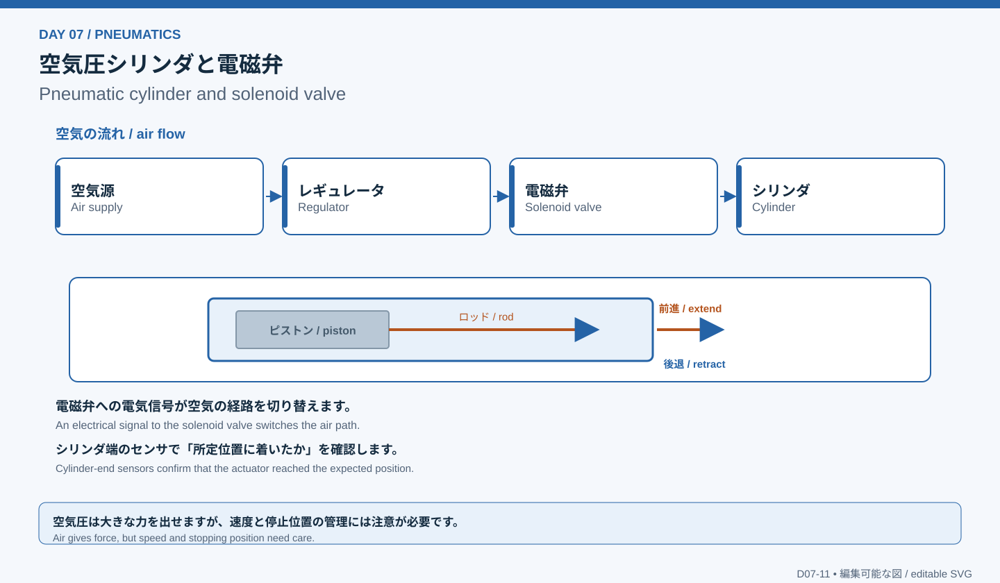
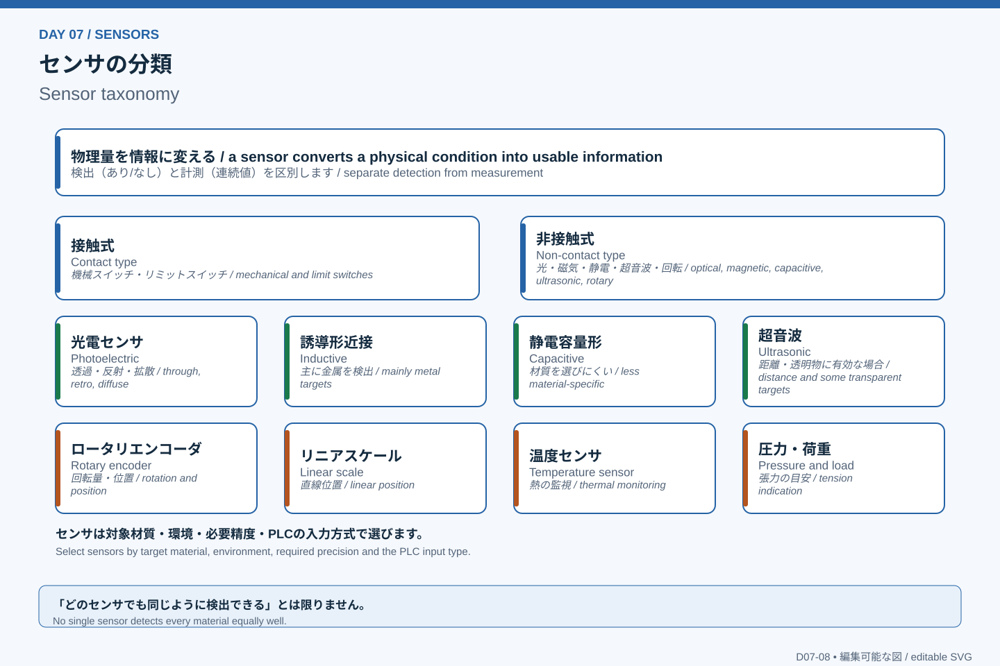
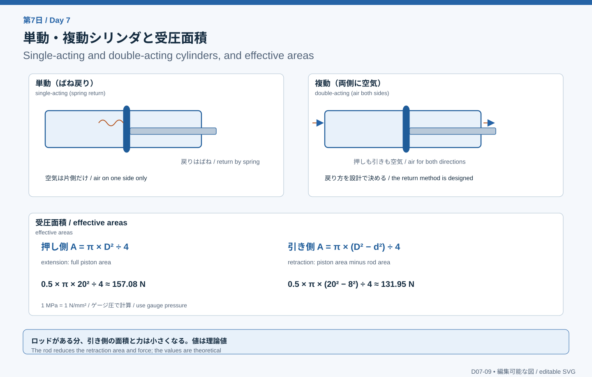
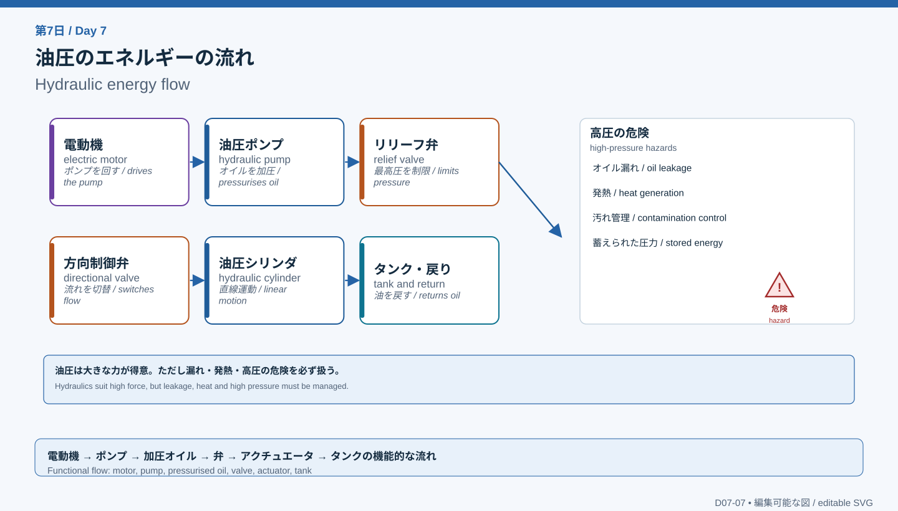
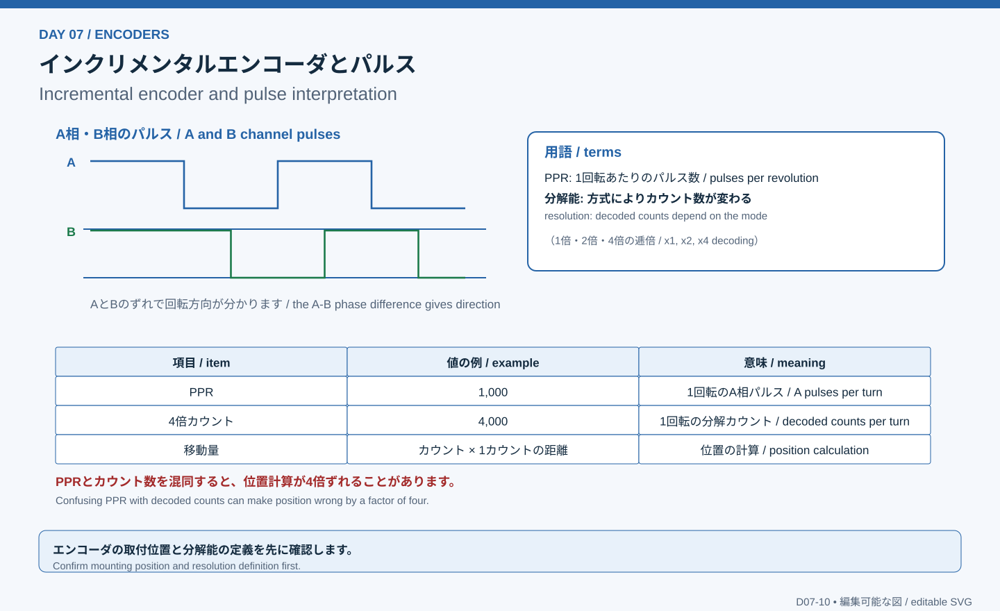
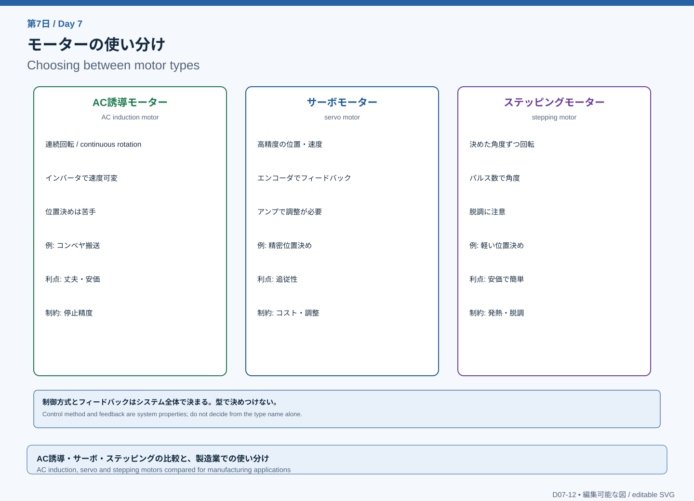
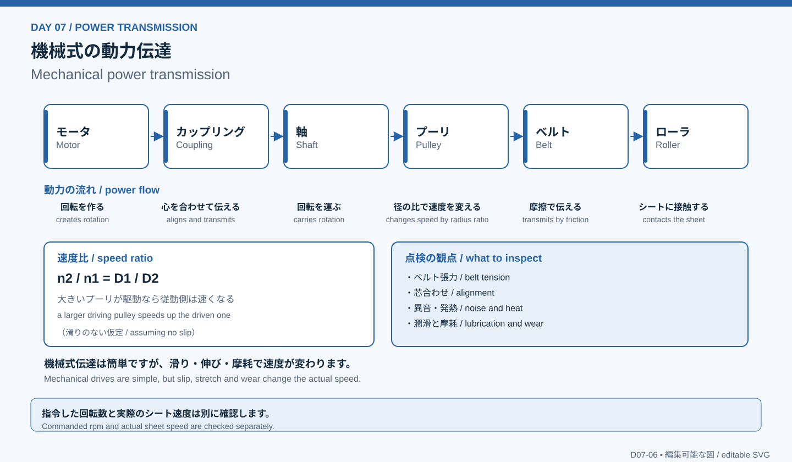

# 第7日 02 動力の種類とアクチュエータの使い道 / Day 7-02 Power Sources and Actuator Applications

> 所要時間 / Duration: **85分 / 85 minutes**
> 元PDF / Source pages: 12-14, 16
> 共通例 / Running example: 小さな製品を押し出す装置 / a small product-pushing machine

## 1. 概要 / Overview

設備は「動力」と「アクチュエータ」で動きます。このノートブックでは、空圧・油圧・電気の3つの動力と、シリンダ・モーター・グリッパなどのアクチュエータを、**どこで使うと向いているか**という視点で学びます。実行するプログラムはありません。

Machines move because of a **power source** and an **actuator**. This notebook looks at pneumatic, hydraulic and electrical power, and at cylinders, motors, grippers and other actuators from the viewpoint of **where each one fits**. There is no code to execute.

**安全に関する前提 / Safety boundary.** 圧縮空気・油圧・電気はいずれも危険を伴います。本資料は机上の学習用で、実機の配管・配線・通電・加圧・動作確認を指示するものではありません。残留圧力・残留油圧・残留電荷・重力による落下は、電源を切っても残ります。実機作業は、リスクアセスメント、隔離、残留エネルギー確認、有資格者の監督のもとで行います。 / Compressed air, oil pressure and electricity are all hazardous. This is desk study; it does not authorise real piping, wiring, energisation, pressurisation or motion checks. Residual air, oil pressure, stored charge and gravity can remain after isolation. Real work follows a risk assessment, isolation, stored-energy verification and qualified supervision.

## 2. 学習目標 / Learning objectives

1. アクチュエータの定義を説明できる。
2. 直線運動・回転運動・把持・クランプ・昇降・押出し・位置決め・搬送の違いを説明できる。
3. 空圧の構成機器と役割を説明できる。
4. 油圧の構成機器と役割を説明できる。
5. 電動アクチュエータの種類と使い分けを説明できる。
6. 3つの動力の特徴を、長所・短所の両面で比較できる。
7. 「動力」と「アクチュエータ」は別の概念だと説明できる。
8. 用途に合わない選び方を指摘できる。

By the end of this notebook you can explain the definition of an actuator; distinguish linear, rotary, gripping, clamping, lifting, pushing, positioning and transporting motion; describe pneumatic and hydraulic components; distinguish electric actuator types; compare the three power sources including their limitations; explain that power source and actuator are different concepts; and point out unsuitable choices.

## 3. 前提 / Prerequisites

07-01 を終えていること。力（N）、圧力（MPa）、質量（kg）の区別が必要です。 / Complete 07-01 first. You need to distinguish force (N), pressure (MPa) and mass (kg).

## 4. アクチュエータとは / what an actuator is

アクチュエータは、**供給されたエネルギーを機械的な動きに変える部品**です。次のような動きがあります。

| 動き / Motion | 内容 / Meaning | 例 / Example |
|---|---|---|
| 直線運動 / linear | まっすぐ往復する / straight reciprocating | シリンダ、電動リニア / cylinder, electric linear |
| 回転運動 / rotary | 回り続ける、または回転角度を決める / continuous or indexed rotation | モーター、ロータリアクチュエータ |
| 把持 / gripping | 物をつかむ / grasp an object | エアグリッパ、電動グリッパ |
| クランプ / clamping | 加工中に固定する / hold during work | クランプシリンダ |
| 昇降 / lifting | 上下に動かす / move up and down | リフトシリンダ、リフト |
| 押出し / pushing | 押して移動させる / push to move | 押出しシリンダ |
| 位置決め / positioning | 決めた位置に止める / stop at a defined position | サーボ、電動アクチュエータ |
| 搬送 / transporting | 連続的に運ぶ / carry continuously | コンベヤ用ギヤードモータ |

**動力とアクチュエータは別の概念です。**「エアシリンダ」は圧縮空気で動くアクチュエータ、「モーター」は電気で動くアクチュエータです。動力（何のエネルギーか）と、アクチュエータ（どう動くか）を分けて考えます。

**A power source and an actuator are different concepts.** A pneumatic cylinder is an actuator driven by compressed air; a motor is an actuator driven by electricity. Keep "which energy" and "which motion" separate.

*図 D07-11：直線・回転・把持・真空の使い分け。 / Figure D07-11: choosing between linear, rotary, gripping and vacuum handling.*

## 5. 空圧 / pneumatic power

空圧は、圧縮した空気の力を使います。機能の流れは次のとおりです。

**コンプレッサ → 空気の準備（フィルタ・レギュレータ） → 方向制御弁（電磁弁） → 流量制御 → シリンダ**

*図 D07-08：コンプレッサからシリンダまでの空圧の流れと各機器の役割。 / Figure D07-08: pneumatic energy flow from compressor to cylinder, with the role of each component.*

| 機器 / Component | 役割 / Role |
|---|---|
| コンプレッサ / compressor | 空気を圧縮して供給する / compresses air and supplies it |
| エアフィルタ / air filter | 水分・ごみを除く / removes water and dirt |
| レギュレータ / regulator | 圧力を設定値に調整する / sets the working pressure |
| 圧力計 / pressure gauge | 圧力を表示する / shows the pressure |
| 電磁弁（方向制御弁）/ solenoid valve | 空気の流れの向きを切り替える / switches the direction of flow |
| 流量制御弁 / flow control valve | 速度を調整する / adjusts speed |
| チューブ・継手 / tubing and fittings | 空気を導く / carries the air |
| シリンダ / cylinder | 空気の力で直線運動を作る / turns air pressure into linear motion |
| シリンダ用位置センサー / cylinder position sensor | ストローク端を検出する / detects the end positions |

**単動と複動 / single-acting and double-acting.** 単動シリンダは片側だけに空気を送り、戻りはばねなどで行います。複動シリンダは両側に空気を送り、押しも引きも空気で行います。戻り方を間違えると、電源を切ったときの動きが逆になります。

A single-acting cylinder is powered in one direction and returns by a spring or similar; a double-acting cylinder is powered in both directions. Getting the return method wrong changes what happens when the air is removed.

*図 D07-09：単動（ばね戻り）と複動の違い、押し側と引き側の受圧面積。 / Figure D07-09: single-acting (spring return) versus double-acting, and the effective areas on the extension and retraction sides.*

**空圧が向く用途 / where pneumatics fit.** 単純な押出し、製品の排除、クランプ、ストッパ、2位置の往復、軽い物の繰り返しハンドリング。構造が比較的簡単で、速い往復を作りやすい方式です。

Simple pushing, product rejection, clamping, stopper operation, two-position movement and light repetitive handling. Pneumatic arrangements are comparatively simple and suit fast reciprocation.

**空圧の制約 / pneumatic limitations.**

- 空気は圧縮できるので、負荷が変わると速度が変わりやすい。
- 通常の空圧回路では、中間の任意位置に精度よく止めるのは苦手。
- 漏れがあるとエネルギーを消費し続ける。
- 圧力と流量に上限がある。
- 残留圧力で、電源を切っても動くことがある。

Air is compressible, so speed changes with load; precise intermediate positioning is difficult with ordinary pneumatic arrangements; leaks waste energy continuously; pressure and flow are limited; residual pressure can still move the machine after the supply is removed.

**用語の訂正 / terminology correction.** 「フィルタレギュレータ」は、フィルタとレギュレータの複合機です。フィルタ・レギュレータ・ルブリケータをまとめた「FRLユニット」とは別のものです。潤滑は、機器が要求する場合にだけ行います。潤滑を常に入れればよい、という説明は誤りです。

A "filter regulator" combines a filter and a regulator. It is not the same as an FRL unit (filter, regulator and lubricator). Lubrication is used only where the selected equipment requires it; "always lubricate" is wrong.

## 6. 油圧 / hydraulic power

油圧は、オイルを加圧して力と動きを作ります。機能の流れは次のとおりです。

**電動機 → 油圧ポンプ → 加圧されたオイル → 弁 → 油圧アクチュエータ → 戻り回路・タンク**

*図 D07-07：電動機・ポンプ・リリーフ弁・方向制御弁・油圧シリンダ・タンクの関係。 / Figure D07-07: motor, pump, relief valve, directional valve, hydraulic cylinder and tank.*

| 機器 / Component | 役割 / Role |
|---|---|
| 油圧ポンプ / hydraulic pump | オイルを加圧する / pressurises the oil |
| 作動油タンク / oil reservoir | オイルをため、熱を逃がす / stores oil and dissipates heat |
| リリーフ弁 / pressure relief valve | 最高圧力を制限する / limits the maximum pressure |
| 方向制御弁 / directional control valve | 流れの向きを切り替える / switches flow direction |
| 油圧シリンダ / hydraulic cylinder | 直線運動を作る / produces linear motion |
| 油圧モーター / hydraulic motor | 回転運動を作る / produces rotary motion |
| ホース・配管 / hoses and piping | 高圧のオイルを導く / carries high-pressure oil |

**油圧が向く用途 / where hydraulics fit.** 大きな力を必要とする用途です。プレス機、重量物の昇降、成形機、重負荷のクランプなどが代表例です。

Applications needing large force: presses, heavy lifting equipment, forming machinery and heavy-duty clamping.

**油圧の制約 / hydraulic limitations.** オイル漏れ、保守、発熱、コンタミ（汚れ）管理、蓄えられたエネルギー、高圧の危険。高圧配管の分解は特に危険です。

Oil leakage, maintenance, heat generation, contamination control, stored energy and high-pressure hazards. Breaking a high-pressure connection is especially dangerous.

**注意 / caution.** 油圧シリンダが「いつも速い」「いつも強い」「いつも効率がよい」わけではありません。性能はシステム全体の設計で決まります。 / Hydraulic cylinders are not automatically faster, stronger or more efficient. Performance depends on the design of the whole system.

## 7. 電気 / electrical power

電気は、**電源 → ドライバ・制御装置 → モーター → 機械的な伝達・運動**の流れで使います。

*図 D07-10：電気の供給からドライバ、モーター、伝達機構までの流れ。 / Figure D07-10: electrical supply, driver, motor and transmission.*

| 種類 / Type | 外観 / Appearance | 働き / Function | 制御の考え方 / Control | 用途 / Applications | 利点 / Advantages | 制約 / Limitations |
|---|---|---|---|---|---|---|
| AC誘導モーター / AC induction motor | 丸い胴のモーター / round-frame motor | 連続回転 / continuous rotation | 電源投入、インバータで速度可変 / direct or inverter drive | コンベヤ、ポンプ / conveyors, pumps | 丈夫で安価 / robust and inexpensive | 位置決めは苦手 / poor positioning |
| DCモーター / DC motor | 小型のモーター / small motor | 回転 / rotation | 電圧・PWM / voltage or PWM | 小型機器 / small equipment | 制御が簡単 / simple control | ブラシ劣化など / brush wear |
| ギヤードモーター / geared motor | モーター＋減速機 / motor with gearbox | 低速・高トルク / low speed, high torque | 電源またはインバータ / supply or inverter | 搬送ローラー / transport rollers | 速度とトルクの調整 / speed and torque match | ギヤ効率・寿命 / gear efficiency and life |
| ステッピングモーター / stepping motor | 角型のモーター / square motor | 決めた角度ずつ回転 / indexed rotation | パルス数で角度、周波数で速度 / pulses set angle, frequency sets speed | 軽い位置決め / light positioning | 安価で扱いやすい / inexpensive and simple | 脱調、発熱 / step loss, heat |
| サーボモーター / servo motor | エンコーダ付きモーター / motor with encoder | 高精度の位置・速度制御 / precise position and speed | サーボアンプでフィードバック制御 / closed-loop servo amplifier | 精密位置決め / precise positioning | 追従性・精度 / accuracy and response | 調整とコスト / tuning and cost |
| 電動リニアアクチュエータ / electric linear actuator | ロッド式の直線装置 / rod-style unit | 直線運動 / linear motion | ドライバで位置・速度 / driver sets position and speed | 中間位置で止める / stopping at intermediate positions | ストロークと位置を設定しやすい / adjustable stroke and position | 推力・速度に上限 / force and speed limits |
| ボールねじ機構 / ball-screw mechanism | ねじ軸とナット / screw and nut | 回転を直線に変える / rotation to linear | モーターで回す / driven by a motor | 精密ステージ / precision stages | 高効率・高精度 / efficient and accurate | 長ストロークでたわみ / deflection over long strokes |
| ベルト駆動リニア軸 / belt-driven linear axis | ベルトとレール / belt and rail | 長い距離の直線搬送 / long-stroke transport | モーターで駆動 / motor driven | 長い搬送軸 / long axes | 長ストローク・安価 / long stroke, low cost | 伸び・精度 / belt stretch, accuracy |

**制御とフィードバックは、モーター単体ではなくシステム全体で決まります。** ステッピングモーターでもエンコーダ付きの構成はありますし、サーボが常に適しているとも限りません。用途、精度、速度、コストで選びます。

Control and feedback capability depend on the whole motor-drive system. Stepping systems can have encoders, and a servo is not always the right answer. Choose by application, accuracy, speed and cost.

**製造業での例 / manufacturing examples.**

- コンベヤの搬送：ACギヤードモーター。
- 精密な位置決め：サーボモーター。
- 軽い位置決め：ステッピングモーター。
- ストロークと中間位置を変えたい：電動リニアアクチュエータ。
- 材料を連続搬送するローラー：ローラー駆動用モーター。

*図 D07-12：AC誘導・サーボ・ステッピングの比較と、製造業での使い分け。 / Figure D07-12: AC induction, servo and stepping motors, with manufacturing applications.*

## 8. その他のアクチュエータとハンドリング / other actuators and handling

| 種類 / Type | 役割 / Role | 例 / Example |
|---|---|---|
| ロータリアクチュエータ / rotary actuator | 一定角度だけ回す / rotate through a set angle | 90度反転 / 90-degree turnover |
| ソレノイド / solenoid | 電磁力で短い直線動作 / short linear stroke by electromagnetism | 小型の押出し / small pusher |
| エアグリッパ / pneumatic gripper | 空気で把持 / grasp with air | 部品のつかみ / part handling |
| 電動グリッパ / electric gripper | 電動で把持、把持力を調整 / grasp with adjustable force | 繊細な部品 / delicate parts |
| 真空吸着 / vacuum suction | 圧力差で吸着 / hold by pressure difference | シートの吸着 / sheet pick-up |
| 直動機構 / linear motion mechanism | 回転を直線に変える / convert rotation to linear | ボールねじ、ベルト / ball screw, belt |

**真空吸着の考え方 / how vacuum holding works.** 真空源が圧力差を作り、適切な吸着パッドを通して保持力が生まれます。保持力は、パッド面積、圧力差、表面状態、ワークの重さ、加速度で変わります。ざらつき、通気性、反り、油分、シートの薄さは保持性能に影響します。**すべての表面に真空が向くわけではありません。**

The vacuum source creates a pressure difference, and a suitable suction cup converts it into holding force. Holding force depends on cup area, pressure difference, surface condition, weight and acceleration. Roughness, porosity, warping, oil and thin sheets all change performance. **Vacuum is not suitable for every surface.**

## 9. 動力の比較 / comparing the power sources

*図 D07-06：空圧・油圧・電気の比較（典型的な特徴であり、絶対的な順位ではありません）。 / Figure D07-06: pneumatic, hydraulic and electrical power compared. These are typical characteristics, not absolute rankings.*

| 観点 / Aspect | 空圧 / pneumatic | 油圧 / hydraulic | 電気 / electric |
|---|---|---|---|
| エネルギー源 / energy source | 圧縮空気 / compressed air | 加圧オイル / pressurised oil | 電力 / electricity |
| 典型的な用途 / typical use | 押出し、クランプ、2位置 / push, clamp, two positions | 大きな力、プレス、昇降 / high force, press, lifting | 搬送、位置決め、回転 / transport, positioning, rotation |
| 力の特性 / force characteristics | 圧力×面積、軽〜中負荷 / pressure × area, light to medium | 高い力を出しやすい / high force is practical | 減速機でトルクを増やす / torque via a reducer |
| 速度制御 / speed control | 流量制御弁で調整、負荷で変化 / flow control, load-dependent | 流量制御で調整 / flow control | ドライバで精密に制御 / precise via driver |
| 位置決め / positioning | 2位置が基本、中間は苦手 / two positions, weak at intermediate | 中間は難しい / intermediate is difficult | 得意（特にサーボ）/ strong, especially servo |
| 保守 / maintenance | ドレン・漏れ管理 / drain and leak management | 油管理・漏れ・交換 / oil, leaks, replacement | 比較的少ないが電気安全 / relatively low, but electrical safety |
| 清潔さ / cleanliness | 排気・潤滑に注意 / exhaust and lubrication | 油漏れのリスク / oil leak risk | 油汚れは少ない / little oil contamination |
| エネルギー消費 / energy consumption | 漏れがあると消費し続ける / leaks waste energy | 絞り損失・発熱 / throttling loss and heat | 保持に電力を要する場合 / holding may need power |
| 設置要件 / installation | コンプレッサ・配管 / compressor and piping | ポンプ・タンク・高圧配管 / pump, tank, high-pressure piping | 電源・ドライバ・配線 / supply, driver, wiring |
| 主な制約 / main limits | 圧縮性、漏れ、残留圧力 / compressibility, leaks, residual pressure | 漏れ、発熱、高圧危険 / leaks, heat, high pressure | 推力・保持・電気安全 / force, holding, electrical safety |

**この表は「どれが一番よいか」を示すものではありません。** 用途ごとに、力、速度、精度、清潔さ、保守、コストのバランスで選びます。

This table does not rank the power sources. Each application balances force, speed, accuracy, cleanliness, maintenance and cost.

## 10. 選ぶときの考え方 / how to choose

1. 必要な動きは直線か回転か、把持か。
2. 必要な力はどのくらいか（N）。
3. ストロークはどのくらいか（mm）。
4. 何秒で動かす必要があるか（サイクルタイム）。
5. 中間位置に止める必要があるか。
6. 電源・空気・油圧のどれが使える環境か。
7. 保守と清掃のしやすさはどうか。
8. 停止したとき、安全に止まるか。

What motion is needed; how much force; how much stroke; how fast; does it need intermediate positions; which power is available; how maintainable is it; and does it fail safely.

## 11. 演習 / Exercises

### 演習1 用途の選択 / exercise 1: choosing an actuator

次の3つの用途に、空圧・電動のどちらが候補になるか、理由を1行で書いてください。

1. 検査後に不良品を横へ10 mm押し出す。1分に30回。位置は2か所だけでよい。
2. シートの端を毎回決まった中間位置まで動かし、位置を変更したい。
3. 15 kgのワークを水平に搬送する。停止位置の精度は±0.1 mm必要。

For each application, name pneumatic or electric as a candidate and give one reason: (1) push a rejected part 10 mm sideways 30 times a minute, two positions only; (2) move a sheet edge to a repeatable intermediate position that must be changeable; (3) transport a 15 kg workpiece horizontally with ±0.1 mm stopping accuracy.

**答えの例 / example answers.**

1. 空圧が候補。2位置の高速往復で、押出すだけなので空圧の得意な形。ただし反動・騒音・残留圧力は確認する。 / Pneumatic is a candidate: fast two-position reciprocation is its strength. Check reaction force, noise and residual pressure.
2. 電動リニアアクチュエータが候補。中間位置とストロークを設定しやすい。 / An electric linear actuator is a candidate: stroke and intermediate position are easy to set.
3. サーボモーター＋ボールねじなどの電動方式が候補。±0.1 mmの停止精度は空圧の2位置制御では難しい。 / A servo motor with a ball screw is a candidate; ±0.1 mm stopping accuracy is difficult with two-position pneumatics.

複数の正解があり得ます。上の答えは「条件付きで妥当」という意味です。 / More than one answer can be valid; these answers are valid under the stated conditions.

### 演習2 言葉の確認 / exercise 2: terminology

「エアシリンダは電気で動くアクチュエータである」という文の誤りを直してください。 / Correct the statement "a pneumatic cylinder is an actuator driven by electricity".

**答え / answer**：エアシリンダは**圧縮空気**で動くアクチュエータです。電気で動くのはモーターや電動リニアアクチュエータです。 / A pneumatic cylinder is driven by compressed air; motors and electric linear actuators are driven by electricity.

## 12. まとめ / Summary

- アクチュエータはエネルギーを動きに変える部品。動力とアクチュエータは別の概念。
- 空圧は2位置の高速動作が得意。圧縮性・漏れ・残留圧力に注意。
- 油圧は大きな力が得意。漏れ・発熱・高圧の危険に注意。
- 電気は速度・位置の制御がしやすい。種類が多く、システム全体で特性が決まる。
- グリッパ、ソレノイド、真空吸着など、動きに応じた選択肢がある。
- どの動力も万能ではない。用途で選ぶ。

Actuators convert energy into motion; power source and actuator differ. Pneumatics suit fast two-position motion, with compressibility, leakage and residual pressure to manage. Hydraulics suit high force, with leakage, heat and high pressure to manage. Electrical drives control speed and position well and come in many types, with system-level characteristics. Grippers, solenoids and vacuum handling cover other motions. No power source is universal.

## 13. 完了チェックリスト / Completion checklist

- [ ] 空圧の流れを、コンプレッサからシリンダまで順に言える。
- [ ] 油圧の流れを、電動機からタンクまで順に言える。
- [ ] 単動と複動の違いを、戻り方で説明できる。
- [ ] 空圧・油圧・電気の制約を、それぞれ2つ以上言える。
- [ ] サーボとステッピングの違いを、用途の観点で説明できる。
- [ ] 真空吸着が向かない表面の例を挙げられる。
- [ ] 「FRLユニット」と「フィルタレギュレータ」の違いを説明できる。

- [ ] I can trace pneumatic flow from compressor to cylinder.
- [ ] I can trace hydraulic flow from motor to tank.
- [ ] I can explain single-acting versus double-acting by the return method.
- [ ] I can state at least two limitations of each power source.
- [ ] I can compare servo and stepping motors by application.
- [ ] I can give a surface that vacuum holding suits poorly.
- [ ] I can explain the difference between an FRL unit and a filter regulator.

## 14. よくある間違い / Troubleshooting and common misunderstandings

| よくある間違い / Common mistake | 正しい考え方 / Correct view |
|---|---|
| 油圧はいつも強い・速い・効率がよい / hydraulics are always strong, fast, efficient | システム設計で決まる / the system design decides |
| 空圧で任意の中間位置に精度よく止められる / pneumatics stop precisely at any intermediate position | 通常の空圧回路では苦手 / difficult with ordinary arrangements |
| 潤滑は常に入れるもの / always lubricate | 機器が要求する場合だけ / only where required |
| エアシリンダ＝電気のアクチュエータ / pneumatic cylinder is electric | 圧縮空気で動く / driven by compressed air |
| サーボなら何でも高精度 / a servo is always precise | 機構・剛性・フィードバックで決まる / mechanics, stiffness and feedback decide |
| 真空はどんな面でも吸着できる / vacuum holds any surface | ざらつき・通気性・反りで変わる / roughness, porosity and warping matter |

## 15. 安全と次の学習 / safety and what comes next

停止したときの動きを必ず確認します。ばね戻り弁では、電気を切るとシリンダが動くことがあります。重力で降下する負荷もあります。空気や油圧を止めても、残留エネルギーは残ります。

Always confirm what happens when the machine stops. With a spring-return valve, removing power can move the cylinder. Gravity can lower a load. Residual energy remains after air or oil pressure is shut off.

次は 07-03 で、選定に必要な仕様と基本計算を学びます。 / Next, 07-03 covers the specifications needed for selection and the basic calculations.
