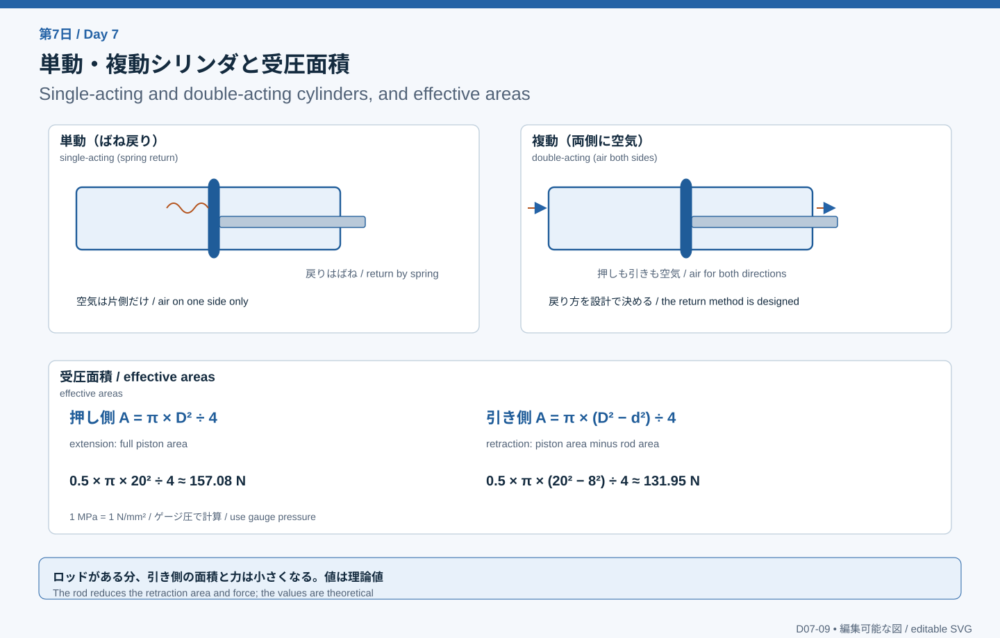

# 第7日 03 シリンダ・モーター・機器選定 / Day 7-03 Cylinder, Motor and Equipment Selection

> 所要時間 / Duration: **135分 / 135 minutes**
> 元資料 / Source pages: 15, 17–20, 47
> 共通題材 / Running example: 小型ワーク押出し装置 / small workpiece-pushing machine

## 1. 概要 / Overview

このノートブックでは、要求仕様を具体的な機器の候補へ変換します。中心になるのは、次の3つです。

This notebook converts requirements into candidate components. Three calculations are central.

1. **必要な力を求める**：質量・摩擦・余裕係数から設計力を概算する。
2. **シリンダ内径の理論下限を求める**：圧力と受圧面積から計算する。
3. **モーターのトルクと減速後の速度・トルクを求める**：出力・回転数・減速比・効率から計算する。

1. **Find the required force** from mass, friction and a teaching margin.
2. **Find the theoretical lower bound of the cylinder bore** from pressure and effective area.
3. **Find motor torque and reducer output speed/torque** from power, speed, ratio and efficiency.

**このノートで最も大切な区別 / The most important distinction**

計算で求めた値は「理論上の下限」または「概算」です。カタログから選ぶ型式は、負荷率、速度、取付、許容モーメント、圧力損失、寿命、安全、入手性を確認した**候補**です。計算値が11.18 mmだからといって、11.18 mmを超える最小の内径をそのまま選ぶ、という話ではありません。

Calculated values are theoretical lower bounds or estimates. A catalogue choice is a **candidate** that has been checked for load factor, speed, mounting, allowable moment, pressure loss, life, safety and availability. A theoretical bore of 11.18 mm does not mean "choose the smallest catalogue bore above 11.18 mm".

## 2. 学習目標 / Learning objectives

1. 質量と力を区別し、単位を付けて説明できる。
2. 静止摩擦と滑り摩擦の違いを説明できる。
3. 摩擦力を F = μmg で概算できる。
4. 設計力に余裕係数を適用できる。
5. 圧力の単位を変換できる（MPa → Pa）。
6. シリンダの理論内径を計算できる。
7. ロッド側の有効面積と推力の違いを説明できる。
8. 理論値とカタログ選定の違いを説明できる。
9. モーターの出力・回転数・トルクの関係を計算できる。
10. 減速比と効率が出力速度・トルクに与える影響を説明できる。
11. 機械部品表（BOM）と版管理を作れる。
12. メーカー資料の確認項目を列挙できる。

By the end of this notebook you can:

1. Distinguish mass from force and state units correctly.
2. Explain static versus sliding friction.
3. Estimate friction with F = μmg.
4. Apply a margin factor to a design force.
5. Convert pressure units (MPa → Pa).
6. Calculate a theoretical cylinder bore.
7. Explain rod-side effective area and reduced pull force.
8. Explain the difference between a theoretical value and a catalogue selection.
9. Calculate the relation between motor power, speed and torque.
10. Explain how ratio and efficiency change output speed and torque.
11. Build a mechanical bill of materials (BOM) with revision control.
12. List the checks required in manufacturer documentation.

## 3. 前提知識 / Prerequisites

第7日01（要求仕様、タクト）、第7日02（空圧、推力、ガイド）を終えていること。次の単位を確認します。

Complete Day 7-01 (requirements, takt) and Day 7-02 (pneumatics, force, guides). Confirm these units.

| 量 / Quantity | 単位 / Unit | 意味 / Meaning |
|---|---|---|
| 質量 / mass | kg | 物質の量 / amount of matter |
| 力 / force | N = kg·m/s² | 質量に加速度を生じさせる作用 / cause of acceleration |
| 圧力 / pressure | Pa = N/m², MPa = 10⁶ Pa | 単位面積当たりの力 / force per area |
| トルク / torque | N·m | 回転軸を回す作用 / turning effect |
| 回転数 / speed | rpm = min⁻¹ | 1分当たりの回転 / revolutions per minute |
| 仕事・エネルギー / work, energy | J = N·m | 力×距離 / force × distance |
| 動力 / power | W = J/s | 単位時間当たりのエネルギー / energy per time |

### 実行環境 / executable environment

このノートのコードは、リポジトリ内の `day07_09_support/examples/automation_models.py` を使います。最初のセルを実行してから、後のセルを順に実行してください。インターネット接続は不要です。

The code uses `day07_09_support/examples/automation_models.py` in this repository. Run the first cell, then the following cells in order. No internet connection is required.

```python exec id="setup"
import sys, pathlib
import matplotlib.pyplot as plt

plt.rcParams["font.family"] = ["Meiryo", "Yu Gothic", "DejaVu Sans"]
plt.rcParams["axes.unicode_minus"] = False

def find_support(start):
    for base in [start, *start.parents]:
        if (base / "day07_09_support" / "examples" / "automation_models.py").is_file():
            return base / "day07_09_support"
    raise FileNotFoundError("Open this notebook inside the Training_Automation repository.")

SUPPORT = find_support(pathlib.Path.cwd())
sys.path.insert(0, str(SUPPORT / "examples"))
import automation_models as am
print("automation_models loaded from", SUPPORT.name)
print("No internet, hardware, PLC software or compressed air is used.")
```

**期待される出力 / Expected output**

```text
automation_models loaded from day07_09_support
No internet, hardware, PLC software or compressed air is used.
```

## 4. 質量・力・摩擦 / Mass, force and friction

**質量 / mass** は 8 kg のように表します。**力 / force** は N（ニュートン）で表します。質量8 kgの物体に働く重力は、8 × 9.81 = 78.48 N です。質量と力を混同すると、式も単位も合わなくなります。

**Mass** is expressed as 8 kg. **Force** is expressed in newtons. The weight of an 8 kg object is 8 × 9.81 = 78.48 N. Confusing mass with force breaks both the equation and the units.

水平面を滑らせる場合の滑り摩擦力は、概算で次のように表せます。

For sliding on a horizontal surface, friction can be estimated as:

```text
F_friction = μ × m × g
```

- **F_friction**: 摩擦力 [N] / friction force [N]
- **μ**: 摩擦係数（単位なし）/ friction coefficient (dimensionless)
- **m**: 質量 [kg] / mass [kg]
- **g**: 重力加速度 ≈ 9.81 [m/s²] / gravitational acceleration



*図 D07-09：ワークに働く力（重力・垂直抗力・摩擦力・押す力）を整理し、その結果をシリンダの理論計算とカタログ確認へつなげます。 / Figure D07-09: organise the forces on the workpiece (weight, normal force, friction, push) and connect the result to theoretical cylinder calculation and catalogue checks.*

**静止摩擦と滑り摩擦 / Static and sliding friction**

静止している物体を動かし始めるときの力は、動き始めた後の力より大きくなることが一般的です。静止摩擦係数は滑り摩擦係数より大きい値になります。したがって、滑り摩擦だけで計算した力は、**動き始めには不足する可能性**があります。実際には、加速力、衝撃、ガイド抵抗、偏荷重も加わります。

The force needed to start motion is generally greater than the force needed to keep it moving. The static friction coefficient is larger than the sliding coefficient. A calculation using sliding friction alone may therefore be **insufficient to start motion**. Acceleration, impact, guide resistance and side load also matter.

**この計算の限界 / Limits of this calculation**

F = μmg は、水平面を等速で滑らせるための概算です。次のものは含みません。

- 加速に必要な力 / force for acceleration
- 静止摩擦から滑り摩擦への変化 / static-to-sliding transition
- ガイド・シールの抵抗 / guide and seal resistance
- 偏荷重によるモーメント / moment from side load
- ワークの変形・傷つき / deformation or damage
- 圧力損失 / pressure loss

F = μmg is an estimate for sliding at constant speed on a horizontal surface. It excludes acceleration, the static-to-sliding transition, guide and seal resistance, side-load moment, deformation and pressure loss.

## 5. シリンダの理論推力と内径 / Cylinder force and theoretical bore

シリンダの押し側の理論推力は、次の式です。

The theoretical push force of a cylinder is:

```text
F = P × A = P × π × D² / 4
```

これを内径について解くと、次のようになります。

Solving for bore:

```text
D = √(4F / (πP))
```

- **F**: 設計力 [N] / design force [N]
- **P**: シリンダにかかるゲージ圧 [Pa] / gauge pressure at the cylinder [Pa]
- **D**: 内径 [m] / bore [m]

**PDFの例 / the source PDF example**

| 項目 / Item | 値 / Value | 計算 / Calculation |
|---|---|---|
| 質量 / mass | 8 kg | — |
| 摩擦係数 / friction coefficient | 0.25 | — |
| 摩擦力 / friction force | **19.62 N** | 0.25 × 8 × 9.81 |
| 演習上の余裕係数 / teaching margin | 2 | — |
| 設計力 / design force | **39.24 N** | 19.62 × 2 |
| 圧力 / pressure | 0.4 MPa | 400,000 Pa |
| 理論内径 / theoretical bore | **約11.18 mm** | √(4 × 39.24 / (π × 400,000)) |

**重要な注意 / Essential caution**

- この11.18 mmは、1つの単純化した条件での**理論下限**です。
- 実際のシリンダにかかる圧力は、配管・弁・速度制御・内部抵抗により、供給圧より低いことがあります。
- 速度、加速、衝突、ガイド抵抗、偏荷重、クッション、押し方の偏心を検討する必要があります。
- メーカーの負荷率・選定プログラム・許容モーメントを確認する必要があります。
- したがって「11.18 mmを超える最小の内径を選べばよい」という結論にはなりません。

- The 11.18 mm is a **theoretical lower bound** under one simplified condition.
- The pressure at the cylinder can be lower than the supply pressure because of piping, valve, flow control and internal resistance.
- Speed, acceleration, impact, guide resistance, side load, cushioning and off-centre pushing must be considered.
- The manufacturer's load factor, selection tool and allowable moment must be checked.
- Therefore the conclusion is **not** "choose the smallest bore above 11.18 mm".

```python exec id="cylinder-calculator"
# 自由に変更してください / edit these values
mass_kg = 8.0
friction_coefficient = 0.25
force_factor = 2.0
pressure_mpa = 0.4
stroke_mm = 100.0
rod_mm = 6.0
catalog_bore_mm = 16.0   # 比較用の仮の候補 / a comparison candidate, not a selection

report = am.cylinder_report(
    mass_kg=mass_kg,
    friction_coefficient=friction_coefficient,
    force_factor=force_factor,
    pressure_mpa=pressure_mpa,
    stroke_mm=stroke_mm,
    rod_mm=rod_mm,
    catalog_bore_mm=catalog_bore_mm,
)
print(f"friction force       : {report['friction_n']:.2f} N")
print(f"design force         : {report['design_force_n']:.2f} N")
print(f"theoretical bore     : {report['theoretical_bore_mm']:.2f} mm")
print(f"candidate bore       : {report['catalog_bore_mm']:.1f} mm (example comparison only)")
print(f"candidate push force : {report['catalog_push_force_n']:.1f} N")
print(f"candidate pull force : {report['catalog_pull_force_n']:.1f} N")
print(f"push margin          : {report['catalog_margin']:.2f} x design force")
print("Margin is a comparison, not an approval. Verify pressure, load factor and side load.")
```

**期待される出力 / Expected output**

```text
friction force       : 19.62 N
design force         : 39.24 N
theoretical bore     : 11.18 mm
candidate bore       : 16.0 mm (example comparison only)
candidate push force : 80.4 N
candidate pull force : 69.1 N
push margin          : 2.05 x design force
```

### 5.1 入力チェック / Input validation

計算機は、負の質量、負の圧力、1未満の余裕係数、ロッド径が内径以上、といった入力を拒否します。エラーメッセージを読んで、どの入力が物理的に意味を持たないかを考えてください。

The calculator rejects negative mass, negative pressure, a margin below 1, and a rod diameter greater than the bore. Read the error message and decide which input has no physical meaning.

```python exec id="cylinder-validation"
bad_inputs = [
    {"mass_kg": -8.0, "friction_coefficient": 0.25, "force_factor": 2.0, "pressure_mpa": 0.4},
    {"mass_kg": 8.0, "friction_coefficient": 0.25, "force_factor": 0.5, "pressure_mpa": 0.4},
    {"mass_kg": 8.0, "friction_coefficient": 0.25, "force_factor": 2.0, "pressure_mpa": -0.4},
]
for index, case in enumerate(bad_inputs, start=1):
    try:
        am.cylinder_report(**case)
        print(f"case {index}: unexpectedly accepted")
    except ValueError as error:
        print(f"case {index}: rejected -> {error}")
```

**期待される出力 / Expected output**

```text
case 1: rejected -> mass_kg must be > 0, got -8.0
case 2: rejected -> factor must be >= 1.0; a value below 1 removes margin instead of adding it
case 3: rejected -> pressure_mpa must be > 0, got -0.4
```

### 5.2 内径と推力の関係を見る / Bore versus force

```python exec id="bore-curve"
import matplotlib.pyplot as plt

pressures = [0.2, 0.3, 0.4, 0.5, 0.6]
bores = [12, 16, 20, 25, 32, 40]
fig, ax = plt.subplots(figsize=(8, 4.2))
for pressure in pressures:
    forces = [am.cylinder_force_n(bore, pressure) for bore in bores]
    ax.plot(bores, forces, marker="o", label=f"{pressure:.1f} MPa")
ax.axhline(39.24, color="firebrick", linestyle="--", label="design force 39.24 N")
ax.set_xlabel("bore [mm] / 内径 [mm]")
ax.set_ylabel("theoretical push force [N] / 理論推力 [N]")
ax.set_title("Bore, pressure and theoretical push force")
ax.grid(alpha=0.3)
ax.legend(fontsize=8)
fig.tight_layout()
plt.show()
```

**読み取り方 / How to read it**

- 同じ内径なら、圧力が高いほど推力が大きい。
- 同じ圧力なら、内径が大きいほど推力が大きい。
- 設計力39.24 Nの線を超える組み合わせは、**理論上**は候補になり得る。
- ただし、速度・偏荷重・圧力損失・負荷率は別に確認する。

- At the same bore, higher pressure gives more force.
- At the same pressure, a larger bore gives more force.
- Combinations above the 39.24 N line are **theoretically** possible candidates.
- Speed, side load, pressure loss and load factor still require separate checks.

## 6. 理論値からカタログ選定へ / From theory to catalogue selection

理論計算の後に行うことを整理します。

After the theoretical calculation, do the following.

| 段階 / Step | 確認すること / What to check | 記録すること / Record |
|---|---|---|
| 1. 力を決める / decide force | 摩擦、加速、ガイド抵抗、偏荷重 / friction, acceleration, guide, side load | 計算式と仮定 / formula and assumptions |
| 2. 圧力を決める / decide pressure | 供給圧、損失、必要推力 / supply, losses, required force | 使用圧と損失の見込み / pressure and loss estimate |
| 3. 内径の下限 / lower bound | D = √(4F/(πP)) | 理論値 / theoretical value |
| 4. 候補を選ぶ / choose candidates | 標準内径、ストローク、取付 / standard bore, stroke, mounting | 複数候補 / several candidates |
| 5. 負荷率を確認 / load factor | メーカーの許容負荷率 / manufacturer allowable load | 根拠ページ / source page |
| 6. 速度を確認 / speed | 許容速度、クッション / allowable speed, cushion | 速度条件 / speed condition |
| 7. モーメントを確認 / moment | 許容モーメント、ガイド / allowable moment, guide | 取付条件 / mounting |
| 8. センサーを確認 / sensing | 対応オートスイッチ、取付 / compatible switch, mounting | 対応表 / compatibility table |
| 9. 空圧周辺を確認 / air circuit | 弁、速度制御、配管、空気品質 / valve, flow control, piping, air quality | 部品表 / BOM |
| 10. 未確認を記録 / record unknowns | 何が分からないか / what remains unknown | 未確認リスト / open list |

**ストロークと取付 / Stroke and mounting**

- ストロークは、必要な移動距離に余裕を加えて決めます。端部でワークを押し切る場合、ストロークを長くしすぎると衝撃が増えます。
- 取付方法（基本形、フランジ、 clevis など）は、荷重方向とモーメントで決まります。
- ロッド先端の金具は、横荷重をかけない構造にします。
- クッション、ストッパ、緩衝材の要否を確認します。
- センサー取付スペースと調整代を確保します。

- Stroke is the required travel plus allowance. Pushing to the end with excessive stroke increases impact.
- Mounting style (basic, flange, clevis, etc.) follows the load direction and moment.
- The rod-end fitting must avoid side load.
- Check the need for cushioning, stoppers and bumpers.
- Provide space and adjustment for sensors.

## 7. モーター・減速機の選定 / Motor and reducer selection

モーターは回転する力を出します。選定には、必要速度、負荷トルク、起動停止回数、慣性、必要精度、保持条件、電源・ドライバ、環境を確認します。

A motor produces rotational power. Selection considers required speed, load torque, start/stop frequency, inertia, accuracy, holding, supply and driver, and environment.

**基本式 / Basic equations**

```text
ω = 2πn / 60          （角速度 / angular velocity [rad/s]）
P = T × ω             （動力 / power [W]）
T = P / ω             （トルク / torque [N·m]）
n_out = n_in / ratio  （減速後の回転数 / output speed）
T_out = T_in × ratio × η （減速後のトルク / output torque）
```

- **n**: 回転数 [rpm] / speed [rpm]
- **ω**: 角速度 [rad/s] / angular velocity
- **P**: 動力 [W] / power
- **T**: トルク [N·m] / torque
- **η**: 減速機の効率（0〜1）/ reducer efficiency
- **ratio**: 減速比 / reduction ratio

**PDFの例 / the source PDF example**

| 項目 / Item | 値 / Value | 計算 / Calculation |
|---|---|---|
| モーター出力 / motor power | 60 W | — |
| モーター回転数 / motor speed | 1,200 rpm | — |
| 減速比 / reduction ratio | 20:1 | — |
| モーター軸トルク / motor torque | **約0.477 N·m** | 60 ÷ (2π × 1200 / 60) |
| 理想出力回転数 / ideal output speed | **60 rpm** | 1200 ÷ 20 |
| 理想出力トルク / ideal output torque | **約9.55 N·m** | 0.477 × 20 |

**効率を入れる場合 / when efficiency is included**

PDFの例には減速機効率が書かれていません。したがって、上の9.55 N·mは**理想値**です。この教材では、追加の仮定として効率0.90を明示し、実際に近い出力トルクを8.59 N·mとして示します。0.90は教育用の仮定であり、実機の減速機効率ではありません。

The PDF example does not state reducer efficiency, so 9.55 N·m is an **ideal** value. This course adds an explicit assumption of 0.90 and shows a delivered torque of 8.59 N·m. The 0.90 is a teaching assumption, not the efficiency of a real reducer.

```python exec id="motor-calculator"
# 自由に変更してください / edit these values
power_w = 60.0
speed_rpm = 1200.0
ratio = 20.0
efficiency = 0.90

motor = am.motor_report(power_w=power_w, speed_rpm=speed_rpm, ratio=ratio, efficiency=efficiency)
print(f"motor torque          : {motor['motor_torque_nm']:.3f} N·m")
print(f"output speed          : {motor['output_speed_rpm']:.2f} rpm")
print(f"ideal output torque   : {motor['ideal_output_torque_nm']:.2f} N·m")
print(f"assumed efficiency    : {motor['efficiency']:.2f}")
print(f"delivered output torque: {motor['delivered_output_torque_nm']:.2f} N·m")
print("Efficiency 0.90 is an added training assumption, not a manufacturer value.")
```

**期待される出力 / Expected output**

```text
motor torque          : 0.477 N·m
output speed          : 60.00 rpm
ideal output torque   : 9.55 N·m
assumed efficiency    : 0.90
delivered output torque: 8.59 N·m
Efficiency 0.90 is an added training assumption, not a manufacturer value.
```

### 7.1 速度とトルクのトレードオフ / Speed–torque trade-off

```python exec id="motor-curve"
import matplotlib.pyplot as plt

ratios = [5, 10, 20, 30, 50]
fig, ax1 = plt.subplots(figsize=(8, 4.2))
speeds = [am.reducer_output_speed_rpm(1200, ratio) for ratio in ratios]
torques = [am.reducer_output_torque_nm(0.477, ratio, 0.90) for ratio in ratios]
ax1.plot(ratios, speeds, marker="o", color="tab:blue", label="output speed [rpm]")
ax1.set_xlabel("reduction ratio / 減速比")
ax1.set_ylabel("output speed [rpm]", color="tab:blue")
ax2 = ax1.twinx()
ax2.plot(ratios, torques, marker="s", color="tab:red", label="delivered torque [N·m]")
ax2.set_ylabel("delivered torque [N·m]", color="tab:red")
ax1.set_title("Reducer: speed falls, torque rises (efficiency 0.90 assumption)")
ax1.grid(alpha=0.3)
fig.tight_layout()
plt.show()

for ratio, speed, torque in zip(ratios, speeds, torques):
    print(f"ratio {ratio:>2}:1 -> {speed:6.1f} rpm, {torque:5.2f} N·m")
```

**モーター選定の限界 / Limits of motor selection**

- 定格点のトルクは、連続運転で出せる値の目安です。起動・加速にはより大きなトルクが必要な場合があります。
- 負荷の慣性、加減速時間、停止回数、保持ブレーキの要否を確認します。
- 減速機の効率、許容ラジアル荷重、許容アキシャル荷重、寿命を確認します。
- 温度、粉じん、水、油、洗浄などの環境条件を確認します。
- サーボ・ステッピング・ACモーターでは、選定方法と必要なドライバが異なります。
- 計算だけでなく、メーカーの選定ツールと実機試験で確認します。

- Rated torque is a guide for continuous operation; starting and acceleration may need more.
- Check load inertia, acceleration/deceleration time, start/stop frequency and the need for a holding brake.
- Check reducer efficiency, allowable radial and axial load, and life.
- Check temperature, dust, water, oil and cleaning.
- Servo, stepper and AC motors use different selection methods and drivers.
- Verify with the manufacturer's selection tool and a real test, not calculation alone.

## 8. 機械部品表（BOM）と版管理 / Mechanical BOM and revision control

BOM（Bill of Materials）は、部品の一覧です。数量だけでなく、**選定理由、仮定、未確認事項、出典、版**を残します。後から「なぜこの候補にしたか」を説明できることが重要です。

A BOM is a parts list. Record not only quantity but also the selection reason, assumptions, open items, source and revision. Being able to explain later why a candidate was chosen is essential.

| 欄 / Column | 記入内容 / Content |
|---|---|
| 品名 / item | シリンダ、ガイド、ブラケットなど / cylinder, guide, bracket |
| 候補仕様 / candidate specification | 内径、ストローク、取付、ロッド径 / bore, stroke, mounting, rod |
| 数量 / quantity | 1など / e.g. 1 |
| 選定理由 / reason | 設計力、速度、モーメント、センサー対応 / force, speed, moment, sensing |
| 仮定 / assumption | 摩擦係数、圧力、効率など / friction, pressure, efficiency |
| 未確認 / open item | メーカー負荷率、圧力損失、納期 / load factor, pressure loss, lead time |
| 出典・版 / source and revision | カタログ名、版、確認日 / catalogue, revision, date |
| 変更履歴 / change history | 何を変えたか、なぜか / what changed and why |

```python exec id="bom-hash"
import hashlib, json

bom = {
    "revision": "A",
    "items": [
        {"item": "double-acting cylinder (candidate)", "bore_mm": 16, "stroke_mm": 100, "rod_mm": 6,
         "reason": "theoretical bore 11.18 mm; candidate to investigate", "open": "load factor, pressure loss"},
        {"item": "linear guide (candidate)", "load": "workpiece 8 kg + pusher", "reason": "carry side load",
         "open": "moment, life"},
        {"item": "5/2 single-solenoid valve (candidate)", "voltage": "DC24V", "reason": "extend/retract control",
         "open": "de-energised behaviour, flow"},
        {"item": "magnetic position switches (candidate)", "quantity": 2, "reason": "end confirmation",
         "open": "compatibility with cylinder"},
        {"item": "flow control valves (candidate)", "quantity": 2, "reason": "speed adjustment",
         "open": "meter-in or meter-out"},
    ],
}
payload = json.dumps(bom, ensure_ascii=False, sort_keys=True)
digest = hashlib.sha256(payload.encode("utf-8")).hexdigest()[:12]
print(f"revision: {bom['revision']}")
print(f"items   : {len(bom['items'])}")
for item in bom["items"]:
    print(f"  - {item['item']}: {item['reason']} | open: {item['open']}")
print(f"content fingerprint: {digest}")
print("Changing any field changes the fingerprint; record it with the revision.")
```

**版管理の考え方 / Revision control**

- 図面、BOM、I/O表、ラダー、試験記録は、同じ版番号で対応させます。
- 変更したら、日時、変更内容、理由、再試験結果を記録します。
- 古い版を消さずに残します。なぜ変更したかを後から確認できるようにします。
- 「最新版」が分かるように、ファイル名や先頭ページに版を書きます。

- Keep drawings, BOM, I/O table, ladder and test records on the same revision.
- On change, record date, content, reason and re-test result.
- Keep old revisions; preserve why the change was made.
- Make the current revision obvious in the file name or first page.

## 9. メーカー資料の確認 / Manufacturer documentation

型式の末尾まで確認します。同じシリーズでも、内径、ストローク、ポート位置、センサー有無、取付方法、電圧、コネクタで型式が変わります。「シリーズ名を見つけた」だけでは発注できません。

Check the full model code. Bore, stroke, port position, sensor option, mounting, voltage and connector change the code. Finding the series name is not enough to order.

| 確認項目 / Check | 質問例 / Example question |
|---|---|
| ① 用途 / purpose | 押す？持ち上げる？止める？検出する？ / push, lift, stop, detect? |
| ② 能力 / capability | 速度・回数・トルク・推力は足りるか / speed, rate, torque, force? |
| ③ 精度 / accuracy | 繰返し停止精度・検出距離は十分か / repeatability, sensing distance? |
| ④ 寸法 / dimensions | 取付スペース、ストローク、質量は適合するか / space, stroke, mass? |
| ⑤ 接続 / connection | 電源、空圧、継手、コネクタ、信号方式は合うか / supply, air, fittings, connector, signal? |
| ⑥ 環境 / environment | 温度、粉じん、水、振動、油、洗浄は？ / temperature, dust, water, vibration, oil, cleaning? |
| ⑦ 寿命 / life | 動作頻度、定期交換部品、保証条件は？ / duty, wear parts, warranty? |
| ⑧ 安全 / safety | 危険時の状態、遮断・排気、保護方策は？ / failure state, isolation, protection? |
| ⑨ 入手性 / availability | 納期、在庫、予備品、後継型式は？ / lead time, stock, spares, successor? |
| ⑩ 根拠 / traceability | 仕様書版数、選定条件、型式、検証者は？ / document revision, conditions, model, reviewer? |

**参考資料の使い方 / Using references**

メーカーの選定支援ページ、カタログ、ハードウェアマニュアル、形式表示の読み方は、必ず最新版を確認します。URLは入口であり、内容の正しさを保証するものではありません。確認日と版数を記録します。

Always check the current edition of selection guides, catalogues, hardware manuals and model-code explanations. A URL is an entry point, not a guarantee of correctness. Record the date and revision you checked.

参考の入口 / entry points（2026年11月確認 / checked November 2026）:

- SMC シリンダ選定 / cylinder selection: https://www.smcworld.com/select/air/en-jp/
- SMC ガイド付きシリンダ / guided cylinder: https://www.smcworld.com/select/guide/en-jp/index.html
- 三菱電機 FA マニュアル検索 / Mitsubishi Electric FA manuals: https://www.mitsubishielectric.co.jp/fa/download/search.page
- オムロン 近接センサ技術解説 / Omron proximity sensor guide: https://www.fa.omron.co.jp/guide/technicalguide/41/17/

> 本教材は特定の実機型式を選定するものではありません。実機の選定・発注・安全確認は、メーカー資料と社内の設計ルール、有資格者のレビューに従ってください。
> This course does not select a real part number. Real selection, ordering and safety verification follow manufacturer documents, company design rules and qualified review.

## 10. 演習 / Exercises

### 演習 A：摩擦力と設計力 / Exercise A: friction and design force

質量8 kg、摩擦係数0.25、余裕係数2のとき、摩擦力と設計力を計算してください。単位も書きます。余裕係数を3に変えた場合も計算し、違いを説明してください。

For 8 kg, μ = 0.25 and a margin of 2, calculate friction and design force with units. Repeat with a margin of 3 and explain the difference.

### 演習 B：理論内径 / Exercise B: theoretical bore

設計力39.24 N、圧力0.4 MPaのとき、理論内径を計算してください。次に圧力を0.3 MPaに下げた場合を計算し、内径がどう変わるか説明してください。

Calculate the theoretical bore for 39.24 N at 0.4 MPa. Repeat at 0.3 MPa and explain the change.

### 演習 C：カタログ候補の比較 / Exercise C: compare catalogue candidates

次の表を埋めてください。実際の型式は書かず、**候補の仕様クラス**として比較します。

Complete the table using **candidate specification classes**, not real part numbers.

| 項目 / Item | 候補1 / candidate 1 | 候補2 / candidate 2 | 候補3 / candidate 3 |
|---|---|---|---|
| 内径 / bore | | | |
| ストローク / stroke | | | |
| 押し側理論推力 / push force | | | |
| 戻り側理論推力 / pull force | | | |
| 取付 / mounting | | | |
| センサー対応 / sensing | | | |
| 未確認事項 / open items | | | |

### 演習 D：モーター計算 / Exercise D: motor calculation

出力60 W、回転数1,200 rpm、減速比20:1、効率0.90のとき、モーター軸トルク、理想出力回転数、理想出力トルク、効率を考慮した出力トルクを計算してください。

For 60 W at 1,200 rpm, ratio 20:1 and efficiency 0.90, calculate motor torque, ideal output speed, ideal output torque and delivered output torque.

### 演習 E：BOMと版管理 / Exercise E: BOM and revision control

押出し装置の機械BOMを10行以内で作り、次の欄を入れてください。仮の値には「仮」と書きます。

Create a mechanical BOM of no more than ten lines with the columns below. Mark hypothetical values as "provisional".

```text
品名 / 候補仕様 / 数量 / 選定理由 / 仮定 / 未確認 / 出典・版
item / candidate spec / quantity / reason / assumption / open / source & revision
```

**提出物 / Deliverables**

1. シリンダ選定計算書 / cylinder sizing calculation
2. モーター選定計算書 / motor sizing calculation
3. 機械BOM（版付き）/ mechanical BOM with revision
4. 候補仕様の比較表 / candidate specification comparison
5. 選定根拠と未確認事項のリスト / selection evidence and open-item list

## 11. 期待される結果 / Expected result

- 摩擦力 **19.62 N**、設計力 **39.24 N** を計算できる。
- 理論内径 **約11.18 mm** を計算できる。
- 11.18 mmが理論下限であり、カタログ選定ではないと説明できる。
- モーター軸トルク **約0.477 N·m** を計算できる。
- 減速比20:1で、理想出力回転数 **60 rpm**、理想出力トルク **約9.55 N·m** を計算できる。
- 効率0.90を仮定した場合、出力トルクが **約8.59 N·m** になることを説明できる。
- BOMに、選定理由・仮定・未確認・出典・版が入っている。

- You can calculate the friction force of **19.62 N** and design force of **39.24 N**.
- You can calculate the theoretical bore of **about 11.18 mm**.
- You can explain that 11.18 mm is a theoretical lower bound, not a catalogue selection.
- You can calculate motor torque of **about 0.477 N·m**.
- With a 20:1 reducer you can calculate **60 rpm** ideal output speed and **about 9.55 N·m** ideal output torque.
- With an assumed efficiency of 0.90 you can explain the delivered output torque of **about 8.59 N·m**.
- The BOM records reason, assumptions, open items, source and revision.

## 12. トラブルシューティング / Troubleshooting

| 症状 / Symptom | 確認すること / Check | よくある原因 / Typical cause |
|---|---|---|
| 計算値と現場の力が違う / calculated force differs from practice | 摩擦係数、加速、ガイド抵抗、偏荷重 / friction, acceleration, guide, side load | 単純化した仮定を実機に適用 / applying simplified assumptions to a real machine |
| シリンダが動かない / cylinder stalls | 実際のシリンダ圧力、負荷率、配管損失 / actual pressure, load factor, piping loss | 供給圧をそのまま推力計算に使用 / using supply pressure as cylinder pressure |
| モーターが過負荷になる / motor overloads | 起動トルク、慣性、減速機効率 / starting torque, inertia, efficiency | 定格トルクだけで選定 / selecting on rated torque only |
| 出力速度が合わない / output speed differs | 減速比、滑り、実際の回転数 / ratio, slip, actual speed | 理想計算との混同 / confusing ideal and actual |
| 型式が決まらない / cannot fix the model | 未確認事項が多すぎる / too many open items | 要求と仮定が曖昧 / vague requirements and assumptions |

## 13. まとめ / Summary

- 質量[kg]と力[N]を区別する。摩擦力は F = μmg で概算できる。
- 設計力は余裕係数を明示して決める。余裕係数は教育用の仮定であり、規格値ではない。
- シリンダの理論推力は F = P × πD²/4。押し側と戻り側で有効面積が違う。
- 理論内径は下限であり、カタログ選定ではない。負荷率、速度、モーメント、圧力損失、センサー対応を確認する。
- モーターのトルクは T = P/ω。減速機で速度は1/ratio、トルクはratio×ηになる。
- 効率は必ず明示する。PDFの例は理想値9.55 N·m。効率0.90なら8.59 N·m。
- BOMには、候補、理由、仮定、未確認、出典、版を残す。

- Distinguish mass [kg] from force [N]. Friction can be estimated with F = μmg.
- State the margin explicitly. It is a teaching assumption, not a standard value.
- Cylinder force is F = P × πD²/4; push and pull sides have different effective areas.
- The theoretical bore is a lower bound, not a selection. Check load factor, speed, moment, pressure loss and sensing.
- Motor torque is T = P/ω. A reducer divides speed by the ratio and multiplies torque by ratio × η.
- Always state efficiency. The PDF example is the ideal 9.55 N·m; at 0.90 it is 8.59 N·m.
- The BOM records candidate, reason, assumptions, open items, source and revision.

## 14. 完了チェックリスト / Completion checklist

- [ ] 質量と力の単位を区別した / distinguished mass and force units
- [ ] 摩擦力19.62 Nを計算した / calculated 19.62 N friction
- [ ] 設計力39.24 Nを計算した / calculated 39.24 N design force
- [ ] 理論内径11.18 mmを計算した / calculated 11.18 mm theoretical bore
- [ ] 理論下限とカタログ選定の違いを説明した / explained theoretical bound versus catalogue selection
- [ ] 押し側と戻り側の有効面積の違いを説明した / explained push and pull effective areas
- [ ] モーター軸トルク0.477 N·mを計算した / calculated 0.477 N·m motor torque
- [ ] 理想出力60 rpm、9.55 N·mを計算した / calculated 60 rpm and 9.55 N·m ideal output
- [ ] 効率0.90の仮定と8.59 N·mを説明した / explained the 0.90 assumption and 8.59 N·m
- [ ] 機械BOMに理由・仮定・未確認・出典・版を入れた / BOM includes reason, assumptions, open items, source and revision
- [ ] 入力チェックのエラーを確認した / checked the input-validation errors
