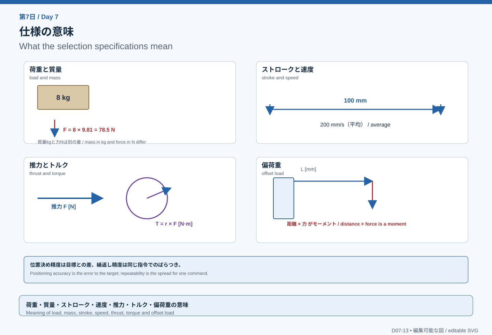
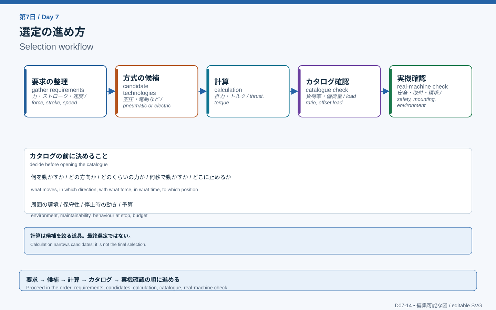
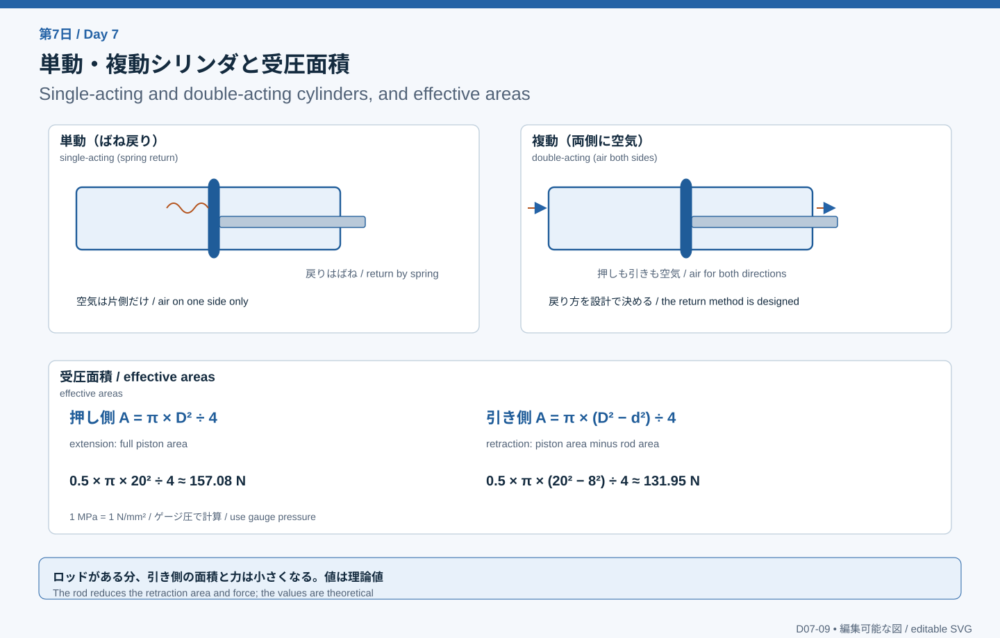

# 第7日 03 アクチュエータ選定に必要な仕様と基本計算 / Day 7-03 Actuator Selection Specifications and Basic Calculations

> 所要時間 / Duration: **135分 / 135 minutes**
> 元PDF / Source pages: 15, 17-20, 47
> 共通例 / Running example: ワークを水平に100 mm動かす / moving a workpiece 100 mm horizontally

## 1. 概要 / Overview

アクチュエータを選ぶとき、最初にすることは「カタログを開くこと」ではありません。**必要な仕様を書き出すこと**です。このノートブックでは、仕様の意味を確認し、シリンダの力とモーターのトルクを計算し、計算値がそのまま選定の答えにならない理由を学びます。実行するプログラムはありません。

Selecting an actuator does not start with a catalogue. It starts with **writing down the required specifications**. This notebook explains what each specification means, calculates cylinder force and motor torque, and explains why the arithmetic is not the selection. There is no code to execute.

**安全に関する前提 / Safety boundary.** 計算は机上の検討です。計算値は実機の保証値ではありません。実機の設計・製作・試運転は、リスクアセスメントと有資格者の確認が必要です。 / The calculations are desk studies and are not guarantees for a real machine. Design, build and commissioning require a risk assessment and qualified review.

## 2. 学習目標 / Learning objectives

1. 選定に必要な仕様項目を列挙できる。
2. 質量（kg）と力（N）を区別できる。
3. 位置決め精度と繰返し精度を区別できる。
4. 平均速度と最高速度の違いを説明できる。
5. シリンダの押し側・引き側の力を計算できる。
6. 摩擦から必要な推力を推定できる。
7. モーターのトルクと減速機の出力を計算できる。
8. 計算値と実機選定の間にある確認事項を説明できる。

By the end you can list the required specifications; distinguish mass from force; distinguish positioning accuracy from repeatability; explain average versus maximum speed; calculate extension and retraction force; estimate required thrust from friction; calculate motor torque and reducer output; and explain the checks between arithmetic and a real selection.

## 3. 前提 / Prerequisites

07-01（生産能力）、07-02（動力とアクチュエータ）を終えていること。関数電卓か、平方根の使える電卓を用意してください。 / Complete 07-01 and 07-02. Bring a calculator with a square-root key.

## 4. 仕様を先に書き出す / write the specifications first

| 仕様 / Specification | 意味 / Meaning | 単位 / Unit | 注意 / Note |
|---|---|---|---|
| 荷重 / load | 動かす物から受ける力 / force from the object | N | 質量と混同しない / not the same as mass |
| 質量 / mass | 物の量 / amount of matter | kg | 重量は力 / weight is a force |
| 推力 / thrust, linear force | 直線方向に出す力 / linear force | N | 摩擦・加速度を含める / includes friction and acceleration |
| トルク / torque | 回転させる力 / turning force | N·m | 半径×力 / radius × force |
| ストローク / stroke | 動く距離 / travel distance | mm | 余裕を見る / allow margin |
| 移動速度 / travel speed | 動く速さ / speed of travel | mm/s | 平均か最高かを書く / state average or peak |
| サイクルタイム / cycle time | 1サイクルの時間 / time per cycle | s | 往復全体で考える / consider the whole cycle |
| 加速度 / acceleration | 速度の変化 / rate of speed change | m/s² | 慣性力に影響 / affects inertia force |
| 位置決め精度 / positioning accuracy | 目標位置との差 / error to the target | mm | 絶対精度 / absolute |
| 繰返し精度 / repeatability | 同じ指令でのばらつき / spread for one command | mm | ばらつき / spread |
| 使用圧力 / operating pressure | 空気・油の圧力 / air or oil pressure | MPa | ゲージ圧 / gauge pressure |
| 使用頻度 / operating frequency | 単位時間の回数 / cycles per time | 回/分 | 発熱に関係 / affects heat |
| デューティ比 / duty cycle | 動作している時間の割合 / proportion of time active | % | 部品の使用条件 / a component condition |
| 許容モーメント / allowable moment | 曲げに耐える限度 / bending limit | N·m | 偏荷重に関係 / offset loads |
| 取付条件 / mounting requirements | 取付方法・向き・空間 / mounting, orientation, space | mm | 干渉確認 / check interference |
| 使用環境 / operating environment | 温度・粉じん・水・油 / temperature, dust, water, oil | — | 保護等級 / ingress protection |
| 寿命 / service life | 交換までの使用量 / usage before replacement | 回・時間 | 保全計画 / maintenance plan |

**デューティ比は部品の使用条件です。** 生産の稼働率とは別の言葉です。混同しないでください。 / Duty cycle is a component usage condition, not the production availability topic.



*図 D07-13：荷重・ストローク・速度・推力・トルク・偏荷重の意味。質量kgと力Nは別の単位です。 / Figure D07-13: load, stroke, speed, thrust, torque and offset load. Mass in kg and force in N are different units.*



*図 D07-14：要求の整理 → 候補方式 → 計算 → カタログ確認 → 実機確認の流れ。 / Figure D07-14: requirements, candidate technology, calculation, catalogue check, real-machine check.*

## 5. 速度とサイクルタイム / speed and cycle time

平均速度は、次の式で求めます。

**平均速度 = 移動距離 ÷ 移動時間**

ストローク100 mmを0.5秒で動く場合：

```text
平均速度 = 100 mm ÷ 0.5 s = 200 mm/s
```

**平均速度は最高速度ではありません。** 実際の動きには加速と減速があり、最高速度は平均より大きくなります。 / Average speed is not maximum speed; real motion accelerates and decelerates, so the peak is higher.

往復の動作では、次の時間を分けて考えます。

- 押し出し時間 / extension time
- 引き戻し時間 / retraction time
- 待ち時間 / waiting time
- センサー応答 / sensor response
- 制御の遅れ / control delay
- 設備全体のサイクルタイム / complete equipment cycle time

**平均速度だけでシリンダやモーターを選んではいけません。** 加速度、負荷、制御の遅れ、センサーの応答を含めた全体で確認します。

Do not select a cylinder or motor from average speed alone. Check acceleration, load, control delay and sensor response as well.

## 6. シリンダの力 / cylinder force

基本の式は次のとおりです。

**力 = 圧力 × 受圧面積**

押し側（ピストン面積）:

```text
A_push = π × D² ÷ 4
```

引き側（ロッドの断面を引く）:

```text
A_pull = π × (D² − d²) ÷ 4
```

- D：シリンダ内径（ボア）/ bore
- d：ロッド径 / rod diameter
- 圧力は MPa、力は N

**便利な単位の関係 / useful unit relationship: 1 MPa = 1 N/mm²**

例：内径20 mm、ロッド径8 mm、使用ゲージ圧0.5 MPa。

```text
押し側の力 = 0.5 × π × 20² ÷ 4
           = 0.5 × 314.159…
           ≈ 157.08 N

引き側の力 = 0.5 × π × (20² − 8²) ÷ 4
           = 0.5 × π × 336 ÷ 4
           = 0.5 × 263.894…
           ≈ 131.95 N
```

**この値は簡易計算です。** 実際に使える力は、反対側の背圧、摩擦力、動的な荷重、配管や継手の損失などで小さくなります。 / Real available force is lower because of opposing back pressure, friction, dynamic loads, piping and fitting losses.



*図 D07-09（再掲）：ロッドがあるため、引き側の面積は押し側より小さくなります。 / Figure D07-09 (repeated): the rod reduces the effective area on the retraction side.*

## 7. 水平負荷の例 / horizontal load example

ワークを水平に押す場合を考えます。

- ワーク質量 / workpiece mass：8 kg
- 仮定したすべり摩擦係数 / assumed sliding friction coefficient：0.25
- 重力加速度 / gravity：9.81 m/s²

```text
摩擦力の推定値 = 8 × 9.81 × 0.25 = 19.62 N
```

設計用の余裕係数を2と仮定します（**これは教材の仮定で、普遍的な設計則ではありません**）。

```text
設計力の目安 = 19.62 × 2 = 39.24 N
```

使用ゲージ圧0.4 MPaのとき、理論上の最小ボアは次のとおりです。

```text
D = √(4 × F ÷ (π × P))
  = √(4 × 39.24 ÷ (π × 0.4))
  = √(124.93…)
  ≈ 11.18 mm
```

**この11.18 mmは最終選定ではありません。** 確認が必要な項目：

- この摩擦係数は実測値か、根拠のある仮定か。
- 静止摩擦は、すべり摩擦より大きいことが多い（すべての材料の組合せに当てはまる「法則」ではない）。
- 加速度、重力の向き、ガイド、衝突、メーカーの荷重限度を考えたか。
- 理論値より少し大きいカタログ内径を選べばよい、というものではない。負荷率、速度、偏荷重、圧力損失、センサー対応を確認する。

This 11.18 mm is not a final selection. Confirm the friction assumption, consider static friction, acceleration, gravity direction, guides, impact and manufacturer limits. Choosing the next catalogue bore above the theoretical value is not automatically acceptable.

**計算の順序を守る / keep the order.**
1. 質量を確認する（kg）。
2. 摩擦や重力から力を求める（N）。
3. 余裕をどう見るか決める。
4. 圧力から面積、面積から内径を求める（mm）。
5. カタログの仕様と、実機の条件を照合する。

## 8. モーターとトルク / motor and torque

回転の基本式は次のとおりです。

```text
角速度 ω = 2 × π × 回転数[rpm] ÷ 60      [rad/s]
機械出力 P = トルク T × 角速度 ω          [W]
トルク T   = 機械出力 P ÷ 角速度 ω        [N·m]
```

例：機械出力60 W、回転数1,200 rpm、減速比20:1。

```text
ω = 2 × π × 1200 ÷ 60 = 125.66 rad/s
T = 60 ÷ 125.66 ≈ 0.477 N·m
```

減速機の出力回転数：

```text
出力回転数 = 1200 ÷ 20 = 60 rpm
```

理想的な出力トルク（効率100%）：

```text
T_out = 0.477 × 20 = 9.55 N·m
```

減速機効率を0.90と仮定した場合：

```text
T_out = 0.477 × 20 × 0.90 ≈ 8.59 N·m
```

**機械出力と電気入力は別物です。** 60 Wが機械出力なら、電気入力はそれより大きくなります。**減速機の効率は、モーターの効率の代わりにはなりません。** 両方の損失があります。

Mechanical output and electrical input differ. Sixty watts of mechanical output needs more electrical input. Reducer efficiency does not replace motor efficiency; both losses exist.

**実際の選定で追加で確認すること / what a real selection must also check.**

- 起動トルク / starting torque
- 加速トルク / acceleration torque
- 負荷イナーシャ / load inertia
- 連続トルクとピークトルク / continuous and peak torque
- デューティ比 / duty cycle
- 熱的な限度 / thermal limits
- 速度範囲 / speed range
- 制動・保持の要否 / braking and holding
- 減速機の出力トルク限度 / gearbox output torque limits
- 軸にかかる荷重 / shaft loading
- 寿命 / service life


*図 D07-13（再掲）：トルクは「半径 × 力」、偏荷重は「距離 × 力」で考えます。 / Figure D07-13 (repeated): torque is radius × force and an offset load is distance × force.*

## 9. 実務に近い選定の例 / a practical selection example

条件：ワークを水平に100 mm、繰り返し動かす。

まず集める情報：

| 項目 / Item | 例 / Example |
|---|---|
| ワーク質量 / workpiece mass | 2.0 kg |
| 可動部の質量 / moving assembly mass | 1.5 kg |
| 必要な力の目安 / required force estimate | ガイド摩擦を仮定して算出 / estimated from guide friction |
| 使える動力 / available power | 圧縮空気 0.5 MPa または DC24V / 0.5 MPa air or DC24V |
| 必要なストローク / required stroke | 100 mm（余裕を見て120 mm程度 / allow margin) |
| 移動時間 / movement time | 0.5 s |
| 位置決めの要求 / positioning requirement | 両端の2位置のみ / two end positions only |
| 取付スペース / mounting space | 幅200 mm以内 / within 200 mm |
| 環境 / environment | 粉じんあり / dusty |

この条件では、**空圧シリンダ**も**電動リニアアクチュエータ**も候補になります。2位置だけなら空圧が簡便、中間位置や速度変更が必要なら電動が向きます。**どちらが正解かは、上の表にない情報（予算、保守体制、騒音、将来の変更）で変わります。**

Under these conditions both a pneumatic cylinder and an electric linear actuator are candidates. Two positions favour pneumatics; intermediate positions or changeable speed favour electric. Which is correct depends on information not in the table: budget, maintenance, noise and future changes.

**実在のメーカー型番を断定しない / do not claim a real model number.** カタログの仕様と実機の条件がそろわない限り、「この型番で確定」とは書きません。 / Unless catalogue specifications and real operating requirements support it, never state that a particular model is finalised.

## 10. 演習 / Exercises

### 演習1 シリンダの力 / exercise 1: cylinder force

内径25 mm、ロッド径10 mm、ゲージ圧0.4 MPaのとき、押し側と引き側の理論力を求めてください。 / For a 25 mm bore, 10 mm rod and 0.4 MPa gauge pressure, find the theoretical extension and retraction force.

```text
押し側 = 0.4 × π × 25² ÷ 4 = 0.4 × 490.87 ≈ 196.35 N
引き側 = 0.4 × π × (25² − 10²) ÷ 4 = 0.4 × 412.33 ≈ 164.93 N
```

**答え / answer**：押し側 約196 N、引き側 約165 N。引き側が小さいのは、ロッドの断面積の分だけ受圧面積が減るためです。 / About 196 N and 165 N. Retraction is smaller because the rod reduces the effective area.

### 演習2 仕様の指摘 / exercise 2: spotting a missing specification

「ストローク100 mm、速度200 mm/sのシリンダを選ぶ」という指示に足りない情報を3つ挙げてください。 / Name three missing pieces of information in the instruction "select a cylinder with 100 mm stroke and 200 mm/s speed".

**答えの例 / example answer**：必要な力（N）、使用圧力（MPa）、ワーク質量と取付姿勢、位置決めの要求、使用頻度、環境。ストロークと速度だけでは選べません。 / Required force, operating pressure, workpiece mass and orientation, positioning requirement, operating frequency, environment. Stroke and speed alone are insufficient.

## 11. まとめ / Summary

- 選定は仕様の整理から始まる。カタログは最後。
- kgは質量、Nは力。MPaは N/mm²。
- 押し側と引き側で受圧面積が違う。
- 摩擦・余裕・加速度・偏荷重を考えてから内径を決める。
- モーターは機械出力からトルクを計算し、減速機効率を別に扱う。
- 計算値は候補を絞る道具であり、最終選定ではない。

Selection starts with specifications, not catalogues. kg is mass and N is force; MPa is N/mm². Extension and retraction areas differ. Decide the bore after friction, margin, acceleration and offset load. Calculate motor torque from mechanical output and treat reducer efficiency separately. Arithmetic narrows candidates; it does not finalise the selection.

## 12. 完了チェックリスト / Completion checklist

- [ ] 仕様項目を10個以上、単位付きで書ける。
- [ ] 質量と力を区別して説明できる。
- [ ] 位置決め精度と繰返し精度を区別できる。
- [ ] 100 mmを0.5秒で動かす平均速度を計算できる。
- [ ] 157.08 Nと131.95 Nを再現できる。
- [ ] 19.62 N → 39.24 N → 11.18 mm を再現できる。
- [ ] 0.477 N·m → 9.55 N·m → 8.59 N·m を再現できる。
- [ ] 計算値が最終選定でない理由を3つ以上言える。

- [ ] I can list ten specifications with units.
- [ ] I can distinguish mass from force.
- [ ] I can distinguish positioning accuracy from repeatability.
- [ ] I can calculate the average speed for 100 mm in 0.5 s.
- [ ] I can reproduce 157.08 N and 131.95 N.
- [ ] I can reproduce 19.62 N, 39.24 N and 11.18 mm.
- [ ] I can reproduce 0.477 N·m, 9.55 N·m and 8.59 N·m.
- [ ] I can give three reasons why a calculation is not a final selection.

## 13. よくある間違い / Troubleshooting and common misunderstandings

| よくある間違い / Common mistake | 正しい考え方 / Correct view |
|---|---|
| kgをそのまま力として使う / using kg as a force | Nに換算する（×9.81）/ convert to N (×9.81) |
| 押し側の式で引き側を計算する / using the piston area for retraction | ロッド面積を引く / subtract the rod area |
| 平均速度を最高速度として扱う / treating average speed as peak | 加速・減速を考える / consider acceleration |
| 理論内径の次のサイズをそのまま採用 / taking the next bore size | 負荷率・偏荷重・速度を確認 / check load ratio, offset load, speed |
| 減速機効率をモーター効率として扱う / treating reducer efficiency as motor efficiency | 別々に考える / treat them separately |
| 位置決め精度と繰返し精度を同じにする / conflating accuracy and repeatability | 絶対誤差とばらつきは別 / absolute error and spread differ |

## 14. 安全と次の学習 / safety and what comes next

選定の計算は「動くかどうか」の一部を確かめるだけです。はさまれ、突き出し、落下、予期しない起動は、計算とは別に安全の設計が必要です。第8日では、電気制御の基礎を学びます。

Selection calculations confirm only part of "will it move". Trapping, ejection, falling and unexpected starting need a separate safety design. Day 8 begins with electrical control fundamentals.
