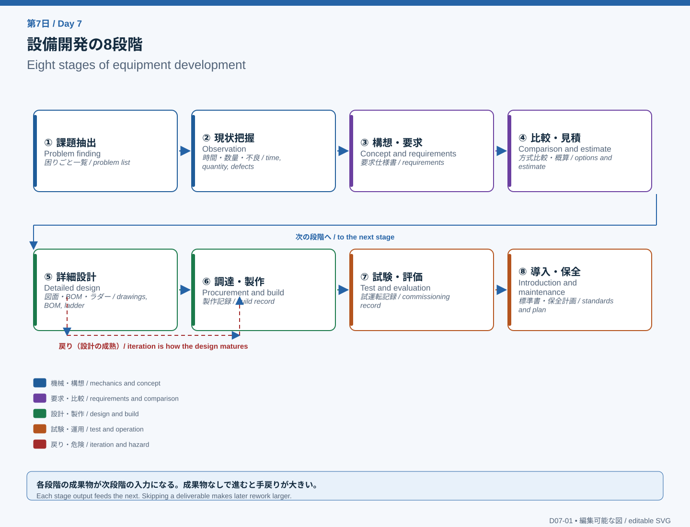
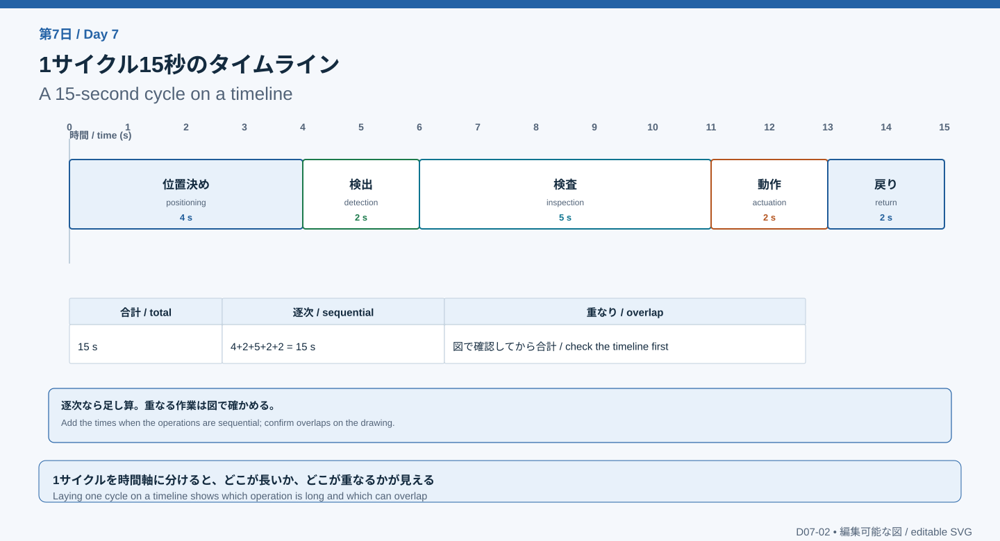
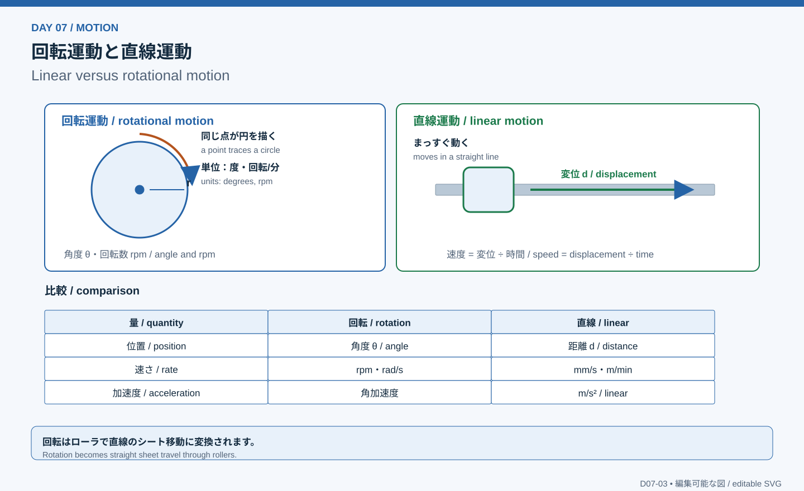
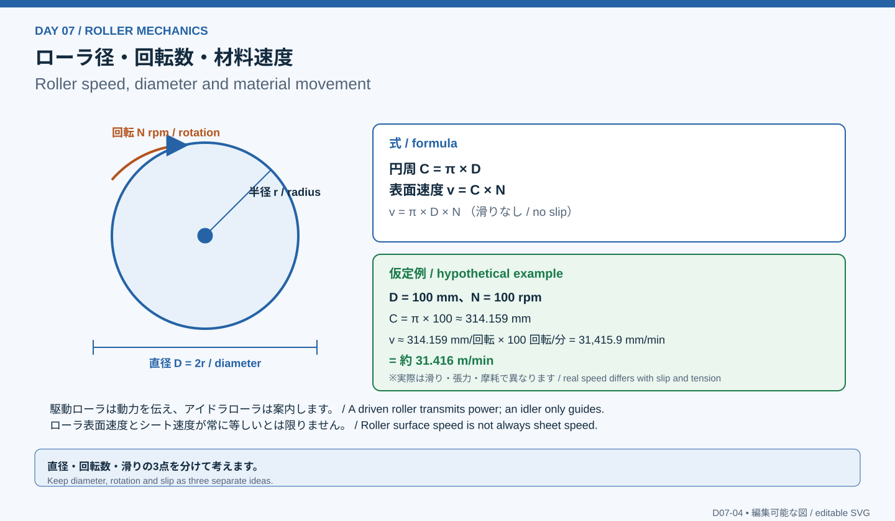
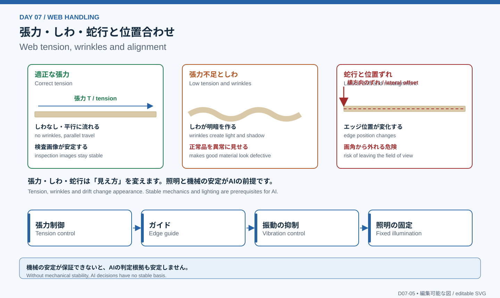
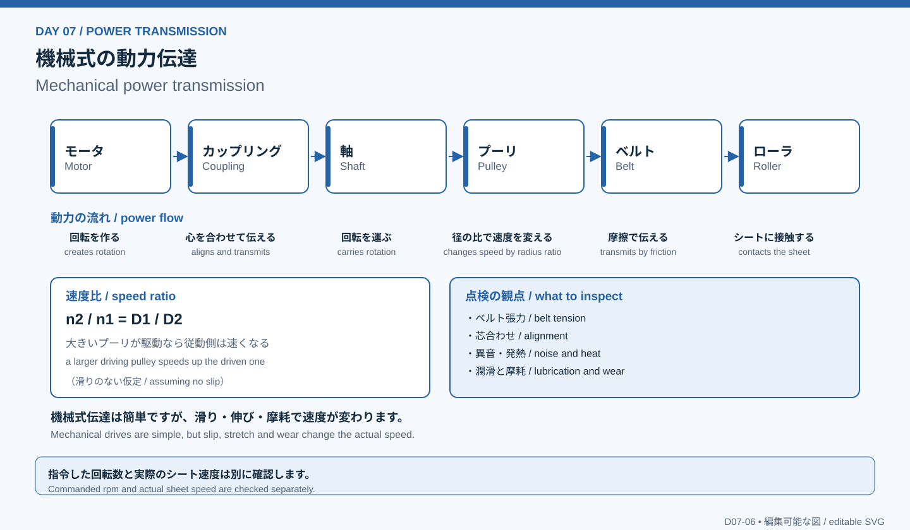

# 第7日 01：機械の基礎 / Day 7 01: Mechanical Fundamentals

**所要時間：80分 / Duration: 80 minutes.** [第7〜9日 時間割 / Day 7–9 syllabus](../../COURSE_SYLLABUS_DAY07_09.md)

この教材は、機械を見たことがあるが設計したことはない人向けです。計算機は不要で、紙とペンで十分です。中心事例は「連続塩ビシート検査機」という**架空の教育用モデル**です。実機の寸法・速度・型番は一切断定しません。
This lesson is for people who have seen machines but never designed one. No calculator is required; paper and pencil are enough. The central case is a **fictional training model**: a continuous PVC sheet inspection machine. No real dimensions, speeds or model numbers are claimed.

**到達目標 / Objectives:** 機構・機械・フレーム・アクチュエータ・センサ・制御装置の役割を区別し、回転と直線の動きを単位付きで説明する。ローラ径と回転数から材料速度を計算し、機械の不安定さが検査画像に与える影響を説明できる。
Distinguish mechanism, machine, frame, actuator, sensor and controller; explain rotation and linear motion with units; calculate nominal material speed from roller diameter and rotation; explain how mechanical instability degrades inspection images.

## 1. 機械とは何か / What is a machine?

機械は、エネルギーを都合のよい動きに変え、決まった仕事をする仕組みです。検査機の場合、仕事は「材料を正しい位置と速度でカメラの前へ運び、安定した画像を得る」ことです。ここで大切なのは、機械・センサ・制御装置・計算機が**別々の役割**を持ちながら一つの結果を作るという点です。

A machine converts energy into a useful motion that performs a defined job. For an inspection machine the job is to carry material past a camera at the right position and speed and obtain a stable image. The important point is that the machine, sensors, controller and computer have **separate roles** yet produce one result.

まず言葉を分けます。**機構（mechanism）**は、リンクや歯車など、動きを伝える部品の組み合わせです。**機械（machine）**は、機構に動力・制御・安全を加えて仕事をする全体です。**フレーム（frame）**は部品を支える構造、**アクチュエータ**は動きを作る部品、**センサ**は状態を情報に変える部品、**制御装置（controller）**は情報に従って指令を出す装置です。

Let us separate the words. A **mechanism** is a combination of parts such as links or gears that transmits motion. A **machine** adds power, control and safety to mechanisms to perform work. A **frame** supports the parts, an **actuator** creates motion, a **sensor** turns a condition into information, and a **controller** issues commands based on that information.

**図 D07-01 / Figure D07-01 — 確認 / check:** 材料を動かすのはどの層で、判定をするのはどの層ですか？ / Which layer moves the material, and which layer makes the decision?

| 要素 / element | 役割 / role | 検査機での例 / example here |
|---|---|---|
| 機構 / mechanism | 動きを伝える / transmits motion | ローラ、ベルト、軸 / rollers, belts, shafts |
| アクチュエータ / actuator | 動きを作る / creates motion | モータ、シリンダ / motor, cylinder |
| センサ / sensor | 状態を情報にする / condition → information | 材料有無、エンコーダ / presence, encoder |
| 制御装置 / controller | 判断して指令する / decides and commands | PLC / PLC |
| 計算機 / computer | 画像を処理する / processes images | 産業用PC / industrial PC |

## 2. 機械構造の部品 / Mechanical structure parts

**フレーム**は、重さ・振動・張力を支えます。薄い板を溶接しただけの台では、モータの振動でカメラが揺れ、画像がぼけます。**ブラケット**は部品を固定する金具、**シャフト（軸）**は回転を伝える棒、**ベアリング**は軸を支えながら摩擦を減らします。ベアリングが摩耗すると、軸がわずかに動き、ローラの位置と回転が不安定になります。

A **frame** carries weight, vibration and tension. A table made from thin welded sheet will let motor vibration shake the camera and blur images. A **bracket** holds a part, a **shaft** transmits rotation, and a **bearing** supports the shaft while reducing friction. Worn bearings let the shaft move slightly, making roller position and rotation unstable.

**カップリング**はモータ軸と機械軸をつなぎます。芯がずれたまま締め付けると振動と発熱が増えます。**プーリとベルト**、**チェーン**、**ギア**は回転を離れた場所へ伝え、径や歯数の比で速度を変えます。**ガイドレール**や**リニアガイド**は直線運動を案内します。**ローラ**は材料に接触する回転体で、駆動ローラとアイドラローラ（従動）は役割が違います。

A **coupling** joins the motor shaft to the machine shaft; clamping it with misalignment increases vibration and heat. **Pulleys and belts**, **chains** and **gears** carry rotation to another place and change speed by radius or tooth ratio. **Guide rails** and **linear guides** constrain straight movement. A **roller** is a rotating body that contacts the material; driven and idler (non-driven) rollers have different jobs.

**図 D07-02 / Figure D07-02 — 確認 / check:** ベアリングが摩耗すると、検査画像にどんな変化が出ると予想しますか？ / What change in the inspection image would you expect from a worn bearing?

| 部品 / part | 受ける力・動き / load or motion | よくある故障の兆候 / typical failure sign |
|---|---|---|
| フレーム / frame | 重量・振動 / weight, vibration | びびり、ボルト緩み / chatter, loose bolts |
| シャフト / shaft | ねじり・曲げ / torsion, bending | 振れ、異音 / run-out, noise |
| ベアリング / bearing | ラジアル荷重 / radial load | 発熱、ざらつき / heat, roughness |
| ローラ / roller | 接触・摩耗 / contact, wear | 表面傷、偏摩耗 / surface marks, uneven wear |
| ベルト / belt | 張力・摩擦 / tension, friction | 伸び、滑り / stretch, slip |

## 3. 回転運動と直線運動 / Rotation and linear motion

回転運動では、点は円を描きます。1分あたりの回転数を **rpm**（revolutions per minute）で表します。直線運動では、物体は決まった方向へ移動し、変位は mm や m、速さは mm/s や m/min で表します。この二つは、ローラと材料の接触で結び付きます。

In rotational motion a point traces a circle, and rotations per minute are expressed in **rpm**. In linear motion an object moves in a defined direction; displacement is in mm or m and speed in mm/s or m/min. The two are linked where a roller touches the material.

単位換算は暗記ではなく、意味で確認します。1 m = 1,000 mm、1 分 = 60 秒です。したがって 30 m/min は 30,000 mm / 60 s = 500 mm/s です。移動量は「速さ × 時間」で、加速度は「速さの変化の割合」です。等速と加速を混ぜると計算を誤ります。

Check unit conversions by meaning rather than memorising: 1 m = 1,000 mm and 1 min = 60 s, so 30 m/min is 30,000 mm ÷ 60 s = 500 mm/s. Displacement is speed × time; acceleration is the rate of change of speed. Mixing constant speed with acceleration produces wrong answers.

**図 D07-03 / Figure D07-03 — 確認 / check:** ローラの回転数が同じでも、径が変わると材料速度はどうなりますか？ / If rotation stays the same but the diameter changes, what happens to material speed?

## 4. ローラの力学 / Roller mechanics

**駆動ローラ**はモータから動力を受けて材料を送ります。**アイドラローラ**は動力を持たず、材料の進行方向を案内し、張力を整えます。ローラの**直径 D** が決まれば円周 C = π × D が決まり、1回転で材料が進む距離の目安になります。

A **driven roller** receives power from the motor and moves the material. An **idler roller** has no drive; it guides direction and helps tension. Once the **diameter D** is known, the circumference C = π × D gives the nominal distance travelled per revolution.

材料速度の式は次のとおりです。
The material-speed formula is:

**v = C × N = π × D × N**

ここで v は表面速度、D は直径、N は単位時間あたりの回転数です。**この式は滑りがない（no slip）と仮定しています。**実際には、材料とローラの間の滑り、張力、摩耗、汚れによって、材料速度は計算値と一致しないことがあります。

Here v is surface speed, D is diameter and N is revolutions per unit time. **The formula assumes no slip.** In reality, slip between material and roller, tension, wear and contamination can make the actual material speed differ from the calculated value.

**仮定例 / Hypothetical example:** 直径 100 mm のローラが 100 rpm で回るとします。円周は π × 100 ≈ 314.159 mm です。1分間に100回転するので、表面速度は約 314.159 × 100 = 31,415.9 mm/min、つまり約 **31.416 m/min** です。これは設計の出発点であり、実測の保証ではありません。

Take a 100 mm diameter roller rotating at 100 rpm. The circumference is π × 100 ≈ 314.159 mm. At 100 revolutions per minute the surface speed is about 314.159 × 100 = 31,415.9 mm/min, or roughly **31.416 m/min**. This is a design starting point, not a guarantee of measured speed.

**図 D07-04 / Figure D07-04 — 確認 / check:** 計算値と実測値が違うとき、最初に何を疑いますか？ / When calculated and measured speeds differ, what do you check first?

## 5. シート搬送 / Web transport

連続シート（ウェブ）は、供給ロールから出て、いくつかのガイドローラを通り、駆動ローラで送られ、巻取りへ進みます。**張力**が弱すぎるとしわができ、強すぎると伸びや破断の危険が増します。**蛇行（横方向のずれ）**は、ローラの平行度や材料の偏りで起こり、画角から材料が外れる原因になります。

A continuous web leaves the supply roll, passes guide rollers, is advanced by a driven roller and winds up downstream. Too little **tension** creates wrinkles; too much increases stretch and breakage risk. **Lateral drift** comes from roller misalignment or uneven material and can move the web out of the camera's view.

**振動**は画像のぼけを生み、**しわ**は明暗のむらを作ります。どちらも「欠陥ではないもの」を欠陥に見せることがあります。検査の安定性は、照明だけでなく機械の安定性に依存します。

**Vibration** blurs images and **wrinkles** create light and shadow variations. Both can make a defect-free area look defective. Inspection stability depends on mechanical stability, not only on lighting.

**図 D07-05 / Figure D07-05 — 確認 / check:** しわによる影をAIが欠陥と判定した場合、AIの調整だけで解決できますか？ / If AI reports a wrinkle shadow as a defect, can software tuning alone solve it?

## 6. 動力伝達 / Power transmission

モータの回転は、カップリング、軸、プーリ、ベルトを経てローラへ届きます。プーリの速度比は、滑りがないと仮定すると **n2 / n1 = D1 / D2** です。ベルトが滑ったり伸びたりすると、この比どおりになりません。チェーンは滑りにくい半面、張りと潤滑の管理が必要です。

Motor rotation reaches the roller through couplings, shafts, pulleys and belts. Assuming no slip, the pulley speed ratio is **n2 / n1 = D1 / D2**. Belt slip or stretch breaks that ratio. Chains slip less but need tension and lubrication control.

**図 D07-06 / Figure D07-06 — 確認 / check:** ベルトが滑っているとき、モータの回転数から材料速度を決めてよいですか？ / While a belt slips, may you derive material speed from motor rpm?

## 7. 機械の不調がAI検査に与える影響 / How mechanical problems affect AI inspection

AIモデルは与えられた画像を処理します。画像がぼけていれば、モデルは「ぼけた画像」を判断します。以下は代表的な因果関係です。

An AI model processes the image it receives. If the image is blurred, the model judges a blurred image. Typical chains of cause and effect:

| 機械の現象 / mechanical event | 画像への影響 / effect on image | 検査への影響 / effect on inspection |
|---|---|---|
| カメラの振動 / camera vibration | ぼけ / blur | 小さな傷の見落とし / missed fine defects |
| シート高さの変化 / sheet height change | ピントずれ / focus loss | コントラスト低下 / lower contrast |
| 速度変動 / speed variation | 同期ずれ / sync error | 位置ずれ・重複 / shifted or duplicated results |
| しわ / wrinkles | 明暗むら / shading | 誤検出 / false positives |
| ローラの偏り / roller misalignment | 材料位置の変化 / position shift | 画角外れ / out-of-view material |
| 照明取付の緩み / loose light mount | 反射の変化 / changing glare | 判定の不安定化 / unstable decisions |

**よくある誤解 / Common misunderstanding:** 「モデルを再学習すれば機械の問題も解決する」。機械が不安定なままでは、同じ材料でも画像が変わり続けます。まず機械と照明を安定させ、その条件でモデルを評価します。
“Retraining the model will fix the mechanical problem.” While the machine is unstable, images of the same material keep changing. Stabilise the machine and lighting first, then evaluate the model under those conditions.

## 8. シミュレーション：ローラ速度 / Simulation: roller speed

`day07_09_support/simulations/sim_roller_speed.html` を開くと、ローラ径と回転数を動かして**公称表面速度**を確認できます。滑りがない前提と、単位の意味も画面に表示します。ネットワークもPLCも使いません。

Open `day07_09_support/simulations/sim_roller_speed.html` to vary roller diameter and rotation and read the **nominal surface speed**, with the no-slip assumption and units shown on screen. No network and no PLC are used.

## 9. 演習 / Exercises

1. 図 D07-01 を見て、機械・センサ・制御・計算・安全の要素を一つずつ挙げてください。 / From D07-01, name one element for each of: mechanics, sensors, control, computing, safety.
2. 「機構」と「機械」の違いを、自分の言葉で一文ずつ書いてください。 / Write one sentence each explaining mechanism versus machine.
3. 直径 80 mm のローラが 200 rpm で回るとき、滑りがないと仮定した表面速度を m/min で求めてください。 / A 80 mm roller turns at 200 rpm. Calculate the no-slip surface speed in m/min.
4. 検査画像が全体にぼやけているとき、機械側の原因を三つ挙げてください。 / List three mechanical causes of a globally blurred inspection image.
5. しわによる明暗が「欠陥」と判定された場合、AIの前に確認すべきことを二つ書いてください。 / If a wrinkle shadow is judged a defect, name two things to check before touching the AI.

### 解答例 / Worked answers

1. 例：機械＝ガイドローラ、センサ＝材料有無センサ、制御＝PLC、計算＝産業用PC、安全＝ガードとインターロック。 / Example: mechanics = guide rollers; sensors = material-presence sensor; control = PLC; computing = industrial PC; safety = guarding and interlocks.
2. 機構は動きを伝える部品の組合せ、機械は動力・制御・安全を含む全体。 / A mechanism is a combination of parts transmitting motion; a machine is the whole system with power, control and safety.
3. C = π × 80 ≈ 251.327 mm。251.327 × 200 = 50,265.5 mm/min ≈ **50.27 m/min**（滑りなしの仮定）。 / C ≈ 251.327 mm; × 200 ≈ 50,265.5 mm/min ≈ **50.27 m/min** (no-slip assumption).
4. 例：カメラブラケットの緩み、フレームの振動、シート高さの変動、ローラの振れ。 / Examples: loose camera bracket, frame vibration, sheet-height variation, roller run-out.
5. 例：張力が適正か、ローラが平行か、照明が均一か。 / Examples: is tension correct, are rollers parallel, is lighting even?

## 9. まとめ / Summary

機械は、フレーム・軸・ベアリング・ローラなどの構造、モータなどのアクチュエータ、センサ、制御装置、計算機、安全系が層になって働く全体です。回転はローラを介して直線の材料移動になりますが、滑りや摩耗を無視すると計算と実測がずれます。機械の不安定さは画像の不安定さになり、AIの判定も不安定になります。

A machine is a layered whole of structure (frame, shafts, bearings, rollers), actuators such as motors, sensors, controllers, computers and safety systems. Rotation becomes linear material travel through rollers, but ignoring slip and wear separates calculation from measurement. Mechanical instability becomes image instability and then unstable AI decisions.

**完了条件 / Completion criteria:** 5つの演習に自分の言葉で答え、ローラ速度の計算を単位付きで説明できること。D07-01〜D07-06 の図で、各部品の役割を説明できること。
**Completion criteria:** answer all five exercises in your own words and explain the roller-speed calculation with units; explain the role of each part in D07-01 to D07-06.

**安全に関する注意 / Safety note:** 本教材は教育用の概念説明です。実際の機械の分解・点検・調整は、現地の安全手順と有資格者の監督のもとで行ってください。
**Safety note:** This is conceptual training material. Work on real machinery only under site safety procedures and qualified supervision.
