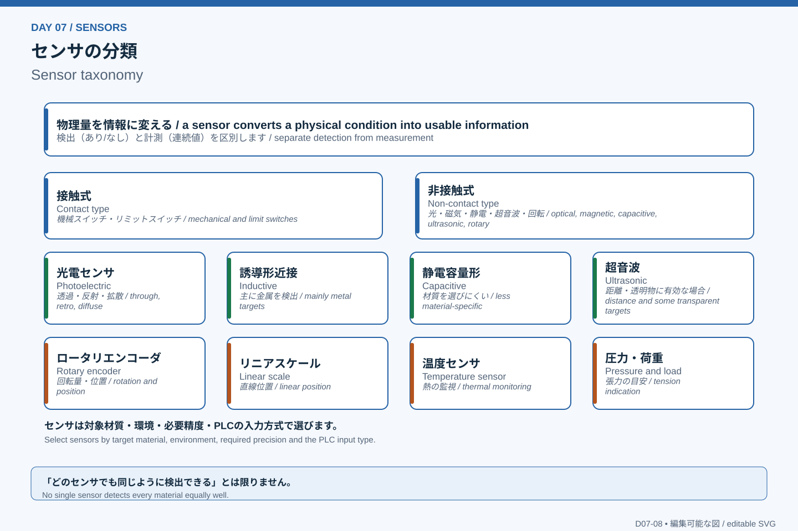
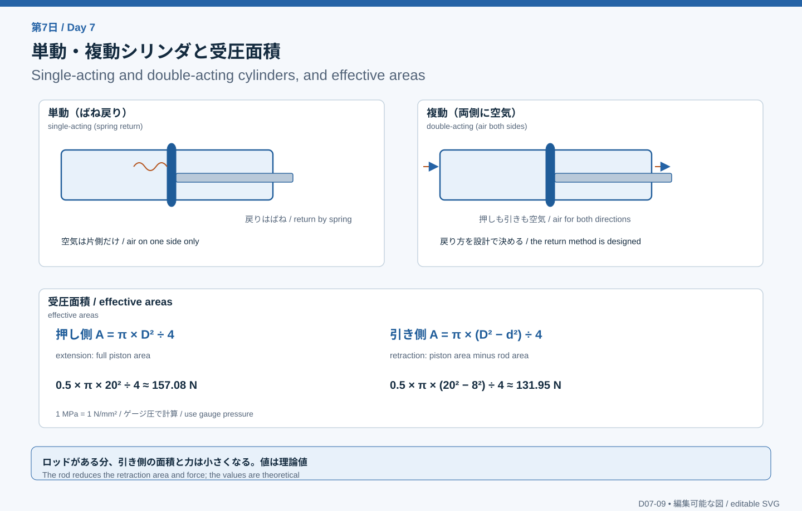
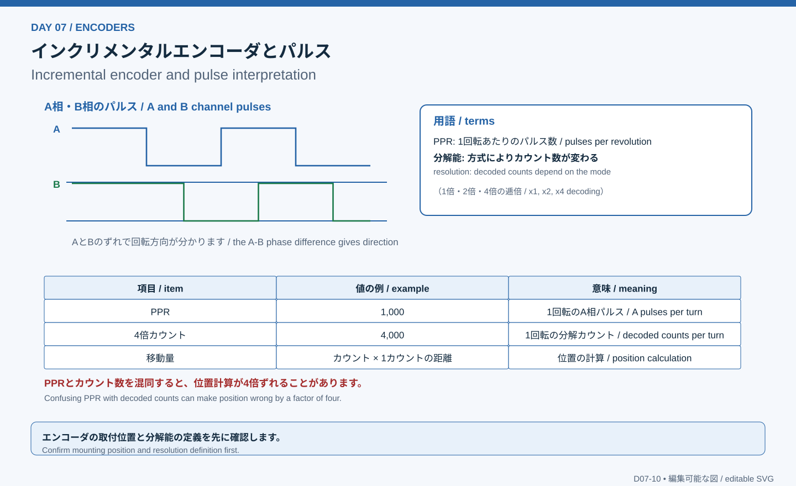

# 第7日 02：センサと信号 / Day 7 02: Sensors and Signals

**所要時間：85分 / Duration: 85 minutes.** [第7〜9日 時間割 / Day 7–9 syllabus](../../COURSE_SYLLABUS_DAY07_09.md)

センサは「現場の状態」を「使える情報」に変える部品です。この教材では、種類の暗記ではなく、**何を検出したいのか、どの信号で受け取るのか、故障をどう見つけるのか**を考えます。
A sensor turns a field condition into usable information. This lesson is not about memorising types; it is about **what must be detected, which signal carries it, and how to recognise a failure.**

**到達目標 / Objectives:** 検出と計測の違い、デジタルとアナログの違い、エンコーダのパルスとカウントの違いを説明し、対象材質と環境からセンサを選べるようになる。
Explain detection versus measurement and digital versus analog signals; explain encoder pulses versus counts; choose a sensor from target material and environment.

## 1. センサとは何か / What is a sensor?

センサは、物理的な条件（光、磁気、圧力、温度、位置など）を受け取り、制御装置が扱える信号に変換します。**検出（detection）**は「ある/なし」を決めること、**計測（measurement）**は連続した量を数値で表すことです。アクチュエータが動きを作るのに対し、センサは状態を情報にします。

A sensor receives a physical condition (light, magnetism, pressure, temperature, position) and converts it into a signal a controller can use. **Detection** decides present/absent; **measurement** expresses a continuous quantity as a number. An actuator creates motion; a sensor turns state into information.

**機械スイッチ**は接触で動き、**電子センサ**は光や磁気などを非接触で使うことが多いです。機械スイッチは構造が分かりやすい一方、接触による摩耗や押し込み量の調整が必要です。電子センサは高速・長寿命の反面、電源・ノイズ・汚れの影響を受けます。

**Mechanical switches** operate by contact, while **electronic sensors** often work without contact using light or magnetism. Mechanical switches are easy to understand but wear and need adjustment of travel. Electronic sensors are fast and long-lived but are affected by power supply, electrical noise and contamination.

## 2. 主なセンサの種類 / Main sensor types

**図 D07-08 / Figure D07-08 — 確認 / check:** 透明シートの有無を確実に検出したいとき、光電センサの方式をどう選びますか？ / To detect a transparent sheet reliably, how would you choose a photoelectric sensing mode?

**光電センサ**は光を使います。**透過形**は投光器と受光器を向かい合わせ、物体が光を遮るのを検出します。**回帰反射形**は反射板を使い、**拡散反射形**は物体自身の反射を使います。透明体は光をよく通すため、透過形でも検出が難しくなることがあり、方式・感度・背景の影響を確認する必要があります。

**Photoelectric sensors** use light. **Through-beam** types place emitter and receiver opposite each other and detect an object blocking the beam. **Retroreflective** types use a reflector; **diffuse** types use the object's own reflection. Transparent materials transmit light, so even through-beam detection can be difficult; verify the mode, sensitivity and background.

**誘導形近接センサ**は主に金属を検出します。**静電容量形**は誘電体の変化を使うため材質を選びにくい反面、周囲の影響を受けやすいです。**超音波**は空気中の音波を使い、距離や一部の透明物に有効な場合があります。**ロータリエンコーダ**と**リニアスケール**は位置や移動量を測ります。**温度**・**圧力**・**荷重**のセンサは状態監視に使います。

**Inductive proximity sensors** mainly detect metal. **Capacitive** sensors use dielectric change and are less material-specific but more sensitive to surroundings. **Ultrasonic** sensors use airborne sound and can suit distance or some transparent targets. **Rotary encoders** and **linear scales** measure position or travel. **Temperature**, **pressure** and **load** sensors support condition monitoring.

**重要な注意 / Important caution:** 一つのセンサがあらゆる材質を同じように検出できるわけではありません。対象材質、表面状態、周囲光、汚れ、温度、取付距離を確認して選びます。
No single sensor detects every material equally well. Select by target material, surface, ambient light, contamination, temperature and mounting distance.

## 3. デジタル信号 / Digital signals

デジタル信号は二つの状態を持ちます。ON/OFF、TRUE/FALSE、1/0 などと呼びます。PLCの入力は、この二状態をビットとして扱います。「検出した」を1とするか0とするかは、**配線とプログラムの両方**で決まります。

A digital signal has two states: ON/OFF, TRUE/FALSE, 1/0. A PLC treats the input as one bit. Whether “detected” is 1 or 0 depends on **both wiring and program**.

**アクティブハイ**は「ONのとき真」、**アクティブロー**は「OFFのとき真」という約束です。ここで混同しやすいのが、**現場スイッチの物理配線（NO/NC）**と、**ラダー上の論理接点（NO/NC）**の違いです。物理的にNC接点のスイッチをNO入力に配線すれば、押されていないときにビットは1になります。論理接点の評価は、あくまで**ビットの値**を見ます。この区別は第8日で詳しく扱います。

**Active-high** means true when ON; **active-low** means true when OFF. A frequent confusion is the difference between a **field switch's physical wiring (NO/NC)** and a **logical contact in ladder (NO/NC)**. Wire a physically NC switch into a NO input and the bit reads 1 while the switch is not pressed. The logical contact evaluates only the **bit value**. Day 8 treats this in detail.

**図 D07-09 / Figure D07-09 — 確認 / check:** タイミング図で「検出」の期間が短いとき、PLCは必ず捉えられますか？ / If a timing diagram shows a very short detection, will the PLC always capture it?

## 4. アナログ信号 / Analog signals

アナログ信号は連続した量を表します。代表的な工業用信号は **0–10 V** と **4–20 mA** ですが、実際の信号形式は選んだ機器の仕様で確認します。アナログ入力モジュールは電圧や電流を数値に変換し、プログラムはその数値を物理量に**スケーリング**します。

Analog signals represent continuous quantities. Common industrial signals are **0–10 V** and **4–20 mA**, but the actual form depends on the selected device. An analog input module converts voltage or current into a number, and the program **scales** that number to a physical quantity.

スケーリングには、必ず**物理範囲**と**電気範囲**の両方が必要です。例えば、0–100 kPa を 0–10 V で出力する仮定の圧力センサなら、5 V は 50 kPa です。4–20 mA の場合は 4 mA が 0 kPa、20 mA が 100 kPa、12 mA が 50 kPa です。**範囲を書かずに公式だけ教えることはしません。**

Scaling always needs **both** a physical range and an electrical range. For a hypothetical pressure sensor with 0–100 kPa on 0–10 V, 5 V is 50 kPa. With 4–20 mA, 4 mA is 0 kPa, 20 mA is 100 kPa and 12 mA is 50 kPa. **We never teach a formula without both ranges.**

| 項目 / item | 0–10 V の例 / example | 4–20 mA の例 / example |
|---|---|---|
| 物理範囲 / physical range | 0–100 kPa | 0–100 kPa |
| 最小 / minimum | 0 V = 0 kPa | 4 mA = 0 kPa |
| 中央 / midpoint | 5 V = 50 kPa | 12 mA = 50 kPa |
| 最大 / maximum | 10 V = 100 kPa | 20 mA = 100 kPa |
| 断線の見分け / open circuit | 0 V と区別しにくい / hard to separate | 0 mA は断線の手がかり / 0 mA hints at a break |

**ノイズ・分解能・校正**はアナログの重要語です。ノイズは値のばらつき、分解能は区別できる最小の変化、校正は表示値と実量の対応付けです。4–20 mA は「0 mA が正常値と区別しやすい」ため断線検出に使われることがありますが、すべての機器に同じ利点があるわけではありません。

**Noise**, **resolution** and **calibration** matter for analog signals. Noise is scatter, resolution is the smallest distinguishable change, and calibration links indicated value to actual quantity. 4–20 mA can make an open circuit easier to separate from a valid zero, but not every device shares that advantage.

## 5. エンコーダの基礎 / Encoder fundamentals

ロータリエンコーダは回転をパルスに変えます。**増分形（incremental）**は回転に応じてパルスを出し、**絶対形（absolute）**は位置をコードとして出力します。増分形は基準位置から数えるため、電源投入時に基準合わせが必要な場合があります。

A rotary encoder converts rotation into pulses. **Incremental** encoders output pulses as the shaft turns; **absolute** encoders output a coded position. Incremental types count from a reference and may need homing after power-up.

**PPR（pulses per revolution）**は1回転あたりのA相パルス数です。A相とB相を組み合わせ、位相差から回転方向が分かります。**カウント数はデコード方式で変わります。**1倍（Aのみ）、2倍（Aの立ち上がりと立ち下がり）、4倍（AとBの両エッジ）では、同じPPRでも1回転のカウント数が1倍・2倍・4倍になります。

**PPR (pulses per revolution)** is the number of A-channel pulses per turn. Combining A and B gives direction from the phase difference. **Decoded counts depend on the decoding mode:** x1 (A only), x2 (both edges of A) and x4 (both edges of A and B) yield different counts for the same PPR.

**仮定例 / Hypothetical example:** PPR = 1,000、4倍デコードとすると、1回転は 4,000 カウントです。1カウントは 360° ÷ 4,000 = 0.09° に相当します。直径 100 mm のローラなら、1回転の移動は π × 100 ≈ 314.159 mm なので、1カウント ≈ 314.159 ÷ 4,000 ≈ 0.07854 mm です。**これは滑りがない場合の公称値です。**

With PPR = 1,000 and x4 decoding, one turn is 4,000 counts. One count is 360° ÷ 4,000 = 0.09°. On a 100 mm diameter roller the travel per turn is π × 100 ≈ 314.159 mm, so one count ≈ 314.159 ÷ 4,000 ≈ 0.07854 mm. **This is nominal, assuming no slip.**

**図 D07-10 / Figure D07-10 — 確認 / check:** PPR 1,000 を「1回転1,000カウント」と言い切ってよいですか？ / May you state that PPR 1,000 always means 1,000 counts per turn?

**位置と速度**は別の量です。一定時間のカウント差は移動量、その移動量を時間で割れば速度です。エンコーダの取付位置（モータ軸か、ローラ軸か、材料に当たる測定ローラか）によって、測っている対象が変わります。モータ軸の回転は、滑りや減速機の影響を含まない「モータの回転」であり、材料の移動そのものではありません。

**Position and speed** are different quantities. A count difference over a fixed time is travel; travel divided by time is speed. Where the encoder is mounted (motor shaft, roller shaft or a measuring roller touching the material) changes what is actually measured. Motor-shaft rotation is the motor's rotation, not the material's travel, and excludes slip and gearbox effects.

## 6. センサの信頼性 / Sensor reliability

**誤検出（false detection）**は、対象がないのに検出すること、またはその逆です。原因には、汚れ、位置ずれ、外乱光、電気ノイズ、応答時間の不足、取付の緩みがあります。**再現性（repeatability）**は同じ条件で同じ結果が得られる度合いです。再現性が悪いセンサは、調整しても安定しません。

A **false detection** reports presence when there is none, or vice versa. Causes include contamination, misalignment, ambient light, electrical noise, insufficient response time and loose mounting. **Repeatability** is how consistently the same condition gives the same result; a sensor with poor repeatability will not become stable through adjustment alone.

**信号の消失**は最も危険な故障の一つです。「材料なし」と「センサ断線」が同じビットになると、制御は区別できません。可能なら、**正常時とは異なる状態**を故障として扱える設計（例：4–20 mA の0 mA、通信のタイムアウト）を検討します。ただし、これも機器の仕様と安全要求を確認して決めます。

**Loss of signal** is one of the most dangerous failures. If “no material” and “sensor disconnected” produce the same bit, control cannot tell them apart. Where possible, design so that a **state different from normal operation** indicates failure (for example 0 mA on a 4–20 mA loop, or a communication timeout). Even this depends on device specifications and safety requirements.

## 7. センサの選び方 / Selecting a sensor

選定では次の順に問います。①何を検出・計測するか。②材質・表面・色・透明性は何か。③動いているか、静止か。④必要なのは有無か位置か。⑤必要な精度・分解能は。⑥環境（水・油・粉塵・温度・光）は。⑦制御装置が受けられる信号は。⑧故障をどう見つけるか。

Ask in this order: (1) what must be detected or measured; (2) material, surface, colour, transparency; (3) moving or stationary; (4) presence or position; (5) required accuracy and resolution; (6) environment (water, oil, dust, temperature, light); (7) which signal the controller accepts; (8) how failure will be recognised.

| 質問 / question | 検査機での例 / example in this machine |
|---|---|
| 何を検出する / what to detect | シートの有無、エッジ位置 / sheet presence, edge position |
| 材質 / material | 塩ビシート（透明〜不透明の仮定） / PVC sheet (assumed clear to opaque) |
| 動き / motion | 連続移動 / continuous movement |
| 精度 / accuracy | 位置の目安か、精密計測か / indicative or precise |
| 環境 / environment | 粉塵・照明・振動 / dust, lighting, vibration |
| 信号 / signal | デジタル入力、アナログ入力、パルス / digital, analog, pulse |
| 故障検出 / failure | 断線・タイムアウトの扱い / open circuit, timeout |

## 8. シミュレーション：センサ信号 / Simulation: sensor signals

`day07_09_support/simulations/sim_sensor_signals.html` では、架空のセンサ状態を切り替えて、**デジタル信号・アナログ値・エンコーダパルス**の表示を確認できます。実機とは接続しません。

`day07_09_support/simulations/sim_sensor_signals.html` lets you toggle fictional sensor states and observe **digital signals, analog values and encoder pulses**. It connects to no real equipment.

## 9. 演習 / Exercises

1. 透明シートの「有無」を検出するセンサを一つ選び、理由と限界を書いてください。 / Choose one sensor to detect presence of a transparent sheet; give a reason and a limitation.
2. 次のタイミングを言葉で説明してください：X0 が 0→1 になり 40 ms 後 1→0、Y0 は X0 の立ち上がりで1になり、立ち下がりで0になる。 / Describe this timing in words: X0 goes 0→1, then 1→0 after 40 ms; Y0 becomes 1 on the rising edge and 0 on the falling edge.
3. 0–10 V で 0–200 kPa を表す仮想センサのとき、7.5 V は何 kPa ですか。 / A hypothetical 0–10 V sensor represents 0–200 kPa. What is 7.5 V in kPa?
4. PPR 500、2倍デコードのエンコーダで、1回転は何カウントですか。 / With PPR 500 and x2 decoding, how many counts are there per turn?
5. センサが「材料なし」を出し続けているとき、汚れ以外に確認することを三つ挙げてください。 / A sensor keeps reporting “no material”; name three things to check besides contamination.

### 解答例 / Worked answers

1. 例：透過形光電センサ。遮光の変化を使えるが、透明体では感度・背景・汚れの影響を確認する必要がある。 / Example: through-beam photoelectric sensor; it uses beam interruption, but transparency requires checking sensitivity, background and contamination.
2. 40 ms の短いパルスであり、PLCのスキャン周期より短いと取りこぼす可能性がある。 / It is a 40 ms pulse; if shorter than the scan, it may be missed.
3. 200 kPa × 7.5/10 = **150 kPa**。 / 200 × 7.5 ÷ 10 = **150 kPa**.
4. 500 × 2 = **1,000 カウント/回転**。 / 500 × 2 = **1,000 counts per turn**.
5. 例：取付位置のずれ、レンズ・投受光面の汚れ、電源・配線の断線、設定（しきい値）の変化、対象材質の変更。 / Examples: mounting shift, dirty lens, broken wiring or supply, changed threshold, changed material.

## 9. まとめ / Summary

センサは状態を情報に変えます。検出と計測、デジタルとアナログ、物理配線と論理評価を区別することが出発点です。エンコーダでは、PPRとデコード後のカウントを混同しないことが重要です。センサの故障、とくに信号消失をどう扱うかは、選定の段階で決めます。

Sensors turn state into information. Start by separating detection from measurement, digital from analog, and physical wiring from logical evaluation. With encoders, never confuse PPR with decoded counts. Decide at selection time how sensor failure, especially loss of signal, will be handled.

**完了条件 / Completion criteria:** 5つの演習に答え、デジタル・アナログ・パルスの違いを図で説明できること。
**Completion criteria:** answer the five exercises and explain digital, analog and pulse signals with a sketch.

**安全に関する注意 / Safety note:** センサの取付・交換は、機械停止・エネルギー遮断・現地手順の確認後に、有資格者が行います。
**Safety note:** Mounting or replacing sensors is done by qualified staff after stopping the machine, isolating energy and following site procedures.
