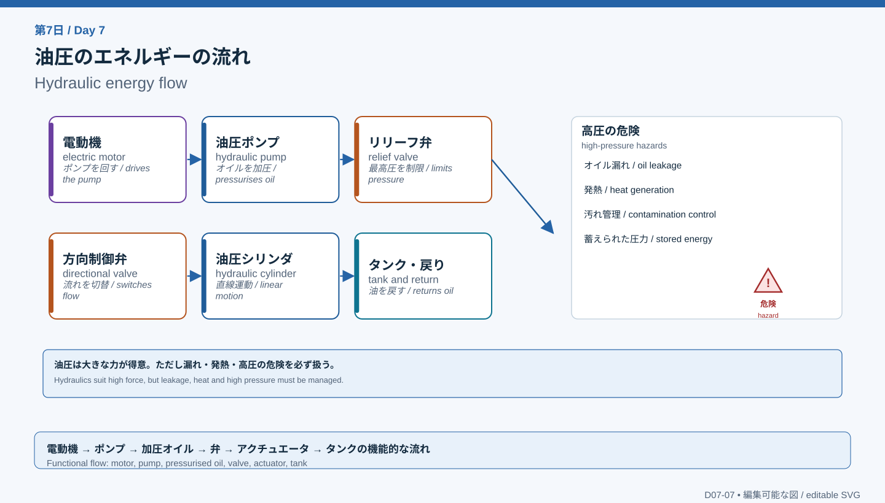
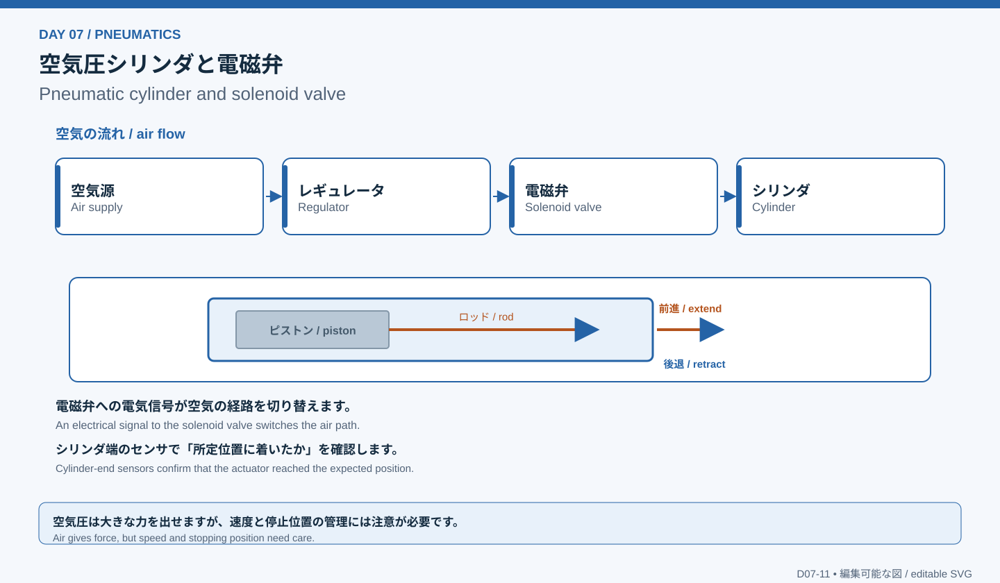
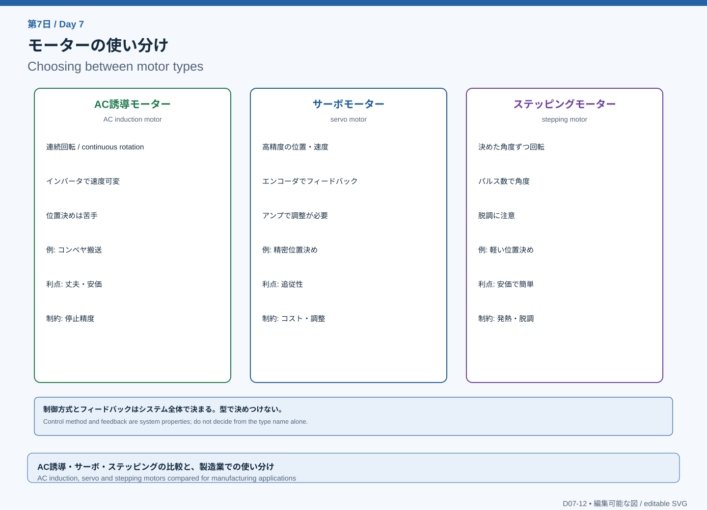
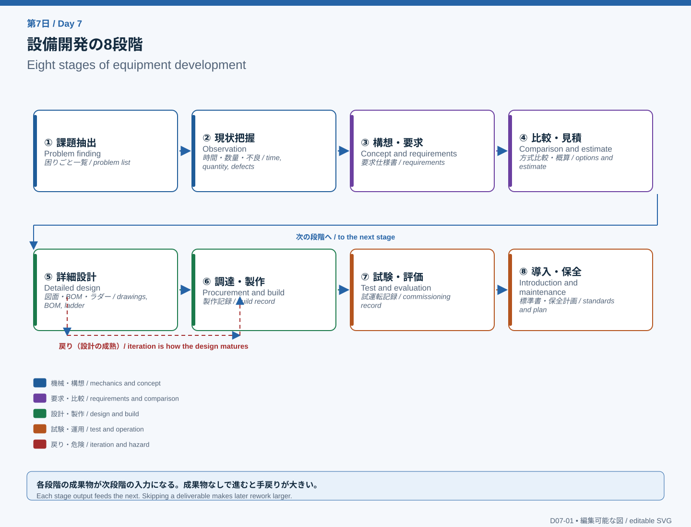

# 第7日 03：アクチュエータと機械構成 / Day 7 03: Actuators and Machine Construction

**所要時間：135分 / Duration: 135 minutes.** [第7〜9日 時間割 / Day 7–9 syllabus](../../COURSE_SYLLABUS_DAY07_09.md)

アクチュエータは「指令」を「動き」に変えます。この教材では、モータ・空気圧・電気制御部品を機能の違いで理解し、最後に検査機の全構成要素を一つの表にまとめます。
Actuators turn a command into motion. This lesson compares motors, pneumatics and electrical control parts by function, then consolidates every component of the inspection machine into one table.

**到達目標 / Objectives:** 電気・空気圧アクチュエータの指令と動力の違いを説明し、機械の危険源と保護の考え方を述べ、検査機の構成要素を目的・信号・故障・安全の観点で整理できる。
Explain command versus energy for electric and pneumatic actuators, describe hazards and protective measures, and organise the machine's components by purpose, signal, failure and safety.

## 1. アクチュエータとは何か / What is an actuator?

アクチュエータは、供給されたエネルギー（電気、圧縮空気、油圧など）を制御された動きに変えます。ここで二つを分けます。**指令信号**は「どう動くか」を伝える小さな信号、**エネルギー**は実際に力を出す源です。スイッチを押す力と、モータがシートを引く力は別物です。

An actuator converts supplied energy (electricity, compressed air, hydraulics) into controlled motion. Separate two things: the **command signal** says how to move, and the **energy** is the source of actual force. The force on a pushbutton and the force a motor applies to a web are different things.

## 2. 電動モータ / Electric motors

**直流モータ**は構造が簡単で速度制御しやすい反面、ブラシの摩耗があります。**交流誘導モータ**は丈夫で連続運転に向き、速度はインバータ（VFD）で調整します。**サーボモータ**は位置・速度・トルクを高精度に制御でき、フィードバックが必須です。**ステッピングモータ**は開ループで段階的に回り、負荷が大きいと脱調（指令と実際のずれ）が起こります。

**DC motors** are simple and easy to speed-control but have brush wear. **AC induction motors** are rugged for continuous duty and are speed-controlled by a VFD. **Servomotors** control position, speed and torque precisely and require feedback. **Stepper motors** move in open-loop steps and can lose steps under heavy load.

「サーボが一番良い」と決めつけません。必要な精度、速度、連続運転、費用、保守で選びます。**インバータ（VFD）**は周波数を変えて誘導モータの速度を調整しますが、設定値の変更は実機の手順と権限に従います。

Do not assume a servo is always best; choose by required accuracy, speed, continuous duty, cost and maintenance. A **VFD** changes frequency to adjust induction-motor speed; parameter changes follow site procedure and authority.

**図 D07-07 / Figure D07-07 — 確認 / check:** PLCがモータを直接動かさないのはなぜですか？ / Why does the PLC not drive the motor directly?

PLCの出力は小さな信号です。モータの運転電力は、ドライバや接触器などの**動力側**の機器が供給します。この区別は第8日の信号経路でも再び出てきます。

A PLC output is a small signal. The motor's operating power is supplied by **power-side** devices such as drivers and contactors. This distinction returns in the Day 8 signal path.

## 3. 空気圧 / Pneumatics

空気圧は、圧縮空気の力でシリンダを動かします。**空気源**から**レギュレータ**で圧力を整え、**電磁弁**で空気の経路を切り替え、**シリンダ**が前進・後退します。**複動シリンダ**は二方向に空気を送り、**単動シリンダ**はばねなどで戻ります。**シリンダ端のセンサ**は「所定位置に着いたか」を確認します。

Pneumatics move a cylinder with compressed air. Air comes from the **supply**, passes a **regulator**, is routed by a **solenoid valve**, and drives a **cylinder** forward or back. **Double-acting** cylinders take air on both sides; **single-acting** ones return by spring. **Cylinder-end sensors** confirm the expected position.

空気圧は大きな力を小さいスペースで出せ、過負荷で壊れにくいという利点があります。一方、空気は圧縮できるため**速度と停止位置の制御が難しく**、圧力変動や漏れの影響を受けます。さらに、残圧（閉じ込められたエネルギー）は危険です。整備前に必ず減圧し、残圧の確認を行います。

Pneumatics give high force in little space and tolerate overload. However, air is compressible, so **speed and stopping position are harder to control**, and pressure changes or leaks affect behaviour. Trapped pressure is stored energy and is hazardous; isolate and verify depressurisation before maintenance.

**図 D07-11 / Figure D07-11 — 確認 / check:** 「弁に信号を出した」だけで「シリンダが動いた」と判断してよいですか？ / Does commanding the valve prove the cylinder moved?

**本教材は、現場でそのまま使える空気圧安全回路を作りません。**安全は別の設計と検証が必要です。
**This course does not produce a field-deployable pneumatic safety circuit.** Safety needs separate design and validation.

## 4. 電気制御部品 / Electrical control components

**電源**は制御用の電力を供給します。**リレー**は小さな信号で別の回路を切り替え、**接触器（コンタクタ）**はモータなど大きな負荷の電源を入切します。**ヒューズ**と**ブレーカ**は過電流から保護します。**端子台**は配線の中継点、**PLC出力**は信号を出し、**ドライバ**や**ソレノイド**が実際の動きを担います。

A **power supply** provides control power. A **relay** switches another circuit from a small signal; a **contactor** makes and breaks the supply to a large load such as a motor. **Fuses** and **breakers** protect against overcurrent. A **terminal block** joins wiring, a **PLC output** issues a signal, and **drivers** or **solenoids** produce the physical action.

| 部品 / component | 信号側か動力側か / signal or power | 役割 / role |
|---|---|---|
| 電源 / power supply | 制御電力 / control power | 24 V などの制御電源 / control supply |
| リレー / relay | 信号 / signal | 小さな信号で回路を切替 / switches a circuit |
| 接触器 / contactor | 動力 / power | モータ電源の入切 / motor supply switching |
| ヒューズ / fuse | 保護 / protection | 過電流を遮断 / interrupts overcurrent |
| 端子台 / terminal block | 接続 / connection | 配線の中継 / wiring junction |
| PLC出力 / PLC output | 信号 / signal | 指令を出す / issues the command |
| ドライバ / driver | 動力 / power | モータへ電力を供給 / supplies motor power |
| ソレノイド / solenoid | 動力 / power（弁操作 / valve) | 空気の経路を切替 / routes air |

## 5. 位置決めと取付 / Positioning and mounting

カメラやセンサの取付は、検査精度に直結します。**カメラの取付**は剛性が高く、振動が伝わりにくい構造にします。**センサブラケット**は微調整ができ、緩まない構造が必要です。**位置合わせ**では、視野と対象の位置関係を決め、**機械的公差**の範囲で安定するかを確認します。

Camera and sensor mounting directly affects inspection accuracy. **Camera mounts** need stiffness and low vibration transmission. **Sensor brackets** need fine adjustment and must not work loose. **Alignment** fixes the relationship between field of view and target, and you check whether it stays stable within **mechanical tolerance**.

**防護カバー**は粉塵・水・接触から守ります。ただし、カバーが視野を妨げたり、汚れが付着しやすくなったりしないか確認します。**保守のアクセス**も設計の一部です。調整ねじが手の届かない場所にあると、現場で無理な力が加わります。

**Protective covers** keep out dust, water and contact, but must not obstruct the view or collect contamination. **Maintenance access** is part of the design; adjustment screws out of reach invite excessive force on site.

## 6. 機械安全の基本 / Basic machinery safety

危険源の例を挙げます。**挟まれ（pinch point）**、**ローラ間の巻き込み（nip point）**、**予期しない起動**、**動くベルト**、**高温面**、**電気**、**圧縮空気**、**蓄えられたエネルギー**です。対策は、**ガード**、**インターロック**、**非常停止**、**安全な保守手順**、そして**リスクアセスメント**です。

Hazards include **pinch points**, **nip points between rollers**, **unexpected start-up**, **moving belts**, **hot surfaces**, **electricity**, **compressed air** and **stored energy**. Measures include **guards**, **interlocks**, **emergency stops**, **safe maintenance procedures** and a **risk assessment**.

**重要な区別 / Essential distinction:** 機械安全は独立した工学分野です。通常のラダー1行で非常停止を実装した、と言うことはできません。安全機能は、危険源・要求性能・規格・選定機器・有資格のレビューに基づいて設計・検証されます。本教材は、展開可能な安全プログラムを作りません。
Machine safety is a distinct engineering discipline. You cannot claim an emergency stop is implemented by a single ordinary ladder rung. Safety functions are designed and validated from hazards, required performance, standards, selected equipment and competent review. This course produces no deployable safety program.

**図 D07-12 / Figure D07-12 — 確認 / check:** 「AIがNGを出したら停止」は安全機能ですか、品質対応ですか？ / Is “stop when AI says NG” a safety function or a quality response?

## 7. 検査機の全構成要素 / Complete machine component identification

中心事例の連続塩ビシート検査機（**架空の教育用モデル**）を、役割ごとに整理します。ここに挙げる数値・型番はありません（数値はすべて仮定です）。実際の装置は別途設計されます。
The continuous PVC sheet inspection machine (**fictional training model**) is organised by role. No numbers or model codes are asserted; a real machine is designed separately.

| # | 構成要素 / component | 目的 / purpose | 信号・エネルギー / signal or energy |
|---|---|---|---|
| 1 | シート入口 / sheet entry | 材料を導く / guides material | 機械 / mechanical |
| 2 | フレーム / frame | 支持 / support | 機械 / mechanical |
| 3 | ガイドローラ / guide rollers | 方向と張力 / direction and tension | 機械 / mechanical |
| 4 | 軸・ベアリング / shafts, bearings | 回転支持 / rotation support | 機械 / mechanical |
| 5 | 搬送機構 / transport drive | 材料を送る / advances material | 電気・機械 / electrical, mechanical |
| 6 | モータとドライブ / motor and drive | 動力を出す / produces power | 電気 / electrical |
| 7 | 張力の考え方 / tension concept | 安定搬送 / stable transport | 機械 / mechanical |
| 8 | エンコーダ / encoder | 移動量の測定 / travel measurement | パルス / pulses |
| 9 | 材料有無センサ / presence sensor | 有無の検出 / presence detection | デジタル / digital |
| 10 | エッジ検出の考え方 / edge sensing concept | 位置の監視 / position monitoring | デジタルまたはアナログ / digital or analog |
| 11 | 検査カメラ / inspection camera | 画像取得 / image capture | 画像データ / image data |
| 12 | 照明 / illumination | 見え方の安定 / stable appearance | 電気 / electrical |
| 13 | 産業用PC / industrial PC | 画像処理とAI / imaging and AI | データ / data |
| 14 | AI推論（YOLO/PatchCore） / AI inference | 判定 / decision | ソフトウェア / software |
| 15 | PLC | 制御 / control | 信号 / signals |
| 16 | HMI | 操作と表示 / operation and display | 通信 / communication |
| 17 | 検査データ保存 / result storage | 記録 / records | データ / data |
| 18 | 警報・品質通知 / alerts | 人への通知 / notification | 信号・表示 / signals, display |
| 19 | 下流の品質対応 / downstream handling | 位置記録・後処理 / marking or later handling | 機械・通信 / mechanical, comms |
| 20 | 安全機能 / safety functions | 危害の防止 / harm prevention | 独立した安全系 / independent safety system |

**連続材料では、不良品を1個ずつ取り除くとは限りません。**欠陥を記録し、位置をマークし、作業者に知らせ、後工程で処理する、という設計も一般的です。コンベヤ上の個品のように「リジェクトシリンダで排除」と決めつけません。

**Continuous material is not always removed piece by piece.** Recording a defect, marking its position, alerting an operator and handling it downstream is a normal design. Do not assume a reject cylinder as if the material were discrete parts on a conveyor.

**図 D07-01（再掲） / Figure D07-01 (revisited) — 確認 / check:** 安全系は、AIの判定と独立していますか？ / Are the safety functions independent of the AI decision?

## 8. 演習 / Exercises

1. 図 D07-01 の構成要素に、機械・センサ・アクチュエータ・制御・安全のラベルを付けてください。 / Label the elements of D07-01 as mechanics, sensors, actuators, control or safety.
2. モータのエネルギーはどこから来て、どこを通って機械に届きますか。 / Trace the motor energy from source to machine.
3. シリンダが前進しないとき、確認する順序を5段階で書いてください。 / List five checks, in order, when a cylinder does not extend.
4. 危険源を三つ挙げ、それぞれに適切な保護の考え方を書いてください。 / Name three hazards and a suitable protective approach for each.
5. 機械の振動が検査精度を下げる経路を、原因→画像→判定の順で説明してください。 / Explain, as cause → image → decision, how vibration reduces inspection accuracy.

### 解答例 / Worked answers

1. 例：機械＝ローラ、センサ＝エンコーダ、アクチュエータ＝モータ、制御＝PLC、安全＝ガード。 / Example: mechanics = rollers; sensors = encoder; actuators = motor; control = PLC; safety = guarding.
2. 電源→ドライブ（インバータ等）→モータ→カップリング→ローラ→材料。 / Supply → drive → motor → coupling → roller → material.
3. 例：①指令信号の有無、②電磁弁の動作音・表示、③空気圧の有無、④配管の漏れ・折れ、⑤機械的拘束（ガイド・負荷）。順序は現場手順に合わせます。 / Examples: command signal, valve operation, air pressure, pipe leak or kink, mechanical binding; follow site procedure.
4. 例：巻き込み→ガードとインターロック、感電→絶縁・遮断・資格、残圧→減圧と確認。 / Examples: nip point → guard and interlock; electric shock → insulation, isolation, qualification; stored pressure → depressurise and verify.
5. 振動→カメラと対象の相対位置が変化→画像がぼける→コントラスト低下→小さな欠陥の見落とし。 / Vibration → relative position changes → blurred image → lower contrast → missed fine defects.

## 9. まとめ / Summary

アクチュエータは指令とエネルギーを分けて理解します。モータは速度・位置・トルクの必要に応じて選び、空気圧は力と制御性の trade-off を理解して使います。電気制御部品は信号側と動力側に分かれます。安全は独立した設計分野であり、AIや通常のラダーで代用できません。最後に、検査機の構成要素を一つの表にまとめ、目的・信号・故障・安全の観点で説明できるようにします。

Understand actuators by separating command from energy. Choose motors by required speed, position and torque; use pneumatics with an awareness of force versus controllability. Electrical parts split into signal and power sides. Safety is an independent design discipline and cannot be replaced by AI or ordinary ladder logic. Finally, consolidate the machine's components into one table and explain each by purpose, signal, failure and safety.

**完了条件 / Completion criteria:** 5つの演習に答え、「機械構成図 / Machine Component Map」ワークシートの下書きを作れること。
**Completion criteria:** answer the five exercises and produce a draft of the **Machine Component Map** worksheet.

**安全に関する注意 / Safety note:** 実機の空気圧・電気・駆動部に触れる作業は、停止・遮断・減圧・ロックアウトと現地手順の確認後に、有資格者が行います。
**Safety note:** Work on real pneumatic, electrical or drive equipment only after stopping, isolating, depressurising, locking out and confirming site procedures, by qualified staff.
