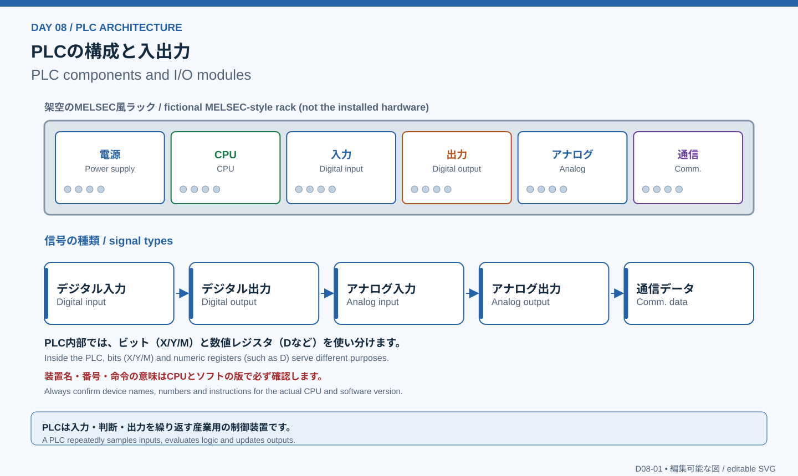
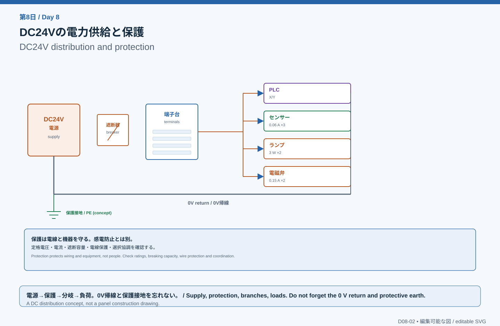
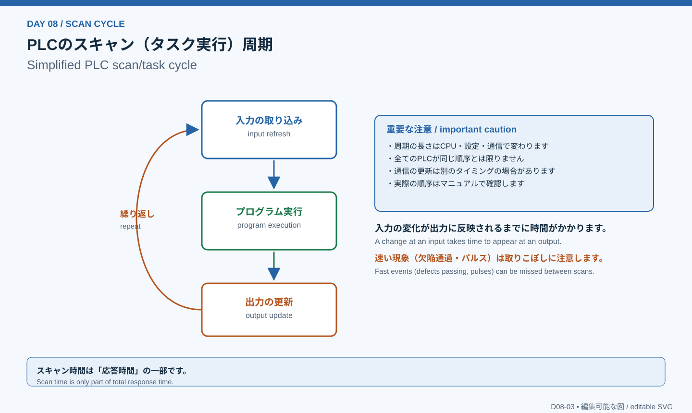
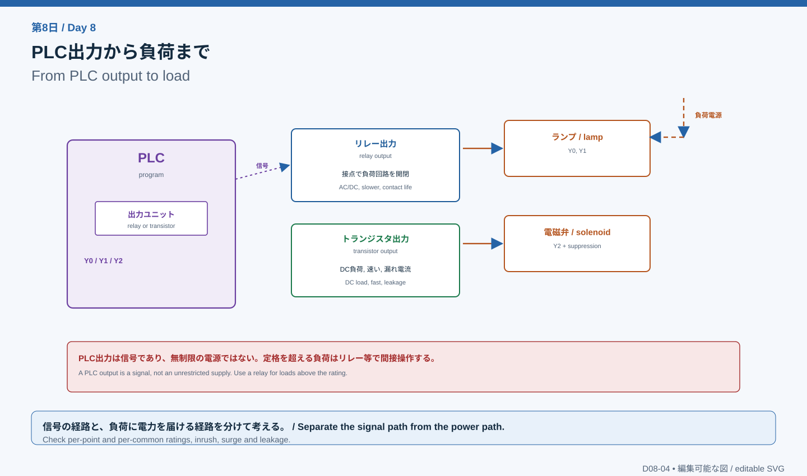
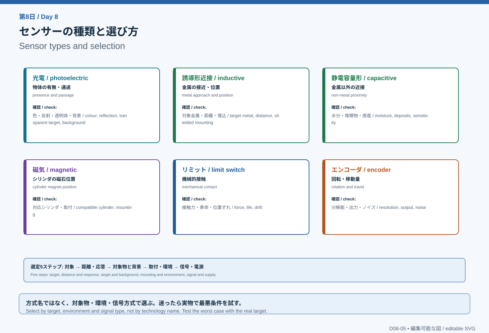

# 第8日 01 電気の基礎・電圧の使い分け・制御盤の機器 / Day 8-01 Electrical Fundamentals, Voltage Applications and Control Panel Components

> 所要時間 / Duration: **80分 / 80 minutes**
> 元PDF / Source pages: 21-23
> 共通例 / Running example: DC24Vで動く小さな検査・仕分け装置 / a small DC24V inspection and sorting machine

## 1. 概要 / Overview

電気は「見えない」ので、苦手に感じる人が多い分野です。このノートブックでは、電圧・電流・抵抗・電力という4つの言葉を最初に整理し、**工場で使う電圧の役割**と、**制御盤の中にある機器**を1つずつ説明します。PLCの前に、まず「盤の中身」を知ることが目的です。回路ブレーカ、リレー、スイッチング電源が何をする部品かを、仮定せずに説明します。

Electricity is invisible, and many beginners find it difficult. This notebook first organises voltage, current, resistance and power, then explains **what each industrial voltage is used for** and **each device inside a control panel**. The aim is to know the panel before the PLC. It does not assume you already know what a circuit breaker, relay or switching power supply does.

**安全に関する前提 / Safety boundary.** 本資料は学習用です。実際の盤の製作・配線・通電・絶縁測定・保護機器の選定を指示するものではありません。AC100V/200Vは感電・短絡・火災の危険があります。DC24Vでも短絡・発熱・火災・予期しない動作の危険があります。実作業は有資格者とリスクアセスメントのもとで行います。 / This is training material. It does not authorise building, wiring, energising or insulation-testing a real panel or selecting protective devices. AC100V/200V presents shock, short-circuit and fire hazards. Even DC24V presents short-circuit, overheating, fire and unexpected-motion hazards. Real work is done by qualified people under a risk assessment.

## 2. 学習目標 / Learning objectives

1. 電圧・電流・抵抗・電力・電力量を、自分の言葉で説明できる。
2. ACとDC、直流のプラスとマイナスの意味を説明できる。
3. AC100V・AC200V・DC24V・DC12V・DC5Vの主な使い道を説明できる。
4. 制御盤の主要機器の役割を、1つずつ説明できる。
5. 遮断器・漏電遮断器・ヒューズ・サーマルの違いを説明できる。
6. 電流・電力・電力量を計算できる。
7. 電源容量を検討するときに、足りない情報を指摘できる。
8. 安全機能と通常の制御の違いを説明できる。

By the end you can explain voltage, current, resistance, power and electrical energy; explain AC and DC and DC polarity; state the main uses of AC100V, AC200V, DC24V, DC12V and DC5V; describe each main panel device; distinguish a circuit breaker, an earth-leakage device, a fuse and an overload relay; calculate current, power and energy; name the missing information in a power-supply sizing question; and distinguish safety functions from ordinary control.

## 3. 前提 / Prerequisites

第7日を終えていること。電卓を用意してください。 / Complete Day 7. Bring a calculator.

## 4. 電気の4つの言葉 / the four basic quantities

| 言葉 / Term | 意味 / Meaning | 単位 / Unit | 水道のたとえ / water analogy |
|---|---|---|---|
| 電圧 / voltage | 電気を押し出す力 / the push that drives current | V（ボルト） | 水圧 / water pressure |
| 電流 / current | 流れる電気の量 / the amount flowing | A（アンペア） | 流量 / flow rate |
| 抵抗 / resistance | 流れにくさ / how hard it is to flow | Ω（オーム） | 配管の細さ / pipe restriction |
| 電力 / power | 1秒あたりの電気エネルギー / energy per second | W（ワット） | 単位時間あたりの仕事 / work per second |

**電力と電力量は違います。** 電力は「瞬間の勢い」（W）、電力量は「積み重ねた量」（Wh、kWh）です。 / Power is an instantaneous rate (W); electrical energy is accumulated quantity (Wh, kWh).

**水のたとえの限界 / limits of the water analogy.** 水のたとえは、電圧・電流・抵抗の関係をつかむのには便利です。しかし、交流、電磁誘導、静電気、電子の動きの向きなどは、水では正しく表せません。たとえは入口として使い、細かい話は電気の言葉で考えます。

The water analogy helps with voltage, current and resistance. It does not describe AC, electromagnetic induction, static charge or the direction of electron motion. Use it as an entry point, then think in electrical terms.



*図 D08-01：電圧は水圧、電流は流量、抵抗は流れにくさに対応します。たとえの限界も図に示しています。 / Figure D08-01: voltage corresponds to pressure, current to flow and resistance to restriction, with the limits of the analogy.*

**ACとDC / AC and DC.** AC（交流）は向きと大きさが周期的に変わる電気です。DC（直流）は向きが一定の電気です。DCにはプラスとマイナスがあり、**逆接続すると動かない・壊れる・危険**な機器があります。

AC alternates direction periodically; DC keeps one direction. DC has positive and negative, and reversing the connection can stop a device, damage it or create a hazard.

## 5. 工場で使う電圧の役割 / industrial voltage applications

| 電圧 / Voltage | 主な使い道 / Typical use | 注意 / Note |
|---|---|---|
| AC100V | 一般の機器の電源、小型機器、対応するAC/DC電源の入力 / common equipment supply, small equipment, input to compatible AC/DC supplies | 感電・短絡の危険 / shock and short-circuit hazard |
| AC200V | 産業用の動力、対応するモーター駆動、機械設備 / industrial power, compatible motor drives, machinery | 単相と三相がある / single-phase or three-phase |
| DC24V | PLCの入出力、センサー、リレー、電磁弁の制御 / PLC I/O, sensors, relays, solenoid valves | 論理信号だけでなく負荷にも使う / not only logic signals |
| DC12V | 一部のカメラ、電子機器、小型の対応機器 / some cameras, electronics, small compatible devices | 24Vと混接続しない / never mix with 24V |
| DC5V | USB給電の機器、マイコン、対応する低電圧電子機器 / USB-powered equipment, microcontrollers, compatible low-voltage electronics | 5V機器を24Vへ直結しない / never connect 5V devices to 24V |

**大切な区別 / important distinctions.**

- AC100VやAC200Vも、制御用の機器に使えます。 / AC100V and AC200V can also supply control equipment.
- DC24Vは、論理信号だけでなく、電磁弁などの**負荷**にも使います。 / DC24V supplies actuator loads, not only logic signals.
- モーターやアクチュエータには、DCや他のAC電圧を使うものもあります。 / Some motors and actuators use DC or other AC voltages.
- **電圧の値だけでは「制御用か動力用か」は決まりません。** / Voltage alone does not define control or power circuits.
- 産業用のAC200Vは、用途により単相か三相かが変わります。 / Industrial AC200V may be single-phase or three-phase.
- 実際の電圧・電流・相数・周波数・インターフェースが機器の定格に合うかを確認します。 / Actual voltage, current, phase, frequency and interface must match the ratings.
- 5V機器を24Vへ直結してはいけません。 / Never connect a 5V device directly to 24V.
- 別のDC電圧系を、確認なしに共通接続してはいけません。 / Never assume different DC systems may share connections.
- 低電圧でも、短絡・発熱・火災・予期しない動作の危険はあります。 / Low voltage still brings short-circuit, overheating, fire and unexpected-motion risks.



*図 D08-02：AC電源 → 保護 → 動力回路、AC → スイッチング電源 → DC24V → PLC・センサー・リレー・電磁弁、DC24V → DC/DC → 12V・5V。承認済みの施工図ではありません。 / Figure D08-02: AC supply through protection to the power circuit; AC through a switching power supply to DC24V distribution for PLC, sensors, relays and valves; DC24V through a DC/DC converter to 12V and 5V devices. This is not an approved installation drawing.*

## 6. 制御盤の機器を1つずつ / control panel components one by one

以下の機器は、図 D08-03 に**模式的な形**で示しています。実物の形・色・端子配置はメーカーと機種で異なるため、必ず公式カタログと取扱説明書で確認してください。 / The devices below appear as **schematic shapes** in Figure D08-03. Real appearance, colour and terminal layout differ by manufacturer and model; always check the official catalogue and manual.



*図 D08-03：制御盤の主要機器の位置と役割。 / Figure D08-03: position and role of the main control panel components.*

| 名称 / Name | 主な機能 / Primary function | 系の中での位置 / Position | 選定の要点 / Selection considerations | よくある誤解 / Common misunderstanding |
|---|---|---|---|---|
| 配線用遮断器・ブレーカー / circuit breaker | 定格内の過電流から回路と配線を保護する / protects circuits and wiring from applicable overcurrent | 電源の入口 / at the supply entry | 定格電流・遮断容量・特性 / rating, breaking capacity, trip curve | 「何でも保護する」/ that it protects everything |
| 漏電遮断器 / earth-leakage protective device | 設計に応じた漏れ電流・残留電流を検出する / detects specified leakage or residual current | 電源の入口付近 / near the supply entry | 感度電流・動作時間 / sensitivity and operating time | 過電流保護と混同 / confusing it with overcurrent protection |
| ヒューズ / fuse | 規定の過電流特性で回路を開く / opens the circuit under its specified overcurrent characteristics | 回路の保護箇所 / at the protected point | 定格・溶断特性 / rating and melting characteristic | 「何度でも使える」/ that it is reusable |
| スイッチング電源 / switching power supply | 対応するAC入力から安定したDC出力を作る / converts a compatible AC input into a regulated DC output | ACとDCの境界 / between AC and DC | 入力電圧・出力電圧・出力電流・定格出力 / input, output, current, rated power | 出力電流を負荷の合計とだけ比べる / comparing only total current |
| DC/DCコンバータ / DC/DC converter | あるDC電圧を別のDC電圧に変える / converts one DC voltage to another | DC分配の中 / inside DC distribution | 入力範囲・出力・効率 / input range, output, efficiency | 「何にでも使える」/ that any converter fits any load |
| リレー / relay | 制御入力で接点や同等の出力を切り替える / uses a control input to switch contacts or an equivalent output | 信号と負荷の間 / between signal and load | コイル電圧・接点容量 / coil voltage and contact rating | 接点容量を無視 / ignoring contact rating |
| 電磁接触器 / contactor | 適切な定格の動力負荷を開閉する / switches appropriately rated power loads | 動力回路 / in the power circuit | 定格電流・使用カテゴリ / rated current and utilisation category | リレーとの混同 / confusing it with a relay |
| サーマルリレー・過負荷保護機器 / overload relay | 指定用途（多くはモーター）の過負荷保護 / overload protection for specified applications, commonly motors | モーターの前 / before the motor | 整定範囲・特性 / setting range and characteristic | 短絡保護と混同 / treating it as short-circuit protection |
| 端子台 / terminal block | 配線を整理して接続する / organised connection points | 盤内の接続部 / panel connections | 定格・極数・取付 / rating, poles, mounting | 配線の整理だけと考える / thinking it is only tidiness |
| 押しボタンスイッチ / pushbutton switch | 作業者の指令を入力する / operator commands | 盤の前面 / panel front | 接点構成・色・保護 / contact arrangement, colour, protection | 押している間だけが入力と知らない / not knowing it is momentary |
| セレクタスイッチ / selector switch | 運転モードを選ぶ / selects an operating mode | 盤の前面 / panel front | 位置数・接点 / number of positions and contacts | モード切替の危険を過小評価 / underestimating mode-change hazards |
| 表示灯 / indicator lamp | 設備の状態を表示する / displays equipment state | 盤の前面 / panel front | 電圧・色・寿命 / voltage, colour, life | 表示＝安全の証明と考える / assuming a lamp proves safety |
| 非常停止機器 / emergency stop device | 人の危険を避けるために停止する / stops to avoid danger to people | 操作しやすい位置 / accessible position | 規格・カテゴリ・回路 / standard, category, circuit | PLCの停止で足りると考える / assuming PLC stop is enough |
| PLC / programmable controller | 入力に応じて出力を制御する / processes inputs and controls outputs | 制御の中枢 / control centre | I/O数・電圧・通信 / I/O count, voltage, communication | 「PLC＝安全装置」/ "the PLC is the safety device" |
| モータードライバ / motor driver | 指令に応じてモーターを制御する / controls a compatible motor | モーターの前 / before the motor | 対応モーター・電流 / compatible motor and current | 汎用の電源と考える / treating it as a general supply |
| インバータ / inverter | 周波数を変えてモーター速度を変える / variable-frequency motor drive | 誘導モーターの前 / before an induction motor | 容量・特性・ノイズ / capacity, characteristics, noise | 位置決め装置と考える / assuming it positions precisely |
| サーボアンプ / servo amplifier | サーボモーターをフィードバック制御する / closed-loop control of a servo motor | サーボ系の中 / in the servo system | 対応モーター・エンコーダ / compatible motor and encoder | 単体で位置決めできると考える / assuming it works without the motor and feedback |
| 保護・接地 / protection and grounding | 感電・故障時の危険を減らし、ノイズを逃がす / reduces shock and fault hazards and provides a noise path | 盤全体 / whole panel | 接地方式・盤の保護等級 / earthing arrangement and enclosure protection | 接地は「なんとなく」でよいと考える / treating earthing as optional |

**用語の注意 / terminology caution.** 「本質安全防爆（intrinsically safe）」は、爆発性雰囲気の区域で使う機器の特定の技術用語です。通常の24V制御を「本質安全だから安全」と呼ぶのは誤りです。

"Intrinsically safe" is a specific technical term for equipment used in hazardous areas. Calling ordinary 24 V control "intrinsically safe" is wrong.

**非常停止について / about emergency stop.** 非常停止ボタンをPLCの通常のラダーに1つ追加しただけでは、機械の安全要件を満たしません。安全機能は、リスクアセスメントに基づいて、独立した安全関連システムとして設計・検証します。

Adding an emergency-stop button to ordinary PLC logic alone does not satisfy machine safety requirements. Safety functions are designed and validated as an independent safety-related system based on a risk assessment.



*図 D08-04：遮断器・漏電遮断器・ヒューズ・サーマルリレーの守る範囲の違い。 / Figure D08-04: what each protective device does and does not cover.*



*図 D08-05：スイッチング電源の入出力、DC/DCの役割、リレーと電磁接触器の違い。 / Figure D08-05: switching power supply input and output, the role of a DC/DC converter, and relay versus contactor.*

## 7. 電流・電力・電力量の計算 / current, power and energy

オームの法則（抵抗モデルが当てはまる場合）：

```text
V = I × R
```

直流の電力：

```text
P = V × I
```

電力量（一定電力で使う場合）：

```text
電力量[kWh] = 電力[kW] × 時間[h]
```

### 7.1 電磁弁の例 / solenoid valve example

DC24Vで0.15 Aの電磁弁：

```text
P = 24 × 0.15 = 3.6 W
```

2個同時に動かすと：

```text
電流 = 0.30 A、電力 = 7.2 W
```

### 7.2 電源容量の検討例 / power budget example

| 負荷 / Load | 数量 / Qty | 1台の電流 / Unit current | 合計 / Total |
|---|---:|---:|---:|
| PLC | 1 | 0.35 A | 0.35 A |
| センサー / sensors | 4 | 0.025 A | 0.10 A |
| 電磁弁 / solenoid valves | 2 | 0.15 A | 0.30 A |
| 表示灯 / indicator lamp | 1 | 0.05 A | 0.05 A |
| 合計 / total | | | **0.80 A** |

```text
合計電流 = 0.35 + 4×0.025 + 2×0.15 + 0.05 = 0.80 A
DC出力   = 24 × 0.80 = 19.2 W
```

計画用の余裕を25%とすると、計画電流は1.00 Aです。**25%は教材の仮定**であり、設計基準ではありません。

```python exec id="power-budget"
import sys, pathlib

start = pathlib.Path.cwd()
root = next(p for p in [start, *start.parents]
            if (p / "day07_09_support" / "examples" / "automation_models.py").is_file())
sys.path.insert(0, str(root / "day07_09_support" / "examples"))
import automation_models as am

report = am.load_report(am.training_power_budget())
for row in report["rows"]:
    print(f"{row['name']:<16} x{row['quantity']}  {row['total_current_a']:.3f} A  {row['total_power_w']:5.2f} W")
print(f"steady total      {report['steady_total_a']:.2f} A  {report['total_power_w']:5.1f} W")
print(f"planning (+25%)   {report['planning_current_a']:.2f} A")
print("This is a training budget, not a power-supply sizing approval.")
```

**最終的な電源選定で確認すること / what final power-supply selection must consider.**

- 同時に動く負荷はいくつか / which loads run simultaneously
- ピーク電流 / peak current
- 突入電流 / inrush current
- 周囲温度 / ambient temperature
- メーカーの定格低下（ディレーティング）/ manufacturer derating
- 将来の増設 / future expansion
- 出力特性 / output characteristics
- 配線と保護機器の要件 / wiring and protective-device requirements

**交流の電力 / AC power.** 交流では、電圧と電流の位相のずれにより、実際に仕事をする電力（W）と、見かけの電力（VA）が違います。この違いを「力率」と呼びます。初級では、**WとVAは別の量**であり、モーターなどの選定では力率を考える必要がある、と理解してください。直流の式を、そのまま交流モーターの電力計算に使ってはいけません。

In AC circuits, the phase difference makes real power (W) differ from apparent power (VA); the ratio is the power factor. At beginner level it is enough to know that W and VA are different and that motor selection considers power factor. Do not apply DC formulas directly to AC motors.

## 8. 電気代の例 / energy cost example

100 Wの機器を8時間使う場合：

```text
電力量 = 0.1 kW × 8 h = 0.8 kWh
電気代 = 0.8 kWh × 30 円/kWh = 24 円
```

**30円/kWhは教材用の仮定**です。実際の単価は契約により異なります。また、定格電力と実際の平均消費電力は違うことがあります。

30 JPY/kWh is an illustrative value; real tariffs differ. Rated power and actual average consumption can also differ.

## 9. 演習 / Exercises

### 演習1 電力の計算 / exercise 1: power

DC24Vで0.08 Aのセンサー3個の合計電力を求めてください。 / Find the total power of three sensors drawing 0.08 A each at DC24V.

```text
1個の電力 = 24 × 0.08 = 1.92 W
3個の合計 = 1.92 × 3 = 5.76 W
合計電流   = 0.24 A
```

**答え / answer**：5.76 W（電流0.24 A）。 / 5.76 W (0.24 A total).

### 演習2 機器の役割 / exercise 2: component roles

「ブレーカーを入れれば、モーターの過負荷も守られる」という文を正してください。 / Correct the statement "turning on the breaker also protects the motor from overload".

**答え / answer**：配線用遮断器は主に過電流から配線と回路を保護します。モーターの過負荷保護には、サーマルリレーなどの過負荷保護機器を別に使います。両者は守る範囲が違います。 / A circuit breaker mainly protects wiring and circuits from overcurrent. Motor overload protection uses a separate overload device such as a thermal relay. Their coverage differs.

## 10. まとめ / Summary

- 電圧は押す力、電流は流れる量、抵抗は流れにくさ、電力は1秒あたりのエネルギー。
- AC100V/200Vは動力や機器電源、DC24Vは制御と負荷、12V/5Vは対応機器。
- 電圧の値だけでは制御用か動力用かは決まらない。
- 盤の機器は、それぞれ守る範囲と役割が違う。
- 遮断器・漏電遮断器・ヒューズ・サーマルは別物。
- 電力はV×I（直流）、電力量はkW×h。
- 電源容量は、同時使用・突入電流・温度・余裕を含めて検討する。
- 通常のPLC制御は、安全機能ではない。

Voltage is the push, current the flow, resistance the restriction, power the energy per second. AC100/200V serve power and equipment supplies; DC24V serves control and loads; 12V and 5V serve compatible devices. Voltage alone does not define control or power. Panel devices differ in what they protect. Breaker, earth-leakage device, fuse and overload relay are different. Power is V×I for DC; energy is kW×h. Supply sizing includes simultaneity, inrush, temperature and margin. Ordinary PLC control is not a safety function.

## 11. 完了チェックリスト / Completion checklist

- [ ] 5つの電圧の使い道を、表を見ずに言える。
- [ ] 制御盤の機器を10個以上、役割付きで言える。
- [ ] 遮断器と漏電遮断器の違いを説明できる。
- [ ] サーマルリレーが短絡保護ではないと説明できる。
- [ ] 3.6 W、7.2 W、0.30 Aを計算できる。
- [ ] 合計0.80 A、19.2 W、計画1.00 Aを再現できる。
- [ ] 電力量0.8 kWh、24円を再現できる。
- [ ] WとVAの違いを一言で説明できる。

- [ ] I can state the use of each of the five voltages without the table.
- [ ] I can name ten panel devices with their roles.
- [ ] I can distinguish a circuit breaker from an earth-leakage device.
- [ ] I can explain why an overload relay is not short-circuit protection.
- [ ] I can calculate 3.6 W, 7.2 W and 0.30 A.
- [ ] I can reproduce 0.80 A, 19.2 W and the 1.00 A planning value.
- [ ] I can reproduce 0.8 kWh and 24 JPY.
- [ ] I can explain W versus VA in one line.

## 12. よくある間違い / Troubleshooting and common misunderstandings

| よくある間違い / Common mistake | 正しい考え方 / Correct view |
|---|---|
| DC24Vなら安全 / DC24V is safe | 短絡・発熱・火災・予期しない動作の危険がある / short-circuit, heat, fire and unexpected motion remain |
| 5Vの機器を24Vにつなぐ / connecting 5V devices to 24V | 定格を必ず確認。直結しない / check ratings; never connect directly |
| ブレーカー＝すべての保護 / the breaker protects everything | 保護範囲は定格と特性の範囲内 / only within its ratings and characteristics |
| サーマルリレー＝短絡保護 / overload relay is short-circuit protection | 過負荷保護。短絡は別 / overload only; short circuit is separate |
| 表示灯がつけば安全 / a lamp means safe | 表示は状態の一部。安全の証明ではない / a lamp shows one state, not safety |
| 電源の合計電流だけで容量を決める / sizing on total current alone | 突入・同時使用・温度・余裕を見る / include inrush, simultaneity, temperature and margin |

## 13. 安全と次の学習 / safety and what comes next

電気の学習は、必ず「止める」「隔離する」「確認する」とセットです。感電、短絡、アーク、火災、予期しない起動は、学習用の図では再現できません。実機では、検電、ロックアウト、有資格者による確認が必須です。

Electrical learning always comes with stop, isolate and verify. Shock, short circuits, arcs, fire and unexpected starting cannot be reproduced by a training diagram. Real work requires voltage verification, lockout and qualified confirmation.

次は 08-02 で、センサー・入力・出力・NPN/PNP を学びます。 / Next, 08-02 covers sensors, inputs, outputs and NPN/PNP.
