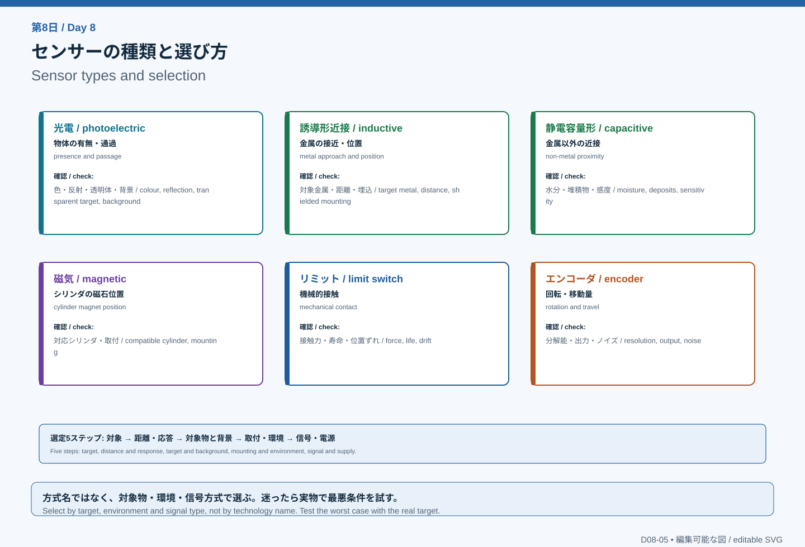

# 第8日 02 センサー・I/O・電気インターフェース / Day 8-02 Sensors, I/O and Electrical Interfaces

> 所要時間 / Duration: **85分 / 85 minutes**
> 元資料 / Source pages: 24–29, 48
> 共通題材 / Running example: 小型ワーク押出し装置 / small workpiece-pushing machine

## 1. 概要 / Overview

このノートブックでは、センサーが「何を検出するか」から始めて、センサーの信号方式（NPN/PNP）、PLC入力回路、出力回路、電磁弁の駆動、I/O表、配線図、通電前確認までを扱います。

This notebook starts from what a sensor detects, then covers its signal type (NPN/PNP), PLC input circuits, output circuits, solenoid driving, the I/O table, wiring diagrams and pre-power checks.

**このノートで最も間違えやすい点 / The most common mistakes**

1. 物理的なNO/NC接点と、PLCプログラム上の論理接点を混同する。
2. NPN/PNPを、PLC入力の共通端子の接続を無視して説明する。
3. PLC出力を、無制限の電源と考える。
4. Y1をランプと電磁弁の両方に使う。
5. アドレス（X0など）と物理端子番号を同一視する。

1. Confusing a physical NO/NC contact with a logical PLC contact.
2. Explaining NPN/PNP while ignoring the PLC input common connection.
3. Treating a PLC output as an unrestricted supply.
4. Using Y1 for both a lamp and a solenoid.
5. Treating an address such as X0 as a physical terminal number.

## 2. 学習目標 / Learning objectives

1. センサーの目的を説明できる。
2. リミットスイッチ、近接センサー、光電センサー、磁気センサーの違いを説明できる。
3. アナログ信号とデジタル信号を区別できる。
4. NPN出力とPNP出力の電流の向きを説明できる。
5. PLC入力のシンク/ソースと共通端子の関係を説明できる。
6. センサーとPLC入力の組み合わせを判定できる。
7. PLC出力のリレー方式とトランジスタ方式を区別できる。
8. 電磁弁の負荷とサージ対策を説明できる。
9. 統一I/O表を作れる。
10. 概略配線図を書ける。
11. 通電前の確認項目を列挙できる。

By the end of this notebook you can:

1. Explain the purpose of a sensor.
2. Distinguish limit switches, proximity sensors, photoelectric sensors and magnetic sensors.
3. Distinguish analog from digital signals.
4. Explain the current direction of NPN and PNP outputs.
5. Explain the relation between PLC input sink/source behaviour and the input common terminal.
6. Judge whether a sensor and PLC input are compatible.
7. Distinguish relay outputs from transistor outputs.
8. Explain solenoid loads and surge suppression.
9. Build a unified I/O table.
10. Draw a conceptual wiring diagram.
11. List pre-power checks.

## 3. 前提知識 / Prerequisites

第8日01（電圧・電流・電力、DC24V、PLC出力の定格）を終えていること。特に「信号」と「電力」の区別を確認してください。

Complete Day 8-01 (voltage, current, power, DC24V, PLC output ratings). In particular, confirm the distinction between a signal and power.

### 実行環境 / executable environment

このノートのコードは、リポジトリ内の `day07_09_support/examples/automation_models.py` を使います。最初のセルを実行してから、後のセルを順に実行してください。インターネット接続は不要です。

The code uses `day07_09_support/examples/automation_models.py` in this repository. Run the first cell, then the following cells in order. No internet connection is required.

```python exec id="setup"
import sys, pathlib
import matplotlib.pyplot as plt

plt.rcParams["font.family"] = ["Meiryo", "Yu Gothic", "DejaVu Sans"]
plt.rcParams["axes.unicode_minus"] = False

def find_support(start):
    for base in [start, *start.parents]:
        if (base / "day07_09_support" / "examples" / "automation_models.py").is_file():
            return base / "day07_09_support"
    raise FileNotFoundError("Open this notebook inside the Training_Automation repository.")

SUPPORT = find_support(pathlib.Path.cwd())
sys.path.insert(0, str(SUPPORT / "examples"))
import automation_models as am
print("automation_models loaded from", SUPPORT.name)
print("No internet, hardware, PLC software or compressed air is used.")
```

**期待される出力 / Expected output**

```text
automation_models loaded from day07_09_support
No internet, hardware, PLC software or compressed air is used.
```

## 4. センサーの目的と種類 / Sensor purpose and types

センサーは「物体があるか」だけを検出する装置ではありません。材質、色、反射率、形状、検出距離、設置スペース、周囲光、油や水、振動、繰返し精度によって方式を選びます。検出の信頼性が低いと、設備停止や不良につながります。

A sensor does more than detect "is something there". Material, colour, reflectivity, shape, sensing distance, space, ambient light, oil, water, vibration and repeatability determine the technology. Poor detection reliability causes downtime and defects.



*図 D08-05：検出対象と方式の対応を示します。同じ「位置検出」でも、金属、透明体、磁石、機械的接触で候補が変わります。 / Figure D08-05: the relation between target and technology. Even for "position detection", metal, transparent objects, magnets and mechanical contact lead to different candidates.*

| 方式 / Type | 得意な例 / Good for | 確認ポイント / Checks |
|---|---|---|
| 光電センサー / photoelectric | 物体の有無、通過検出 / presence, passage | 色、反射、透明体、背景、距離 / colour, reflection, transparent target, background, distance |
| 誘導形近接センサー / inductive proximity | 金属の接近・位置 / metal approach and position | 対象金属、距離、埋込条件 / target metal, distance, shielded mounting |
| 静電容量形 / capacitive | 金属以外も含む近接検出 / non-metal proximity | 水分、堆積物、感度設定 / moisture, deposits, sensitivity |
| 磁気センサー / magnetic | シリンダの磁石位置、扉開閉 / cylinder magnet, door | 対応シリンダ、取付、出力方式 / compatible cylinder, mounting, output |
| リミットスイッチ / limit switch | 機械的接触による位置確認 / mechanical position confirmation | 接触力、寿命、位置ずれ / actuation force, life, drift |
| エンコーダ / encoder | 回転・移動量 / rotation and travel | 分解能、出力方式、取付、ノイズ / resolution, output, mounting, noise |

**アナログとデジタル / analog and digital**

- **デジタル / digital**: ON/OFFの2状態。リミットスイッチ、近接センサー、光電センサーの多く。
- **アナログ / analog**: 連続した値。0–10V、4–20mAなど。位置、圧力、距離の連続測定。

- **Digital**: two states, ON/OFF. Most limit switches, proximity and photoelectric sensors.
- **Analog**: a continuous value such as 0–10 V or 4–20 mA, used for continuous position, pressure or distance.

PLCの入力がデジタルかアナログかで、接続先のユニットが変わります。アナログ入力は、分解能、入力範囲、基準電位、ノイズ対策を確認します。

Whether the PLC input is digital or analog determines the module. For analog inputs, check resolution, range, reference potential and noise measures.

**センサー選定の5ステップ / five selection steps**

1. 何を検出するか / what is detected
2. 距離と応答時間 / distance and response time
3. 対象物と背景 / target and background
4. 取付場所・環境 / mounting and environment
5. 信号・電源との整合 / signal and supply compatibility

迷ったら、検出対象の実物でテストし、想定する最悪条件を試します。

When in doubt, test with the actual target under the worst expected conditions.

## 5. NPN・PNPとPLC入力 / NPN, PNP and PLC inputs

3線式DCセンサーは、一般に次の3本を持ちます。

A three-wire DC sensor generally has three conductors.

| 線 / Wire | 一般的な色 / Typical colour | 役割 / Role |
|---|---|---|
| ＋電源 / + supply | 茶 / brown | DC24V |
| 0V | 青 / blue | 0V |
| 出力 / output | 黒 / black | 信号 / signal |

**PNP出力 / PNP output（ソース / sourcing）**

ONのとき、出力線を＋側につなぎます。電流は、＋24V → センサー → 出力線 → PLC入力端子 → PLC入力回路 → 入力共通端子（0V）の向きに流れます。したがって、PLC入力の共通端子が0V側にある**シンク入力**と組み合わせます。

When ON, the output connects to the positive side. Current flows +24 V → sensor → output → PLC input terminal → PLC input circuit → input common (0 V). It therefore pairs with a **sinking input** whose common is at 0 V.

**NPN出力 / NPN output（シンク / sinking）**

ONのとき、出力線を0V側につなぎます。電流は、＋24V → PLC入力共通端子 → PLC入力回路 → 入力端子 → センサー出力 → 0Vの向きに流れます。したがって、PLC入力の共通端子が＋24V側にある**ソース入力**と組み合わせます。

When ON, the output connects to 0 V. Current flows +24 V → PLC input common → PLC input circuit → input terminal → sensor output → 0 V. It therefore pairs with a **sourcing input** whose common is at +24 V.


*図 D08-06：左がPNP＋シンク入力、右がNPN＋ソース入力の概念図です。どちらも入力共通端子までの電流経路を含めて示しています。実際の端子配置はPLCのマニュアルで確認してください。 / Figure D08-06: left is PNP with a sinking input; right is NPN with a sourcing input. Both show the current path through the input common. Check the actual terminal arrangement in the PLC manual.*

**よくある誤解 / common misunderstandings**

| 誤解 / Misunderstanding | 正しい考え方 / Correct view |
|---|---|
| PNPは「＋の信号」なので、どのPLC入力でもつながる / a PNP "positive signal" works with any input | 入力共通端子の電位と入力回路の方式で決まる / it depends on the common potential and input circuit |
| NPNは「－の信号」なので危険 / NPN is a "negative signal" and dangerous | 電流の向きが違うだけで、正しく組み合わせれば使える / it is a different current direction, usable when matched |
| センサーの出力線だけを見ればよい / only the output wire matters | 電源、0V、入力共通端子を含む閉回路で考える / think in a closed circuit including supply, 0 V and input common |
| 2線式も3線式と同じ / two-wire is the same as three-wire | 2線式は漏れ電流があり、OFF時の電圧を確認する / two-wire sensors have leakage; check OFF-state voltage |

> **重要 / Important**: PLC入力の方式は、メーカー・機種・ユニットによって異なります。入力が双方向対応、フォトカプラ絶縁、グループごとの共通端子など、さまざまな構成があります。本教材の「シンク入力」「ソース入力」は教育用の整理であり、実機は必ずハードウェアマニュアルの結線図で確認してください。
> PLC input arrangements differ by manufacturer, model and module: bidirectional inputs, opto-isolated groups, separate commons and more. The "sinking" and "sourcing" labels here are a teaching simplification. Always confirm with the hardware manual's wiring diagram.

### 5.1 架空の互換性チェック / fictional compatibility check

次の構成は**教育用の架空例**です。実在のPLCの仕様ではありません。

The following are **fictional training configurations**, not real PLC specifications.

| 構成 / Configuration | PLC入力 / PLC input | センサー出力 / sensor output | 判定 / Verdict |
|---|---|---|---|
| A | シンク入力、共通0V / sinking, common 0 V | PNP（ソース）/ PNP sourcing | 適合 / compatible |
| B | ソース入力、共通+24V / sourcing, common +24 V | NPN（シンク）/ NPN sinking | 適合 / compatible |
| C | シンク入力、共通0V / sinking, common 0 V | NPN（シンク）/ NPN sinking | 不適合の可能性 / likely incompatible |
| D | ソース入力、共通+24V / sourcing, common +24 V | PNP（ソース）/ PNP sourcing | 不適合の可能性 / likely incompatible |
| E | 2線式対応入力 / two-wire capable input | 2線式 / two-wire | 漏れ電流・OFF電圧を確認 / check leakage and OFF voltage |

```python exec id="sensor-compatibility"
configurations = [
    {"name": "A", "plc": "sinking", "sensor": "PNP", "two_wire": False},
    {"name": "B", "plc": "sourcing", "sensor": "NPN", "two_wire": False},
    {"name": "C", "plc": "sinking", "sensor": "NPN", "two_wire": False},
    {"name": "D", "plc": "sourcing", "sensor": "PNP", "two_wire": False},
    {"name": "E", "plc": "sinking", "sensor": "two-wire", "two_wire": True},
]

def compatibility(plc: str, sensor: str, two_wire: bool) -> tuple[str, str]:
    if two_wire:
        return "CHECK", "two-wire sensor: verify leakage current and OFF-state voltage in the manual"
    if plc == "sinking" and sensor == "PNP":
        return "COMPATIBLE", "PNP sources current into a sinking input with common at 0 V"
    if plc == "sourcing" and sensor == "NPN":
        return "COMPATIBLE", "NPN sinks current from a sourcing input with common at +24 V"
    return "LIKELY INCOMPATIBLE", "input common and sensor output direction do not match"

for case in configurations:
    verdict, reason = compatibility(case["plc"], case["sensor"], case["two_wire"])
    print(f"{case['name']}: PLC={case['plc']:<9} sensor={case['sensor']:<9} -> {verdict}: {reason}")
```

**期待される出力 / Expected output**

```text
A: PLC=sinking   sensor=PNP       -> COMPATIBLE: PNP sources current into a sinking input with common at 0 V
B: PLC=sourcing  sensor=NPN       -> COMPATIBLE: NPN sinks current from a sourcing input with common at +24 V
C: PLC=sinking   sensor=NPN       -> LIKELY INCOMPATIBLE: input common and sensor output direction do not match
D: PLC=sourcing  sensor=PNP       -> LIKELY INCOMPATIBLE: input common and sensor output direction do not match
E: PLC=sinking   sensor=two-wire  -> CHECK: two-wire sensor: verify leakage current and OFF-state voltage in the manual
```

> この判定は出発点です。実際の適合は、センサーの負荷電流、漏れ電流、PLC入力のON電流・OFF電流、電圧降下、応答時間、配線長を含めて確認します。
> This verdict is a starting point. Real compatibility includes sensor load current, leakage, PLC ON/OFF current, voltage drop, response time and cable length.

## 6. PLC出力と電磁弁 / PLC outputs and solenoids

PLC出力には、リレー方式とトランジスタ方式があります。前のノートで比較したように、接点方式か半導体方式かで、使える負荷・応答・配線が変わります。

PLC outputs are relay or transistor type. As compared in the previous notebook, contact versus semiconductor changes the load, response and wiring.

**電磁弁を駆動するときの確認 / checks when driving a solenoid**

- コイルの定格電圧（DC24Vなど）/ coil rated voltage
- コイルの消費電力・電流 / coil power and current
- 突入電流と保持電流 / inrush and holding current
- 応答時間 / response time
- サージ（逆起電力）対策 / surge (back-EMF) suppression
- 無通電時の弁位置 / de-energised valve position
- 出力1点当たり、共通端子当たりの定格 / per-point and per-common ratings
- 同時ONする負荷 / simultaneous loads
- 漏れ電流が負荷に与える影響 / effect of leakage current

**サージ対策 / surge suppression**

電磁弁やリレーのコイルは誘導性負荷です。OFF時に逆起電力が発生し、出力素子や接点にダメージを与えることがあります。ダイオード、バリスタ、CR回路などのサージ吸収素子を使いますが、**方式によって弁の復帰時間が変わる**ことがあります。メーカーの推奨回路に従います。

Solenoid and relay coils are inductive. Switching them off produces back-EMF that can damage output devices or contacts. Diodes, varistors or CR networks are used, but **the suppression method can change valve release time**. Follow the manufacturer's recommended circuit.

**出力方式の違い / output type differences**

| 項目 / Item | リレー出力 / relay output | トランジスタ出力 / transistor output |
|---|---|---|
| 電磁弁 / solenoid | AC/DCどちらも比較的柔軟 / relatively flexible | DCが中心、極性に注意 / mainly DC, polarity |
| 応答 / response | 遅い / slower | 速い / fast |
| 寿命 / life | 接点寿命 / contact life | 過電流・サージに弱い / sensitive to overcurrent and surge |
| 漏れ電流 / leakage | 小さい / low | OFF時も微小漏れ / small OFF leakage |
| サージ対策 / suppression | 接点保護が必要 / contact protection | 出力素子保護が必要 / device protection |

## 7. 統一I/O表 / Unified I/O specification

Day 8とDay 9で同じI/O表を使います。次の表が**このコースの唯一の正**です。X0〜X3、M0、Y0、Y1、Y2、T0を使います。Y1は**遅延ランプ専用**であり、電磁弁には使いません。電磁弁の前進指令は**Y2**です。

Days 8 and 9 use the same I/O table. This is the **single source of truth** for the course: X0–X3, M0, Y0, Y1, Y2 and T0. Y1 is **only** the delayed lamp; it is never the solenoid. The extend command is **Y2**.

| 種別 / Kind | アドレス / Address | 機器 / Device | 正常時の状態 / Normal state |
|---|---|---|---|
| 入力 / input | X0 | START押しボタン / START pushbutton | OFF（押している間ON）/ OFF, ON while pressed |
| 入力 / input | X1 | STOP許可（物理NC停止） / STOP_OK from physical NC stop | 健全時ON / ON while healthy |
| 入力 / input | X2 | 後退端確認 / retracted confirmation | 後退端でON / ON at retracted end |
| 入力 / input | X3 | 前進端確認 / extended confirmation | 前進端でON / ON at extended end |
| 内部 / internal | M0 | 運転状態 / RUN state | 電源投入時OFF / OFF at power-up |
| 出力 / output | Y0 | 運転表示ランプ / RUN lamp | 停止時OFF / OFF when stopped |
| 出力 / output | Y1 | 遅延表示ランプ（T0完了）/ delayed lamp (T0 done) | 3秒未満はOFF / OFF before 3 s |
| 出力 / output | Y2 | 前進電磁弁指令 / extend solenoid command | OFF＝ばね戻り（訓練用弁）/ OFF = spring return (training valve) |
| タイマー / timer | T0 | 3秒オン遅延 / 3 s on-delay | 運転OFFで0 / 0 when RUN off |

**アドレスと端子は別 / addresses and terminals are different**

X0、Y0などはプログラム上のアドレスです。物理端子番号、コモン端子、拡張ユニット上の位置は、実際のPLC構成で決まります。本教材のアドレスは**架空の訓練用**であり、実機の端子番号ではありません。

X0, Y0 and similar are program addresses. Physical terminal numbers, common terminals and slot positions depend on the actual PLC configuration. The addresses here are **fictional training assignments**, not real terminal numbers.

**物理接点と論理接点 / physical and logical contacts**

X1は、物理的にはNCの停止ボタンから来ています。健全時はONです。PLCプログラムでは、X1を「ONなら許可」として扱います。ラダー上の接点記号は、物理接点のNO/NCとは別に、**入力状態をどう評価するか**で決めます。

X1 comes from a physical NC stop button and is ON when healthy. The PLC program treats X1 as "permission when ON". The ladder contact symbol is chosen by **how the input state is evaluated**, not by the physical NO/NC label.

```python exec id="io-table"
rows = list(am.CANONICAL_IO)
print(f"{'addr':<5} {'kind':<9} {'device':<58} normal")
for row in rows:
    print(f"{row['address']:<5} {row['kind']:<9} {row['device']:<58} {row['normal']}")

problems = am.validate_io(rows)
print("\nconsistency problems:", problems if problems else "none")
print("Fictional training addresses. Terminal numbers depend on the selected PLC.")
```

**期待される出力 / Expected output**（抜粋 / excerpt）

```text
addr  kind      device                                                     normal
X0    input     START pushbutton                                           OFF; momentary ON when pressed
X1    input     STOP_OK permission from physical NC STOP                   ON while healthy
...
Y1    output    delayed indicator lamp (T0 done)                           OFF until 3 s of RUN
Y2    output    EXTEND solenoid command                                    OFF = spring-return retract (training valve)

consistency problems: none
Fictional training addresses. Terminal numbers depend on the selected PLC.
```

### 7.1 I/O表の一貫性を検査する / validate the I/O table

次のセルは、わざと誤った表を作り、検査がエラーを見つけることを示します。Y1に電磁弁を割り当てる誤りと、X1の正常状態をOFFと書く誤りを検出します。

The next cell deliberately builds a wrong table and shows that the check finds both the Y1 solenoid misuse and the X1 normal-state error.

```python exec id="io-validation"
bad_rows = [dict(row) for row in am.CANONICAL_IO]
for row in bad_rows:
    if row["address"] == "Y1":
        row["device"] = "extend solenoid valve"
    if row["address"] == "X1":
        row["normal"] = "OFF in normal condition"
for problem in am.validate_io(bad_rows):
    print("detected:", problem)
```

**期待される出力 / Expected output**

```text
detected: X1 STOP_OK is ON while the physical NC stop is healthy; its normal state is ON
detected: Y1 is reserved for the delayed indicator lamp; use Y2 for the extend solenoid
```

## 8. 概略配線図 / Conceptual wiring diagram


*図 D08-07：入力側はセンサーと入力共通、出力側はランプと電磁弁、電源と0Vを示します。実機の端子番号・コモン・保護・接地は、PLCと機器のマニュアルで確認してください。 / Figure D08-07: the input side shows sensors and the input common; the output side shows lamps and the solenoid, with supply and 0 V. Confirm real terminals, commons, protection and earthing in the PLC and device manuals.*

**配線図に書くべき内容 / what a wiring diagram should show**

- 電源の＋と0V / supply + and 0 V
- 端子番号 / terminal numbers
- PLC入力・出力の共通端子 / input and output commons
- 機器の型式 / device model
- 線番号 / wire numbers
- 保護装置 / protective devices
- 接地 / earthing
- コネクタ / connectors
- 予備端子 / spare terminals
- 信号方式（NPN/PNP、シンク/ソース）/ signal type

使用PLC・センサーの電気仕様が確定する前に、実機向けの配線を決め打ちしないでください。

Do not fix real-machine wiring before the PLC and sensor electrical specifications are confirmed.

## 9. 通電前の確認 / Pre-power verification

通電前には、配線が正しいことを**電気を入れずに**確認します。

Before applying power, verify the wiring **without energising it**.

| 確認 / Check | 内容 / Detail |
|---|---|
| 遮断・無電圧 / isolation and zero energy | 遮断器、別電源、バックフィード、蓄電部 / breaker, alternative supply, backfeed, stored energy |
| 図面との照合 / drawing check | 配線図、機器型式、端子番号 / drawing, model, terminal number |
| 定格・極性 / ratings and polarity | 電圧、極性、信号方式、保護 / voltage, polarity, signal type, protection |
| 導体 / conductors | ほつれ、露出、短絡、端子の緩み / strands, exposure, short, loose terminal |
| 安全 / safety | 可動部への立入り、飛出し、ガード / access, ejection, guard |
| 承認 / approval | 講師・有資格者の確認 / instructor or qualified person |

> 本研修では、実機の通電・空圧供給を行いません。通電前確認は、実機作業の手順を理解するための机上演習です。
> This course does not energise real equipment or supply compressed air. The pre-power check is a paper exercise to understand the real procedure.

## 10. 演習 / Exercises

### 演習 A：センサー方式を選ぶ / Exercise A: choose sensor technologies

次の3用途について、候補方式と選定上の不安を書いてください。

For the three applications, write candidate technologies and the selection concerns.

1. 鉄部品が定位置に来たことを確認する。
2. 透明な樹脂容器の通過を確認する。
3. シリンダの後退端を確認する。

1. Confirm that a steel part has reached position.
2. Confirm the passage of a transparent resin container.
3. Confirm the retracted end of a cylinder.

### 演習 B：NPN/PNPの電流経路 / Exercise B: NPN/PNP current paths

PNPセンサーとシンク入力の組合せ、NPNセンサーとソース入力の組合せについて、電流の向きを矢印で書いてください。入力共通端子の電位も明記します。

Draw the current direction for PNP with a sinking input and for NPN with a sourcing input. State the input common potential.

### 演習 C：I/O表を作る / Exercise C: build the I/O table

押出し装置のI/O表を、X0〜X3、M0、Y0、Y1、Y2、T0を使って作ってください。Y1を電磁弁に使わないこと、X1の正常状態をONとすることに注意します。

Build the pusher I/O table using X0–X3, M0, Y0, Y1, Y2 and T0. Do not use Y1 for the solenoid, and record X1 as ON in the normal condition.

### 演習 D：出力容量を確認する / Exercise D: check output capacity

ランプ2個、電磁弁1個、リレー1個をPLC出力で駆動する場合、直接接続できるかを判断するために必要な仕様を一覧にしてください。電圧、電流、突入、サージ、共通端子の定格を含めます。

For two lamps, one solenoid and one relay driven from PLC outputs, list the specifications needed to judge direct connection: voltage, current, inrush, surge and common-terminal ratings.

### 演習 E：通電前チェック / Exercise E: pre-power check

自分が触る予定のPLCとランプについて、電源系統、入出力の役割、通電条件をチェックシート形式にまとめてください。

For the PLC and lamps you would touch, write a checklist of supply circuits, I/O roles and conditions for energisation.

**提出物 / Deliverables**

1. 電気機器リスト / electrical equipment list
2. センサー選定表 / sensor selection table
3. I/O表（統一表と一致）/ I/O map matching the canonical table
4. 入力共通・出力互換性の確認 / input-common and output-compatibility check
5. 概略配線図 / conceptual wiring diagram

## 11. 期待される結果 / Expected result

- センサーの方式を、対象物と環境から選べる。
- NPNとPNPの電流の向きを、入力共通端子を含めて説明できる。
- PNP＋シンク入力、NPN＋ソース入力が適合することを説明できる。
- Y1を遅延ランプ専用とし、電磁弁をY2に割り当てられる。
- X1の正常状態がONであることを説明できる。
- PLC出力の定格を確認し、必要ならリレーを介する判断ができる。
- 通電前の確認項目を列挙できる。

- You can select a sensor technology from the target and environment.
- You can explain NPN and PNP current directions including the input common.
- You can explain that PNP with a sinking input and NPN with a sourcing input are compatible.
- You can keep Y1 for the delayed lamp and assign the solenoid to Y2.
- You can explain that X1 is ON in the normal condition.
- You can check PLC output ratings and decide when a relay is needed.
- You can list pre-power checks.

## 12. トラブルシューティング / Troubleshooting

| 症状 / Symptom | 確認すること / Check | よくある原因 / Typical cause |
|---|---|---|
| センサーがONしない / sensor does not turn ON | 電源、0V、出力線、入力共通 / supply, 0 V, output wire, common | 結線違い、NPN/PNP不一致 / wiring error, NPN/PNP mismatch |
| 常にONになる / always ON | 漏れ電流、短絡、論理 / leakage, short, logic | 2線式の漏れ、配線短絡 / two-wire leakage, short |
| 入力が反転する / input appears inverted | 物理NCと論理NCの混同 / physical NC versus logical NC | ラダー接点の選び方 / contact selection |
| 電磁弁が動かない / solenoid does not move | コイル電圧、極性、出力定格 / coil voltage, polarity, output rating | 出力容量不足、サージ / insufficient rating, surge |
| 出力が壊れる / output damaged | 誘導性負荷、サージ、共通電流 / inductive load, surge, common current | サージ対策なし、定格超過 / no suppression, over rating |

## 13. まとめ / Summary

- センサーは、対象物・環境・信号方式で選ぶ。
- NPN/PNPは、PLC入力の共通端子を含む電流経路で理解する。
- PNPはソース、NPNはシンク。組み合わせるPLC入力の方式を確認する。
- 物理接点のNO/NCと、ラダー上の論理接点は別である。
- 統一I/O表はX0〜X3、M0、Y0、Y1、Y2、T0。Y1は遅延ランプ専用、電磁弁はY2。
- アドレスと物理端子番号は別。実機はマニュアルで確認する。
- PLC出力は信号であり、定格を超える負荷はリレーなどで間接操作する。
- 通電前確認は、無電圧・図面照合・定格・導体・安全・承認の順で行う。

- Select sensors by target, environment and signal type.
- Understand NPN/PNP through the current path including the PLC input common.
- PNP sources; NPN sinks. Confirm the PLC input type.
- Physical NO/NC contacts and logical ladder contacts are different.
- The canonical I/O is X0–X3, M0, Y0, Y1, Y2 and T0. Y1 is only the delayed lamp; the solenoid is Y2.
- Addresses and physical terminal numbers are different. Confirm on the real PLC.
- A PLC output is a signal; loads above its rating are driven through a relay or similar.
- Pre-power checks cover zero energy, drawings, ratings, conductors, safety and approval.

## 14. 完了チェックリスト / Completion checklist

- [ ] センサー方式を3用途で比較した / compared sensor technologies for three applications
- [ ] アナログとデジタルを区別した / distinguished analog and digital
- [ ] NPN/PNPの電流経路を入力共通端子まで書いた / drew NPN/PNP paths including the input common
- [ ] PNP＋シンク、NPN＋ソースの適合を説明した / explained PNP+sinking and NPN+sourcing
- [ ] 2線式の漏れ電流に注意した / noted two-wire leakage
- [ ] 統一I/O表を再現した / reproduced the canonical I/O table
- [ ] Y1を電磁弁に使わなかった / did not use Y1 for the solenoid
- [ ] X1の正常状態をONと書いた / recorded X1 as ON in normal condition
- [ ] 出力容量とサージ対策を確認した / checked output ratings and surge suppression
- [ ] 通電前チェック項目を作った / produced pre-power checks
