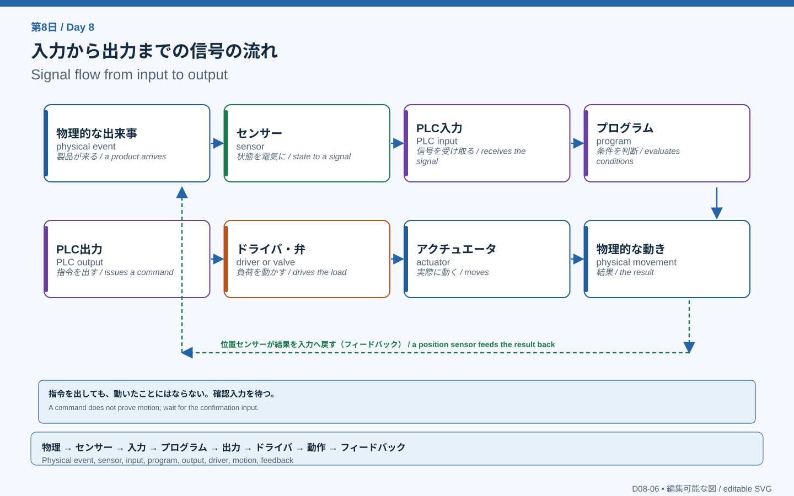
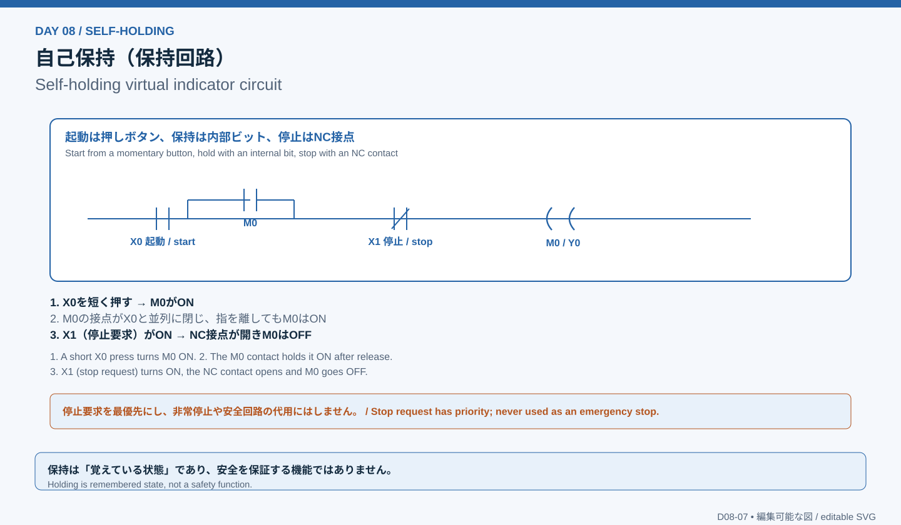
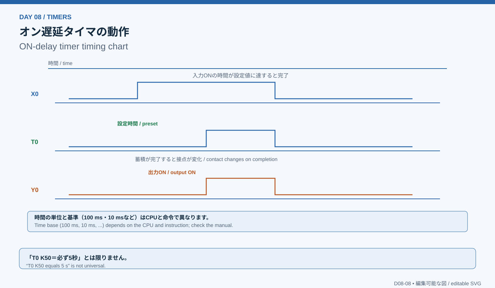
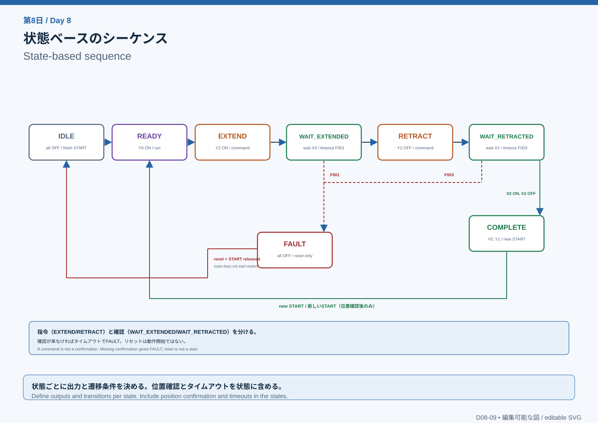

# 第8日 02 センサーの種類・選定・入出力・NPN/PNP / Day 8-02 Sensor Types, Selection, I/O and NPN/PNP Interfaces

> 所要時間 / Duration: **85分 / 85 minutes**
> 元PDF / Source pages: 24-29, 48
> 共通例 / Running example: シリンダの位置と製品の有無を検出する / detecting cylinder position and product presence

## 1. 概要 / Overview

センサーは「設備の目」です。このノートブックでは、PLCを基準にして**入力（IN）と出力（OUT）**を整理し、代表的なセンサーの種類と選び方を学びます。後半は、実務でつまずきやすい**NPN/PNPとPLC入力の共通端子**を、電流の流れで説明します。最後に、PLC出力の種類と負荷の関係を確認します。

Sensors are the eyes of a machine. This notebook organises **inputs and outputs** using the PLC as the reference, then covers the main sensor types and how to choose them. The second half explains **NPN/PNP and the PLC input common** through the conventional current path, which is where practical mistakes happen. It closes with PLC output types and their load limits.

**安全に関する前提 / Safety boundary.** センサーの検出は、安全の保証ではありません。安全用の光カーテンやインターロックは、通常のセンサーやPLCの入力とは別の、安全関連システムとして設計します。実機の配線・通電は有資格者が行います。 / Sensor detection is not a safety guarantee. Safety light curtains and interlocks are designed as safety-related systems, separate from ordinary sensors and PLC inputs. Real wiring and energisation are done by qualified people.

## 2. 学習目標 / Learning objectives

1. 入力と出力を、PLCを基準に説明できる。
2. 指令と確認の違いを説明できる。
3. 代表的なセンサーの検出原理と用途を説明できる。
4. センサー選定の手順を、順番に言える。
5. ON/OFF、アナログ、パルス、通信の違いを説明できる。
6. PNPとNPNの電流経路を、図で説明できる。
7. PLC入力の共通端子との整合を判断できる。
8. PLC出力の種類と負荷の制約を説明できる。

By the end you can explain inputs and outputs relative to the PLC; distinguish a command from a confirmation; describe sensor principles and applications; state the sensor selection sequence; distinguish ON/OFF, analog, pulse and communication signals; explain PNP and NPN current paths with a diagram; judge PLC input common compatibility; and explain PLC output types and load limits.

## 3. 前提 / Prerequisites

08-01 を終えていること。DC24Vの話と、リレー・電磁弁の話を覚えている前提で進めます。 / Complete 08-01; DC24V, relays and solenoid valves are assumed.

## 4. 入力と出力 / inputs and outputs

PLCを基準に考えます。

- **入力（IN）**：PLCが受け取る信号。
- **出力（OUT）**：PLCが出す指令・信号。

**入力の例 / input examples**：スタートボタン、ストップボタン、製品有無センサー、シリンダ後退端センサー、シリンダ前進端センサー、カメラの検査結果（対応する入力信号として）。

**出力の例 / output examples**：表示灯、電磁弁、モーターの起動指令、モータードライブへの指令、不良品排出の指令。



*図 D08-06：物理的な出来事 → センサー → PLC入力 → プログラム → PLC出力 → ドライバ・電磁弁 → アクチュエータ → 物理的な動き。位置センサーは結果を入力へ戻します。 / Figure D08-06: physical event, sensor, PLC input, program, PLC output, driver or valve, actuator, physical movement. A position sensor feeds the result back as an input.*

**指令と確認は違います / commands and confirmations differ.**

- 「Y2をONにした」は**指令**です。
- 「X3がONになった」は**確認**です。
- 指令を出しただけでは、シリンダが動いたことは分かりません。
- 確認が来ない場合の扱い（タイムアウトなど）を決めておきます。

"Y2 is ON" is a command; "X3 is ON" is a confirmation. A command alone does not prove motion. Decide in advance what happens when the confirmation does not arrive.

**PLC出力端子の定格 / output terminal ratings.** PLCの出力端子には、電圧・電流の限度があります。大きな負荷は、リレー・接触器・ドライバなど、適切な開閉機器を介して動かします。出力端子の定格を超えて直接つながないでください。

PLC output terminals have voltage and current limits. Larger loads are switched through suitable devices such as relays, contactors or drivers. Never connect a load beyond the terminal rating directly.

## 5. センサーの種類 / sensor types



*図 D08-07：代表的なセンサーの検出原理と用途。 / Figure D08-07: detection principles and applications of common sensors.*

| センサー / Sensor | 検出の原理（初級） / Principle (beginner) | 検出できるもの / What it detects | 主な用途 / Applications | 主な制約 / Limitations | 選定の仕様 / Selection specifications |
|---|---|---|---|---|---|
| 透過型光電 / through-beam photoelectric | 投光器と受光器の間を遮る / object blocks the beam | 不透明な物、通過の有無 / opaque objects, passage | 通過検出、落下検出 / passage, drop detection | 取付に空間が必要 / needs space on both sides | 距離、応答時間、出力形式 / distance, response, output |
| 反射型（再帰反射）/ retroreflective | 反射板からの光がさえぎられる / beam returns from a reflector | 比較的大きな物 / fairly large objects | 通過検出 / passage detection | 光沢面で誤検出 / shiny targets misbehave | 距離、ヒステリシス / distance, hysteresis |
| 拡散反射型 / diffuse-reflective | 対象物からの反射光を受ける / light reflected by the target | 色・表面で距離が変わる / depends on colour and surface | 近距離の有無 / presence at short range | 黒・透明・光沢は苦手な場合 / black, clear or glossy targets | 設定距離、スポット径 / range, spot size |
| 誘導型近接 / inductive proximity | 金属に近づくと変化 / responds to metal | 金属 / metal | 金属部品の有無 / metal part presence | 非金属は検出しない / not for non-metals | 検出距離、材質補正 / range, material derating |
| 静電容量型近接 / capacitive proximity | 静電容量の変化 / capacitance change | 金属・非金属・液体 / metal, non-metal, liquid | 樹脂部品、液面 / plastic parts, level | 周囲の影響を受けやすい / sensitive to surroundings | 感度、材質 / sensitivity, material |
| シリンダ用磁気センサー / magnetic cylinder sensor | ピストンの磁石を検出 / detects the piston magnet | 磁石を付けたピストン / magnetised piston | ストローク端の検出 / end position | 取付位置の調整が必要 / needs position adjustment | 対応シリンダ、応答 / cylinder compatibility |
| リミットスイッチ / mechanical limit switch | 機械的な接触 / mechanical contact | 物理的な位置 / physical position | 端の確認、ドア / end confirmation, doors | 摩耗、接触の力 / wear, actuation force | 動作力、寿命 / actuating force, life |
| 超音波 / ultrasonic | 音波の反射時間 / sound reflection time | 距離、透明物も比較的 / distance, some clear objects | 液面、距離 / level, distance | 風・形状の影響 / air currents, shape | 範囲、ビーム角 / range, beam angle |
| 圧力センサー / pressure sensor | 圧力を電気信号に / pressure to a signal | 空気・油の圧力 / air or oil pressure | 圧力監視 / pressure monitoring | 種類・範囲の適合 / type and range matching | 範囲、出力、精度 / range, output, accuracy |
| エンコーダ / encoder | 回転量をパルスに / rotation to pulses | 回転量・速度 / rotation, speed | ローラー回転、搬送量 / roller rotation, travel | 取付精度、ノイズ / mounting, noise | 分解能、出力形式 / resolution, output type |
| カメラ・画像センサー / camera or vision sensor | 画像から特徴を取る / image features | 形状・色・欠陥 / shape, colour, defects | 外観検査 / appearance inspection | 照明と環境に依存 / lighting and environment | 解像度、視野、速度 / resolution, FOV, speed |

**正直な限界 / honest limits.** 通常の反射型光電センサーが、すべての透明体や黒い対象を確実に検出するわけではありません。**実際の対象物で試すこと**が最も重要です。 / Ordinary reflective photoelectric sensors do not reliably detect every transparent or black target. Testing with the actual target is essential.

**PVCシートのような材料では / for a material like PVC sheet.** 透明・半透明・光沢・黒・つや消しで、光の返り方が大きく変わります。透過型、拡散反射型、低角度照明と組み合わせた画像検査など、候補は複数あります。第9日で詳しく扱います。 / Clear, translucent, glossy, black and matte surfaces reflect light very differently. Through-beam, diffuse and imaging with low-angle lighting are all candidates; Day 9 covers this.

## 6. センサー選定の手順 / sensor selection workflow



*図 D08-08：選定は「何を」「どんな材質で」「どれだけ離れて」「どれだけ速く」の順に整理します。 / Figure D08-08: selection proceeds from what, which material, at what distance, and how fast.*

1. 何を検出したいか（有無、位置、距離、色、欠陥）。
2. 対象物の材質・色・表面状態は何か。
3. 必要な検出距離はいくつか。
4. 対象物はどれだけ速く動くか。
5. 必要な応答時間はいくつか。
6. 環境はどうか（粉じん、水、油、温度、光）。
7. 出力はデジタルかアナログか。
8. 必要な電源電圧はいくつか。
9. 出力インターフェースは何か（NPN/PNP、アナログ、パルス、通信）。
10. どのPLC入力・インターフェースと整合するか。

**信号の種類 / signal types.**

- **ON/OFF（デジタル）**：ある／ない、の2値。
- **アナログ**：連続した値。例として 0–10 V、4–20 mA。
- **パルス**：回転量や流量を数える。
- **通信**：値をデジタルデータとして送る。

**4–20 mAの考え方 / about 4-20 mA.** 4 mAを「0」、20 mAを「最大」として扱うことが多い方式です。断線すると0 mAになるため、0 mAを正常値と区別しやすいという特徴があります。細かい計算はこの研修の範囲外です。

A 4-20 mA loop commonly maps 4 mA to zero and 20 mA to full scale. A broken wire gives 0 mA, which is distinguishable from a valid zero. Detailed design calculations are outside this course.

**PLC入力の定格 / PLC input ratings.** PLCの入力には、ONと判定する電圧・電流の範囲、OFFと判定する範囲、応答時間、フィルタ時間があります。センサーの出力形式と、PLC入力の共通端子の接続が合っているかを確認します。

PLC inputs have defined ON and OFF thresholds, response times and filter times. Check that the sensor output type matches how the PLC input common is connected.

## 7. NPNとPNP / NPN and PNP

**NPNとPNPは「出力インターフェースの種類」であり、検出原理ではありません。** 同じ拡散反射型でも、PNP出力のものとNPN出力のものがあります。

NPN and PNP are output-interface characteristics, not detection principles. The same diffuse-reflective sensor can be ordered with a PNP or an NPN output.

### 7.1 PNP（プラスコモン） / PNP (positive switching)

3線式のPNPセンサーは、動作時に**プラス電源から電流を出す（ソース）**動きをします。これを受けるPLC入力は、**入力共通端子を0V**にした「シンク入力」が一般的です。

A conventional three-wire PNP sensor **sources** current from the positive supply when active. A compatible sinking PLC input commonly has its **input common at 0V**.

```text
+24V → PNPセンサー出力 → PLC入力回路 → 0V（共通）
+24V → PNP sensor output → PLC input circuit → 0V (common)
```

### 7.2 NPN（マイナスコモン） / NPN (negative switching)

3線式のNPNセンサーは、動作時に**0Vへ電流を引き込む（シンク）**動きをします。これを受けるPLC入力は、**入力共通端子を+24V**にした「ソース入力」が一般的です。

A conventional three-wire NPN sensor **sinks** current toward 0V when active. A compatible sourcing PLC input commonly has its **input common at +24V**.

```text
+24V（共通） → PLC入力回路 → NPNセンサー出力 → 0V
+24V (common) → PLC input circuit → NPN sensor output → 0V
```



*図 D08-09：PNP（上）とNPN（下）の電流経路、PLC入力の共通端子、ONの条件。 / Figure D08-09: PNP (top) and NPN (bottom) current paths, the PLC input common, and the ON condition.*

| センサー出力 / Sensor output | 動作時の動き / Behaviour when active | 適合する入力共通 / Compatible input common | 電流の向き / Current direction |
|---|---|---|---|
| PNP | +側から電流を出す / sources from + | 0V（シンク入力）/ 0V (sinking input) | +24V → センサー → PLC → 0V |
| NPN | 0Vへ電流を引き込む / sinks to 0V | +24V（ソース入力）/ +24V (sourcing input) | +24V → PLC → センサー → 0V |

```python exec id="npn-pnp"
import sys, pathlib

start = pathlib.Path.cwd()
root = next(p for p in [start, *start.parents]
            if (p / "day07_09_support" / "examples" / "automation_models.py").is_file())
sys.path.insert(0, str(root / "day07_09_support" / "examples"))
import automation_models as am

for output_type in ("PNP", "NPN"):
    for common in ("0V", "+24V"):
        result = am.plc_input_compatibility(output_type, common)
        mark = "OK  " if result["compatible"] else "NG  "
        print(f"{mark}{output_type} sensor, input common {common:<4} : {result['current_path']}")
print("Check the datasheet: wire colours and terminal numbers vary by product.")
```

**配線色について / about wire colours.** 茶＝+24V、青＝0V、黒＝出力、という並びは**よくある例**です。実際の配線は、必ずその製品のデータシートに従ってください。色だけで判断してはいけません。

Brown = +24V, blue = 0V and black = output is a **common example**. Actual wiring must follow the product datasheet; never decide from colour alone.

**NO/NCとNPN/PNPは別 / NO/NC is separate from NPN/PNP.** センサーのNO（動作で出力ON）とNC（動作で出力OFF）は、検出の論理です。NPN/PNPは電流の向きです。この2つを混同すると、配線は合っているのに動作が逆、という症状になります。

Sensor NO (output ON when detecting) and NC (output OFF when detecting) describe the detection logic. NPN/PNP describe current direction. Confusing them produces correct wiring with inverted behaviour.

## 8. センサー出力に合わせたPLCの選定 / selecting a PLC for the sensor output

確認する項目：

- 入力モジュールの電圧が合っているか / input module voltage compatibility
- 入力共通端子の配線 / input common wiring
- シンク入力かソース入力か / sourcing or sinking input
- 設定変更できる入力、双方向入力があるか / configurable or bidirectional inputs
- 入力電流とON/OFFしきい値 / input current and thresholds
- 漏れ電流（OFF時に流れる微小電流）/ leakage current
- 入力の応答時間とフィルタ / response time and filtering
- 電気的な絶縁 / electrical isolation

**PLC全体を「NPNのPLC」「PNPのPLC」と呼ぶのは正確ではありません。** 入力モジュールと配線で決まります。メーカーの用語も違うため、**電流の経路と共通端子の接続**を基準に理解してください。

It is not accurate to call an entire PLC "an NPN PLC" or "a PNP PLC". The input module and the wiring decide. Manufacturer terminology varies, so use the conventional current path and the common-terminal connection as the reference.

**メーカー固有の事例について / about manufacturer-specific examples.** 実在の機種の端子番号や互換性は、公式ハードウェアマニュアルで確認する必要があります。この教材では、誤った端子番号を書かないために、**汎用の概念例**だけを示します。実機では必ず公式マニュアルを確認してください。

Terminal numbers and compatibility for a real model must be checked in the official hardware manual. To avoid inventing terminal numbers, this material shows only a **generic conceptual example**. Always check the official manual for a real machine.

## 9. PLC出力の種類 / PLC output types

| 種類 / Type | 特徴 / Characteristic | 使える負荷の例 / Load examples | 注意 / Caution |
|---|---|---|---|
| リレー出力 / relay output | 接点で開閉 / mechanical contacts | ランプ、小型リレー、小型電磁弁 / lamps, small relays, small valves | 寿命、開閉頻度、AC/DCの定格を確認 / life, switching frequency, AC/DC ratings |
| シンク出力（トランジスタ）/ sinking transistor output | 0V側へ電流を引き込む / sinks to 0V | DC負荷 / DC loads | 極性、電流定格 / polarity, current rating |
| ソース出力（トランジスタ）/ sourcing transistor output | +側から電流を出す / sources from + | DC負荷 / DC loads | 極性、電流定格 / polarity, current rating |

**リレー出力なら何でも開閉できるわけではありません。** 電圧、電流、種類（AC/DC）、突入電流、開閉頻度、寿命を確認します。誘導負荷（電磁弁、リレーコイル、モーター）にはサージ対策を考えます。サージは、コイルの電流を切ったときに発生する高い電圧です。

Relay outputs cannot switch arbitrary loads. Check voltage, current, AC or DC, inrush, switching frequency and life. Inductive loads (solenoid valves, relay coils, motors) need surge suppression considered; a surge is the high voltage produced when a coil current is interrupted.

**安全との区別 / safety distinction.** 出力のON/OFFは通常の制御です。安全機能（非常停止、ガード、安全扉）は、安全リレーや安全PLCなどを含む独立したシステムで実現します。

Output ON/OFF is ordinary control. Safety functions (emergency stop, guards, safety doors) are implemented in an independent system with safety relays or a safety PLC.

## 10. 演習 / Exercises

### 演習1 センサーの選択 / exercise 1: sensor selection

「黒いゴム板の通過を検出したい。周囲に粉じんがある。検出距離は200 mm程度」という条件で、候補と確認事項を書いてください。 / For "detect the passage of a black rubber sheet, dusty environment, about 200 mm", name a candidate and what to check.

**答えの例 / example answer**：透過型光電センサーが候補。黒い対象は反射が少ないため、拡散反射型では不安定になりやすい。確認事項は、取付スペース、粉じんによるレンズ汚れ、応答時間、出力形式（PNP/NPN）、PLC入力との整合。実際のゴム板で試験する。 / A through-beam photoelectric sensor is a candidate because black targets reflect little light, making diffuse types unstable. Check mounting space, dust on the lenses, response time, output type (PNP/NPN) and PLC input compatibility, and test with the actual rubber sheet.

### 演習2 NPN/PNPの整合 / exercise 2: NPN/PNP compatibility

NPN出力のセンサーを、入力共通端子が0VのPLC入力に接続しました。正しく動くでしょうか。理由も書いてください。 / An NPN sensor is connected to a PLC input whose common is at 0V. Will it work? Explain.

**答え / answer**：通常は動きません。NPNは0Vへ電流を引き込む出力で、入力共通が+24Vのソース入力と組み合わせます。共通0VはPNP用のシンク入力の組み合わせです。ただし、双方向入力や設定変更できる機種もあるため、**必ずマニュアルで確認**します。 / Usually not. An NPN output sinks to 0V and pairs with a sourcing input whose common is +24V. A 0V common belongs with a PNP sensor and a sinking input. Some inputs are configurable or bidirectional, so always check the manual.

## 11. まとめ / Summary

- 入力はPLCが受け取る信号、出力はPLCが出す指令。
- 指令と確認は別。確認が来ない場合を設計する。
- センサーは、対象・距離・速さ・環境・出力形式の順に選ぶ。
- NPN/PNPは出力インターフェース。NO/NCは検出の論理。別の話。
- PNPは+から出し、共通0Vの入力へ。NPNは0Vへ引き、共通+24Vの入力へ。
- PLC全体をNPN/PNPと呼べない。入力モジュールと配線で決まる。
- 出力はリレー・シンク・ソースで制約が違う。定格を超えて直接つながない。
- 通常の入力・出力は、安全機能ではない。

Inputs are received signals; outputs are commands. Commands and confirmations differ. Choose sensors by target, distance, speed, environment and output type. NPN/PNP describe the output interface; NO/NC describes detection logic. PNP sources into a 0V-common input; NPN sinks from a +24V-common input. A whole PLC is not NPN or PNP; the module and wiring decide. Relay, sinking and sourcing outputs have different limits. Ordinary I/O is not a safety function.

## 12. 完了チェックリスト / Completion checklist

- [ ] 入力5例・出力5例を挙げられる。
- [ ] 指令と確認の違いを、シリンダの例で説明できる。
- [ ] センサー6種類以上の原理と用途を言える。
- [ ] 選定手順10項目を、順番に言える。
- [ ] ON/OFF・アナログ・パルス・通信の違いを説明できる。
- [ ] PNPの電流経路を、+24Vから0Vまで書ける。
- [ ] NPNの電流経路を、+24Vから0Vまで書ける。
- [ ] 0V共通・+24V共通のどちらがどちらか説明できる。
- [ ] リレー出力の制約を2つ以上言える。

- [ ] I can list five inputs and five outputs.
- [ ] I can explain command versus confirmation with a cylinder.
- [ ] I can describe six sensor types with principle and use.
- [ ] I can state the ten selection steps in order.
- [ ] I can distinguish ON/OFF, analog, pulse and communication.
- [ ] I can draw the PNP path from +24V to 0V.
- [ ] I can draw the NPN path from +24V to 0V.
- [ ] I can say which sensor type goes with which input common.
- [ ] I can give two limits of a relay output.

## 13. よくある間違い / Troubleshooting and common misunderstandings

| よくある間違い / Common mistake | 正しい考え方 / Correct view |
|---|---|
| NPNとPNPを検出原理と考える / treating NPN/PNP as a detection principle | 出力インターフェースの種類 / an output-interface characteristic |
| 配線色だけで判断する / deciding by wire colour | データシートで確認 / check the datasheet |
| PLC全体がNPNだと考える / calling the whole PLC NPN | 入力モジュールと配線で決まる / module and wiring decide |
| 指令を出せば動いたと考える / a command proves motion | 確認入力を待つ / wait for the confirmation input |
| 反射型で透明体も確実に検出できる / reflective sensors detect any clear object | 実対象で試験する / test the actual target |
| リレー出力で何でも開閉できる / relay outputs switch anything | 定格・種類・寿命を確認 / check ratings, type and life |

## 14. 安全と次の学習 / safety and what comes next

センサーが検出したから安全、という考え方は危険です。安全扉、光カーテン、非常停止は、通常のセンサーとPLCの入力とは別の安全関連システムで実現します。次は 08-03 で、PLCとラダープログラム、自己保持、インターロックを学びます。

"Detected, therefore safe" is a dangerous assumption. Safety doors, light curtains and emergency stops belong to safety-related systems, separate from ordinary sensors and PLC inputs. Next, 08-03 covers the PLC, ladder programming, self-holding and interlocks.
