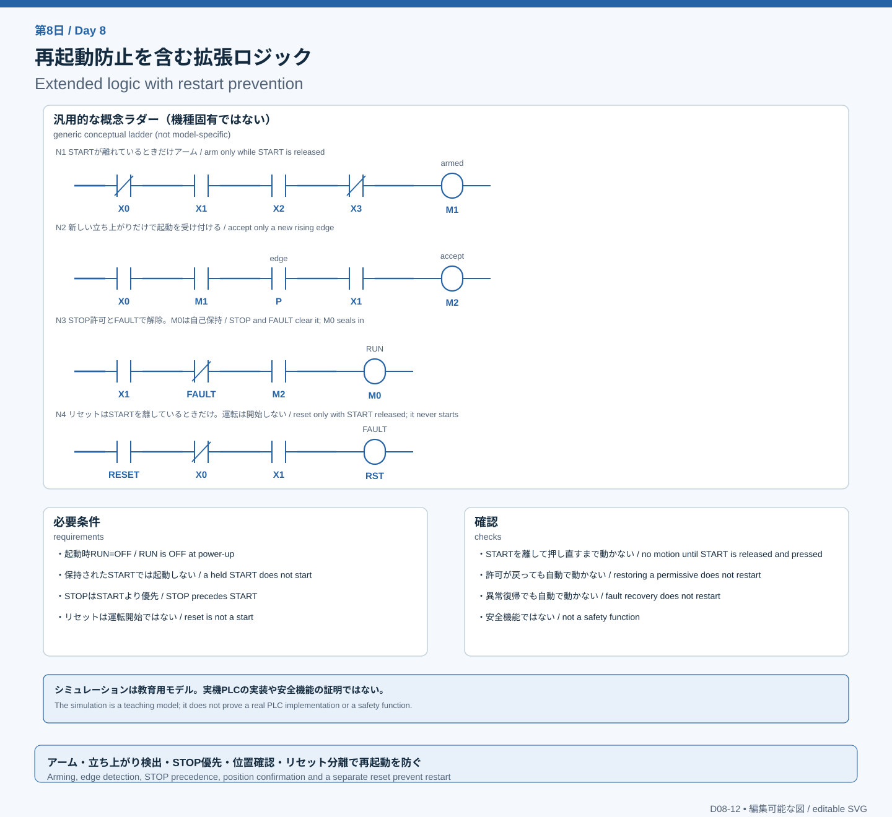
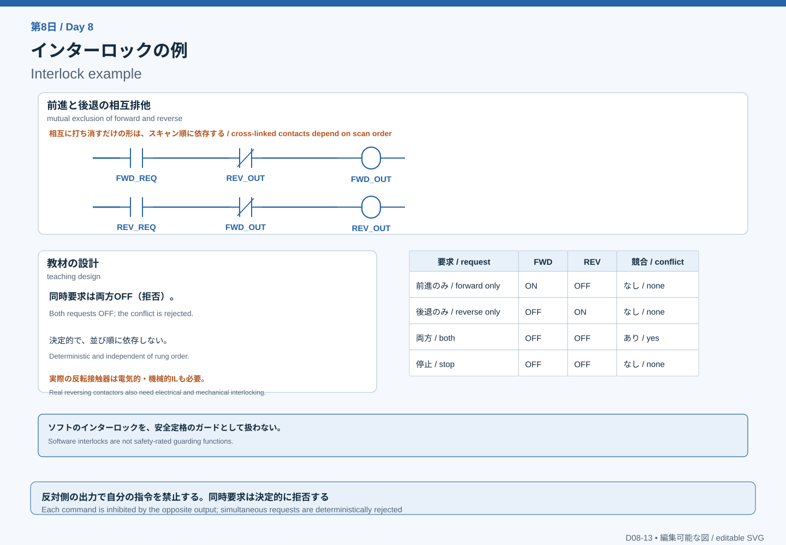
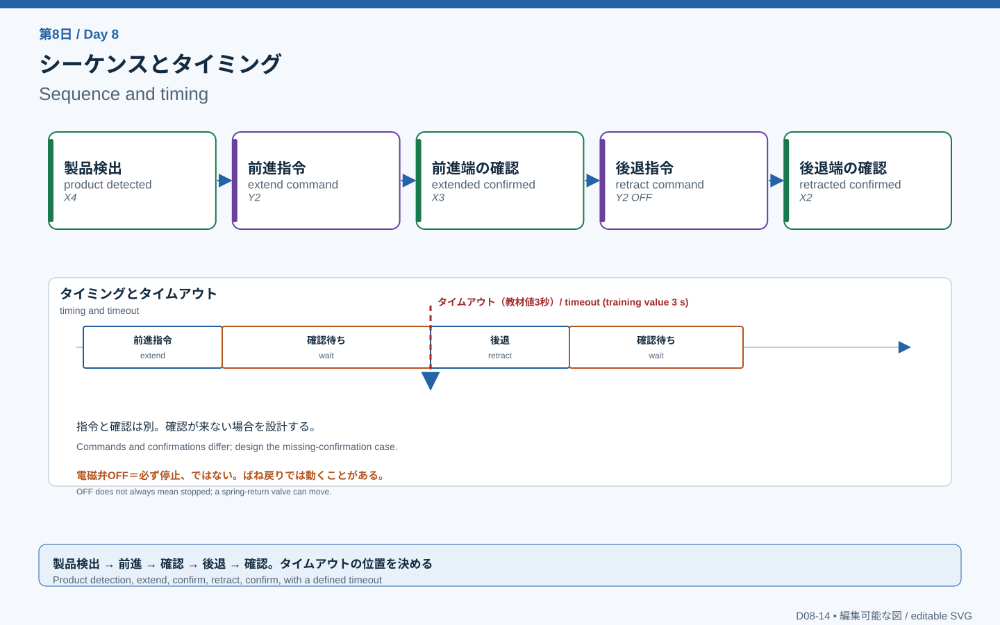

# 第8日 03 PLCとラダープログラム・自己保持・インターロック / Day 8-03 PLC and Ladder Programming, Self-Holding and Interlocks

> 所要時間 / Duration: **135分 / 135 minutes**
> 元PDF / Source pages: 30-33
> 共通例 / Running example: 小さなワークを押し出す装置 / a small workpiece-pushing machine

## 1. 概要 / Overview

PLCは、入力を見て、プログラムで判断し、出力を動かす装置です。このノートブックでは、ラダープログラムを**ゼロから**説明し、自己保持回路とインターロックを学びます。最後に、**「STARTを押しっぱなしにしても再起動しない」**ための論理を、図とシミュレーションで確認します。これは、実際の設備で非常に重要な考え方です。

A PLC reads inputs, decides in a program and drives outputs. This notebook explains ladder programming **from zero**, then covers self-holding circuits and interlocks. It closes by showing the logic that **prevents a restart when START is still held**, checked with a diagram and a simulation. This matters on real equipment.

**安全に関する前提 / Safety boundary.** このノートブックのラダーとシミュレーションは教育用です。安全PLCのプログラムでも、認証された安全機能でもありません。実機の安全機能は、リスクアセスメントに基づく独立した安全関連システムとして設計・検証します。通常のPLCのSTOP論理を、非常停止や人体安全の代わりにしてはいけません。学習コードは実機のPLC出力・モーター・電磁弁を動かしません。 / The ladder and simulation here are educational. They are not a safety PLC program or a certified safety function. Real safety functions are designed and validated as an independent safety-related system based on a risk assessment. Ordinary PLC STOP logic must never substitute for emergency stopping or personal safety. The training code never drives real PLC outputs, motors or valves.

## 2. 学習目標 / Learning objectives

1. PLCのモジュール構成を説明できる。
2. スキャンの流れ（入力読取り → プログラム実行 → 出力更新）を説明できる。
3. NO/NC接点、コイル、内部ビット、直列・並列を読める。
4. AND・OR・NOTを、ラダーで表せる。
5. 物理接点と論理接点の違いを説明できる。
6. 自己保持回路の動作を、5つの場面で説明できる。
7. 再起動防止のために足りない論理を指摘できる。
8. インターロックの目的と、同時指令の扱いを説明できる。
9. 指令と確認の違いを、シーケンスで説明できる。
10. 通常の制御と安全機能の境界を説明できる。

By the end you can describe PLC modules; explain the scan; read NO/NC contacts, coils, internal bits and series/parallel; express AND, OR and NOT in ladder; distinguish physical and logical contacts; explain self-holding in five situations; identify the logic missing for restart prevention; explain interlocks and conflicting commands; distinguish commands from confirmations in a sequence; and state the boundary between ordinary control and safety functions.

## 3. 前提 / Prerequisites

08-01（電気）、08-02（センサー・I/O・NPN/PNP）を終えていること。共通I/O表（X0〜X4、M0、M1、Y0、Y2）を確認してください。 / Complete 08-01 and 08-02. Review the canonical I/O table (X0-X4, M0, M1, Y0, Y2).

```text
X0  START 押しボタン（NO、押している間ON）      / START pushbutton (NO, ON while pressed)
X1  STOP_OK 許可（物理NCのSTOP、健全時ON）      / STOP_OK permission (physical NC stop, ON while healthy)
X2  後退端の確認                                / retracted position confirmation
X3  前進端の確認                                / extended position confirmation
X4  製品あり                                    / product present
M0  運転中（RUN）                               / RUN state
M1  START受付許可（アーム）                     / START armed
Y0  運転表示灯                                  / RUN lamp
Y2  前進用電磁弁の指令                          / extend solenoid command
```

## 4. PLCとは / what a PLC is

| モジュール / Module | 役割 / Role |
|---|---|
| 電源 / power supply | PLC内部と入出力に電力を供給 / powers the PLC and I/O |
| CPU | プログラムを実行 / executes the program |
| 入力 / input module | スイッチ・センサーの状態を読む / reads switches and sensors |
| 出力 / output module | ランプ・電磁弁などを動かす / drives lamps and valves |
| 内部メモリ / internal memory | 状態・タイマー・カウンタを保持 / holds state, timers and counters |
| 通信 / communication interface | PC・HMI・他のPLCと通信 / communicates with PCs, HMIs and other PLCs |

**処理の流れ（簡略）/ simplified scan.**

```text
入力を読む → プログラムを上から実行 → 出力を更新 → 繰り返す
read inputs → execute the program top to bottom → update outputs → repeat
```

実際の動きは、機種・設定・命令によって変わります。即時入出力命令、割込み、タスク、通信の更新周期、入力フィルタ時間などで挙動が変わるため、**すべてのPLCが同じスキャンをするとは限りません**。

Actual behaviour depends on model, settings and instructions: immediate I/O instructions, interrupts, tasks, communication update cycles and input filters all change it. Do not assume every PLC scans identically.

## 5. ラダープログラムの基本 / ladder fundamentals

ラダーは、リレー回路に似た図で論理を書きます。

| 要素 / Element | 意味 / Meaning |
|---|---|
| `--| |--` NO接点 / normally-open logical contact | 条件が真のとき通す / passes when the condition is true |
| `--|/|--` NC接点 / normally-closed logical contact | 条件が偽のとき通す / passes when the condition is false |
| `--( )--` 出力コイル / output coil | 結果を出力・内部ビットに書く / writes the result |
| 直列 / series | AND |
| 並列 / parallel | OR |
| NC接点での否定 / negation by an NC contact | NOT |

**AND / OR / NOT /**

```text
AND   |--[ A ]--[ B ]--( Y )--|           Y = A AND B
OR    |--+--[ A ]--+--( Y )--|            Y = A OR B
      |  +--[ B ]--+
NOT   |--[/ A ]-------( Y )--|            Y = NOT A
```


*図 D08-10：NO/NC接点、コイル、AND/OR/NOT、物理接点と論理接点の違い、オンディレイタイマー。 / Figure D08-10: NO/NC contacts, coils, AND/OR/NOT, physical versus logical contacts and an on-delay timer.*

**図の接点は「論理状態の評価」です。** 実際の接点や、実際に電流が流れていることを、そのまま表しているわけではありません。 / The graphic contact represents evaluation of a logical state, not necessarily a physical contact or real current flow.

**オンディレイタイマー / on-delay timer.** 条件が続いた時間を数え、設定時間に達したら出力をONにします。`T0` は「M0がONの間だけ時間を数える」例です。時間の分解能とリセット条件は機種で違います。

An on-delay timer counts while its condition is true and turns its output ON at the set time. Here T0 counts while M0 is ON. Resolution and reset behaviour vary by model.

## 6. 物理接点と論理接点 / physical and logical contacts

物理接点は「部品の接点」、論理接点は「プログラム上の条件」です。**一致しないことがあります。**

- 物理NCのSTOPボタンを、「健全なときPLC入力がON」になるように配線する。
- このときPLCのX1は、正常時にONである。
- プログラムでは、X1を「ONで許可」として使う（NO論理接点で評価する）。

**物理的にNCのスイッチを、必ずNC論理接点で使う、という規則はありません。** 大事なのは「異常時にどちらへ倒れるか」を設計者が理解していることです。配線が断線したときに、ONとOFFのどちらになるかを考えます。この考え方を「フェイルセーフ」と呼びますが、通常のPLC入力だけで安全機能になるわけではありません。

There is no rule that a physically NC switch must use an NC logical instruction. What matters is that the designer knows which way the signal falls when something fails. Consider whether a broken wire produces ON or OFF. This relates to fail-safe thinking, but ordinary PLC inputs alone do not create a safety function.

## 7. 基本の自己保持回路 / the basic self-holding circuit

まず、**ランプの演示**で自己保持を理解します。

```text
M0_next = X1 AND ( X0 OR M0_previous )

|--[ X1 ]--+--[ X0 ]--+--( M0 )--|
           +--[ M0 ]--+
|--[ M0 ]----------------( Y0 )--|
```

X0を押すとM0がONになり、X0を離しても、並列のM0接点が自分自身を保持します。X1（許可）がOFFになると、M0はOFFになります。

Pressing X0 turns M0 ON. Releasing X0 leaves the parallel M0 contact holding itself. When X1 (permission) goes OFF, M0 goes OFF.


*図 D08-11：START枝とM0保持枝。教材用の基本回路です。 / Figure D08-11: the START branch and the M0 holding branch. This is a basic teaching circuit.*

**5つの場面 / five situations.**

1. STARTを離す → RUNが続く（保持）。
2. STARTを押す → RUNになる。
3. 押してから離す → RUNのまま。
4. STOP許可がOFF → RUNがOFFになる。
5. STOP許可が戻る → **この基本回路では、STARTを押しっぱなしだとRUNが戻ってしまう。**

場面5が重要です。基本の自己保持は「記憶」の説明には十分ですが、**再起動防止の機能はありません**。

Situation 5 matters. Basic seal-in explains memory but provides **no restart prevention**.

## 8. 再起動防止を含む拡張ロジック / extended logic with restart prevention

実際の設備では、次のすべてを満たす必要があります。

- 起動時のRUN状態はOFF。
- 電源投入時にSTARTが押されていても、運転を開始しない。
- STARTが一度離されたことを確認する。
- 新しく押された（立ち上がり）ことを必要とする。
- STOP許可が有効。
- 起動位置の確認（後退端）が有効。
- STOPはSTARTより優先。
- リセットは運転を開始しない。
- 異常からの復帰で、自動的に動き出さない。
- STARTを押したまま許可が戻っても、動き出さない。

All of these are required: RUN is OFF at power-up; a held START at power-up does not start; START must be observed released; a new rising edge is required; stop permission must be valid; the starting position must be confirmed; STOP takes precedence over START; reset does not start; fault recovery does not restart motion; restoring a permissive while START is held does not start.



*図 D08-12：アーム（M1）・立ち上がり検出・STOP優先・位置確認・リセットの関係。基本回路との違いを明示しています。 / Figure D08-12: arming (M1), rising-edge detection, STOP precedence, position confirmation and reset, shown against the basic circuit.*

```text
Network 1  START受付のアーム（STARTが離れているときだけ許可）
|--[/ X0 ]--[ X1 ]--[ X2 ]--[/ X3 ]--[/ M0 ]--[/ FAULT ]--( M1 )--|

Network 2  新しいSTARTの立ち上がりだけで起動を受け付ける
|--[ X0 ]--[ M1 ]--[ X1 ]--[ X2 ]--[/ X3 ]--[/ FAULT ]--[ P ]--( M2 )--|
|--[ M2 ]------------------------------------------------( RST M1 )--|

Network 3  運転の保持（STOP許可とFAULTで解除）
|--[ X1 ]--[/ FAULT ]--+--[ M2 ]--+--( M0 )--|
                       +--[ M0 ]--+

Network 4  リセット（STARTを離しているときだけ、FAULTを解除）
|--[ RESET ]--[/ X0 ]--[ X1 ]--[/ M0 ]--( RST FAULT )--|

Network 5  出力
|--[ M0 ]----------------( Y0 )--|
|--[ M0 ]--[ X2 ]--[/ X3 ]--( Y2 )--|
```

- `[ P ]` は立ち上がり検出（正転移）の**汎用**の命令です。メーカーによって名前と書き方が違います。
- `FAULT` は異常状態の内部ビットです。異常時の扱い（タイムアウトなど）は §10 で扱います。
- `M1` がONでないと、STARTを押しても起動しません。M1はSTARTが離れるまでONになりません。
- Y2は、後退端（X2）で前進端でない（X3でない）ときだけONにします。

`[ P ]` is a **generic** positive-transition instruction; names and syntax vary by manufacturer. `FAULT` is an internal fault bit, covered in section 10. Without M1, pressing START does nothing, and M1 cannot become true until START is released. Y2 is only ON from the retracted end.

**重要な注意 / important caution.** 上の拡張ロジックは、**汎用的な概念ラダー**です。三菱・オムロンなどの実機の命令語・アドレス・実行仕様に合わせたものではありません。実機では、その機種の公式マニュアルに従って書き直し、試験します。また、この論理は**安全機能ではありません**。

The extended logic above is a **generic conceptual ladder**, not written for a specific Mitsubishi, Omron or other instruction set. On a real machine it must be rewritten and tested according to that model's official manual. It is also **not a safety function**.

**シミュレーションは証明ではありません / a simulation is not proof.** 次のコードは、教育用の決定論的モデルを動かします。実際のスキャン周期、入力フィルタ、タイマー精度、割込み、通信遅延は再現しません。実機のPLC実装や安全機能の証明にはなりません。

The code below runs a deterministic teaching model. It does not reproduce real scan periods, input filters, timer accuracy, interrupts or communication delay, and proves nothing about a real PLC implementation or a safety function.

```python exec id="seal-in-vs-extended"
import sys, pathlib

start_path = pathlib.Path.cwd()
root = next(p for p in [start_path, *start_path.parents]
            if (p / "day07_09_support" / "examples" / "automation_models.py").is_file())
sys.path.insert(0, str(root / "day07_09_support" / "examples"))
import automation_models as am

basic = am.BasicSealIn()
basic.step(start=True, stop_ok=True)
basic.step(start=True, stop_ok=False)
print("basic seal-in, STOP opened while START held :", basic.step(start=True, stop_ok=True))

gate = am.StartGate()
gate.power_on()
held = gate.step(start=True)
print("extended, held START at power-up            :", held)
print("extended, START released                    :", gate.step(start=False))
print("extended, new START edge                    :", gate.step(start=True))
print("extended, STOP opened                       :", gate.step(start=True, stop_ok=False))
print("extended, permission restored, START held   :", gate.step(start=True, stop_ok=True))
```

**確認すること / what to notice.** 基本回路は、STOPを戻すとRUNが復活します。拡張ロジックは、許可が戻ってもSTARTを離して押し直すまで運転しません。この違いが、再起動防止の核心です。

The basic circuit restores RUN when the stop permission returns. The extended logic does not run again until START is released and pressed again. That difference is the core of restart prevention.

## 9. インターロック / interlocks

**インターロック（interlock）**は、同時に成立してはいけない指令や、条件がそろっていない操作を、**成立させない**仕組みです。

Examples: a cylinder may extend only when the product is present; a process may start only after a positioning signal is confirmed; forward and reverse motor commands must not be active together; a rejection must not fire for an OK product; a process must not start when the preceding operation is incomplete.

```text
|--[ X4 製品あり ]--[/ X3 前進端 ]--[ M0 ]--( Y2 前進指令 )--|
Y2 = M0 AND X4 AND NOT X3
```

**前進・後退の同時指令 / simultaneous forward and reverse.** 次のように、反対側の指令で自分の指令を打ち消す形が基本です。

```text
|--[ FORWARD_REQ ]--[/ REVERSE_OUT ]--( FORWARD_OUT )--|
|--[ REVERSE_REQ ]--[/ FORWARD_OUT ]--( REVERSE_OUT )--|
```

ただし、この**相互に打ち消すだけの形は、スキャン順に依存**します。両方を同時に要求したときに、どちらが残るかがプログラムの並び順で変わる可能性があります。教材では、**同時要求は両方OFF（拒否）**という単純で決定的な設計にします。

However, a naive pair of cross-linked contacts depends on scan order: with both requests present, which output remains can depend on the order of the rungs. The teaching design deliberately rejects simultaneous requests (both outputs OFF), which is simple and deterministic.



*図 D08-13：前進・後退の相互排他、同時要求の拒否、製品ありの条件。 / Figure D08-13: forward/reverse mutual exclusion, rejection of simultaneous requests, and the product-present condition.*

```python exec id="interlock"
import sys, pathlib

start_path = pathlib.Path.cwd()
root = next(p for p in [start_path, *start_path.parents]
            if (p / "day07_09_support" / "examples" / "automation_models.py").is_file())
sys.path.insert(0, str(root / "day07_09_support" / "examples"))
import automation_models as am

drive = am.MotorInterlock()
print("forward only        :", drive.step(forward_req=True, reverse_req=False))
print("reverse only        :", drive.step(forward_req=False, reverse_req=True))
print("both at the same time:", drive.step(forward_req=True, reverse_req=True))
print("stop opened         :", drive.step(forward_req=True, reverse_req=False, stop_ok=False))
print("extend allowed      :", am.interlock_allows({"product": True, "retracted": True}, True))
print("extend refused      :", am.interlock_allows({"product": False, "retracted": True}, True))
```

**実際の前進・後退 / real forward and reverse.** 実際の反転用電磁接触器では、電気的なインターロック（補助接点）や機械的なインターロックも必要です。**ソフトウェアのインターロックを、安全定格のガード機能として扱ってはいけません。**

Real reversing contactors also need electrical (auxiliary-contact) and/or mechanical interlocking. Software interlocks must not be presented as safety-rated guarding functions.

## 10. 基本のシーケンス / a basic equipment sequence

```text
製品検出（X4） → 前進指令（Y2） → 前進端の確認（X3） → 後退指令 → 後退端の確認（X2）
product detected → extend command → extended confirmation → retract command → retracted confirmation
```

**指令と確認 / command and confirmation.**

- 「Y2をONにした」は指令。シリンダが動いた証明ではない。
- 「X3がONになった」は確認。
- 確認が来ない場合に備えて、**タイムアウト**を考えます。タイムアウト値は、速度・負荷・圧力・温度から決めます。この研修の3秒は**教材値**です。

"Y2 is ON" is a command, not proof of motion. "X3 is ON" is a confirmation. Design a timeout for a missing confirmation; the value comes from speed, load, pressure and temperature. Three seconds here is a training value.



*図 D08-14：製品検出から前進・確認・後退・確認までの流れと、タイムアウトの位置。 / Figure D08-14: the sequence from product detection through extend, confirm, retract and confirm, with the timeout position.*

**電磁弁をOFFにすれば必ず止まる、とは限りません / de-energising a valve does not always stop the mechanism.** ばね戻り弁では、電気を切るとシリンダが戻る方向に動きます。保持弁や残留圧力の影響もあります。「OFFにしたら止まる」と決めつけず、**止まったときに何が起きるか**を設計で確認します。

With a spring-return valve, removing power can move the cylinder. Holding valves and residual pressure also matter. Do not assume that OFF means stopped; design and confirm what happens when it stops.

## 11. 安全との境界 / the safety boundary

| 区分 / Category | 内容 / What it is |
|---|---|
| 通常のプロセス制御 / ordinary process control | 製品の有無で電磁弁を動かすなど / moving a valve based on product presence |
| 通常の停止 / ordinary stopping | 作業者が運転を終えるための停止 / stopping at the end of a run |
| 非常停止 / emergency stopping | 人の危険を避けるための停止。独立した安全関連システム / stopping to avoid danger to people; an independent safety-related system |
| 安全定格の制御機能 / safety-rated control functions | リスクアセスメントに基づく安全機能 / safety functions based on a risk assessment |
| 安全リレー・安全PLC / safety relays and safety PLCs | 安全機能を実現する専用の機器 / dedicated devices for safety functions |
| ガード・エネルギー隔離 / guarding and energy isolation | ガード、ロックアウト、残留エネルギー確認 / guards, lockout, stored-energy verification |

学習者は、実際の制御盤に配線・通電してはいけません。学習コードが実機の出力を動かすこともありません。実機の演示は、別途承認され、適切な有資格者が行います。

Trainees must not wire or energise a real control panel, and training code never drives real outputs. Any real demonstration is separately approved and conducted by qualified personnel.

## 12. 演習 / Exercises

### 演習1 入出力の読取り / exercise 1: reading I/O

「Y2 = M0 AND X4 AND NOT X3」のとき、Y2がONになる条件を、日本語と英語で書いてください。 / State, in Japanese and English, the conditions for Y2 to be ON.

**答え / answer**：運転中（M0）で、製品があり（X4）、前進端でない（X3がOFF）とき。 / While running (M0), with a product present (X4) and not at the extended end (X3 OFF).

### 演習2 自己保持の理由 / exercise 2: why RUN stays on

STARTを離してもRUNが続く理由を、接点の言葉で説明してください。 / Explain why RUN stays on after START is released, using contact terminology.

**答え / answer**：M0のコイルと並列に、M0自身のNO接点があるため。M0がONになると、その接点が閉じ、X0が開いても論理が成立し続ける。これを自己保持（シールイン）という。 / Because an NO contact of M0 is in parallel with the START branch. Once M0 is ON, its own contact closes and the logic stays true even when X0 opens. This is self-holding (seal-in).

### 演習3 インターロック / exercise 3: interlock

前進と後退を同時に要求したとき、教材の設計ではどうなるか、理由とともに書いてください。 / What happens in the teaching design when forward and reverse are requested together, and why?

**答え / answer**：両方OFFになり、競合として扱う。相互に打ち消すだけの回路はスキャン順に依存するため、同時要求は拒否する設計にしている。 / Both outputs go OFF and the state is treated as a conflict. A merely cross-linked circuit depends on scan order, so simultaneous requests are rejected.

## 13. まとめ / Summary

- PLCは、入力読取り → プログラム → 出力更新を繰り返す。挙動は機種・設定で変わる。
- ラダーの接点は論理状態の評価であり、物理接点や電流そのものではない。
- 物理NCのSTOPは、プログラムではONで許可を表すことがある。
- 基本の自己保持は記憶を説明するが、再起動防止はない。
- 再起動防止には、アーム、立ち上がり、STOP優先、位置確認、リセットの分離が必要。
- インターロックは、同時に成立してはいけない指令を成立させない。
- 同時要求は、スキャン順に依存しない決定的な扱いにする。
- 指令と確認は別。タイムアウトを設計する。
- 通常の制御と安全機能は、別のシステム。

The PLC repeats read, execute and update, with model-dependent behaviour. Ladder contacts evaluate logical states, not physical contacts. A physical NC stop may appear as an ON permission in the program. Basic seal-in explains memory but not restart prevention. Restart prevention needs arming, edge detection, STOP precedence, position confirmation and a separate reset. Interlocks prevent incompatible commands, with a deterministic response to simultaneous requests. Commands and confirmations differ, and timeouts are designed. Ordinary control and safety functions are separate systems.

## 14. 完了チェックリスト / Completion checklist

- [ ] スキャンの3段階を言える。
- [ ] AND/OR/NOTを、ラダーで書ける。
- [ ] 物理NCのSTOPと、プログラムのON許可の関係を説明できる。
- [ ] 自己保持の5つの場面を、順に説明できる。
- [ ] 基本回路に足りない機能を3つ以上挙げられる。
- [ ] 拡張ロジックの各ネットワークの役割を説明できる。
- [ ] 同時要求を拒否する理由を説明できる。
- [ ] 指令と確認の違いを、タイムアウトと一緒に説明できる。
- [ ] 通常の制御と安全機能の違いを説明できる。

- [ ] I can state the three scan stages.
- [ ] I can write AND, OR and NOT in ladder.
- [ ] I can explain the physical NC stop and the ON permission in the program.
- [ ] I can describe the five self-holding situations.
- [ ] I can name three things the basic circuit lacks.
- [ ] I can explain each network of the extended logic.
- [ ] I can explain why simultaneous requests are rejected.
- [ ] I can explain command versus confirmation with a timeout.
- [ ] I can explain the difference between ordinary control and safety functions.

## 15. よくある間違い / Troubleshooting and common misunderstandings

| よくある間違い / Common mistake | 正しい考え方 / Correct view |
|---|---|
| 基本の自己保持で再起動も防止できる / basic seal-in prevents restart | 再起動防止は別の論理が必要 / restart prevention needs extra logic |
| 物理NCならNC論理接点で使う / a physical NC switch needs an NC instruction | 状態の意味で決める / decide from the meaning of the state |
| ラダーの接点＝実際の接点 / a ladder contact is a real contact | 論理状態の評価 / evaluation of a logical state |
| 相互インターロックだけで十分 / cross-linked interlocks are enough | スキャン順に依存する。決定的な扱いにする / order-dependent; make it deterministic |
| 同時要求でどちらかが勝つ / one output wins a conflict | 教材では両方OFF / both OFF in the teaching design |
| シミュレーションで安全が証明できる / a simulation proves safety | 教育用モデル。安全設計は別 / a teaching model; safety design is separate |

## 16. 次の学習 / what comes next

第9日では、AI検査カメラを自分で作るときの、カメラ・レンズ・照明・撮像環境・PCとPLCの関係を学びます。PLCで学んだ「指令と確認」は、検査結果を機械へ伝える場面でもそのまま使います。

Day 9 covers building an AI inspection camera: cameras, lenses, lighting, the imaging environment, and the PC-to-PLC relationship. The command-and-confirmation idea from the PLC lesson carries straight over to sending inspection results to a machine.
