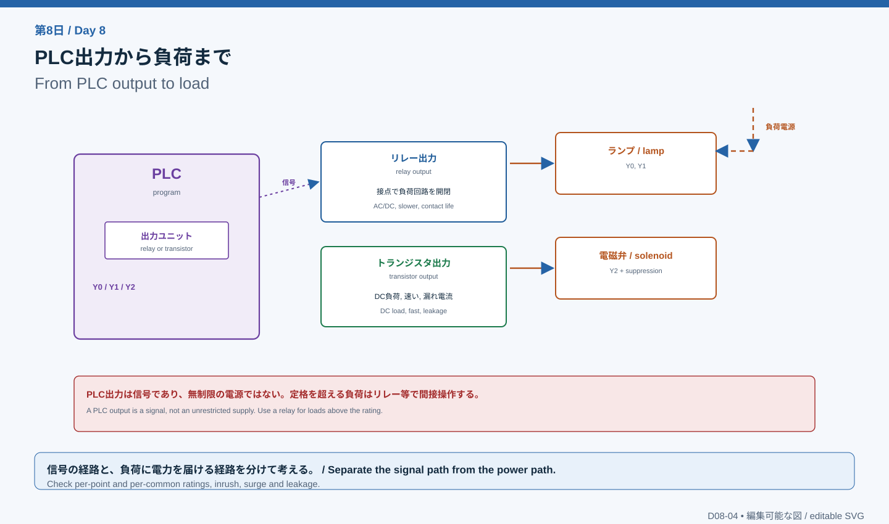
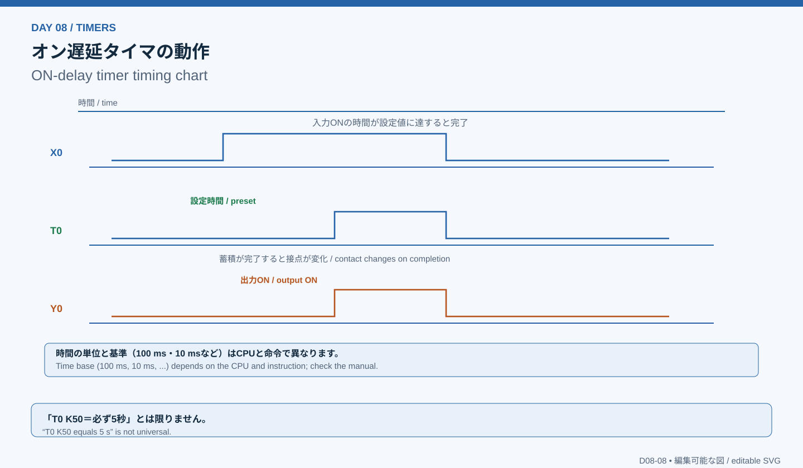
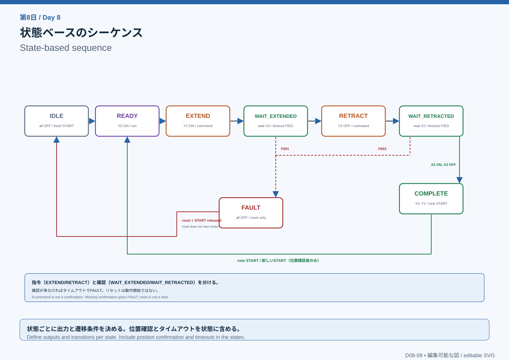
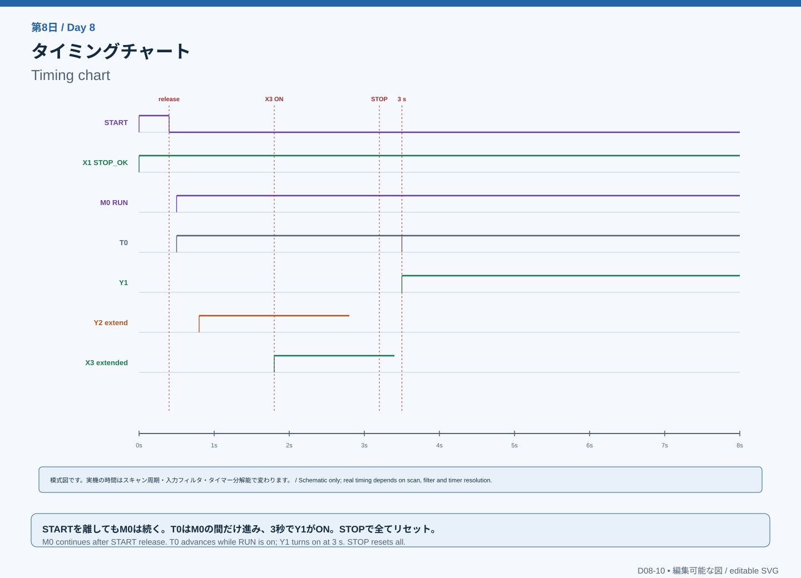
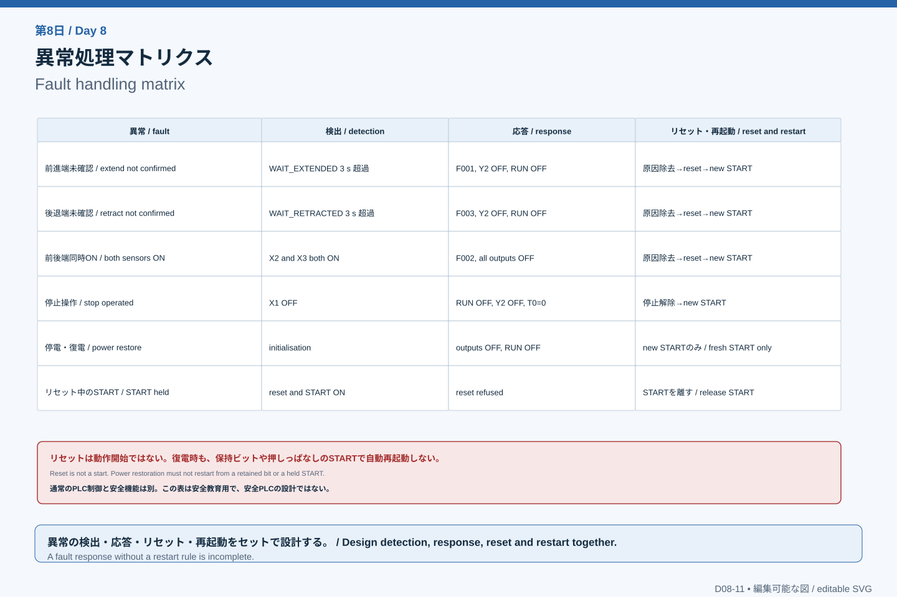

# 第8日 03 PLC・ラダー・シーケンス制御 / Day 8-03 PLC, Ladder and Sequence Control

> 所要時間 / Duration: **135分 / 135 minutes**
> 元資料 / Source pages: 30–33
> 共通題材 / Running example: 小型ワーク押出し装置 / small workpiece-pushing machine

## 1. 概要 / Overview

このノートブックは、Day 8の中心です。PLCの動作、ラダーの接点とコイル、自己保持、タイマー、状態遷移、位置確認、異常処理、復旧、再起動防止を扱います。

This is the central notebook of Day 8. It covers PLC operation, ladder contacts and coils, self-holding, timers, state transitions, position confirmation, fault handling, recovery and restart prevention.

**元資料の重要な誤りを修正します / correcting an important source error**

元PDFの31ページの自己保持回路には、**並列の保持接点がありません**。そのため、STARTを離すと運転状態が消えてしまいます。このノートブックでは、正しい自己保持回路を示し、シミュレーションで「STARTを離しても運転が続く」ことを確認します。

The self-holding circuit on page 31 of the source PDF **lacks the parallel holding contact**, so the RUN state would disappear when START is released. This notebook shows the corrected circuit and proves in simulation that RUN survives START release.

また、元PDFの32ページの順序制御は、前進・後退の**位置確認**が状態として明確ではありません。このノートブックでは、IDLE、READY、EXTEND、WAIT_EXTENDED、RETRACT、WAIT_RETRACTED、COMPLETE、FAULTの状態を使い、指令と確認を分けます。

The sequence on page 32 of the source PDF does not make **position confirmation** an explicit state. This notebook uses IDLE, READY, EXTEND, WAIT_EXTENDED, RETRACT, WAIT_RETRACTED, COMPLETE and FAULT, separating commands from confirmations.

**安全に関する前提 / Safety boundary**

このノートブックのラダーとシミュレーションは教育用です。安全PLCのプログラムでも、認定された安全機能でもありません。実機の安全機能は、リスクアセスメントに基づく独立した安全関連システムで設計・検証します。通常のPLCのSTOPラダーを、非常停止や人身安全の代用にしてはいけません。

The ladder and simulation here are educational. They are not a safety PLC program or a certified safety function. Real safety functions are designed and validated as an independent safety-related system based on a risk assessment. Ordinary PLC STOP logic must not substitute for emergency stopping or personal safety.

## 2. 学習目標 / Learning objectives

1. PLCが入力・論理・出力をどう扱うか説明できる。
2. PLCのハードウェア構成とアドレスを説明できる。
3. ラダーのNO/NC接点、コイル、AND/OR/NOTを読める。
4. 物理接点と論理接点を区別できる。
5. 正しい自己保持回路を書ける。
6. タイマーの動作とリセットを説明できる。
7. 状態ベースのシーケンスを設計できる。
8. 位置確認とタイムアウトを設計できる。
9. 異常処理、リセット、復旧を設計できる。
10. 復電時に自動再起動しないことを説明できる。
11. シミュレーションで、要求された動作を検証できる。
12. 通常の制御と安全機能を区別できる。

By the end of this notebook you can:

1. Explain how a PLC handles inputs, logic and outputs.
2. Explain PLC hardware modules and addresses.
3. Read ladder NO/NC contacts, coils and AND/OR/NOT.
4. Distinguish physical contacts from logical contacts.
5. Write a correct self-holding circuit.
6. Explain timer operation and reset.
7. Design a state-based sequence.
8. Design position confirmation and timeouts.
9. Design fault handling, reset and recovery.
10. Explain why power restoration must not restart the machine.
11. Verify the required behaviour in simulation.
12. Distinguish ordinary control from safety functions.

## 3. 前提知識 / Prerequisites

第8日01（電気）、第8日02（センサー・I/O・NPN/PNP）を終えていること。統一I/O表（X0〜X3、M0、Y0、Y1、Y2、T0）を確認してください。

Complete Day 8-01 (electrical) and Day 8-02 (sensors, I/O, NPN/PNP). Review the canonical I/O table: X0–X3, M0, Y0, Y1, Y2 and T0.

### 実行環境 / executable environment

このノートのコードは、リポジトリ内の `day07_09_support/examples/automation_models.py` を使います。最初のセルを実行してから、後のセルを順に実行してください。インターネット接続は不要です。

The code uses `day07_09_support/examples/automation_models.py` in this repository. Run the first cell, then the following cells in order. No internet connection is required.

```python exec id="setup"
import sys, pathlib
import matplotlib.pyplot as plt

plt.rcParams["font.family"] = ["Meiryo", "Yu Gothic", "DejaVu Sans"]
plt.rcParams["axes.unicode_minus"] = False

def find_support(start):
    for base in [start, *start.parents]:
        if (base / "day07_09_support" / "examples" / "automation_models.py").is_file():
            return base / "day07_09_support"
    raise FileNotFoundError("Open this notebook inside the Training_Automation repository.")

SUPPORT = find_support(pathlib.Path.cwd())
sys.path.insert(0, str(SUPPORT / "examples"))
import automation_models as am
print("automation_models loaded from", SUPPORT.name)
print("No internet, hardware, PLC software or compressed air is used.")
```

**期待される出力 / Expected output**

```text
automation_models loaded from day07_09_support
No internet, hardware, PLC software or compressed air is used.
```

## 4. PLCの動作 / How a PLC works

PLCは、入力状態を読み取り、プログラムの条件に従って内部状態・タイマーなどを更新し、出力を制御します。

A PLC reads input states, updates internal states and timers according to the program, and controls outputs.



*図 D08-04（再掲）：センサーやスイッチの入力が、PLCのプログラムを通って、ランプや電磁弁の出力になります。 / Figure D08-04 (repeated): sensor and switch inputs pass through the PLC program to lamp and solenoid outputs.*

**代表的な処理の流れ / typical processing sequence**

1. 入力ユニットの状態を読み取り、入力イメージに取り込む。
2. プログラムを上から順に実行する。
3. 出力イメージを出力ユニットへ反映する。
4. 1〜3を繰り返す。

1. Read input modules into the input image.
2. Execute the program from top to bottom.
3. Write the output image to output modules.
4. Repeat.

**重要 / Important**: この順序やタイミングは、PLCの機種・設定・命令によって異なります。即時入出力命令、割込み、タスク、通信の更新周期、入力フィルタ時間などで挙動が変わります。「すべてのPLCが同じスキャンをする」と仮定しないでください。

The order and timing depend on the PLC model, settings and instructions: immediate I/O instructions, interrupts, tasks, communication update cycles and input filter times all change behaviour. Do not assume every PLC scans identically.

**ハードウェア構成 / hardware modules**

| モジュール / Module | 役割 / Role |
|---|---|
| 電源 / power supply | PLC内部と入出力に電力を供給 / power for the PLC and I/O |
| CPU | プログラムを実行 / executes the program |
| 入力ユニット / input module | スイッチ・センサーの状態を読む / reads switches and sensors |
| 出力ユニット / output module | ランプ・電磁弁などを駆動 / drives lamps, valves |
| 通信ユニット / communication module | PC・HMI・他PLCと通信 / PC, HMI, other PLCs |
| ベース・拡張 / base and expansion | モジュールを接続 / connects modules |

**アドレス / addresses**

| 種類 / Kind | 例 / Example | 意味（機種により異なる）/ Meaning (model-dependent) |
|---|---|---|
| 入力 / input | X0 | スイッチ・センサーの状態 / switch or sensor state |
| 出力 / output | Y0 | ランプ・弁への指令 / command to a lamp or valve |
| 内部ビット / internal bit | M0 | 運転中などの状態記憶 / stored state such as RUN |
| タイマー / timer | T0 | 条件が続いた時間 / elapsed condition time |
| データ / data | D100 | 数値・設定値 / numeric value or setting |

アドレスはプログラム上の名前です。物理端子番号とは別です。

An address is a program name. It is not a physical terminal number.

## 5. ラダーの基礎 / Ladder fundamentals

ラダーは、電気回路に似た図で制御条件を表します。左の母線から右のコイルへ、条件が成立したときに「流れる」と読みます。

Ladder represents control conditions in a diagram similar to a relay circuit. Read from the left rail to the right coil: when the condition is true, "flow" reaches the coil.

| 記号 / Symbol | 名称 / Name | 意味 / Meaning |
|---|---|---|
| `—| |—` | NO接点 / normally open contact | 状態がONのとき導通 / true when the bit is ON |
| `—|/|—` | NC接点 / normally closed contact | 状態がOFFのとき導通 / true when the bit is OFF |
| `—( )—` | コイル / coil | 条件成立でON / ON when the rung is true |
| `—[ ]—` の並列 / parallel | OR | どちらかが成立 / either branch true |
| 直列 / series | AND | すべて成立 / all conditions true |

**AND・OR・NOT / AND, OR, NOT**

- **AND**: 直列接続。両方の条件が成立。
- **OR**: 並列接続。どちらかが成立。
- **NOT**: NC接点。状態がOFFのとき成立。

- **AND**: series; both conditions true.
- **OR**: parallel; either condition true.
- **NOT**: NC contact; true when the bit is OFF.

**物理接点と論理接点 / physical and logical contacts**

ここが最も混乱しやすい点です。

This is the most confusing point.

- 物理接点のNO/NCは、**部品そのものの通常状態**を表します。
- ラダー上のNO/NCは、**そのビットのON/OFFをどう評価するか**を表します。
- 物理NCの停止ボタンは、健全時にONを入力します。そのため、ラダーでは「X1がONなら許可」としてNO接点で読むことができます。
- 物理NCだからといって、ラダーで必ずNC接点を使うわけではありません。

- A physical NO/NC contact describes the **component's normal state**.
- A ladder NO/NC contact describes **how the bit is evaluated**.
- A physical NC stop button inputs ON when healthy, so the ladder can read X1 with an NO contact as "permission when ON".
- A physical NC device does not force an NC instruction in the ladder.

> **例 / Example**: X1は物理NCの停止ボタンから来る。健全時はON。ラダーでは `—| |— X1` として「ONなら許可」と読む。停止ボタンを押すとX1がOFFになり、許可が消える。
> X1 comes from a physical NC stop button and is ON when healthy. The ladder reads `—| |— X1` as "permission when ON". Pressing stop turns X1 OFF and removes permission.

**停止優先 / stop priority**

停止条件は、運転条件より優先されるように組みます。停止命令が成立したら、出力をOFFにし、タイマーをリセットし、次の開始条件を満たすまで再開しません。

Arrange the stop condition to take priority over run conditions. When stop is true, turn outputs OFF, reset timers and do not resume until the next start condition is satisfied.

## 6. 自己保持回路 / Self-holding circuit

自己保持は、操作が離れても運転状態を記憶する回路です。正しい自己保持には、**START接点と並列の保持接点**が必要です。

Self-holding remembers the RUN state after the operator releases START. A correct circuit needs a **holding contact in parallel with the START contact**.



*図 D08-08：正しい自己保持です。(X0 AND X2) OR M0 の並列枝を作り、その全体にX1（停止許可）を直列に入れています。M0の保持枝はX2を通らないため、シリンダが前進してX2がOFFになっても運転状態を維持できます。 / Figure D08-08: correct self-holding. The parallel branch is (X0 AND X2) OR M0, with X1 (stop permission) in series with the whole branch. The M0 hold branch does not pass through X2, so RUN survives X2 turning OFF as the cylinder extends.*

**回路の読み方 / reading the rung**

```text
|--+--[ X0 ]--[ X2 ]--+--[ X1 ]--( M0 )--|
|  |                  |
|  +--[ M0 ]----------+
```

- **X0**: START押しボタン。押している間ON。
- **X2**: 後退端確認。**開始時だけ**必要。
- **M0**: 運転状態。一度ONになると、自分の接点で保持。
- **X1**: 停止許可。健全時ON。OFFになるとM0が落ちる。
- **Y0**: M0と同じ運転表示。

- **X0**: START pushbutton, ON while pressed.
- **X2**: retracted confirmation, required **only at start**.
- **M0**: RUN state; once ON it holds itself.
- **X1**: stop permission, ON while healthy; OFF drops M0.
- **Y0**: RUN indicator, same as M0.

**なぜX2を保持枝に入れないのか / why X2 is not in the holding branch**

X2をM0の保持枝にも入れると、シリンダが前進してX2がOFFになった瞬間にM0が落ち、動作が止まってしまいます。開始条件と保持条件を分けることが重要です。

If X2 were also in the M0 holding branch, M0 would drop the moment the cylinder extends and X2 turns OFF. Separate the start condition from the run condition.

**開始・停止・復電 / start, stop, power restoration**

- STARTを押す → M0 ON → Y0 ON。
- STARTを離す → M0の自己保持により運転継続。
- STOP許可がOFF → M0 OFF、Y0 OFF、T0リセット。
- 復電 → M0を自動でONにしない。STARTを離してから再度押す必要がある。

- Press START → M0 ON → Y0 ON.
- Release START → self-holding keeps RUN.
- Stop permission OFF → M0 OFF, Y0 OFF, T0 reset.
- Power restoration → do not turn M0 ON automatically. Release START, then press again.

**タイマー / timer**

T0は、M0がONの間だけ時間を数えるオン遅延タイマーです。3秒に達するとY1をONにします。M0がOFFになるとT0は0に戻ります。タイマーの時間単位・リセット条件は機種で異なります。

T0 is an on-delay timer that counts while M0 is ON. At 3 s it turns Y1 ON. When M0 goes OFF, T0 returns to 0. Timer resolution and reset behaviour depend on the PLC.

```text
|--[ M0 ]--[ T0.DN ]--( Y1 )--|
```

**カウンタ / counter（時間があれば）/ if time permits**

カウンタは、条件が成立した回数を数えます。生産数、サイクル数、異常回数の記録に使えます。カウンタの保持・リセット・桁あふれは機種で異なるため、マニュアルを確認します。

A counter counts events. It can record production count, cycles or faults. Retention, reset and overflow depend on the PLC; check the manual.

## 7. 状態ベースのシーケンス / State-based sequence

出力のON/OFFだけでなく、「いま何をしている状態か」を管理します。状態ごとに、出力と次へ進む条件を決めます。

Manage "what state the machine is in", not only output ON/OFF. For each state, define the outputs and the transition condition.



*図 D08-09：指令（EXTEND/RETRACT）と確認（WAIT_EXTENDED/WAIT_RETRACTED）を分けています。位置確認が来なければタイムアウトでFAULTへ移ります。 / Figure D08-09: commands (EXTEND/RETRACT) are separated from confirmations (WAIT_EXTENDED/WAIT_RETRACTED). If confirmation does not arrive, a timeout moves to FAULT.*

| 状態 / State | 出力 / Outputs | 次へ進む条件 / Transition | タイムアウト / Timeout |
|---|---|---|---|
| IDLE | 全出力OFF / all outputs OFF | START（新規押下）and X2 and X1 / fresh START, X2, X1 | — |
| READY | Y0 ON, M0 ON | 次スキャンでEXTEND / next scan to EXTEND | — |
| EXTEND | Y2 ON | WAIT_EXTENDEDへ / to WAIT_EXTENDED | — |
| WAIT_EXTENDED | Y2 ON | X3 ON and X2 OFF → RETRACT | F001 extend timeout |
| RETRACT | Y2 OFF | WAIT_RETRACTEDへ / to WAIT_RETRACTED | — |
| WAIT_RETRACTED | Y2 OFF | X2 ON and X3 OFF → COMPLETE | F003 retract timeout |
| COMPLETE | Y0 ON, Y1 if T0 done | 新しいSTART / new START | — |
| FAULT | 全出力OFF, 警報 / all outputs OFF, alarm | リセット＋新規START / reset + fresh START | — |

**指令と確認の違い / command versus confirmation**

- 「Y2をONにした」は、**指令**です。
- 「X3がONになった」は、**確認**です。
- 指令を出しただけでは、シリンダが動いたことは分かりません。
- 確認が来ない場合に備え、タイムアウトを設計します。
- タイムアウト値は、速度・負荷・圧力・温度などの条件から決めます。この教材の3秒は**仮値**です。

- "Y2 is ON" is a **command**.
- "X3 is ON" is a **confirmation**.
- A command alone does not prove that the cylinder moved.
- Design a timeout in case confirmation does not arrive.
- The timeout value comes from speed, load, pressure, temperature and other conditions. The 3 s here is a **training value**.

**位置センサーの矛盾 / conflicting position sensors**

X2とX3が同時にONになるのは、通常あり得ない状態です。配線、センサー位置、プログラム、機械の詰まりを確認する必要があります。この教材ではF002としてFAULTにします。

X2 and X3 ON together is not a normal state. Check wiring, sensor position, program and mechanical jams. This course treats it as fault F002.

## 8. 異常処理・復旧・再起動防止 / Fault handling, recovery and restart prevention



*図 D08-10：START、M0、T0、Y1、Y2、X3、状態の時間関係を示します。T0はM0がONの間だけ進み、STOPで0に戻ります。 / Figure D08-10: the timing relation of START, M0, T0, Y1, Y2, X3 and state. T0 advances only while M0 is ON and resets on STOP.*



*図 D08-11：異常の検出、応答、リセット、再起動の関係を示します。リセットは「動作開始」ではありません。 / Figure D08-11: detection, response, reset and restart. Reset is not a start command.*

| 異常 / Fault | 検出 / Detection | 応答 / Response | リセット / Reset | 再起動 / Restart |
|---|---|---|---|---|
| 前進端未確認 / extend not confirmed | WAIT_EXTENDEDで3秒超過 / >3 s in WAIT_EXTENDED | F001, Y2 OFF, M0 OFF | 原因除去＋リセット / clear cause + reset | 新規START / fresh START |
| 後退端未確認 / retract not confirmed | WAIT_RETRACTEDで3秒超過 / >3 s in WAIT_RETRACTED | F003, Y2 OFF, M0 OFF | 原因除去＋リセット / clear cause + reset | 新規START / fresh START |
| 前後端同時ON / both sensors ON | X2 and X3 both ON | F002, 全出力OFF / all outputs OFF | 原因除去＋リセット / clear cause + reset | 新規START / fresh START |
| 停止操作 / stop operated | X1 OFF | M0 OFF, Y2 OFF, T0=0, IDLE | 停止を戻す / release stop | 新規START / fresh START |
| 停電・復電 / power loss and restore | 電源監視・初期化 / supply monitor, initialisation | 出力OFF、M0 OFF | 自動で開始しない / do not auto-start | 新規START / fresh START |
| リセット中のSTART / START held during reset | reset and START both ON | リセットを受け付けない / reset refused | STARTを離す / release START | 新規START / fresh START |

**リセットの原則 / reset principles**

- リセットは、異常状態を解除する操作です。**動作を開始する操作ではありません。**
- リセット後は、位置確認（後退端）と停止許可を確認してから、新しいSTARTを受け付けます。
- STARTを押しっぱなしにしても、リセット後に自動で動き出してはいけません。
- 復電時も同じです。保持されたM0や、押しっぱなしのSTARTで自動再起動してはいけません。

- Reset clears a fault state. **It is not a start command.**
- After reset, confirm the retracted position and stop permission before accepting a new START.
- Holding START through a reset must not cause motion.
- The same applies after power restoration: a retained M0 or a held START must not restart the machine.

**「保持されない」ことを前提にする / assume nothing is retained**

PLCの内部ビットが保持されるかは、機種・設定・電池・不揮発メモリによって異なります。保持される場合でも、運転状態を自動復帰させない設計が必要です。「保持されているから大丈夫」「保持されていないから大丈夫」のどちらも危険です。

Whether an internal bit is retained depends on the PLC, settings, battery and non-volatile memory. Even when retained, the design must prevent automatic resumption of RUN. Neither "it is retained, so it is fine" nor "it is not retained, so it is fine" is a safe assumption.

## 9. シミュレーション / Simulation

次のシミュレーションは、PLCのスキャンを単純化した**決定論的モデル**です。実際のPLCのスキャン周期、入力フィルタ、タイマー精度、割込み、通信遅延は再現しません。安全教育用であり、安全PLCの代用ではありません。

The following is a **deterministic model** with a simplified scan. It does not reproduce real scan periods, input filters, timer accuracy, interrupts or communication delay. It is for teaching and is not a substitute for a safety PLC.

```python exec id="sim-selfhold"
def fresh_plc():
    plc = am.PusherSequence()
    plc.step(am.PlcInputs(start=False), 100)  # one release scan
    return plc

plc = fresh_plc()
inputs = am.PlcInputs(start=False)
print("initial          :", am.snapshot_line(plc.snapshot()))
inputs.start = True
print("START pressed    :", am.snapshot_line(plc.step(inputs, 100)))
inputs.start = False
print("START released +1:", am.snapshot_line(plc.step(inputs, 100)))
print("START released +2:", am.snapshot_line(plc.step(inputs, 100)))
inputs.stop_ok = False
print("STOP opened      :", am.snapshot_line(plc.step(inputs, 100)))
```

**期待される出力 / Expected output**

```text
initial          :   100 ms | IDLE           | RUN=0 Y0=0 Y1=0 Y2=0 | T0=   0 ms | fault=-
START pressed    :   200 ms | READY          | RUN=1 Y0=1 Y1=0 Y2=0 | T0=   0 ms | fault=-
START released +1:   300 ms | EXTEND         | RUN=1 Y0=1 Y1=0 Y2=1 | T0= 100 ms | fault=-
START released +2:   400 ms | WAIT_EXTENDED  | RUN=1 Y0=1 Y1=0 Y2=1 | T0= 200 ms | fault=-
STOP opened      :   500 ms | IDLE           | RUN=0 Y0=0 Y1=0 Y2=0 | T0=   0 ms | fault=-
```

**確認すること / what to notice**

- STARTを離してもRUNが1のまま（自己保持）。
- STOPでRUN、Y0、Y2がOFFになり、T0が0に戻る。
- Y2はEXTENDとWAIT_EXTENDEDの間だけON。

- RUN stays 1 after START is released (self-holding).
- STOP clears RUN, Y0 and Y2, and resets T0 to 0.
- Y2 is ON only in EXTEND and WAIT_EXTENDED.

### 9.1 タイマーの境界 / timer boundary

```python exec id="sim-timer"
plc = fresh_plc()
am.normal_cycle(plc)
inputs = am.PlcInputs(start=False, stop_ok=True, retracted=True, extended=False)
print("state after normal cycle:", plc.state, "T0:", plc.t0_ms, "ms")
while plc.t0_ms < 2999:
    plc.step(inputs, 1)
before = plc.snapshot()
print(f"T0={before.t0_ms} ms, Y1={before.y1_delayed_lamp}")
at = plc.step(inputs, 1)
print(f"T0={at.t0_ms} ms, Y1={at.y1_delayed_lamp}")
inputs.stop_ok = False
after_stop = plc.step(inputs, 1)
print(f"after STOP: T0={after_stop.t0_ms} ms, Y1={after_stop.y1_delayed_lamp}, state={after_stop.state}")
```

**期待される出力 / Expected output**（T0の開始値は正規化 / starting T0 may differ）

```text
state after normal cycle: COMPLETE T0: 300 ms
T0=2999 ms, Y1=False
T0=3000 ms, Y1=True
after STOP: T0=0 ms, Y1=False, state=IDLE
```

> 実機のタイマーは、時間単位・分解能・更新周期が機種で異なります。3秒ちょうどで必ずONになるとは限らず、スキャン周期の分だけ遅れることがあります。
> Real timers differ in time base, resolution and update period. Y1 may not turn ON at exactly 3.000 s; it can be delayed by the scan.

### 9.2 正常サイクル / normal cycle

```python exec id="sim-sequence"
plc = fresh_plc()
result = am.normal_cycle(plc)
final = result["final"]
visited = []
for state in result["visited"]:
    if not visited or visited[-1] != state:
        visited.append(state)
print("state sequence:", " -> ".join(visited))
print("final state   :", final.state)
print("cycle count   :", final.cycle_count)
print("RUN           :", final.run, " Y0:", final.y0_run_lamp, " Y1:", final.y1_delayed_lamp)
```

**期待される出力 / Expected output**

```text
state sequence: IDLE -> READY -> EXTEND -> WAIT_EXTENDED -> RETRACT -> WAIT_RETRACTED -> COMPLETE
final state   : COMPLETE
cycle count   : 1
RUN           : True  Y0: True  Y1: False
```

### 9.3 異常とタイムアウト / faults and timeouts

```python exec id="sim-faults"
for name in ("sensor_stuck_off", "retract_stuck", "motion_slow", "sensor_conflict"):
    result = am.run_scenario(name)
    final = result["final"]
    print(f"{name:<18} state={final.state:<6} fault={final.fault_code} Y2={final.y2_extend_solenoid} RUN={final.run}")
```

**期待される出力 / Expected output**

```text
sensor_stuck_off   state=FAULT  fault=F001 Y2=False RUN=False
retract_stuck      state=FAULT  fault=F003 Y2=False RUN=False
motion_slow        state=FAULT  fault=F001 Y2=False RUN=False
sensor_conflict    state=FAULT  fault=F002 Y2=False RUN=False
```

### 9.4 リセット・復電・再起動 / reset, power restoration and restart

```python exec id="sim-reset"
# 1. fault reset while START is held is refused
plc = am.PusherSequence()
plc.step(am.PlcInputs(start=False, retracted=True, extended=True), 100)  # conflict -> FAULT
print("after conflict      :", plc.state, plc.fault_code)
held = am.PlcInputs(start=True, retracted=False, extended=False)
plc.step(held, 100, reset=False)
print("reset with START held:", plc.step(held, 100, reset=True).state)
released = am.PlcInputs(start=False, retracted=True, extended=False)
plc.step(released, 100, reset=False)
plc.step(released, 100, reset=False)
print("reset after release :", plc.step(released, 100, reset=True).state, plc.fault_code)

# 2. power restoration while START is held
plc = am.PusherSequence()
plc.power_on()
held = am.PlcInputs(start=True, retracted=True, extended=False)
for _ in range(10):
    snap = plc.step(held, 100)
print("power + START held  :", snap.state, "RUN=", snap.run)
held.start = False
plc.step(held, 100)
held.start = True
print("new press after release:", plc.step(held, 100).state)

# 3. repeat cycle
plc = am.PusherSequence()
am.normal_cycle(plc)
released = am.PlcInputs(start=False, retracted=True, extended=False)
plc.step(released, 100)
released.start = True
print("repeat cycle        :", plc.step(released, 100).state, "cycles=", plc.cycle_count)
```

**期待される出力 / Expected output**

```text
after conflict      : FAULT F002
reset with START held: FAULT
reset after release : IDLE None
power + START held  : IDLE RUN= False
new press after release: READY
repeat cycle        : READY cycles= 2
```

### 9.5 不正な遷移を拒否する / invalid transitions are rejected

```python exec id="sim-invalid"
plc = am.PusherSequence()
for target in ("COMPLETE", "WAIT_RETRACTED", "UNKNOWN"):
    try:
        plc.transition_to(target)
        print(f"{target}: unexpectedly accepted")
    except ValueError as error:
        print(f"{target}: rejected -> {error}")
```

**期待される出力 / Expected output**

```text
COMPLETE: rejected -> invalid transition IDLE -> COMPLETE
WAIT_RETRACTED: rejected -> invalid transition IDLE -> WAIT_RETRACTED
UNKNOWN: rejected -> unknown state 'UNKNOWN'
```

## 10. 演習 / Exercises

### 演習 A：自己保持を説明する / Exercise A: explain self-holding

D08-08を見ながら、次の問いに答えてください。

Using D08-08, answer the following.

1. STARTを離してもM0がONを続ける理由。
2. X2を保持枝に入れてはいけない理由。
3. X1がOFFになったとき、何が起こるか。
4. 復電時にM0が自動でONにならない理由。

1. Why does M0 stay ON after START is released?
2. Why must X2 not be in the holding branch?
3. What happens when X1 turns OFF?
4. Why must M0 not turn ON automatically on power restoration?

### 演習 B：物理NCと論理接点 / Exercise B: physical NC and logical contacts

物理NCの停止ボタンが健全時にONを入力するとき、ラダーではNO接点とNC接点のどちらで読むか。理由も書いてください。物理NOのSTARTではどうか。

When a physical NC stop button inputs ON while healthy, should the ladder use an NO or NC contact? Explain. What about a physical NO START button?

### 演習 C：状態遷移表を作る / Exercise C: state-transition table

押出し装置の状態を、IDLE、READY、EXTEND、WAIT_EXTENDED、RETRACT、WAIT_RETRACTED、COMPLETE、FAULTとして、各状態の出力と遷移条件を表にしてください。

Tabulate the outputs and transition conditions for IDLE, READY, EXTEND, WAIT_EXTENDED, RETRACT, WAIT_RETRACTED, COMPLETE and FAULT.

### 演習 D：タイムアウトを設計する / Exercise D: design timeouts

前進と後退のタイムアウトを、実機条件から決めるために必要な情報を列挙してください。3秒という値を、実機でそのまま使ってよいか説明してください。

List the information needed to set extend and retract timeouts from real conditions. Explain whether the 3 s value can be used unchanged on a real machine.

### 演習 E：異常処理マトリクス / Exercise E: fault-handling matrix

次の異常について、検出、応答、リセット、再起動の条件を書いてください。

For each fault, write detection, response, reset and restart conditions.

1. 前進端が来ない。
2. 前後端が同時にONになる。
3. STOPが押された。
4. 停電から復電した。
5. 故障リセット中もSTARTを押し続けている。

1. Extend confirmation never arrives.
2. Both end sensors are ON.
3. STOP is pressed.
4. Power is restored after a loss.
5. START is held during a fault reset.

### 演習 F：リセット後に動かないことを確認する / Exercise F: verify no motion on reset

シミュレーションで、FAULT状態からリセットした直後に、Y2がONにならないことを確認してください。確認した日時、入力、状態、出力を記録します。

In simulation, confirm that Y2 does not turn ON immediately after a reset from FAULT. Record the time, inputs, state and outputs.

**提出物 / Deliverables**

1. 正しい自己保持回路の説明 / explanation of the correct self-holding rung
2. シミュレーション結果 / simulation results
3. 状態遷移表 / state-transition table
4. I/Oトレース / I/O trace
5. 異常処理マトリクス / fault-handling matrix
6. 試験証跡 / test evidence

## 11. 期待される結果 / Expected result

- STARTを離してもRUNが保持される。
- STOPでRUN、Y0、Y1、Y2がOFFになり、T0が0に戻る。
- T0が2999 msではY1がOFF、3000 msでONになる。
- 前進端が来ない場合、3秒後にF001でFAULTになる。
- X2とX3が同時ONの場合、F002でFAULTになる。
- FAULTリセット後はIDLEになり、Y2はONにならない。
- STARTを押したままのリセットは拒否される。
- 復電時にSTARTを押しっぱなしでも自動起動しない。離して再押下すると起動する。
- 繰返しサイクルが動作する。
- 不正な状態遷移は拒否される。

- RUN survives START release.
- STOP clears RUN, Y0, Y1 and Y2, and resets T0 to 0.
- Y1 is OFF at 2999 ms and ON at 3000 ms.
- Missing extend confirmation produces F001 after 3 s.
- X2 and X3 ON together produces F002.
- After a fault reset the state is IDLE and Y2 is OFF.
- Reset with START held is refused.
- Power restoration with START held does not auto-start; release and press again starts.
- A repeat cycle runs.
- Invalid state transitions are rejected.

## 12. トラブルシューティング / Troubleshooting

| 症状 / Symptom | 確認すること / Check | よくある原因 / Typical cause |
|---|---|---|
| STARTを離すと止まる / stops when START released | 並列の保持接点 / parallel holding contact | 自己保持がない / no seal-in |
| 前進すると運転が落ちる / RUN drops on extend | X2が保持枝に入っている / X2 in the holding branch | 開始条件と保持条件の混同 / start and hold mixed |
| タイマーが動かない / timer does not run | M0、タイマー入力、時間設定 / M0, timer input, preset | 条件が続いていない / condition not continuous |
| タイムアウトしない / no timeout | 監視条件、タイマーリセット / monitor condition, reset | 状態遷移でリセット / reset by transition |
| リセットで動き出す / motion on reset | リセットとSTARTの区別 / reset versus start | リセットを開始条件に使用 / reset used as start |
| 復電で動く / motion on power restore | 保持ビット、初期化 / retained bits, initialisation | 自動復帰設計 / auto-resume design |

## 13. まとめ / Summary

- PLCは入力・論理・出力を繰り返すが、スキャン順序は機種依存。
- 物理接点のNO/NCと、ラダー上の論理接点は別。
- 自己保持には、STARTと並列の保持接点が必要。
- 開始条件と保持条件を分ける。X2を保持枝に入れない。
- タイマーは条件が続く間だけ数え、停止でリセットする。
- 状態ベースで、指令と位置確認を分ける。
- タイムアウトと矛盾検出を設計する。
- リセットは動作開始ではない。復電時も新規STARTを要求する。
- 通常のPLC制御と安全機能は別である。

- A PLC repeats input, logic and output, but scan order is model-dependent.
- Physical NO/NC contacts and logical ladder contacts are different.
- Self-holding needs a holding contact in parallel with START.
- Separate the start condition from the run condition. Do not put X2 in the holding branch.
- A timer counts while the condition is continuous and resets on stop.
- Use states and separate commands from position confirmations.
- Design timeouts and contradiction detection.
- Reset is not a start. Power restoration also requires a fresh START.
- Ordinary PLC control and safety functions are separate.

## 14. 完了チェックリスト / Completion checklist

- [ ] PLCの入力・論理・出力の流れを説明した / explained PLC input, logic and output
- [ ] スキャンが機種依存であると説明した / explained that scanning is model-dependent
- [ ] 物理接点と論理接点を区別した / distinguished physical and logical contacts
- [ ] 正しい自己保持回路を書いた / wrote the correct self-holding rung
- [ ] STARTを離してもRUNが続くことを確認した / verified RUN survives START release
- [ ] STOPでT0が0に戻ることを確認した / verified T0 resets on STOP
- [ ] 2999 msと3000 msのY1を確認した / checked Y1 at 2999 and 3000 ms
- [ ] 状態遷移表を作った / built the state-transition table
- [ ] 前進端未確認でF001になることを確認した / verified F001 on missing extend confirmation
- [ ] 前後端同時ONでF002になることを確認した / verified F002 on conflicting sensors
- [ ] リセット後にY2がONにならないことを確認した / verified Y2 stays OFF after reset
- [ ] 復電時に自動起動しないことを確認した / verified no auto-start on power restoration
- [ ] 繰返しサイクルを確認した / verified a repeat cycle
- [ ] 不正な遷移が拒否されることを確認した / verified invalid transitions are rejected
