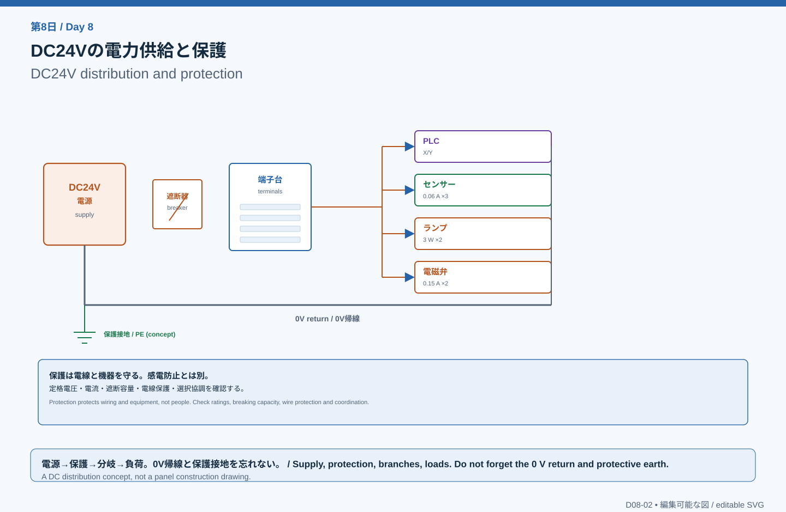
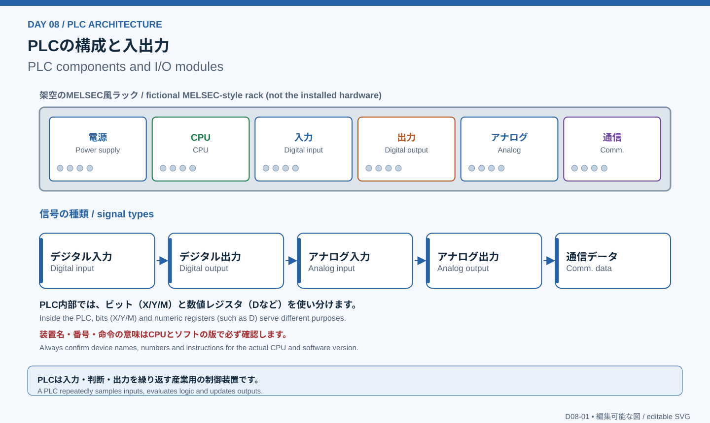
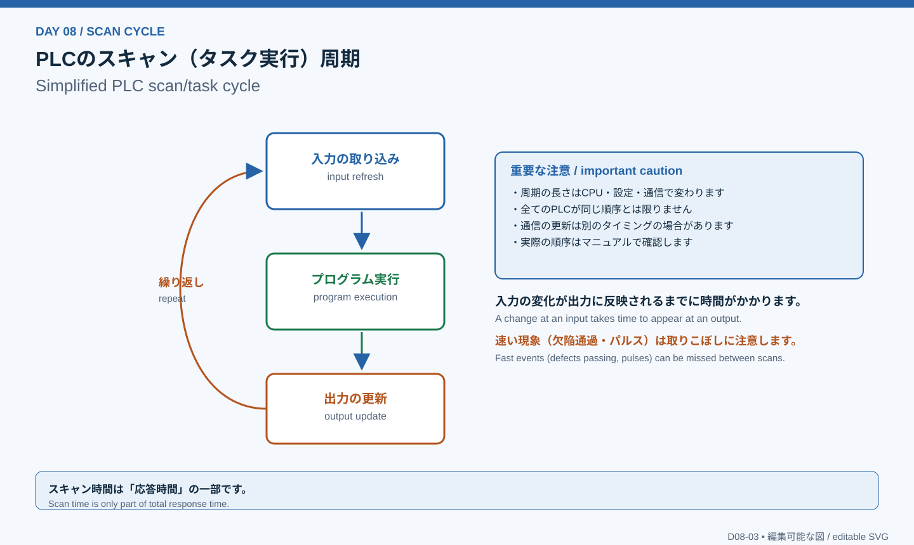

# 第8日 01：PLCの基礎 / Day 8 01: PLC Fundamentals

**所要時間：80分 / Duration: 80 minutes.** [第7〜9日 時間割 / Day 7–9 syllabus](../../COURSE_SYLLABUS_DAY07_09.md)

PLCは、センサの情報を受け取り、決められた手順で出力を操作する産業用の制御装置です。この教材では、電気の最小限の考え方から始め、PLCの構成とスキャン周期を学びます。
A PLC is an industrial controller that receives sensor information and operates outputs according to a defined procedure. This lesson starts from minimal electrical ideas and builds up to PLC structure and the scan cycle.

**到達目標 / Objectives:** 電圧・電流・電力の関係を機能として説明し、センサ→入力→プログラム→出力→ドライバ→アクチュエータの経路をたどり、PLCとPCの役割の違いを説明できる。
Explain voltage, current and power functionally; trace sensor → input → program → output → driver → actuator; explain how a PLC's role differs from a PC's.

## 1. 電気の基礎 / Basic electricity

**電圧（V）**は「押し出す力」、**電流（A）**は「流れる量」、**抵抗（Ω）**は「流れにくさ」です。オームの法則は **V = I × R** です。**電力（W）**は **P = V × I** です。数字の暗記より、「同じ抵抗なら電圧が高いほど電流が増える」という関係をつかみます。

**Voltage (V)** is the push, **current (A)** is the flow, and **resistance (Ω)** is the opposition. Ohm's law is **V = I × R**, and electrical power is **P = V × I**. Grasp the relationships rather than memorising numbers: for the same resistance, a higher voltage gives more current.

**交流（AC）**は向きと大きさが周期的に変わり、**直流（DC）**は向きが一定です。工場では動力にAC、制御信号にDC（例：24 V）が使われることが多いですが、実際の電圧・方式は設備の仕様で確認します。**電源**は必要な電圧を作り、**グラウンド（基準点）**は電圧を測る基準を与えます。

**Alternating current (AC)** changes direction and magnitude periodically; **direct current (DC)** keeps one direction. Factories often use AC for power and DC (for example 24 V) for control signals, but confirm actual voltages and systems in the equipment specification. A **power supply** creates the required voltage, and a **ground/reference** provides the zero point for measurement.

**重要 / Important:** 電気の話は、感電・火災・機器破損につながります。本教材は計算と概念の説明だけを行い、充電部を開ける作業は教えません。
Electrical topics relate to shock, fire and equipment damage. This course explains concepts and calculations only; it does not teach work inside energised panels.

## 2. 産業制御のアーキテクチャ / Industrial control architecture

制御の流れは次のとおりです：**センサ → PLC入力 → PLCプログラム → PLC出力 → ドライバ → アクチュエータ**。ここで「論理的な指令」と「実際の電力供給」を分けます。PLC出力は信号であり、モータの運転電力はドライバや接触器が供給します。

The control path is: **sensor → PLC input → PLC program → PLC output → driver → actuator**. Separate the **logical command** from the **actual power delivery**. A PLC output is a signal; the motor's operating power comes from a driver or contactor.

**図 D08-02 / Figure D08-02 — 確認 / check:** PLC出力がONになったとき、モータに電流が流れるのはどの機器のおかげですか？ / When a PLC output turns ON, which device actually causes motor current to flow?

## 3. PLCとは何か / What is a PLC?

**PLC（Programmable Logic Controller）**は、産業環境で使われる制御用の計算機です。主な構成は、**CPU**、**入力モジュール**、**出力モジュール**、**メモリ**、**通信インタフェース**、**電源**、**診断表示**、**プログラミングソフト**です。ラックにモジュールを並べる形式が一般的です。

A **PLC (Programmable Logic Controller)** is a controller-class computer for industrial environments. Its parts are the **CPU**, **input modules**, **output modules**, **memory**, **communication interfaces**, **power supply**, **diagnostic indicators** and **programming software**. A rack of modules is a common physical form.

**図 D08-01 / Figure D08-01 — 確認 / check:** 入力モジュールと出力モジュールは、どちらが「現場から受け取る」側ですか？ / Which of input and output modules receives signals from the field?

**架空のMELSEC風ラック**として説明しますが、これは**実際に設置されている装置ではありません**。CPUの型番、アドレス範囲、命令、タイマの時間単位、メモリの保持範囲は、実機のマニュアルで確認します。
The **fictional MELSEC-style rack** is a teaching image, **not the installed hardware**. Confirm CPU model, address ranges, instructions, timer time bases and memory retention in the actual manual.

## 4. デジタル入出力とアナログ入出力 / Digital and analog I/O

**デジタル入力（DI）**はON/OFFを受け取ります。**デジタル出力（DO）**はON/OFFを出します。**アナログ入力（AI）**は連続値を数値として受け取り、**アナログ出力（AO）**は連続値を出します。**内部変数**はプログラム内のビットや数値、**通信データ**は他の機器とのやり取りです。

**Digital inputs (DI)** receive ON/OFF. **Digital outputs (DO)** issue ON/OFF. **Analog inputs (AI)** receive continuous values as numbers, and **analog outputs (AO)** issue continuous values. **Internal variables** are bits and numbers inside the program; **communication data** is exchanged with other devices.

| 種類 / kind | 例 / example | 何を表すか / meaning |
|---|---|---|
| DI | X0 | 材料有無センサ / material presence |
| DI | X1 | エンコーダのZ相（仮定） / encoder Z (hypothetical) |
| DO | Y0 | 表示灯 / indicator lamp |
| DO | Y1 | 電磁弁の指令 / valve command |
| AI | D100（例） | アナログ値の格納先 / stored analog value |
| AO | — | ドライブへの速度指令（仮定） / speed reference (hypothetical) |
| 内部 / internal | M0 | 自己保持の状態 / held state |
| 通信 / comms | — | HMI・PCとのデータ / data to HMI and PC |

**デバイス名は一例です。**実際の番号・範囲・意味はCPUとプログラムで決まります。
Device names are examples. Actual numbers, ranges and meanings are defined by the CPU and the program.

## 5. PLCのスキャン周期 / PLC scan cycle

PLCは、おおまかに「**入力の取り込み → プログラム実行 → 出力の更新**」を繰り返します。この繰り返しを**スキャン（scan）**またはタスク実行と呼びます。1周期の時間はCPU、プログラム量、設定、通信で変わります。

A PLC broadly repeats **input refresh → program execution → output update**. This repetition is the **scan** or task execution. Cycle time depends on the CPU, program size, configuration and communications.

**図 D08-03 / Figure D08-03 — 確認 / check:** 入力の変化が出力に反映されるまでに、どのような時間がかかりますか？ / What delays exist between an input change and the output response?

**すべてのPLCが同じ順序・同じ仕組みとは限りません。**割り込み、通信の更新タイミング、入力フィルタ、出力の反映方法は機種で異なります。速い現象（短いパルス、通過する欠陥）は、スキャン周期より短いと取りこぼす可能性があります。だからこそ、**取りこぼしを検出する仕組み**（カウンタ、ラッチ、専用入力）を検討します。

**Not every PLC scans identically.** Interrupts, communication refresh, input filters and output behaviour differ by model. Fast events (short pulses, passing defects) can be missed if shorter than the scan. That is why you consider **mechanisms that detect a miss** (counters, latches, dedicated inputs).

## 6. PLCとPCの比較 / PLC versus PC

PLCは、決められた制御を**決められた周期で確実に繰り返す**のが得意です。産業用PCは、画像処理やAI推論など**大量の計算**が得意です。検査機では、PLCが機械の状態と出力を管理し、PCが画像を処理して結果を返す、という分担が一般的です。

A PLC is good at **repeating defined control reliably at a defined rate**. An industrial PC is good at **heavy computation** such as imaging and AI inference. In an inspection machine, the PLC usually manages machine state and outputs while the PC processes images and returns results.

| 観点 / aspect | PLC | 産業用PC / industrial PC |
|---|---|---|
| 主な役割 / main role | 機械の制御 / machine control | 画像処理・AI / imaging and AI |
| 時間の性質 / timing | 周期的・決定的 / cyclic, deterministic | 処理量に依存 / depends on workload |
| 得意な計算 / strength | 論理・順序 / logic, sequencing | 大規模計算 / heavy computation |
| 故障時 / on failure | 出力を安全側へ（設計次第） / outputs to a defined state by design | 結果を返せない / may return no result |
| 更新 / updates | 慎重な変更管理 / careful change control | ソフト更新が比較的容易 / easier software updates |

PLCが「安全装置」そのものではない点も重要です。安全機能は、リスクアセスメントに基づく独立した安全系で実現します。
It is also important that a PLC is not automatically a safety device. Safety functions come from an independent system designed from a risk assessment.

## 7. Mitsubishi風のデバイス用語 / Mitsubishi-style device terminology

入門として、次の記号を紹介します。**X** は入力、**Y** は出力、**M** は内部ビット、**T** はタイマ関連、**C** はカウンタ関連です。これらは**導入のための慣例**であり、すべての機種に同じ番号規則が当てはまるわけではありません。

As an introduction: **X** for inputs, **Y** for outputs, **M** for internal bits, **T** for timer-related devices and **C** for counters. These are **introductory conventions**; numbering rules are not identical across models.

**内部ビットが電源断後も保持されるとは限りません。**保持範囲・保持設定・初期化の動作は、CPUと設定で確認します。同様に、タイマの時間単位（100 ms、10 ms など）や命令の意味も、マニュアルで確認します。
**Internal bits are not necessarily retained through power loss.** Confirm the retentive range, settings and initialisation behaviour for the CPU. Likewise, confirm timer time bases (100 ms, 10 ms, ...) and instruction definitions in the manual.

## 8. 演習 / Exercises

1. 次のうち入力と出力に分けてください：材料有無センサ、表示灯、電磁弁、エンコーダ、ブザー。 / Classify as input or output: presence sensor, indicator lamp, solenoid valve, encoder, buzzer.
2. センサからモータまでの経路を、機器名を入れて書いてください。 / Draw the path from sensor to motor, naming each device.
3. スキャン周期が 10 ms のとき、4 ms のパルスが必ず読まれるとは限らない理由を説明してください。 / With a 10 ms scan, explain why a 4 ms pulse is not guaranteed to be read.
4. PLCと産業用PCの役割の違いを、検査機の例で説明してください。 / Explain PLC versus industrial PC roles using the inspection machine.
5. 「内部ビット M0 は電源を切っても必ず残る」と言えるか、理由とともに答えてください。 / Can you state that internal bit M0 always survives power-off? Explain.

### 解答例 / Worked answers

1. 入力：材料有無センサ、エンコーダ。出力：表示灯、電磁弁、ブザー。 / Inputs: presence sensor, encoder. Outputs: indicator lamp, solenoid valve, buzzer.
2. センサ→PLC入力→プログラム→PLC出力→ドライバ→モータ。 / Sensor → PLC input → program → PLC output → driver → motor.
3. 入力の更新は周期ごとに行われるため、周期の合間に始まり終わるパルスは取り込まれない可能性がある。 / Inputs are refreshed once per cycle; a pulse that starts and ends between refreshes may be missed.
4. PLCは機械の状態と出力を周期的に管理し、PCは画像を処理して結果を返す。 / The PLC manages machine state and outputs cyclically; the PC processes images and returns results.
5. 言えない。保持範囲・設定・CPUにより異なる。 / No; retention depends on range, settings and CPU.

## 9. まとめ / Summary

PLCは、入力・プログラム・出力を繰り返す産業用制御装置です。信号と動力、デジタルとアナログ、PLCとPCを区別することが基礎になります。デバイス名や時間単位は機種依存であり、実機のマニュアル確認が必須です。

A PLC is an industrial controller that repeats input, program and output. The foundations are separating signal from power, digital from analog, and PLC from PC. Device names and time bases are model-dependent and must be confirmed in the manual.

**完了条件 / Completion criteria:** 5つの演習に答え、スキャン周期と信号経路を図で説明できること。
**Completion criteria:** answer the five exercises and explain the scan cycle and signal path with a sketch.

**安全に関する注意 / Safety note:** PLCのプログラム変更・配線変更は、権限・バックアップ・現地手順・検証のもとで行います。本教材の例はすべて訓練用です。
**Safety note:** PLC program and wiring changes require authority, backups, site procedure and verification. All examples here are for training.
