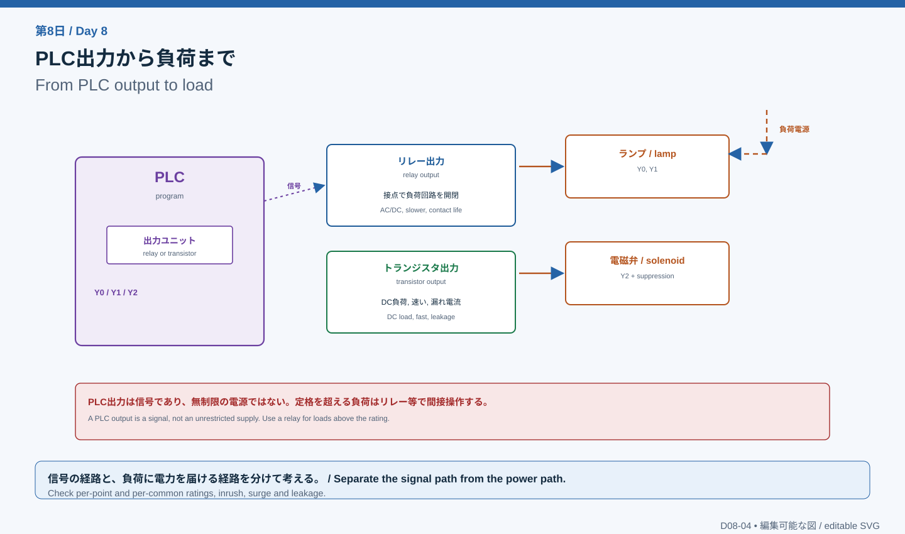
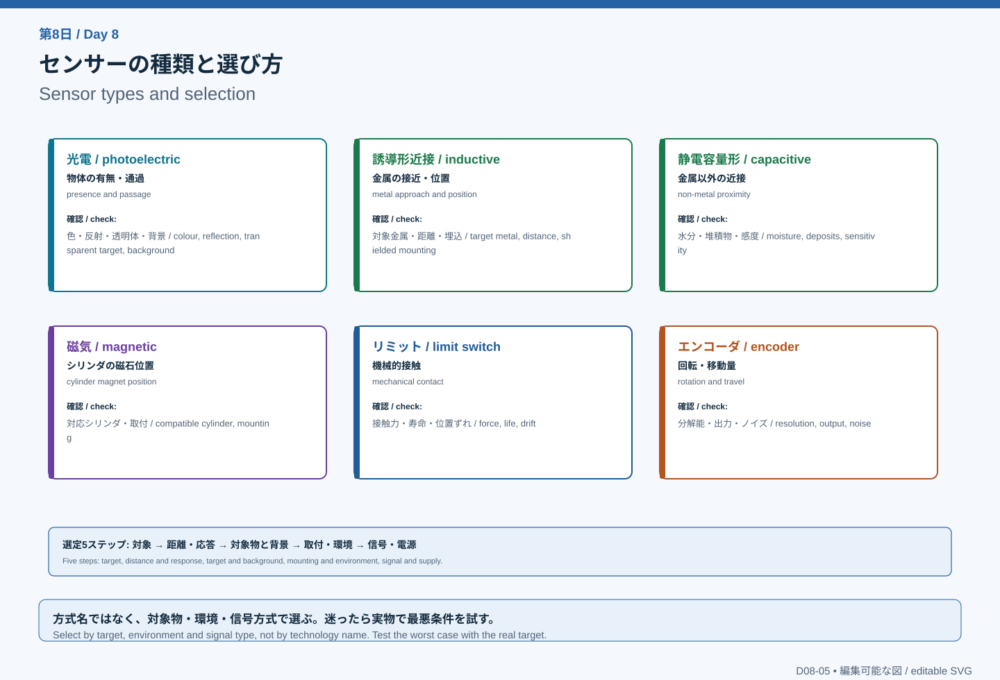
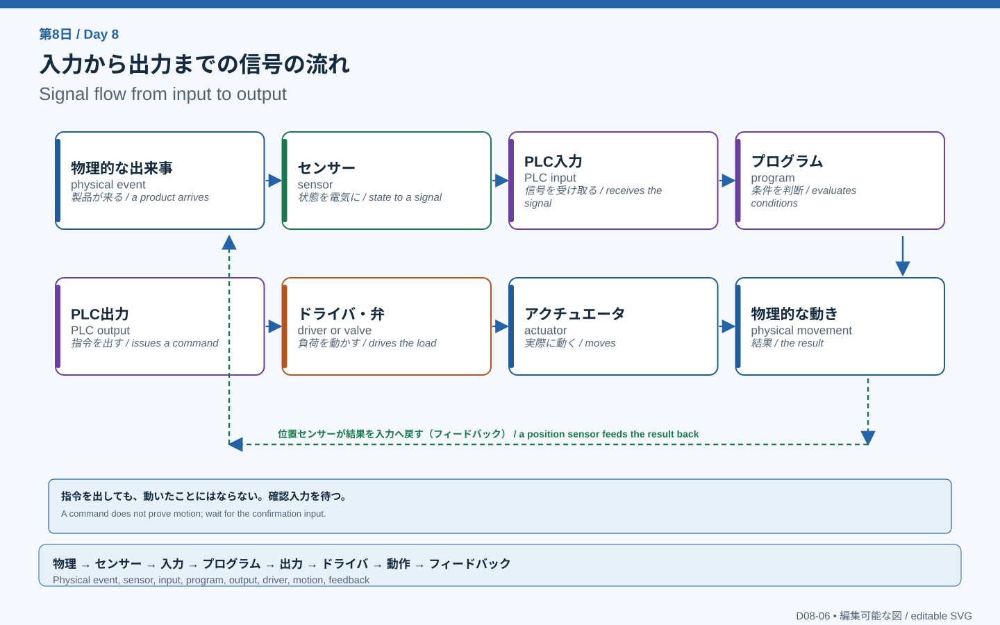
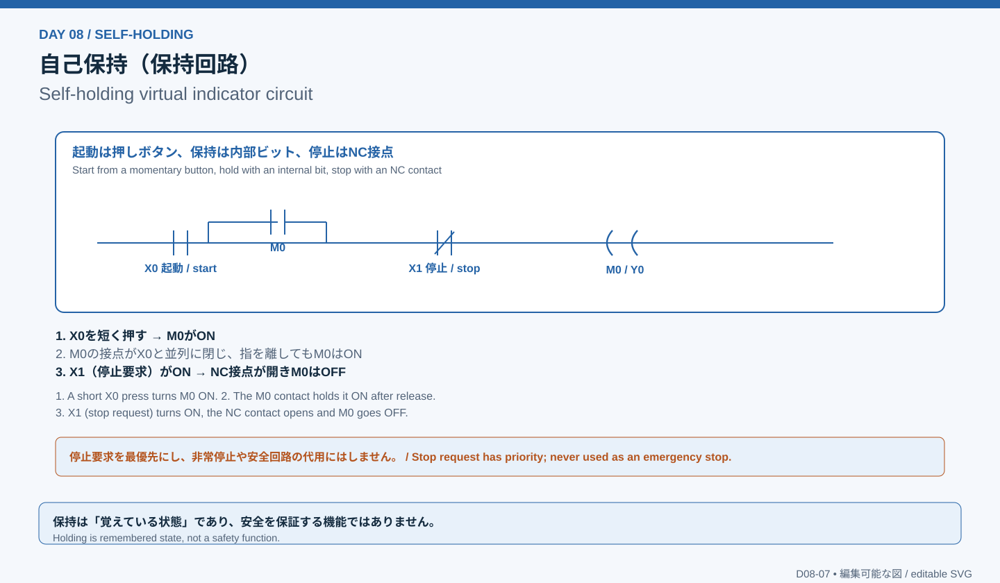
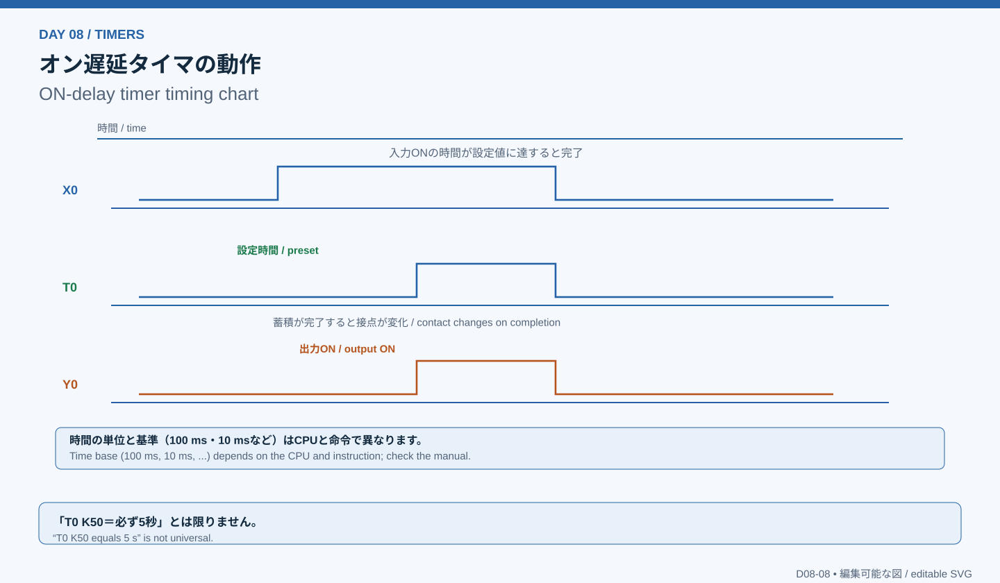
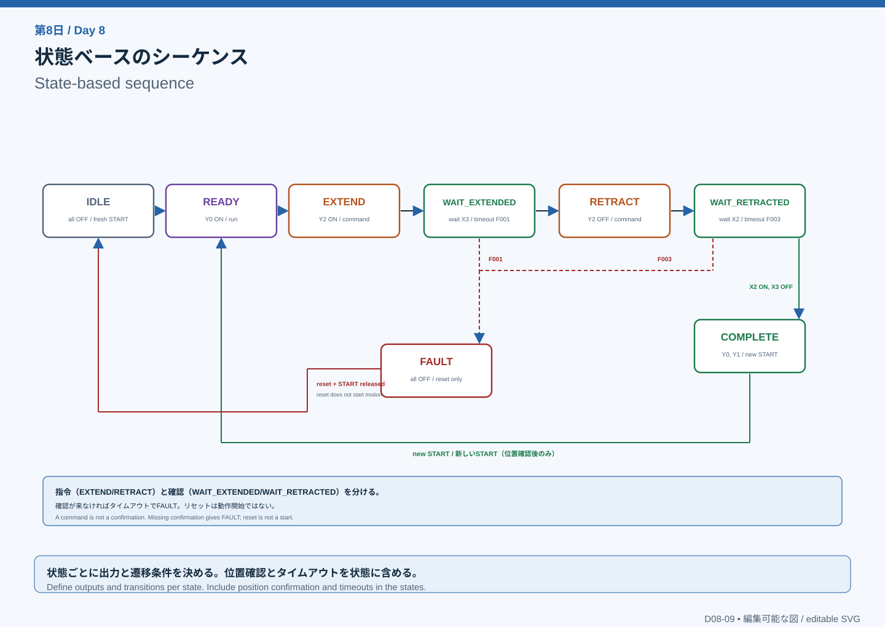

# 第8日 02：ラダープログラムの基礎 / Day 8 02: Ladder Programming Basics

**所要時間：85分 / Duration: 85 minutes.** [第7〜9日 時間割 / Day 7–9 syllabus](../../COURSE_SYLLABUS_DAY07_09.md)

ラダー図は制御の論理を表す図であって、電線の配線図そのものではありません。この教材では、接点・コイル・AND/OR/NOT・自己保持・タイマ・カウンタを、シミュレータで確かめながら学びます。例はすべて架空の訓練用です。
A ladder diagram expresses control logic; it is not literally a wiring diagram. This lesson covers contacts, coils, AND/OR/NOT, self-holding, timers and counters, checked with an offline simulator. Every example is fictional training material.

**到達目標 / Objectives:** NO/NC接点の論理評価をビットの値から説明し、AND/OR/NOTの真理値表を書き、自己保持・タイマ・カウンタの動作を予測できる。
Explain NO/NC contact evaluation from bit values, write AND/OR/NOT truth tables, and predict self-holding, timer and counter behaviour.

## 1. ラダープログラミングとは / What is ladder programming?

**ラダー図（ladder diagram, LD）**は、IEC 61131-3 で定義される視覚的なプログラミング言語の一つです。左右の母線の間に**ネットワーク（rung）**を並べ、左から右への「**電力の流れ**」のメタファーで論理を表します。**接点**が条件、**コイル**が結果です。この流れは**論理的なもの**であり、実際の電流の経路とは限りません。

A **ladder diagram (LD)** is one of the visual programming languages defined in IEC 61131-3. **Networks (rungs)** sit between two rails, using a left-to-right **power-flow** metaphor. **Contacts** are conditions and **coils** are results. The flow is **logical**, not necessarily a real current path.

**プログラム実行**は、上から下、左から右の順に行われます。同じコイルを二つのrungで駆動すると、後のrungが前の結果を上書きします（デバイスによっては二重コイルが禁止されます）。この「順序」は、初心者が最も間違えやすい点です。

**Program execution** proceeds top-to-bottom and left-to-right. Driving the same coil from two rungs means the later rung overwrites the earlier result (some devices forbid duplicate coils). This **order** is where beginners most often go wrong.

## 2. NO接点とNC接点 / Normally open and normally closed contacts

ラダーの**NO接点**は、参照ビットが1のときに導通します。**NC接点**は、参照ビットが0のときに導通します。**これは「ビットの値」の評価であり、現場スイッチの物理配線（NO/NC）とは別の話です。**

A ladder **NO contact** conducts when the referenced bit is 1. An **NC contact** conducts when the referenced bit is 0. **This evaluates the bit value and is separate from the physical wiring (NO/NC) of a field switch.**

**図 D08-04 / Figure D08-04 — 確認 / check:** 「ビットが0」と「スイッチが押されていない」は同じ情報ですか？ / Are “bit is 0” and “switch is not pressed” the same information?

**よくある誤解 / Common misunderstanding:** 「NC接点はNCスイッチのことだ」。違います。論理接点はビットを評価する命令であり、現場のスイッチがNOでもNCでも、ビットの値を通して間接的に影響するだけです。
“An NC contact means an NC switch.” No. A logical contact is an instruction evaluating a bit; whether the field switch is NO or NC only affects the bit value.

**図 D08-05 / Figure D08-05 — 確認 / check:** X0 が0のとき、NO接点とNC接点はそれぞれ導通しますか？ / When X0 is 0, which contact conducts?

## 3. ブール論理 / Boolean logic

**AND**は直列、**OR**は並列、**NOT**は反転です。真理値表を書くと、論理の誤りを見つけやすくなります。すべての例は**訓練用の仮想入出力**です。
**AND** is series, **OR** is parallel and **NOT** is inversion. A truth table exposes logic errors. Every example uses **simulated training signals**.

**図 D08-06 / Figure D08-06 — 確認 / check:** ORの真理値表で、出力が0になるのはどの行だけですか？ / In the OR table, which single row gives 0?

| X0 | X1 | AND (X0·X1) | OR (X0+X1) | NOT X0 |
|---|---|---|---|---|
| 0 | 0 | 0 | 0 | 1 |
| 0 | 1 | 0 | 1 | 1 |
| 1 | 0 | 0 | 1 | 0 |
| 1 | 1 | 1 | 1 | 0 |

## 4. 基本的なラダー例 / Basic ladder examples

**例1**：仮想入力 X0 で仮想表示 Y0 を点ける。X0 が1のとき Y0 が1になります。
**Example 1:** virtual input X0 turns on virtual indicator Y0; when X0 is 1, Y0 is 1.

**例2**：X0 と X1 の**両方**が1のとき Y0 を点ける（AND、直列）。
**Example 2:** Y0 turns on only when **both** X0 and X1 are 1 (AND, series).

**例3**：X0 または X1 の**どちらか**が1のとき Y0 を点ける（OR、並列）。
**Example 3:** Y0 turns on when **either** X0 or X1 is 1 (OR, parallel).

**例4**：停止要求 X2 が1のとき、NC接点が開いて Y0 を消す。X2 が1なら、他の条件が成立していても Y0 は0になります。
**Example 4:** a stop request X2 opens an NC contact and clears Y0. If X2 is 1, Y0 is 0 even when other conditions hold.

**これらはすべてシミュレーション用の訓練論理です。**実機の安全停止を、この論理だけで構成することはできません。
All of these are simulated training logic. Real safety stops cannot be built from this logic alone.

## 5. 内部リレー / Internal relays

**内部ビット（Mなど）**は、プログラムの中だけで使う記憶です。物理的な端子に接続されているとは限りません。内部ビットを使うと、複雑な条件に名前を付け、「状態」として再利用できます。たとえば「検査準備完了」を M10 にまとめ、複数のrungで使えます。

An **internal bit (such as M)** is memory used inside the program. It is not necessarily connected to a physical terminal. Internal bits let you name complex conditions and reuse them as a “state”, for example a “ready for inspection” bit M10.

**注意 / Caution:** 内部ビットが電源断後も残るかは、CPU・設定・デバイス範囲で異なります。起動時の初期化を明示的に設計します。
Whether an internal bit survives power-off depends on the CPU, settings and device range. Design start-up initialisation explicitly.

## 6. 自己保持 / Self-holding

**自己保持（holding circuit）**は、短い操作を「覚えている状態」に変える基本パターンです。起動ボタン X0 を押すと内部ビット M0 が1になり、M0 自身のNO接点が X0 と並列に入ることで、ボタンを離しても M0 が1のまま残ります。停止要求 X1 はNC接点で直列に入れ、X1 が1になると M0 を0に戻します。

**Self-holding** turns a brief operation into a remembered state. Pressing start X0 sets internal bit M0; the M0 NO contact in parallel with X0 keeps M0 at 1 after release. A stop request X1 sits in series as an NC contact so that X1 = 1 clears M0.

**図 D08-07 / Figure D08-07 — 確認 / check:** 停止要求と起動要求が同時に来たとき、どちらを優先すべきですか？ / When start and stop arrive together, which should win?

**停止要求を優先します。**これは訓練用の論理であり、**モータの安全設計や非常停止の代用ではありません**。安全機能は別に設計します。
**The stop request takes priority.** This is training logic and **not a motor safety design or emergency stop**. Safety functions are designed separately.

## 7. タイマ / Timers

**オン遅延タイマ（ON-delay timer）**は、入力がONになってから設定時間が経過すると完了します。入力が短時間でOFFになれば、蓄積はリセットされます（動作は実装依存）。設定時間の単位は、100 ms、10 ms など、CPUと命令で異なります。

An **ON-delay timer** completes after its preset time has elapsed with the input ON. If the input turns OFF early, accumulation resets (implementation-dependent). The time base (100 ms, 10 ms, ...) depends on the CPU and instruction.

**図 D08-08 / Figure D08-08 — 確認 / check:** 入力ONから出力ONまでに、どんな時間が入っていますか？ / What time lies between input ON and output ON?

**仮定例 / Hypothetical example:** 100 ms 単位で K20 と設定した場合、20 × 100 ms = 2.0 s です。「T0 K50 が必ず5秒」とは限らないため、必ず実機のマニュアルで確認します。
With a 100 ms base and K20, 20 × 100 ms = 2.0 s. “T0 K50 is 5 s” is not universal, so confirm in the manual.

## 8. カウンタ / Counters

**カウンタ**は、決まった回数の出来事を数えます。重要なのは、**連続したONは何度も数えない**という点です。数えるのは**変化（立ち上がりエッジ）**です。プリセットに達すると出力が変わり、**リセット**で0に戻ります。

A **counter** counts a set number of events. Crucially, **a continuous ON is not counted repeatedly**; the counter counts **transitions (rising edges)**. At the preset the output changes, and **reset** returns the count to zero.

**図 D08-09 / Figure D08-09 — 確認 / check:** X0 が1のまま3秒間続いたとき、カウントはいくつ増えますか？ / If X0 stays 1 for three seconds, how much does the count increase?

**ノイズによる短いパルスも数えることがあります。**入力フィルタやシールドを検討します。カウント値の保持・リセット条件も実装ごとに確認します。
**Short noise pulses can be counted too.** Consider input filtering and shielding. Retention and reset conditions of the count are implementation-specific.

## 9. オフライン・ラダーシミュレータ / Offline ladder simulator

`day07_09_support/simulations/sim_ladder_logic.html` は、ブラウザだけで動く**完全オフライン**の学習用シミュレータです。PLCにもネットワークにも接続しません。次の例を切り替えられます。

`day07_09_support/simulations/sim_ladder_logic.html` is a **fully offline** browser simulator for learning. It connects to no PLC and no network. It offers these examples:

- AND（直列）/ AND (series)
- OR（並列）/ OR (parallel)
- NOT（反転）/ NOT (invert)
- 自己保持（停止優先）/ self-holding with stop priority
- オン遅延タイマ / ON-delay timer
- カウンタ / counter
- リセット / reset

画面には「なぜ出力がON/OFFなのか」を日本語と英語で表示します。**シミュレータはGX Works3などの実機動作を完全に再現するものではありません。**
The screen explains why each output is ON or OFF in Japanese and English. **The simulator does not reproduce any real controller's runtime.**

**実行テストの例 / Executable test cases（AND）:**

| X0 | X1 | Y0 |
|---|---|---|
| 0 | 0 | 0 |
| 0 | 1 | 0 |
| 1 | 0 | 0 |
| 1 | 1 | 1 |

同じ形式のテストを OR、NOT、自己保持、タイマ、カウンタ、リセットにも用意し、`day07_09_support/tests/` で自動検証します。
Equivalent tests for OR, NOT, self-holding, timer, counter and reset are provided and checked automatically in `day07_09_support/tests/`.

## 10. デバッグの練習 / Logic debugging

1. 真理値表とラダーを見比べ、**食い違い**を探す。
2. どの条件が**不足**しているかを探す。
3. リセット条件が**誤っていないか**を確認する。
4. コイルの**二重使用**がないか確認する。

1. Compare the truth table with the ladder and look for a **mismatch**.
2. Find the **missing** condition.
3. Check whether the **reset condition is wrong**.
4. Check for **duplicate coils**.

## 11. 演習 / Exercises

1. X0=1、X1=0 のとき、AND・OR・NOT(X0) の出力を答えてください。 / With X0=1 and X1=0, give AND, OR and NOT(X0).
2. 自己保持で停止要求をNC接点にする理由を説明してください。 / Why is the stop request an NC contact in self-holding?
3. オン遅延タイマで、設定2.0秒・入力ONが1.5秒で終わった場合、出力はONになりますか？ / An ON-delay of 2.0 s with a 1.5 s input: does the output turn ON?
4. カウンタのプリセット3で、X0 が 1→0→1→0→1→0 と変化しました。カウントはいくつですか？ / With preset 3, X0 goes 1→0→1→0→1→0. What is the count?
5. 「NO接点はNOスイッチのことである」という文の誤りを説明してください。 / Explain the error in “an NO contact means an NO switch”.

### 解答例 / Worked answers

1. AND=0、OR=1、NOT(X0)=0。 / AND = 0, OR = 1, NOT(X0) = 0.
2. 停止要求が1のとき導通を遮断し、状態を解除するため。停止を優先する設計。 / At 1 it breaks conduction and clears the state, giving stop priority.
3. ならない。設定時間に達する前に蓄積がリセットされる（実装依存の確認は必要）。 / No; accumulation resets before the preset (confirm implementation behaviour).
4. 立ち上がりは3回なので **3**。 / Three rising edges, so **3**.
5. NO接点はビットが1で導通する論理命令であり、現場スイッチの物理接点形式とは別。 / An NO contact conducts on bit = 1; it is unrelated to the switch's physical contact form.

## 12. まとめ / Summary

ラダーは論理の図です。NO/NCはビット評価、AND/OR/NOTは真理値表と対応します。自己保持は「覚えている状態」、タイマは時間の蓄積、カウンタは変化の回数です。どれも訓練用であり、安全機能の代用ではありません。

Ladder is a logic diagram. NO/NC evaluate bits; AND/OR/NOT map to truth tables. Self-holding is remembered state, timers accumulate time and counters count transitions. All are training logic, never substitutes for safety functions.

**完了条件 / Completion criteria:** 5つの演習に答え、シミュレータでAND/OR/NOT・自己保持・タイマ・カウンタを操作し、出力理由を説明できること。
**Completion criteria:** answer the five exercises and operate AND/OR/NOT, self-holding, timer and counter in the simulator while explaining each output.

**安全に関する注意 / Safety note:** シミュレータは実機に接続しません。実機のPLCプログラム変更は、権限・バックアップ・検証・現地手順が必要です。
**Safety note:** The simulator never connects to real equipment. Changing a real PLC program requires authority, backups, verification and site procedure.
