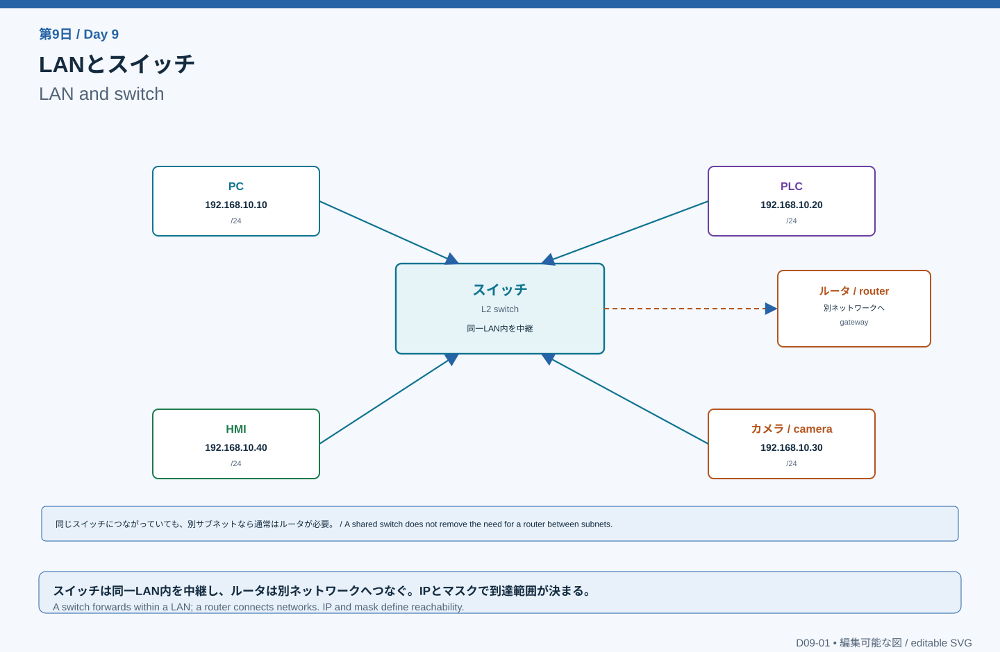
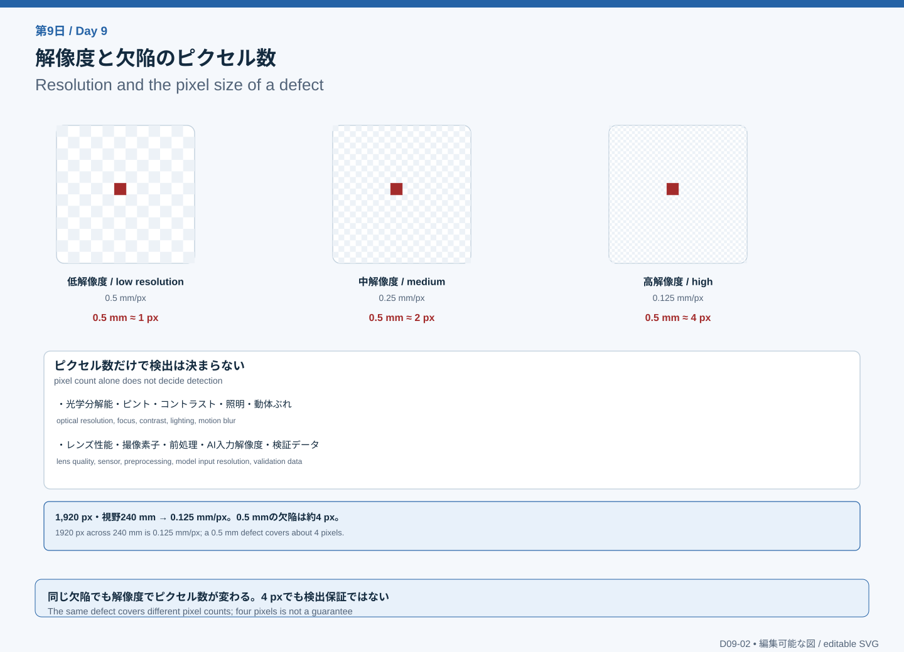
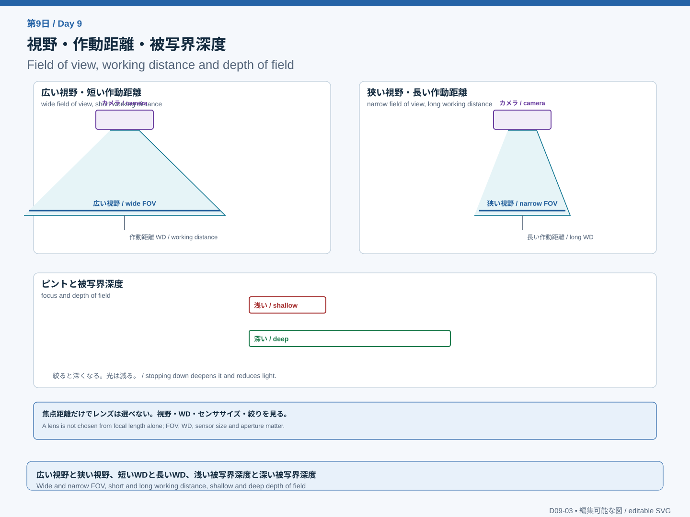
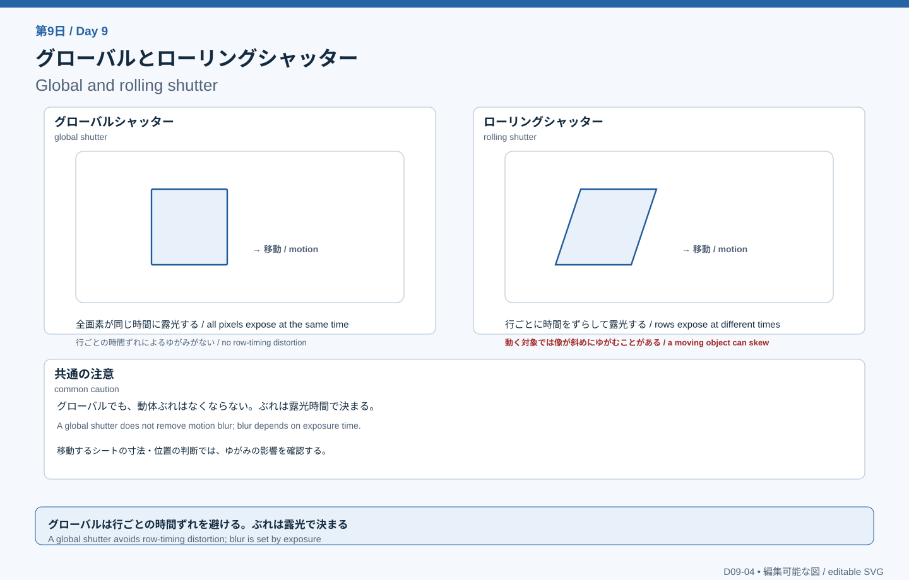
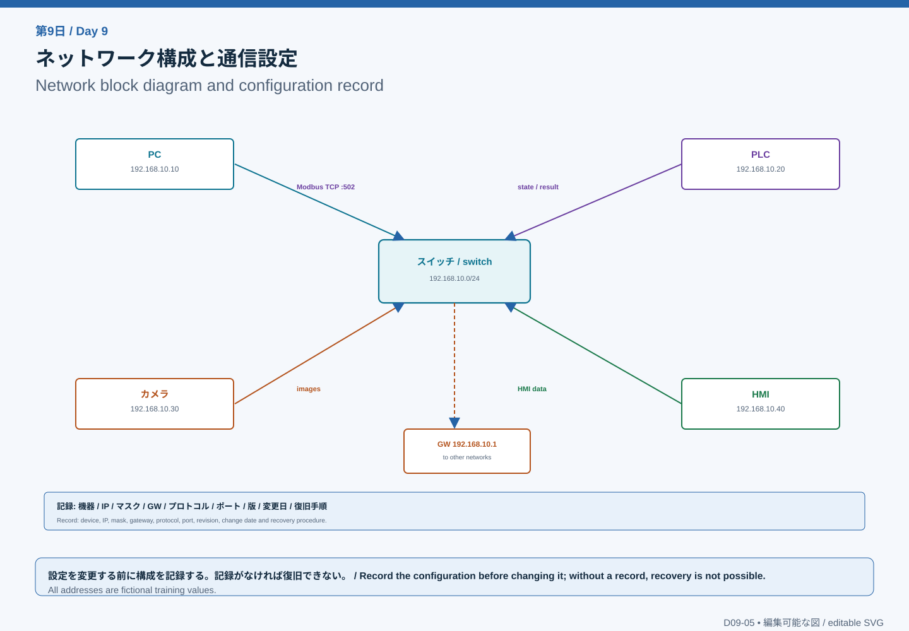

# 第9日 01 カメラ・レンズ・撮像条件の基礎 / Day 9-01 Camera, Lens and Image Acquisition Fundamentals

> 所要時間 / Duration: **80分 / 80 minutes**　元PDF / Source pages: 34, 36-37　共通例 / Running example: PVCシートの外観検査 / PVC sheet appearance inspection

## 1. 概要 / Overview

AI検査は良い画像から始まります。このノートブックでは、カメラの種類、解像度と視野、レンズ、シャッター、露光とぶれ、エリア／ラインセンサ、通信インターフェースを学びます。**「どんな画像が撮れるか」を決められるようになること**が目標です。

AI inspection starts with a good image. This notebook covers camera types, resolution and field of view, lenses, shutters, exposure and blur, area and line scan, and interfaces. The goal is to decide **what image you can capture**.

**安全境界 / Safety boundary.** 学習用です。実機のカメラ・照明の取付、生産設備への接近、ネットワーク設定の変更を指示しません。回転ローラーやカレンダーロールの近くで、安全教育なしに作業してはいけません。 / This is training material. It does not authorise installing cameras or lighting, approaching production equipment or changing a network. Never work near moving rollers or calender rolls without a safety review.

## 2. 学習目標 / Learning objectives

1. カメラの種類と、画像ができる流れを説明できる。
2. 視野と画素数から1ピクセルの実寸と欠陥のピクセル数を計算できる。
3. レンズ選定の要素と、シャッター・露光・ぶれの関係を説明できる。
4. エリアセンサとラインセンサ、通信インターフェースを用途で選べる。

By the end you can explain camera types and the imaging chain; calculate object-space sampling and defect pixels; explain lens selection and the relation between shutter, exposure and blur; and choose area or line scan and an interface by application.

## 3. 前提 / Prerequisites

第1日〜第6日の画像とAIの基礎、第7日〜第8日の設備と制御の基礎。電卓を用意してください。 / Days 1-6 (images, AI) and Days 7-8 (equipment, control). Bring a calculator.

## 4. カメラの種類と撮像の流れ / camera types and the imaging chain



*図 D09-01：対象物 → 照明 → レンズ → 撮像素子 → デジタル画像 → コンピュータ。 / Figure D09-01: object, illumination, lens, image sensor, digital image, computer.*

| 種類 / Type | 特徴 / Characteristic | 注意 / Caution |
|---|---|---|
| 民生用ウェブカメラ / consumer webcam | 安価で入手しやすい / cheap and available | 取付・露出・同期の自由度が低い / limited control |
| 産業用カメラ / industrial camera | 堅牢、トリガ可能、レンズ交換可 / robust, triggerable, interchangeable lenses | 処理はPCなどが必要 / needs a PC |
| スマートカメラ / smart camera | 撮像と処理が一体 / integrated | 処理能力と拡張性に制限 / limited expansion |
| PCベース自作 / custom PC-based | 自由度が高い / flexible | 構築と保守の手間 / integration effort |

**産業用カメラは画像を撮る装置です。** AI推論はPCや組込みの処理装置が行います。すべての産業用カメラがAI処理を内蔵しているわけではありません。

An industrial camera captures images; AI inference runs on a PC or embedded processor. Not every industrial camera contains AI processing.

## 5. 解像度と視野 / resolution and field of view

```text
1ピクセルの実寸[mm/px] = 視野の幅[mm] ÷ 画像の横画素数[px]
欠陥のピクセル数        = 欠陥寸法[mm] ÷ 1ピクセルの実寸[mm/px]
```

例 / example: 視野240 mm、幅1,920 px → **0.125 mm/px**。0.5 mm の欠陥 → **4 px**。



*図 D09-02：同じ欠陥でも解像度でピクセル数が変わる。 / Figure D09-02: the same defect covers different pixel counts at different resolutions.*

**4ピクセルあれば必ず検出できるわけではありません。** 検出可否は、光学分解能、ピント、コントラスト、照明、動体ぶれ、レンズ性能、撮像素子、前処理、AIの入力解像度、実際の検証データで決まります。元の解像度と、AIに入れるときの解像度も違います。

Four pixels does not guarantee detection. Detection depends on optical resolution, focus, contrast, lighting, motion blur, lens quality, sensor, preprocessing, model input resolution and validation data. Native resolution also differs from the resolution fed to the model.

```python exec id="sampling"
import sys, pathlib

start = pathlib.Path.cwd()
root = next(p for p in [start, *start.parents]
            if (p / "day07_09_support" / "examples" / "automation_models.py").is_file())
sys.path.insert(0, str(root / "day07_09_support" / "examples"))
import automation_models as am

sampling = am.object_space_sampling_mm_per_px(240, 1920)
print(f"object-space sampling : {sampling:.3f} mm/px")
print(f"0.5 mm defect         : {am.defect_size_px(0.5, sampling):.1f} px")
print(f"1.0 mm defect         : {am.defect_size_px(1.0, sampling):.1f} px")
print("Pixel count alone does not guarantee detection.")
```

## 6. レンズの選定 / lens selection



*図 D09-03：広い／狭い視野、短い／長い作動距離、浅い／深い被写界深度。 / Figure D09-03: wide and narrow field of view, short and long working distance, shallow and deep depth of field.*

焦点距離は視野と作動距離（WD）の関係を決めますが、**焦点距離だけでレンズは選べません**。センササイズ対応、レンズマウント、絞り（明るさと被写界深度）、フォーカス、ひずみも確認します。薄レンズ近似を使う場合は前提を明記し、実務ではメーカーの選定ツールを使います。

Focal length links field of view and working distance, but **focal length alone does not select a lens**. Check sensor-size compatibility, mount, aperture (brightness and depth of field), focus and distortion. If you use a thin-lens approximation, state its assumptions; in practice use the manufacturer's selection tools.

## 7. シャッター / shutter



*図 D09-04：動く対象の写り方の違い。 / Figure D09-04: a moving object captured with each method.*

- **グローバルシャッター / global shutter**：全画素が同時に露光する。行ごとの時間ずれによるゆがみがない。
- **ローリングシャッター / rolling shutter**：行ごとに時間をずらす。動く対象では像が斜めにゆがむことがある。

**グローバルでも動体ぶれはなくなりません。** ぶれは露光時間で決まります。 / A global shutter removes row-timing skew but not motion blur; blur depends on exposure time.

## 8. 露光と動体ぶれ / exposure and motion blur



*図 D09-05：速度・露光時間・移動量・ピクセル換算。 / Figure D09-05: speed, exposure time, movement and the pixel conversion.*

材料速度1,000 mm/s、露光1 ms → 移動量 **1 mm** → 0.125 mm/px では **8 px**。ぶれを1 pxに抑える露光は **0.125 ms**。これは**例示的な目標**で、検査性能の保証ではありません。露光を短くすると光が減り、照明の明るさと画質（ノイズ・コントラスト）に直結します。

At 1,000 mm/s and 1 ms, the object moves 1 mm, which is 8 px at 0.125 mm/px; a one-pixel target needs about 0.125 ms. This is an illustrative target, not a guarantee. A shorter exposure collects less light, which affects brightness, noise and contrast.

**カメラのFPSは検査のFPSではありません。** 転送、推論、判定、待ち時間が加わります。 / Camera FPS is not inspection FPS: transfer, inference, decision and waiting time add up.

## 9. エリアセンサとラインセンサ / area-scan and line-scan cameras

エリアセンサは1回で2次元画像を撮ります。ラインセンサは1本の線を撮り、材料の移動に合わせて画像を組み立てます。連続シートではラインセンサが候補になり、**エンコーダ**で同期する場合があります。

An area-scan camera captures a two-dimensional image; a line-scan camera captures lines and builds the image as the material moves. For a continuous sheet, line scan is a candidate, often synchronised with an **encoder**.

```text
材料速度1,000 mm/s、移動方向0.125 mm/ライン
必要な理想ライン速度 = 1,000 ÷ 0.125 = 8,000 ライン/秒
```

実際のカメラ・照明・エンコーダ・取込み・処理の能力は検証が必要です。**連続ラインすべてにラインセンサが必要なわけではありません。**

Actual camera, lighting, encoder, acquisition and processing capability must be validated. **Line scan is not required on every continuous line.**

## 10. 通信インターフェース / camera interfaces

USB、USB3 Vision、GigE Vision、メーカー独自方式があります。ケーブル長、転送能力、設置の自由度、ドライバ／SDKの有無、PCとの互換性で選びます。**PoEは電源供給の仕組みで、通信方式とは別**であり、すべてのEthernetカメラが対応しているわけではありません。ネットワークの詳しい設定はこの研修の範囲外です。

USB, USB3 Vision, GigE Vision and vendor-specific interfaces differ in cable length, bandwidth, installation freedom, driver/SDK availability and PC compatibility. **PoE supplies power and is separate from the communication method**; not every Ethernet camera supports it. Detailed network configuration is outside this course.

## 11. 演習 / Exercises

**演習 / exercise:** 幅2,448 px、視野300 mm のときの1ピクセルの実寸と、0.6 mm の欠陥のピクセル数を求めてください。800 mm/s、0.1 mm/px でぶれを1 px以内にする露光も求めてください。 / For 2,448 px across 300 mm, find the sampling and the pixels of a 0.6 mm defect; also find the exposure for one pixel of blur at 800 mm/s and 0.1 mm/px.

```text
1 px = 300 ÷ 2448 ≈ 0.1225 mm/px     0.6 mm ÷ 0.1225 ≈ 4.9 px
露光 = 1 × 0.1 ÷ 800 = 0.000125 s = 0.125 ms
```

**答え / answer**：約0.1225 mm/px、約4.9 px（検出を保証しない）、露光 0.125 ms（光量が減るため照明の確認が必要）。 / About 0.1225 mm/px and 4.9 px (no guarantee), and 0.125 ms (lighting must be re-checked).

## 12. まとめ / Summary

- 産業用カメラは画像を撮り、AI推論はPCなどが行う。
- 1ピクセルの実寸＝視野÷画素数。欠陥のピクセル数＝欠陥÷実寸。
- ピクセル数だけで検出は保証されない。
- レンズは焦点距離だけで選べない。視野・WD・センササイズ・絞りを見る。
- グローバルはゆがみを避けるが、ぶれは露光時間で決まる。
- カメラFPSと検査FPSは違う。
- エリアとラインは対象と搬送で選ぶ。
- インターフェースは長さ・帯域・電源・ドライバで選ぶ。

Industrial cameras capture images and AI runs elsewhere. Sampling is field of view divided by pixels. Pixel count alone does not guarantee detection. Lenses need field of view, working distance, sensor size and aperture. A global shutter avoids skew but not blur. Camera FPS is not inspection FPS. Area or line scan follows the object and transport. Interfaces are chosen by length, bandwidth, power and drivers.

## 13. 完了チェックリスト / Completion checklist

- [ ] 4種類のカメラの違いを説明できる。
- [ ] 0.125 mm/px と 4 px を再現できる。
- [ ] 1 mm、8 px、0.125 ms を再現できる。
- [ ] 8,000 ライン/秒を再現できる。
- [ ] カメラFPSと検査FPSが違う理由を言える。

- [ ] I can distinguish the four camera classes.
- [ ] I can reproduce 0.125 mm/px and 4 px.
- [ ] I can reproduce 1 mm, 8 px and 0.125 ms.
- [ ] I can reproduce 8,000 lines/second.
- [ ] I can explain why camera FPS differs from inspection FPS.

## 14. よくある間違い / Troubleshooting and common misunderstandings

| よくある間違い / Common mistake | 正しい考え方 / Correct view |
|---|---|
| 解像度が高ければ検出できる / higher resolution always detects | 光学・照明・ぶれ・検証で決まる / optics, lighting, blur, validation |
| カメラFPS＝検査能力 / camera FPS is capacity | 転送・推論・判定を含める / include transfer, inference, decision |
| グローバルならぶれない / a global shutter has no blur | ぶれは露光時間で決まる / blur depends on exposure |
| すべてのEthernetカメラがPoE対応 / every Ethernet camera supports PoE | 電源供給は別の機能 / it is a separate feature |

## 15. 安全と次の学習 / safety and what comes next

カメラは「見るだけ」ではありません。取付、配線、レンズの落下、照明の熱とまぶしさ、設備への接近には危険が伴います。次は 09-02 で、照明と撮像環境を学びます。

A camera is not "just looking": mounting, wiring, falling lenses, hot or dazzling lighting, and access to production equipment all carry hazards. Next, 09-02 covers lighting and the imaging environment.
