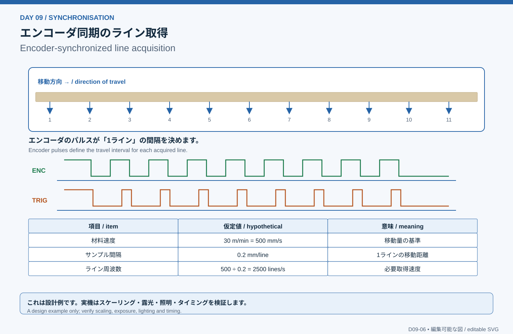
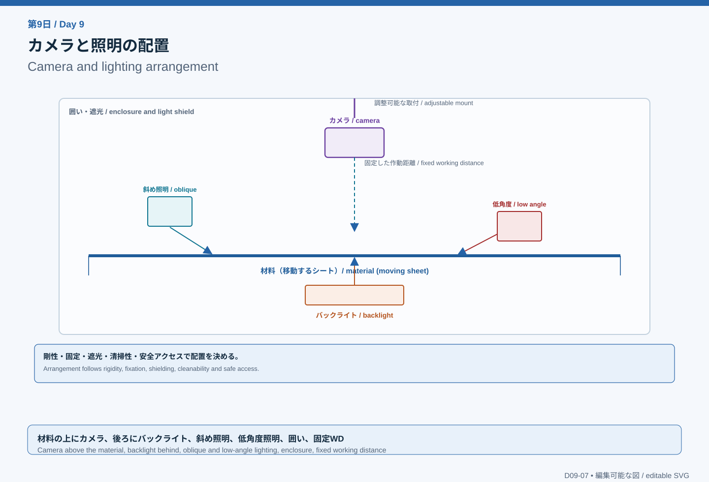
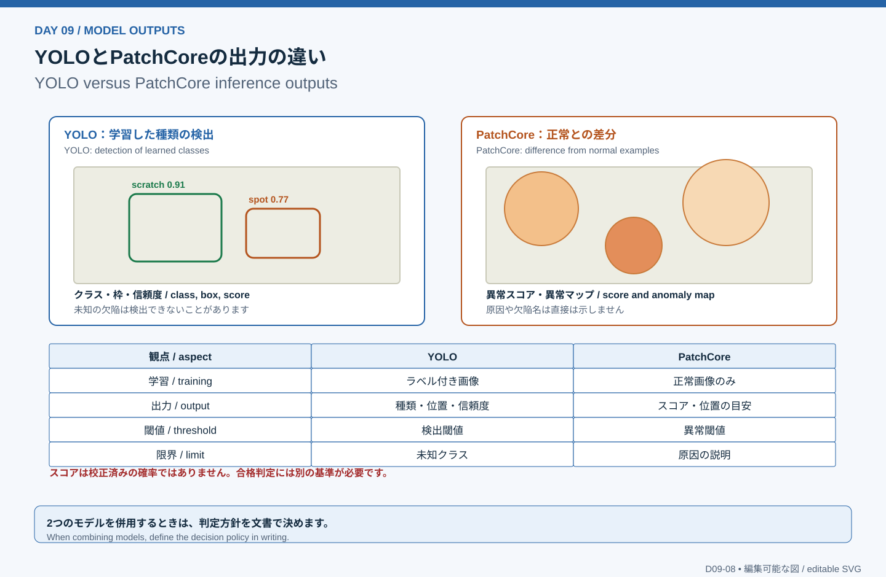

# 第9日 02 照明・反射・撮像環境の作り方 / Day 9-02 Lighting, Reflection and Imaging Environment Design

> 所要時間 / Duration: **85分 / 85 minutes**　元PDF / Source pages: 35, 49　共通例 / Running example: 流れるPVCシートの表面検査 / surface inspection of a moving PVC sheet

## 1. 概要 / Overview

AI検査は、**適切で安定した画像**から始まります。どんなに良いモデルでも、写っていない欠陥や、毎回違う明るさの画像を補うことはできません。照明の種類、反射、カメラと照明の配置、環境の安定化、撮像条件の記録を学びます。

AI inspection begins with **appropriate and consistent images**. No model compensates for a defect that is not captured or for images whose brightness changes daily. This notebook covers lighting types, reflection, arrangement, a stable environment and the record of imaging conditions.

**安全境界 / Safety boundary.** 照明やカメラの取付は、生産設備の停止・隔離・リスクアセスメントなしに行ってはいけません。回転ローラー、カレンダーロール、挟まれ箇所の近くでの作業は特に危険です。 / Never mount lights or cameras without stopping and isolating production equipment and completing a risk assessment. Work near rollers, calender rolls and trapping points is especially hazardous.

## 2. 学習目標 / Learning objectives

1. 照明がコントラスト・反射・影・グレアに与える影響を説明できる。
2. 6種類の照明の特徴と用途を説明できる。
3. PVCシートの表面状態ごとに照明を変える理由を説明できる。
4. 撮像環境を不安定にする要因と、撮像条件の記録項目を挙げられる。

By the end you can explain how lighting affects contrast, reflection, shadow and glare; describe six lighting types; explain why PVC inspection changes lighting with surface condition; and list the factors that destabilise imaging and the items to record.

## 3. 前提 / Prerequisites

09-01 を終えていること。露光時間と動体ぶれの計算を使います。 / Complete 09-01; exposure and motion-blur calculations are used.

## 4. なぜ照明が重要か / why lighting matters

同じ対象物でも、照明で見え方が変わります。コントラストが低いと欠陥が見えず、反射や影は欠陥と誤認され、強すぎる反射（グレア）は白飛び（飽和）を起こし、露出不足はノイズを目立たせます。背景の映り込みも誤検出の原因です。

Lighting changes what is visible. Low contrast hides defects; reflections and shadows mimic them; glare saturates the image; underexposure makes noise dominate; background patterns interfere.

**AIモデルは、物理的に写っていないものを検出できません。** 画像に現れない欠陥は、照明から見直します。 / An AI model cannot detect what is not physically imaged. When a defect does not appear, revisit the lighting.

## 5. 照明の種類 / lighting types



*図 D09-06：バックライト・リング・バー・拡散・同軸・低角度（暗視野）の模式的な比較。効果は材質と欠陥形状に依存します。 / Figure D09-06: backlight, ring, bar, diffuse, coaxial and low-angle lighting compared. Effectiveness depends on material and defect geometry.*

| 照明 / Lighting | 特徴 / Characteristic | 向く例 / Suitable examples |
|---|---|---|
| バックライト / backlight | 対象の後ろから当てる / light from behind | シルエット、輪郭、穴、透過欠陥 / silhouette, edges, holes, transmission |
| リング照明 / ring light | レンズ周囲から当てる / around the lens axis | 一般的な表面、近距離 / general surfaces at short range |
| バー照明 / bar light | 直線状で方向を決められる / linear and directional | 広い範囲、斜め照射 / wide areas, oblique light |
| 拡散照明 / diffuse lighting | 光を散らす / scattered light | 光沢、曲面、むらの低減 / gloss, curved surfaces, unevenness |
| 同軸照明 / coaxial lighting | レンズと同軸で当てる / along the lens axis | 平らな反射面の傷・印字 / flat reflective surfaces, marks |
| 低角度・暗視野 / low angle, dark field | 浅い角度で当てる / shallow angle | 傷、異物、微細な凹凸 / scratches, particles, fine relief |

**どの照明でも、特定の欠陥が必ず見えるとは限りません。** 実際の対象物で比較試験を行います。 / No lighting type guarantees detection of a specific defect; compare options on the actual target.

## 6. PVCシートの検査例 / PVC sheet inspection examples

以下は**代表例**です。実際の製品特性が不明な場合は、確認済みの要求ではなく「例示」として扱ってください。

The following are **representative examples**. Where the actual product characteristics are unknown, treat them as illustrations, not confirmed plant requirements.

| 検査対象 / Target | 課題 / Challenge | 照明の候補 / Candidates |
|---|---|---|
| 黒い異物 / black contamination | 反射が少ない / little reflection | 拡散、同軸、バックライト / diffuse, coaxial, backlight |
| 白・淡色の異物 / light contamination | 背景と同化 / blends with background | 低角度、バックライト / low angle, backlight |
| 傷・凹み / scratches, dents | 方向で見え方が変わる / direction-dependent | 低角度、バー / low angle, bar |
| 穴・透過欠陥 / holes, transmission defects | 透過で明るく抜ける / transmits light | バックライト / backlight |
| しわ・むら / wrinkles, uneven texture | 影が欠陥と似る / shadows mimic defects | 拡散＋斜め / diffuse with oblique |
| 端部の欠陥 / edge defects | 背景との境界 / boundary with background | バックライト、同軸 / backlight, coaxial |

透明・半透明・光沢・つや消しで光の返り方が大きく変わります。同じ「PVC」でも、配合・厚み・表面処理で最適な照明は変わります。 / Clear, translucent, glossy and matte surfaces reflect light very differently, and formulation, thickness and surface treatment change the best choice.

## 7. カメラと照明の配置 / camera and lighting arrangement



*図 D09-07：材料の上にカメラ、後ろにバックライト、斜め照明、低角度照明、囲い・遮光、固定した作動距離。 / Figure D09-07: camera above the material, backlight behind, oblique and low-angle lighting, enclosure, fixed working distance.*

配置で確認すること：取付の剛性と振動、作動距離とピントの固定、照明の位置と角度の再現性、外光の遮断、材料の高さ・張力・ばたつき、レンズや保護窓の汚れと清掃性、保守時の安全なアクセス。

Check mounting rigidity and vibration; fixed working distance and focus; reproducible light position and angle; shielding from ambient light; material height, tension and flutter; contamination and cleanability; and safe access for maintenance.

## 8. 撮像環境 / the imaging environment

| 要因 / Factor | 何が起きるか / Effect | 対策の例 / Countermeasure |
|---|---|---|
| 工場の環境光・太陽光 / ambient and sunlight | 明るさと色が時間帯で変わる / brightness and colour drift | 遮光、囲い / shielding, enclosure |
| 反射・グレア / reflection, glare | 一部だけ明るい / local bright areas | 照明角度の変更、拡散 / change angle, diffuse |
| 振動・カメラの移動 / vibration, movement | ぶれ、視野ずれ / blur, field-of-view drift | 剛性のあるブラケット、固定 / rigid brackets |
| 材料の高さ・張力 / height, tension | ピントずれ、しわ / focus drift, wrinkles | 被写界深度、張力管理 / depth of field, tension control |
| 粉じん・汚れ / dust, contamination | コントラスト低下 / contrast loss | 保護窓、清掃計画 / protective window, cleaning |
| 温度・照明の劣化 / temperature, ageing | 特性変化、暗くなる / drift, dimming | 温度管理、定期点検 / thermal management, checks |
| 製品の色・材質変更 / product change | 見え方の変化 / appearance change | 品種ごとの条件設定 / per-product recipes |

## 9. 撮像条件の記録 / recording the imaging conditions

同じ画像を再現するために、**カメラ機種、レンズ、作動距離、視野、カメラ角度、照明の種類と位置、露光時間、ゲイン、フレームレートまたはライン速度、材料速度、画像解像度、代表的な欠陥サンプル、環境条件**を記録します。学習時と本番で条件が違うと、AIの性能は再現しません。

Record the camera model, lens, working distance, field of view, camera angle, light type and position, exposure, gain, frame or line rate, material speed, image resolution, representative defect samples and environmental conditions. If training and production conditions differ, performance will not reproduce.

## 10. 比較演示と合成例 / comparison demonstrations and synthetic examples



*図 D09-08：露出不足・適正・露出過多、低／高コントラスト、グレア、拡散、照明方向の違い。**合成例であり、実機のPVC測定値ではありません。** / Figure D09-08: underexposure, correct exposure, overexposure, low and high contrast, glare, diffuse light and a changed direction. **Synthetic illustrations, not PVC measurements.***

演習では、露出不足／適正／露出過多、ピントの合否、照明の安定／不安定、低／高コントラスト、グレア／拡散、照明方向の違いを比較します。可能であれば実機の撮像セットで演示します。**合成の例を、実際の工場測定値として扱ってはいけません。**

The exercises compare under, correct and over exposure; sharp and blurred; stable and unstable lighting; low and high contrast; glare and diffuse; and different light directions. Demonstrate on a real imaging setup where possible. **Never present a synthetic example as a factory measurement.**

```python exec id="light-budget"
import sys, pathlib

start = pathlib.Path.cwd()
root = next(p for p in [start, *start.parents]
            if (p / "day07_09_support" / "examples" / "automation_models.py").is_file())
sys.path.insert(0, str(root / "day07_09_support" / "examples"))
import automation_models as am

speed, sampling = 1000.0, 0.125
for exposure_ms in (1.0, 0.5, 0.25, 0.125):
    exposure_s = exposure_ms / 1000.0
    blur_px = am.motion_blur_px(speed, exposure_s, sampling)
    print(f"exposure {exposure_ms:>5.3f} ms : blur {blur_px:5.1f} px, relative light {exposure_ms / 1.0:.3f}")
print("Shorter exposure limits blur but reduces the light collected.")
```

## 11. 演習 / Exercises

**演習 / exercise:** 「透明なシート内部の黒い異物」を検出するときの照明候補と確認事項を書いてください。 / For "detect a black contaminant inside a clear sheet", name lighting candidates and what to check.

**答えの例 / example:** 透過（バックライト）が第一候補。異物が光を遮り、シルエットとして見える可能性がある。確認事項は、シートの厚みと透明度、異物の大きさ、材料速度とぶれ、表面の傷と内部異物の区別、照明の均一性。「朝は安定、午後に誤検出が増える」場合は、太陽光・温度・汚れを疑い、時間帯別に同じサンプルを撮って明るさとコントラストを比較する。 / Backlight is the first candidate: the contaminant blocks light. Check thickness and clarity, contaminant size, speed and blur, separating surface scratches from internal contamination, and uniformity. If false detections rise in the afternoon, suspect sunlight, temperature drift and contamination, and compare the same sample across the day.

## 12. まとめ / Summary

- 良いAIは良い画像から。写らない欠陥は検出できない。
- 照明はコントラスト・反射・影・グレアを決める。
- 6種類の照明には、それぞれ向く用途と制約がある。
- PVCは透明・光沢・色で見え方が変わる。例示と実測を区別する。
- 配置は剛性・固定・遮光・清掃性・安全アクセスで決める。
- 環境要因は多く、記録と再評価が品質を支える。
- 合成の比較例は、実測値として扱わない。

Good AI starts with good images. Lighting determines contrast, reflection, shadow and glare. Each lighting type has uses and limits. PVC appearance changes with clarity, gloss and colour. Arrangement follows rigidity, fixation, shielding, cleanability and safe access. Records and re-evaluation protect quality. Synthetic comparisons are not measurements.

## 13. 完了チェックリスト / Completion checklist

- [ ] 照明が画質に与える影響を5つ言える。
- [ ] 6種類の照明の特徴を言える。
- [ ] 透明シートの異物検査の候補を説明できる。
- [ ] 環境要因を6つ以上挙げられる。
- [ ] 撮像条件の記録項目を8個以上挙げられる。
- [ ] 合成例と実測の区別を説明できる。

- [ ] I can name five ways lighting changes an image.
- [ ] I can describe six lighting types.
- [ ] I can explain candidates for contamination in a clear sheet.
- [ ] I can list six environmental factors.
- [ ] I can list eight imaging-condition record items.
- [ ] I can distinguish a synthetic example from a measurement.

## 14. よくある間違い / Troubleshooting and common misunderstandings

| よくある間違い / Common mistake | 正しい考え方 / Correct view |
|---|---|
| 明るければよい / brighter is better | 飽和すると情報が失われる / saturation destroys information |
| 1種類の照明で全欠陥が見える / one light shows every defect | 欠陥形状と材質で変わる / depends on geometry and material |
| 環境光は関係ない / ambient light does not matter | 時間帯で変化する / it varies through the day |
| ピントは一度合わせれば済む / focus is set once | 振動・温度・高さでずれる / drifts with vibration, temperature, height |
| 合成画像で性能を証明できる / synthetic images prove performance | 実対象の検証が必要 / validate on real targets |

## 15. 安全と次の学習 / safety and what comes next

照明の追加は、まぶしさ、熱、配線、取付強度の問題を伴います。設備への取付は必ず安全手順の中で行います。次は 09-03 で、AI検査カメラの全体構成を学びます。

Adding lighting brings glare, heat, wiring and mounting-strength issues; mounting always follows the safety procedure. Next, 09-03 covers the complete AI inspection camera architecture.
