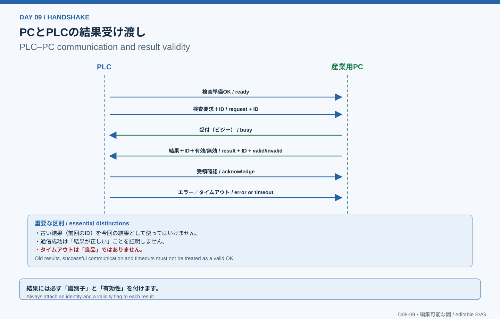
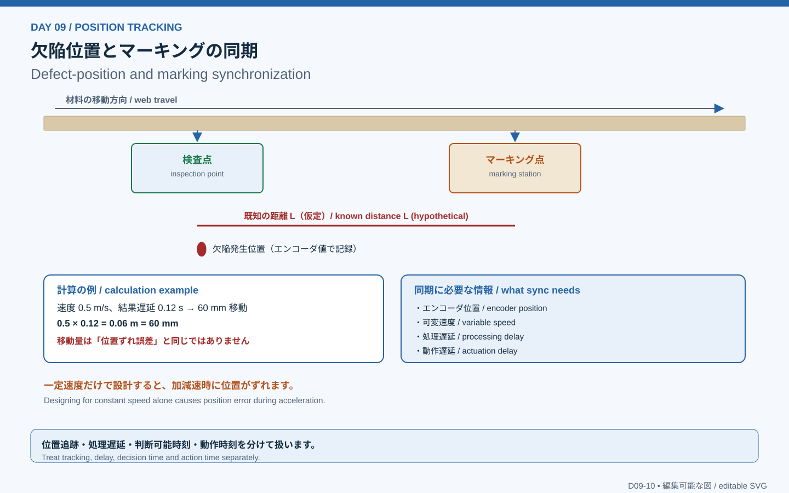
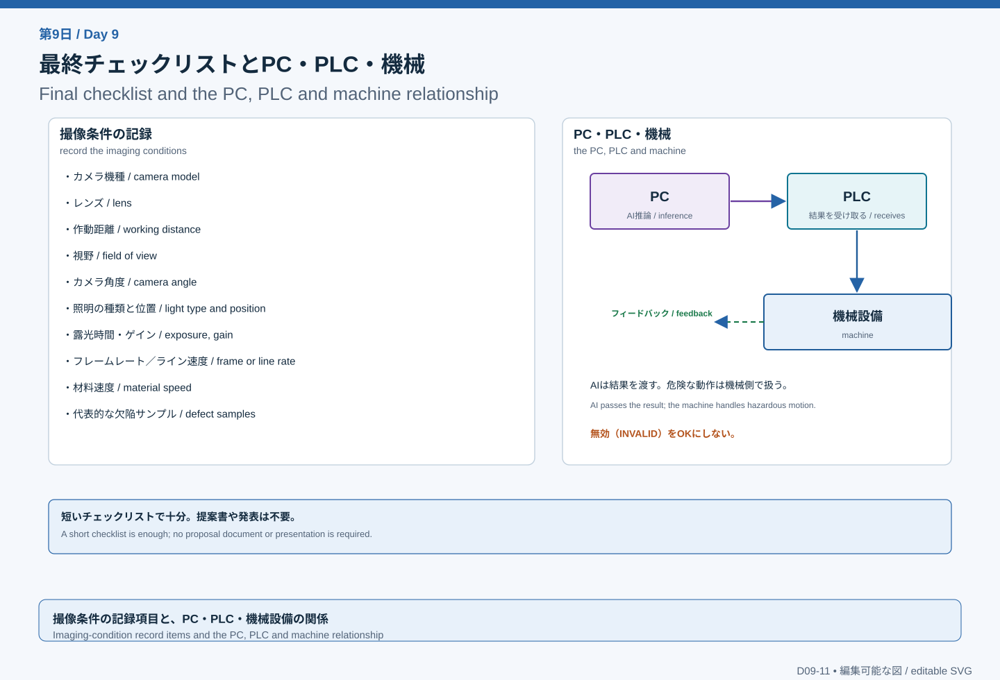

# 第9日 03 AI検査カメラの構成と自作の流れ / Day 9-03 AI Inspection Camera Architecture and Development Workflow

> 所要時間 / Duration: **135分 / 135 minutes**　元PDF / Source pages: 新規教材 / new material（画像データと制御の関係は34, 40を参考 / informed by pages 34 and 40）

## 1. 概要 / Overview

ここまでで、設備、動力、電気、センサー、PLC、カメラ、レンズ、照明を個別に学びました。このノートブックでは、それらを**1つのAI検査システム**として組み立てます。画像がどこから来て、どこで判断され、どうやって機械へ伝わるのかを説明できるようになることが目標です。

You have studied equipment, power, electricity, sensors, PLCs, cameras, lenses and lighting individually. This notebook assembles them into **one AI inspection system**: where images come from, where decisions are made, and how the result reaches the machine.

**安全境界 / Safety boundary.** AIソフトウェアが危険なアクチュエータを直接動かす構成にしてはいけません。検査結果は機械の制御装置へ渡し、機械側の制御と安全の構成の中で扱います。本資料のコードは実機を動かしません。 / AI software must not directly operate hazardous actuators. Results go to the machine controller and are handled inside the machine's control and safety architecture. The code here never drives real equipment.

## 2. 学習目標 / Learning objectives

1. 検査システム全体を、5種類の流れを区別して説明できる。
2. 必要なハードウェアとソフトウェアを列挙できる。
3. 開発の手順を順番に説明できる。
4. 撮像間隔と材料の移動量を計算できる。
5. OK・NG・無効（INVALID）の扱いと、最終チェックリストを作れる。

By the end you can describe the architecture with five distinct flows; list the hardware and software; state the development sequence; calculate capture interval and material movement; and handle OK, NG and INVALID and produce the final checklist.

## 3. 前提 / Prerequisites

09-01、09-02 を終えていること。第1日〜第6日のAIと画像処理の知識を使いますが、モデル学習の理論は繰り返しません。 / Complete 09-01 and 09-02. Days 1-6 knowledge is used without repeating model-training theory.

## 4. システム全体の構成 / complete system architecture



*図 D09-09：カメラ＋レンズ＋照明 → 画像取込み → PC → 前処理 → AI推論 → 検査判定 → PLC通信 → 機械設備。記録・画像保存は任意。 / Figure D09-09: camera, lens and lighting, acquisition, PC, preprocessing, inference, decision, PLC communication and machine. Logging and storage are optional.*

| 流れ / Flow | 内容 / What it carries | 例 / Example |
|---|---|---|
| 画像データ / image data | 撮像素子からPCへ / sensor to PC | 1枚の画像、ライン画像 / one frame, joined lines |
| 制御信号 / control signal | 判定結果、トリガ、指令 / results, triggers, commands | OK/NG、撮影トリガ / OK/NG, trigger |
| 電力 / electrical power | 機器を動かすエネルギー / energy for devices | DC24V、AC100V、PoE |
| 機械動作 / mechanical movement | 実際の動き / physical motion | シリンダ、コンベヤ / cylinder, conveyor |
| フィードバック / feedback | 動いた結果の確認 / confirmation | 位置センサー、エンコーダ / sensor, encoder |

**AIは結果を渡す役割です。** 危険な動作は機械側の制御と安全の構成で行い、AIソフトが電磁弁を直接動かす構成は避けます。 / The AI passes results to the controller; hazardous motion belongs to the machine's control and safety architecture. Avoid AI software driving valves directly.

## 5. 必要なハードウェア / hardware components

産業用カメラ（最初はUSBカメラでも可）、レンズ、照明、カメラと照明の取付、PC、記憶装置、カメラケーブル、電源、通信インターフェース、機械と接続する場合はPLC。**特定のGPUやカメラを「これで十分」と決めつけないでください。** 計算能力の必要性は、モデル、画像サイズ、カメラ台数、必要な処理速度、実測した遅れで変わります。

Industrial camera (a USB camera is acceptable to start), lens, lighting, camera and lighting mounts, PC, storage, cables, power supplies, communication interfaces and, where machine integration is required, a PLC. **Do not declare a specific GPU or camera sufficient**: requirements depend on the model, image size, camera count, required throughput and measured latency.

## 6. 必要なソフトウェア / software components

カメラのドライバまたはメーカーSDK、Python、OpenCV、画像取込み、前処理（リサイズ、色変換、トリミング）、AI推論の実行環境、判定ロジック、画像ログ、ユーザーインターフェース、PLC通信。**学習・推論・しきい値判定・画面表示・制御出力は、それぞれ別の役割**です。YOLOや異常検知は、この研修で扱った範囲で「どの役割を担うか」だけを確認します。

Camera driver or SDK, Python, OpenCV, image acquisition, preprocessing, inference runtime, decision logic, image logging, a user interface and PLC communication. **Training, inference, threshold-based decision, display and control output are separate roles.** YOLO and anomaly detection are mentioned only for the role they play here.

## 7. 開発の手順 / development workflow

1. 検査対象を決める。2. 欠陥の大きさを決める。3. 検査範囲を測る。4. 材料速度を測る。5. カメラ・レンズ・照明の候補を選ぶ。6. 代表的な画像を撮る。7. 画質を評価する。8. 学習用と検証用のデータを準備する。9. モデルを学習・設定する。10. 新しい画像で推論する。11. 推論結果を検査判定に変える。12. 検査性能を検証する。13. 機械制御との接続を計画する。

Define the target; identify the defect size; measure the inspection area; measure the material speed; select candidate camera, lens and lighting; capture representative images; evaluate image quality; prepare training and validation data; train or configure the model; run inference on new images; convert results into decisions; validate performance; and plan machine-controller integration.

**撮像の設定を先に固めます。** 画質が決まる前にモデルの精度を議論しても、本番性能の代表値にはなりません。 / Establish the imaging setup first; model accuracy before the imaging is settled is not representative of production.

## 8. 検査のタイミング / inspection timing



*図 D09-10：撮像間隔、材料の移動、転送・推論・判定・アクチュエータ応答の積み重ね。 / Figure D09-10: capture interval, material movement and the accumulation of transfer, inference, decision and actuator response.*

30 FPS、材料1,000 mm/s なら、連続フレーム間の移動は **1,000 ÷ 30 ≈ 33.33 mm**。移動方向の視野がこれより小さいと隙間ができる可能性があります。**移動方向の視野と幅方向の視野を混同しないでください。** FPSが足りるように見えても、完全な検査は約束できません。

At 30 FPS and 1,000 mm/s the material moves about 33.33 mm between frames; a smaller field of view in the travel direction can leave gaps. Do not confuse the travel-direction field of view with the width. Nominal FPS does not promise complete inspection.

```python exec id="timing-and-decision"
import sys, pathlib

start_path = pathlib.Path.cwd()
root = next(p for p in [start_path, *start_path.parents]
            if (p / "day07_09_support" / "examples" / "automation_models.py").is_file())
sys.path.insert(0, str(root / "day07_09_support" / "examples"))
import automation_models as am

print(f"frame interval movement at 30 FPS, 1000 mm/s : {am.frame_interval_move_mm(1000, 30):.2f} mm")
print(f"line rate for 0.125 mm/line at 1000 mm/s      : {am.line_rate_lps(1000, 0.125):.0f} lines/s")
for label, result, flags in (
    ("valid OK", "OK", {}),
    ("valid NG", "NG", {}),
    ("no image", "OK", {"image_available": False}),
    ("inference failed", "NG", {"inference_ok": False}),
    ("PLC link lost", "OK", {"communication_ok": False}),
    ("unknown result", None, {}),
):
    print(f"{label:<18} -> {am.inspection_decision(result, **flags)}")
```

## 9. 検査判定 / the basic inspection decision

画像取得 → 推論 → 検査結果 → 制御装置が結果を受け取る → 機械が結果に応じて処理。**OK / NG / 無効（INVALID）**の3つを区別します。

Image acquired, inference, inspection result, the controller receives it, and the machine acts on it. Distinguish **OK, NG and INVALID**.

| 異常 / Failure | 検出方法 / Detection | 扱いの例 / Example handling |
|---|---|---|
| カメラの切断 / camera disconnected | 取得エラー、ハートビート / acquisition error, heartbeat | 無効として通知 / report INVALID |
| 画像なし / missing image | タイムアウト、空フレーム / timeout, empty frame | 無効。OKにしない / INVALID, never OK |
| 推論の失敗 / inference failure | 例外、出力なし / exception, no output | 無効として記録 / record INVALID |
| 通信の失敗 / communication failure | 応答なし、タイムアウト / no response | 機械側でフェイルセーフに扱う / fail-safe on the machine side |
| 結果なし / result unavailable | タイムアウト / timeout | 無効。工程の扱いを事前に決める / INVALID |

**適切な対応は、実機ごとに設計・検証します。** この表は考える順番を示すものです。 / The appropriate response must be designed and validated for the real equipment; this table shows the order of thinking.

## 10. 最終演習：撮像システムのチェックリスト / final activity: the imaging system checklist



*図 D09-11：撮像条件のチェック項目と、PC・PLC・機械の関係。 / Figure D09-11: imaging-condition check items and the PC, PLC and machine relationship.*

自分の工程について、次を埋めてください。**提案書や10分発表は不要です。** / Fill this in for your own process. **No proposal or ten-minute presentation is required.**

| 項目 / Item | 記入 / Your answer |
|---|---|
| 何を検査するか / what to inspect | |
| 欠陥のおおよその大きさ / approximate defect size | |
| 必要な検査範囲 / required inspection area | |
| カメラの候補（種類・解像度・速度）/ candidate camera | |
| レンズの候補（視野・作動距離）/ candidate lens | |
| 照明の候補（種類・位置）/ candidate lighting | |
| 材料の速度 / material speed | |
| 予想される撮像の難しさ / expected imaging difficulties | |
| PCが画像を受け取る方法 / how the PC receives images | |
| 結果を機械へ伝える方法 / how the result reaches the controller | |

## 11. 演習 / Exercises

**演習1 / exercise 1:** 25 FPS、材料800 mm/s のとき、連続フレーム間の材料移動を求めてください。 / At 25 FPS and 800 mm/s, find the material movement between frames.

```text
800 ÷ 25 = 32 mm
```

**答え / answer**：32 mm。移動方向の視野が32 mmより小さいと隙間ができる可能性があります。 / 32 mm; a smaller travel-direction field of view can leave gaps.

**演習2 / exercise 2:** 「通信エラーのとき、検査結果がないのでOKとして流す」運用の問題点を説明してください。 / Explain the problem with "if communication fails, pass the product as OK".

**答え / answer**：検査していない製品をOKとして出荷する危険がある。無効は無効として扱い、停止・保留・再検査など機械側の決められた処理に従う。運用は実機ごとに設計・検証する。 / It risks shipping an uninspected product. Treat INVALID as INVALID and follow the machine's agreed rule (stop, hold, re-inspect), designed and validated per machine.

## 12. まとめ / Summary

- AI検査システムは、カメラ・照明・PC・AI・PLC・機械の組み合わせ。
- 画像データ、制御信号、電力、機械動作、フィードバックを分けて考える。
- 開発は、対象 → 欠陥サイズ → 範囲 → 速度 → 機材 → 撮像 → データ → モデル → 判定 → 検証 → 接続の順。
- 撮像間隔と移動量を計算し、カバレッジを確認する。
- OK・NG・無効を区別し、無効をOKにしない。
- 実機の対応は設計・検証が必要。最終成果物は短いチェックリストでよい。

An AI inspection system combines camera, lighting, PC, AI, PLC and machine. Separate image data, control signals, power, movement and feedback. Develop in the order given. Calculate interval and movement and check coverage. Distinguish OK, NG and INVALID, never turning INVALID into OK. Real responses need design and validation; the final deliverable is a short checklist.

## 13. 完了チェックリスト / Completion checklist

- [ ] 5種類の流れを区別して構成を描ける。
- [ ] ハードウェアとソフトウェアを役割ごとに挙げられる。
- [ ] 開発手順13項目を順番に言える。
- [ ] 33.33 mm と 32 mm を再現できる。
- [ ] 無効をOKにしない理由を説明できる。
- [ ] 自分の工程のチェックリストを埋めた。

- [ ] I can draw the architecture with five distinct flows.
- [ ] I can list hardware and software by role.
- [ ] I can state the thirteen development steps in order.
- [ ] I can reproduce 33.33 mm and 32 mm.
- [ ] I can explain why INVALID must not become OK.
- [ ] I completed the checklist for my own process.

## 14. よくある間違い / Troubleshooting and common misunderstandings

| よくある間違い / Common mistake | 正しい考え方 / Correct view |
|---|---|
| AIが機械を直接動かす / AI drives the machine | 制御装置へ結果を渡す / pass results to the controller |
| カメラFPSで検査能力を判断 / judging capacity by camera FPS | 転送・推論・判定を含める / include transfer, inference, decision |
| 結果がないのでOK / no result means OK | 無効として扱う / treat as INVALID |
| モデル精度だけで本番性能を判断 / judging production by model accuracy | 撮像条件と検証データが必要 / imaging and validation matter |
| 高いPCなら速い / a fast PC guarantees throughput | 実測した遅れで判断 / use measured latency |

## 15. 研修のまとめ / course summary

第7日で目的と数字、第8日で電気と制御、第9日で画像とAI検査を学びました。**アクチュエータ、電気機器、センサー、PLC、カメラ、照明、コンピュータ、AIソフトウェアが、それぞれ何をして、どうつながるか**を説明できるようになったはずです。次の一歩は、自分の工程で実際の画像を撮ることです。

Day 7 covered purpose and numbers, Day 8 electricity and control, Day 9 images and AI inspection. You should now be able to explain what actuators, electrical devices, sensors, PLCs, cameras, lighting, computers and AI software each do and how they connect. The next step is to capture real images in your own process.

**安全に / stay safe.** 実機への取付、通電、加圧、ネットワーク変更は、必ず停止・隔離・リスクアセスメント・有資格者の確認のもとで行ってください。 / Mounting, energisation, pressurisation and network changes on real equipment always require stopping, isolation, a risk assessment and qualified confirmation.
