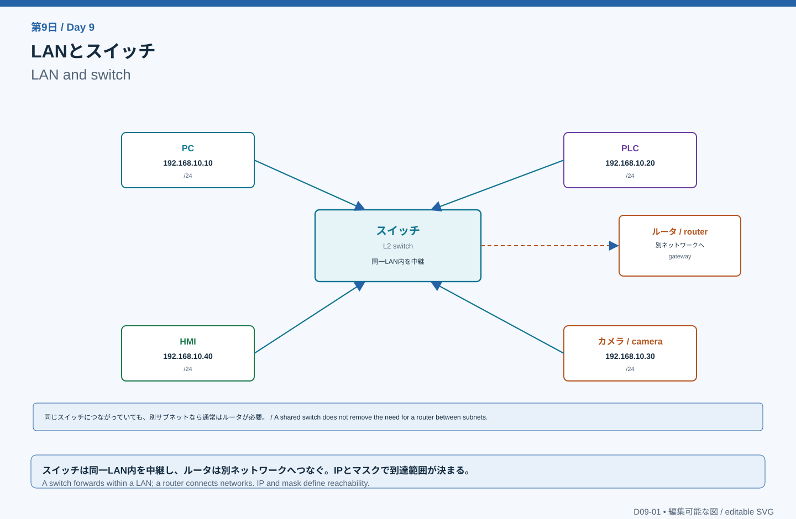
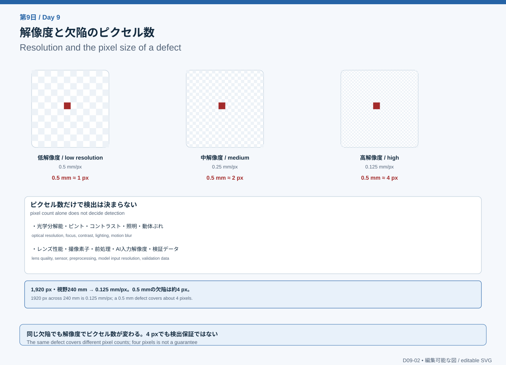
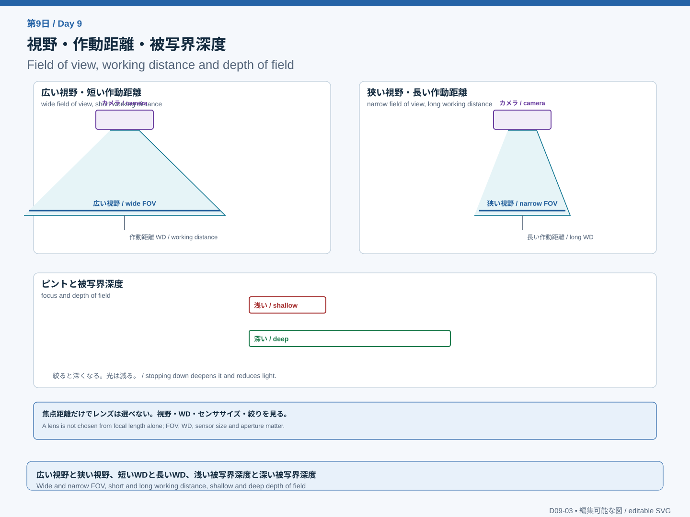
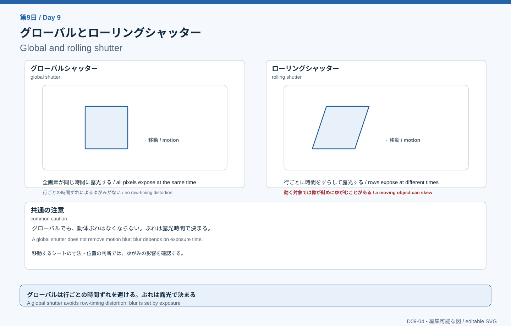
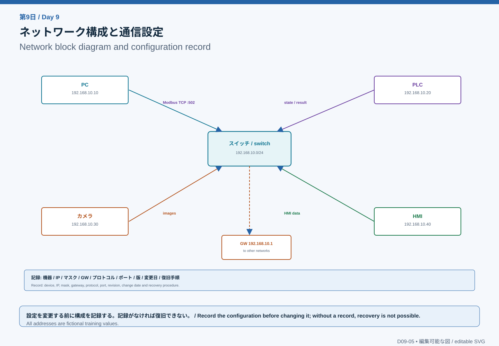

# 第9日 01 産業用ネットワークと通信設定 / Day 9-01 Industrial Networking and Communication Settings

> 所要時間 / Duration: **80分 / 80 minutes**
> 元資料 / Source pages: 34–38, 49
> 共通題材 / Running example: 押出し装置のPLCとPC・カメラの接続 / pusher PLC with PC and camera

## 1. 概要 / Overview

このノートブックでは、LAN、IPアドレス、サブネットマスク、ゲートウェイ、TCP/UDP、ポート、産業用Ethernet、Modbus TCPの基礎を学びます。目的は、PLCとPCが「通信できる構成」を、記録して説明できるようになることです。

This notebook covers LAN, IP addresses, subnet masks, gateways, TCP/UDP, ports, industrial Ethernet and Modbus TCP. The goal is to describe and record a configuration in which a PLC and PC can communicate.

**重要な区別 / Essential distinction**

- ケーブルがつながること（物理リンク）
- IPアドレスが同じネットワークにあること（論理接続）
- アプリケーションがデータを読めること（通信の成功）

この3つは別です。ケーブルがつながっても、IP設定が違えば通信できません。pingが通っても、Modbus TCPでデータを読めるとは限りません。

- The cable is connected (physical link).
- The IP addresses are in the same network (logical connection).
- The application can read data (successful communication).

These are different. A connected cable does not overcome wrong IP settings. A successful ping does not prove that Modbus TCP data can be read.

**安全に関する前提 / Safety boundary**

本研修では、実在の工場ネットワーク、生産設備、PLCの設定を変更しません。演習は架空の `192.168.10.0/24` などの訓練用ネットワークだけで行います。実ネットワークの変更は、管理者の許可、影響評価、復旧手順のもとで行います。

This course does not change a real factory network, production equipment or PLC settings. Exercises use fictional training networks such as `192.168.10.0/24`. Real network changes require administrator approval, impact assessment and a recovery procedure.

## 2. 学習目標 / Learning objectives

1. LANとスイッチの役割を説明できる。
2. IPv4アドレスの4つのオクテットを説明できる。
3. サブネットマスクとプレフィックス長を対応づけられる。
4. ネットワークアドレス、ブロードキャストアドレス、割当可能範囲を求められる。
5. デフォルトゲートウェイの役割を説明できる。
6. 同一サブネットと別サブネットを判定できる。
7. TCPとUDPの違いを説明できる。
8. ポート番号とアプリケーションの関係を説明できる。
9. 産業用EthernetとModbus TCPの位置づけを説明できる。
10. 通信設定を記録できる。
11. 通信トラブルを順序立てて切り分けられる。
12. 実ネットワークを変更せずに演習できる。

By the end of this notebook you can:

1. Explain LAN and switch roles.
2. Explain the four octets of an IPv4 address.
3. Relate a subnet mask to a prefix length.
4. Find the network address, broadcast address and assignable range.
5. Explain the role of the default gateway.
6. Judge same-subnet versus different-subnet.
7. Explain the difference between TCP and UDP.
8. Explain the relation between port numbers and applications.
9. Explain industrial Ethernet and Modbus TCP.
10. Record communication settings.
11. Troubleshoot communication in a defined order.
12. Practise without changing a real network.

## 3. 前提知識 / Prerequisites

第8日を終えていること。PLCのI/Oとシーケンスの基礎を確認してください。ネットワークの専門知識は前提にしません。2進数が分からなくても、このノートの範囲は理解できます。

Complete Day 8 and review PLC I/O and sequence basics. No prior networking expertise is assumed; the material is understandable without binary arithmetic.

### 実行環境 / executable environment

このノートのコードは、リポジトリ内の `day07_09_support/examples/automation_models.py` を使います。最初のセルを実行してから、後のセルを順に実行してください。インターネット接続は不要です。

The code uses `day07_09_support/examples/automation_models.py` in this repository. Run the first cell, then the following cells in order. No internet connection is required.

```python exec id="setup"
import sys, pathlib
import matplotlib.pyplot as plt

plt.rcParams["font.family"] = ["Meiryo", "Yu Gothic", "DejaVu Sans"]
plt.rcParams["axes.unicode_minus"] = False

def find_support(start):
    for base in [start, *start.parents]:
        if (base / "day07_09_support" / "examples" / "automation_models.py").is_file():
            return base / "day07_09_support"
    raise FileNotFoundError("Open this notebook inside the Training_Automation repository.")

SUPPORT = find_support(pathlib.Path.cwd())
sys.path.insert(0, str(SUPPORT / "examples"))
import automation_models as am
print("automation_models loaded from", SUPPORT.name)
print("No internet, hardware, PLC software or compressed air is used.")
```

**期待される出力 / Expected output**

```text
automation_models loaded from day07_09_support
No internet, hardware, PLC software or compressed air is used.
```

## 4. LANと機器 / LAN and devices

**LAN（Local Area Network）** は、限られた範囲の機器をつなぐネットワークです。工場では、PLC、PC、HMI、カメラ、センサー、ゲートウェイなどが接続されます。

A **LAN** connects devices within a limited area. In a factory it may connect PLCs, PCs, HMIs, cameras, sensors and gateways.



*図 D09-01：PC、PLC、HMIがスイッチを介して接続されています。スイッチは同じLAN内の通信を中継します。 / Figure D09-01: PC, PLC and HMI connect through a switch. The switch forwards traffic within the same LAN.*

| 機器 / Device | 役割 / Role |
|---|---|
| PC | 設定、監視、データ収集 / configuration, monitoring, data collection |
| PLC | 制御、状態の提供 / control and state |
| HMI | 人による操作・表示 / operator interface |
| スイッチ / switch | 同じLAN内の通信を中継 / forwards traffic in the LAN |
| ルータ / router | 別ネットワークへの経路 / path to another network |
| カメラ / camera | 画像データ / image data |

**スイッチとルータの違い / switch versus router**

スイッチは、同じLANの中でフレームを転送します。ルータは、別のネットワークへパケットを転送します。同じスイッチにつながっていても、IPアドレスが別サブネットなら、通常はルータが必要です。

A switch forwards frames within the same LAN. A router forwards packets to another network. Devices on the same switch but in different subnets normally need a router.

## 5. IPv4アドレス / IPv4 addresses

IPv4アドレスは32ビットで、4つのオクテット（8ビットずつ）を10進数で書きます。

An IPv4 address is 32 bits, written as four octets (8 bits each) in decimal.

```text
192 . 168 . 10 . 20
  ↑     ↑    ↑    ↑
第1   第2  第3  第4 オクテット / octet
```

各オクテットは0〜255です。したがって、`192.168.10.256` は不正です。

Each octet is 0–255. Therefore `192.168.10.256` is invalid.

**IPアドレスの役割 / role of the IP address**

IPアドレスは、ネットワーク上の機器を論理的に識別します。MACアドレスが機器固有の物理アドレスであるのに対し、IPアドレスは設定で変更できます。

An IP address logically identifies a device on the network. A MAC address is a device-specific physical address; an IP address is configurable.

**プライベートアドレス / private addresses**

`192.168.x.x`、`10.x.x.x`、`172.16.x.x`〜`172.31.x.x` は、組織内で使われるプライベートアドレスです。インターネットへ直接ルーティングされません。工場内でも、勝手に使ってよいわけではなく、ネットワーク管理者の割当ルールに従います。

`192.168.x.x`, `10.x.x.x` and `172.16.x.x`–`172.31.x.x` are private addresses used inside organisations. They are not routed directly on the internet. Even inside a factory, follow the network administrator's allocation rules.

## 6. サブネットマスク / Subnet masks

サブネットマスクは、IPアドレスのどこまでが「ネットワーク部」で、どこからが「ホスト部」かを示します。

A subnet mask shows which part of an IP address is the network and which part is the host.



*図 D09-02：IPv4の4オクテット、/24と/25の境界、ネットワーク・ブロードキャスト・割当可能範囲を示します。 / Figure D09-02: the four IPv4 octets, the /24 and /25 boundaries, and the network, broadcast and assignable ranges.*

| マスク / Mask | プレフィックス / Prefix | ネットワーク部 / Network bits | ホスト部 / Host bits |
|---|---|---|---|
| 255.255.255.0 | /24 | 先頭24ビット / first 24 bits | 下位8ビット / last 8 bits |
| 255.255.255.128 | /25 | 先頭25ビット / first 25 bits | 下位7ビット / last 7 bits |
| 255.255.0.0 | /16 | 先頭16ビット / first 16 bits | 下位16ビット / last 16 bits |

**/24の例 / /24 example**

`192.168.10.10/24` のネットワークアドレスは `192.168.10.0`、ブロードキャストアドレスは `192.168.10.255` です。割当可能なホストは `192.168.10.1`〜`192.168.10.254` の254個です。

For `192.168.10.10/24`, the network address is `192.168.10.0` and the broadcast address is `192.168.10.255`. Assignable hosts are `192.168.10.1`–`192.168.10.254`, 254 addresses.

**/25の例 / /25 example**

`192.168.10.130/25` は、後半の128個の範囲に入ります。

`192.168.10.130/25` is in the upper half of the /24 range.

| 項目 / Item | 値 / Value |
|---|---|
| マスク / mask | 255.255.255.128 |
| ネットワーク / network | 192.168.10.128 |
| ブロードキャスト / broadcast | 192.168.10.255 |
| 割当可能 / assignable | 192.168.10.129〜192.168.10.254 |
| ホスト数 / host count | 126 |

`192.168.10.200/25` も同じ `192.168.10.128/25` に入るため、`192.168.10.130/25` と同一サブネットです。一方、`192.168.10.20/25` は `192.168.10.0/25` に入るため、別サブネットです。

`192.168.10.200/25` is also in `192.168.10.128/25`, so it is in the same subnet as `192.168.10.130/25`. `192.168.10.20/25` is in `192.168.10.0/25`, a different subnet.

> **注意 / Caution**: 「先頭3オクテットが同じなら同じネットワーク」とは限りません。マスクが/24なら同じでも、/25や/26では同じ第3オクテットでも別サブネットに分かれます。必ずマスクと一緒に判定します。
> "The first three octets are the same, so it is the same network" is not always true. With /25 or /26, addresses in the same third octet can be in different subnets. Always judge with the mask.

### 6.1 特殊なマスク / special masks

- **/31**: RFC 3021のポイントツーポイント用。ネットワークアドレスとブロードキャストアドレスを除外せず、2アドレスとも使用できます。
- **/32**: 1つのホストだけを表します。ネットワーク/ブロードキャストの区別はありません。

- **/31**: RFC 3021 point-to-point. Both addresses are usable; the conventional network/broadcast exclusion does not apply.
- **/32**: a single host; there is no network/broadcast pair.

通常の授業演習では /24〜/30 を使います。特殊なマスクは、機器と設計の意図を確認してから使います。

Normal exercises use /24–/30. Use special masks only after confirming the device and design intent.

## 7. 同一サブネットとルーティング / Same subnet and routing



*図 D09-03：同じサブネットならスイッチ内で通信できます。別サブネットなら、通常はルータとゲートウェイ設定が必要です。 / Figure D09-03: devices in the same subnet communicate through the switch. Different subnets normally need a router and gateway settings.*

**同一サブネットの条件 / condition for the same subnet**

2つのIPアドレスが同じサブネットにあるのは、同じマスクで計算したネットワークアドレスが一致する場合です。

Two addresses are in the same subnet when their network addresses, calculated with the same mask, are equal.

**デフォルトゲートウェイ / default gateway**

デフォルトゲートウェイは、別のネットワークへ出るための「次の通信先」です。同じサブネット内の通信には通常不要ですが、別サブネットの機器と通信するには、適切なゲートウェイとルーティングが必要です。

The default gateway is the next hop for traffic to another network. It is normally unnecessary within the same subnet, but communication with another subnet needs an appropriate gateway and routing.

**DNS / Domain Name System**

DNSは、名前からIPアドレスを引く仕組みです。IPアドレスを直接指定してPLCに接続するだけなら、DNSが不要な構成もあります。工場ネットワークでは、名前解決の要否を設計時に決めます。

DNS resolves names to IP addresses. A direct IP connection to a PLC may not need DNS. Decide whether name resolution is required during design.

## 8. TCP・UDP・ポート / TCP, UDP and ports

IPアドレスは「どの機器へ届けるか」を決めます。ポート番号は「その機器のどのサービスへ届けるか」を決めます。TCP/UDPは「データをどう運ぶか」を決めます。

The IP address decides which device receives the data. The port number decides which service on that device receives it. TCP/UDP decides how the data is carried.



*図 D09-04：IPアドレス、ポート、プロトコルの層を示します。同じIPアドレスでも、ポートが違えば別のサービスです。 / Figure D09-04: the layers of IP address, port and protocol. The same IP address can host different services on different ports.*

| 用語 / Term | 意味 / Meaning |
|---|---|
| IPアドレス / IP address | どの機器へ届けるか / which device |
| ポート番号 / port number | 機器のどのサービスへ届けるか / which service |
| TCP | 接続・順序・再送などの機能を持つ / connection, ordering, retransmission |
| UDP | 接続確立を前提とせず、軽量 / connectionless and lightweight |
| Modbus TCP | レジスタやコイルの読み書き。標準TCPポート502が一般的 / register and coil access; TCP 502 is common |
| 無手順TCP / raw TCP | 機器間で決めた形式のバイト列 / vendor-defined byte stream |
| EtherNet/IP | 産業用通信規格。通常のEthernetと同義ではない / industrial protocol, not synonymous with Ethernet |
| RS-232C / RS-485 | シリアル通信の物理的な接続方式 / serial physical layers |

**TCPとUDPの使い分け / choosing TCP or UDP**

- **TCP**: データの欠落や順序を気にしたい制御・設定・ファイル転送。
- **UDP**: 短い周期のデータ、遅延を抑えたい通信、ブロードキャスト的な用途。
- どちらも、アプリケーションのプロトコルとポート設定が必要です。

- **TCP**: control, configuration and file transfer where loss and ordering matter.
- **UDP**: short periodic data, low-latency traffic and broadcast-like use.
- Both need an application protocol and port configuration.

**産業用Ethernet / industrial Ethernet**

産業用Ethernetは、工場向けの通信規格の総称です。EtherNet/IP、PROFINET、Modbus TCPなど、複数の規格があります。コネクタがRJ45だからといって、同じプロトコルで通信できるわけではありません。

Industrial Ethernet is a family of factory protocols including EtherNet/IP, PROFINET and Modbus TCP. An RJ45 connector does not imply a common protocol.

**Modbus TCPの例 / Modbus TCP example**

Modbus TCPは、レジスタやコイルを読み書きする比較的単純なプロトコルです。TCPポート502がよく使われます。ただし、ユニットID、アドレス表現、レジスタの型、バイト順、最大読み取り数など、機器ごとの仕様を確認します。

Modbus TCP reads and writes registers and coils and is relatively simple. TCP port 502 is common. Unit ID, address notation, register type, byte order and maximum read length are device-specific and must be checked.

## 9. 通信設定の記録 / Recording communication settings

設定を変更する前に、構成を記録します。記録がないと、変更後の復旧ができません。

Record the configuration before changing it. Without a record, recovery after a change is difficult.



*図 D09-05：PC、PLC、カメラ、HMIとスイッチの構成、通信の種類、記録項目を示します。IPアドレスは架空の訓練用です。 / Figure D09-05: PC, PLC, camera, HMI and switch topology, traffic types and record fields. The IP addresses are fictional training values.*

| 機器 / Device | IP / マスク | GW | 接続先・役割 / Connected to and role |
|---|---|---|---|
| PC | 192.168.10.10 / 255.255.255.0 | 192.168.10.1（例）/ example | 設定・監視 / configuration and monitoring |
| PLC | 192.168.10.20 / 255.255.255.0 | 192.168.10.1（例）/ example | 制御 / control |
| カメラ / camera | 192.168.10.30 / 255.255.255.0 | 192.168.10.1（例）/ example | 画像 / image |
| HMI | 192.168.10.40 / 255.255.255.0 | 192.168.10.1（例）/ example | 表示・操作 / display and operation |

**記録する項目 / fields to record**

- 機器名、型式、シリアル / device, model, serial
- IPアドレス、マスク、ゲートウェイ / IP, mask, gateway
- MACアドレス（必要なら）/ MAC if needed
- 接続ポート、ケーブル、スイッチ / port, cable, switch
- VLAN、プロトコル、ポート / VLAN, protocol, port
- 設定の版、変更日、変更者 / configuration revision, date, author
- 変更前の値 / previous values
- 影響範囲と復旧手順 / impact and recovery

## 10. 通信トラブルの切り分け / Communication troubleshooting

通信できない原因は、物理接続、IP設定、ルーティング、ファイアウォール、ポート、相手機器の設定、プロトコルなど多岐にわたります。基本から順に確認します。

Causes include physical connection, IP configuration, routing, firewall, ports, peer settings and protocol. Check from the bottom up.

| 順番 / Order | 確認すること / Check | 見つかる原因例 / Example cause |
|---|---|---|
| ① 物理 / physical | 電源、LAN、リンク表示、ケーブル / power, LAN, link LED, cable | 断線、抜け、電源OFF / broken, unplugged, off |
| ② IP設定 / IP configuration | PCのIPとマスク、重複 / PC IP and mask, duplicates | 別サブネット、IP重複 / wrong subnet, duplicate |
| ③ 到達性 / reachability | 経路、ping等 / route, ping | 経路違い、応答制限 / wrong route, response blocked |
| ④ サービス / service | ポート、接続許可、FW / port, permission, firewall | ポート閉塞、サーバ停止 / closed port, server down |
| ⑤ プロトコル / protocol | データアドレス、形式、役割 / data address, format, role | 読み書き先誤り、設定不一致 / wrong address, mismatch |
| ⑥ 復旧 / recovery | 再接続時の機械動作 / machine behaviour on reconnect | 意図しない再起動・誤出力 / unexpected restart or output |

**pingについて誤解しない / do not overinterpret ping**

- pingが失敗しても、相手機器がICMPに応答しない設定なら、アプリケーション通信はできる場合があります。
- pingが成功しても、Modbus TCPなどのアプリケーション通信が成功する保証はありません。
- 実機のネットワーク設定変更は、運転影響を考え、管理者・講師の許可を得ます。

- A failed ping does not prove that application communication is impossible; the peer may not answer ICMP.
- A successful ping does not guarantee that Modbus TCP or another application protocol will work.
- Real network changes require administrator or instructor approval after considering production impact.

## 11. サブネット計算 / Subnet calculations

```python exec id="subnet-basic"
for ip, prefix in (("192.168.10.10", 24), ("192.168.10.20", 24),
                   ("192.168.10.130", 25), ("192.168.10.200", 25),
                   ("192.168.10.20", 25)):
    info = am.describe_subnet(ip, prefix)
    print(f"{ip}/{prefix:<2} network={info['network']:<15} broadcast={info['broadcast']:<15} "
          f"hosts={info['first_host']}..{info['last_host']} ({info['usable_hosts']})")
```

**期待される出力 / Expected output**

```text
192.168.10.10/24  network=192.168.10.0    broadcast=192.168.10.255  hosts=192.168.10.1..192.168.10.254 (254)
192.168.10.20/24  network=192.168.10.0    broadcast=192.168.10.255  hosts=192.168.10.1..192.168.10.254 (254)
192.168.10.130/25 network=192.168.10.128  broadcast=192.168.10.255  hosts=192.168.10.129..192.168.10.254 (126)
192.168.10.200/25 network=192.168.10.128  broadcast=192.168.10.255  hosts=192.168.10.129..192.168.10.254 (126)
192.168.10.20/25  network=192.168.10.0    broadcast=192.168.10.127  hosts=192.168.10.1..192.168.10.126 (126)
```

**同一サブネットの判定 / same-subnet judgement**

```python exec id="subnet-pairs"
pairs = [
    ("192.168.1.10", "192.168.1.20", 24),
    ("192.168.1.10", "192.168.2.20", 24),
    ("192.168.10.130", "192.168.10.200", 25),
    ("192.168.10.130", "192.168.10.20", 25),
]
for ip_a, ip_b, prefix in pairs:
    report = am.subnet_pair_report(ip_a, ip_b, prefix)
    print(f"{ip_a}/{prefix} vs {ip_b}/{prefix}: same_subnet={report['same_subnet']}")
    print("  ", report["explanation"])
```

**期待される出力 / Expected output**

```text
192.168.1.10/24 vs 192.168.1.20/24: same_subnet=True
   ... They share the same network, so they can communicate directly if the physical link, VLAN and host configuration also allow it.
192.168.1.10/24 vs 192.168.2.20/24: same_subnet=False
   ... They are in different networks, so a router or routing configuration is normally required.
...
```

### 11.1 IP割当表を検査する / validate an IP allocation

```python exec id="ip-allocation"
allocation = [
    {"device": "PC", "ip": "192.168.10.10"},
    {"device": "PLC", "ip": "192.168.10.20"},
    {"device": "camera", "ip": "192.168.10.30"},
    {"device": "HMI", "ip": "192.168.10.255"},   # deliberately invalid
    {"device": "spare", "ip": "192.168.10.20"},  # deliberately duplicated
]
prefix = 24
seen = {}
problems = []
for row in allocation:
    if row["ip"] in seen:
        problems.append(f"duplicate address {row['ip']} for {seen[row['ip']]} and {row['device']}")
    seen[row["ip"]] = row["device"]
    info = am.describe_subnet(row["ip"], prefix)
    if not info["is_host_address"]:
        problems.append(f"{row['device']} {row['ip']} is not an assignable host in {info['cidr']}")
print("allocation:")
for row in allocation:
    print(f"  {row['device']:<8} {row['ip']}")
print("\nproblems:")
for problem in problems:
    print("  -", problem)
```

**期待される出力 / Expected output**

```text
problems:
  - HMI 192.168.10.255 is not an assignable host in 192.168.10.0/24
  - duplicate address 192.168.10.20 for PLC and spare
```

## 12. 演習 / Exercises

### 演習 A：IPアドレスを割り当てる / Exercise A: allocate IP addresses

PC、PLC、HMIの3機器に、`192.168.10.0/24` から重複しないIPアドレスを割り当ててください。ネットワークアドレスとブロードキャストアドレスは使いません。表に、機器、IP、マスク、ゲートウェイ、役割を書きます。

Assign unique IP addresses from `192.168.10.0/24` to a PC, PLC and HMI. Do not use the network or broadcast address. Record device, IP, mask, gateway and role.

### 演習 B：同一サブネット判定 / Exercise B: same-subnet judgement

次の組合せが同一サブネットか判定してください。理由も書きます。

Judge whether each pair is in the same subnet, with reasons.

1. `192.168.1.30/24` と `192.168.1.40/24`
2. `192.168.1.30/24` と `192.168.2.40/24`
3. `192.168.10.130/25` と `192.168.10.200/25`
4. `192.168.10.130/25` と `192.168.10.20/25`

### 演習 C：通信方式を整理する / Exercise C: communication specification

PCからPLCの「現在の運転状態」を読み取る想定で、必要な確認事項を列挙してください。PLC型式、プロトコル、ポート、データアドレス、データ型、更新周期、タイムアウト、通信喪失時の動作を含めます。

For reading the PLC's current run state from a PC, list the required checks: PLC model, protocol, port, data address, data type, update period, timeout and behaviour on communication loss.

### 演習 D：トラブルシュート / Exercise D: troubleshoot

「PLCは通電、LANリンク点灯、ping不応答」という想定で、原因候補を5つと確認方法を書いてください。順番も付けます。

For "PLC powered, link LED on, ping no response", list five possible causes and how to check them, in order.

### 演習 E：/24と/25の違い / Exercise E: /24 versus /25

同じ第3オクテットでも、/25では別サブネットになる例を1つ作り、ネットワークアドレス、ブロードキャスト、割当可能範囲を示してください。

Create an example where two addresses in the same third octet are in different /25 subnets. Show network, broadcast and assignable range.

**提出物 / Deliverables**

1. IPアドレス割当表 / IP allocation sheet
2. ネットワーク構成図 / network block diagram
3. 通信プロトコル仕様 / communication protocol specification
4. トラブルシューティングチェックリスト / troubleshooting checklist
5. /24と/25の計算結果 / /24 and /25 calculations

## 13. 期待される結果 / Expected result

- IPv4アドレスが4オクテットで、各0〜255であることを説明できる。
- /24と/25のネットワーク、ブロードキャスト、割当可能範囲を計算できる。
- `192.168.10.130/25` と `192.168.10.200/25` が同一サブネットであることを説明できる。
- `192.168.10.130/25` と `192.168.10.20/25` が別サブネットであることを説明できる。
- 同一サブネットと、ルータが必要な別サブネットを区別できる。
- 物理リンク、IP設定、アプリケーション通信を別々に確認できる。
- 通信設定を表に記録できる。
- 実ネットワークを変更せずに演習した。

- You can explain that an IPv4 address has four octets, each 0–255.
- You can calculate network, broadcast and assignable ranges for /24 and /25.
- You can explain that `192.168.10.130/25` and `192.168.10.200/25` are in the same subnet.
- You can explain that `192.168.10.130/25` and `192.168.10.20/25` are in different subnets.
- You can distinguish same-subnet communication from a different subnet that needs a router.
- You can check physical link, IP configuration and application communication separately.
- You can record communication settings in a table.
- You practised without changing a real network.

## 14. トラブルシューティング / Troubleshooting

| 症状 / Symptom | 確認すること / Check | よくある原因 / Typical cause |
|---|---|---|
| リンクLEDが消えている / link LED off | ケーブル、ポート、電源 / cable, port, power | 断線、抜け、ポート故障 / break, unplug, port failure |
| pingが通らない / ping fails | IP、マスク、経路、ICMP設定 / IP, mask, route, ICMP | 別サブネット、重複、応答制限 / wrong subnet, duplicate, blocked |
| pingは通るがデータが読めない / ping works, data does not | ポート、プロトコル、アドレス / port, protocol, address | ポート閉塞、アドレス誤り / closed port, wrong address |
| 時々切れる / intermittent | ケーブル、ノイズ、負荷、電源 / cable, noise, load, power | シールド不良、電源不安定 / poor shield, unstable supply |
| 通信復旧で機械が動く / machine moves on reconnect | 通信喪失時の動作、再起動条件 / behaviour on loss, restart conditions | 自動再開の設計 / auto-resume design |

## 15. まとめ / Summary

- LANは限られた範囲のネットワーク。スイッチは同一LAN内を中継し、ルータは別ネットワークへつなぐ。
- IPv4は32ビット、4オクテット。各オクテットは0〜255。
- サブネットマスクはネットワーク部とホスト部の境界。プレフィックス長で表せる。
- ネットワークアドレス、ブロードキャストアドレス、割当可能範囲を計算する。
- 同一サブネットかどうかは、マスクと一緒に判定する。
- TCP/UDP、ポート、プロトコルは別の層。IPアドレスだけでは通信は決まらない。
- Modbus TCPは一例。ポート502が一般的だが、機器仕様を確認する。
- 物理リンク、IP設定、アプリケーション通信を別々に切り分ける。
- 設定は変更前に記録する。実ネットワークは許可なく変更しない。

- A LAN is a limited network. A switch forwards within it; a router connects networks.
- IPv4 is 32 bits in four octets, each 0–255.
- A subnet mask is the boundary between network and host bits and can be written as a prefix.
- Calculate network, broadcast and assignable ranges.
- Judge same-subnet membership together with the mask.
- TCP/UDP, ports and protocols are separate layers; an IP address alone does not define communication.
- Modbus TCP is one example. TCP 502 is common, but check device specifications.
- Separate physical link, IP configuration and application communication.
- Record settings before changing them. Do not change real networks without approval.

## 16. 完了チェックリスト / Completion checklist

- [ ] LANとスイッチの役割を説明した / explained LAN and switch roles
- [ ] IPv4の4オクテットを説明した / explained the four IPv4 octets
- [ ] /24と/25を対応づけた / related /24 and /25 masks
- [ ] ネットワーク・ブロードキャスト・割当範囲を計算した / calculated network, broadcast and host range
- [ ] 同一サブネットを判定した / judged same-subnet membership
- [ ] ゲートウェイの役割を説明した / explained the gateway role
- [ ] TCPとUDPを区別した / distinguished TCP and UDP
- [ ] ポートとプロトコルを説明した / explained ports and protocols
- [ ] Modbus TCPの位置づけを説明した / explained Modbus TCP
- [ ] IP割当表を作った / built an IP allocation table
- [ ] 通信トラブルの切り分け順を作った / built a troubleshooting order
- [ ] 実ネットワークを変更しなかった / did not change a real network
