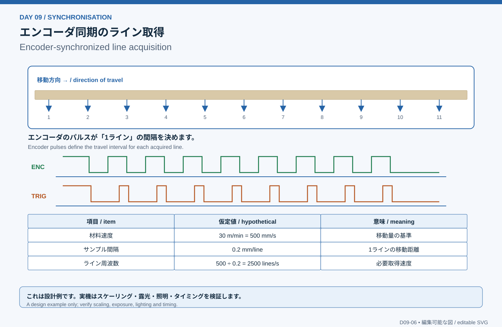
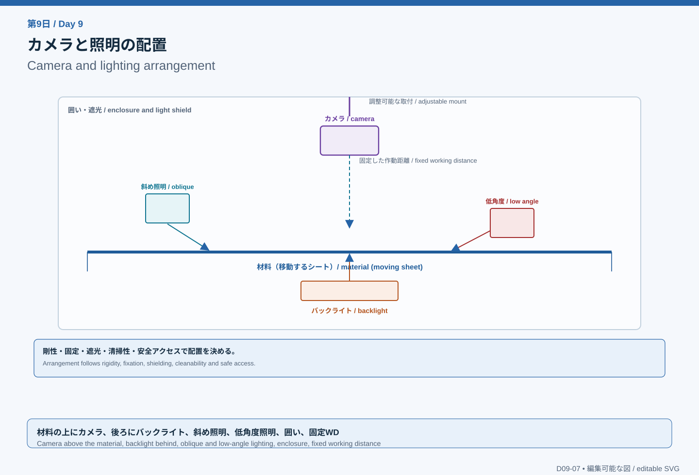

# 第9日 02 試運転・異常試験・引継ぎ / Day 9-02 Commissioning, Abnormal Testing and Handover

> 所要時間 / Duration: **85分 / 85 minutes**
> 元資料 / Source pages: 39–43, 50
> 共通題材 / Running example: 小型ワーク押出し装置 / small workpiece-pushing machine

## 1. 概要 / Overview

このノートブックでは、設備を「少しずつ確認しながら立ち上げる」方法を学びます。中心は、**段階ゲート**と**試験記録**です。一度に全部の電源を入れず、文書、機械、電気、オフライン制御、監督下の準備、承認された通電試験、最終受入の順に進めます。

This notebook covers staged commissioning: verifying a machine a little at a time. The two central tools are **verification gates** and **test records**. Do not power everything at once. Proceed through documentation, mechanics, electrical inspection, offline control, supervised readiness, approved energised testing and final acceptance.

**安全に関する前提 / Safety boundary**

本研修では、実機の通電、空圧供給、シリンダ動作、安全回路の調整を行いません。試験はすべてオフラインのシミュレーションです。実機の試運転は、リスクアセスメント、事前承認、電気的・空圧的隔離、残留エネルギー確認、ガード、有資格者の監督、復旧手順が揃った場合にのみ行います。課程の完了に、実機の通電試験は不要です。

This course does not energise real equipment, supply compressed air, move cylinders or adjust safety circuits. All tests are offline simulations. Real commissioning requires a risk assessment, prior approval, electrical and pneumatic isolation, stored-energy verification, guarding, qualified supervision and a recovery procedure. Course completion does not require an energised hardware test.

## 2. 学習目標 / Learning objectives

1. 組立・配線・ソフト・試験の作業順を説明できる。
2. 機械的検査の項目を列挙できる。
3. 電気的検査を、安全な隔離状態で行う意味を説明できる。
4. 空圧系統の検査項目を列挙できる。
5. 制御プログラムをオフラインで検証できる。
6. 段階ゲートを設計できる。
7. 正常試験と異常試験を区別できる。
8. タイムアウト、位置センサー矛盾、停電、圧力低下を試験できる。
9. 故障履歴と復旧設計を記録できる。
10. 保全アクセスと引継ぎ文書を設計できる。
11. 変更管理と再試験を記録できる。
12. PASS、FAIL、NOT TESTED、BLOCKEDを区別して記録できる。

By the end of this notebook you can:

1. Explain the order of assembly, wiring, software and testing.
2. List mechanical inspection items.
3. Explain why electrical inspection is done under safe isolation.
4. List pneumatic inspection items.
5. Verify a control program offline.
6. Design staged gates.
7. Distinguish normal from abnormal testing.
8. Test timeout, sensor disagreement, power interruption and pressure loss.
9. Record fault history and recovery design.
10. Design maintenance access and handover documents.
11. Record change management and re-testing.
12. Distinguish PASS, FAIL, NOT TESTED and BLOCKED.

## 3. 前提知識 / Prerequisites

第7日（機械・空圧）、第8日（電気・PLC・シーケンス）を終えていること。特に、シミュレーションの状態（IDLE〜FAULT）と、統一I/O表を確認してください。

Complete Day 7 (mechanics, pneumatics) and Day 8 (electrical, PLC, sequence). Review the simulation states (IDLE–FAULT) and the canonical I/O table.

### 実行環境 / executable environment

このノートのコードは、リポジトリ内の `day07_09_support/examples/automation_models.py` を使います。最初のセルを実行してから、後のセルを順に実行してください。インターネット接続は不要です。

The code uses `day07_09_support/examples/automation_models.py` in this repository. Run the first cell, then the following cells in order. No internet connection is required.

```python exec id="setup"
import sys, pathlib
import matplotlib.pyplot as plt

plt.rcParams["font.family"] = ["Meiryo", "Yu Gothic", "DejaVu Sans"]
plt.rcParams["axes.unicode_minus"] = False

def find_support(start):
    for base in [start, *start.parents]:
        if (base / "day07_09_support" / "examples" / "automation_models.py").is_file():
            return base / "day07_09_support"
    raise FileNotFoundError("Open this notebook inside the Training_Automation repository.")

SUPPORT = find_support(pathlib.Path.cwd())
sys.path.insert(0, str(SUPPORT / "examples"))
import automation_models as am
print("automation_models loaded from", SUPPORT.name)
print("No internet, hardware, PLC software or compressed air is used.")
```

**期待される出力 / Expected output**

```text
automation_models loaded from day07_09_support
No internet, hardware, PLC software or compressed air is used.
```

## 4. 段階ゲート / Staged verification gates

「とりあえず動かす」ではなく、設計資料を確認し、組立・配線・プログラム・試験の順で進めます。各ゲートは、前のゲートが完了するまで次へ進みません。

Do not "just run it". Confirm the design documents and proceed through assembly, wiring, programming and testing. Do not pass a gate until the previous gate is complete.



*図 D09-06：G0文書、G1機械、G2電気（隔離）、G3オフライン制御、G4監督下の準備、G5承認された通電試験（該当時）、G6最終受入。G5は課程の必須ではありません。 / Figure D09-06: G0 documentation, G1 mechanical, G2 electrical (isolated), G3 offline control, G4 supervised readiness, G5 approved energised testing (if applicable), G6 final acceptance. G5 is not required for course completion.*

| ゲート / Gate | 確認すること / What to verify | 必要な許可 / Approval | 本研修 / This course |
|---|---|---|---|
| G0 文書 / documentation | 要求仕様、図面、BOM、I/O表、ラダー、試験計画、変更履歴 / requirements, drawings, BOM, I/O, ladder, test plan, change history | 講師・レビュー者 / instructor or reviewer | 机上で実施 / paper |
| G1 機械 / mechanical | 取付、ボルト、ガイド、ストローク、干渉、カバー、挟まれ / mounting, bolts, guide, stroke, interference, covers, pinch | 講師・保全 / instructor or maintenance | 机上・模型 / paper or model |
| G2 電気（隔離）/ electrical, isolated | 図面照合、極性、短絡、端子、保護、接地、無電圧 / drawing, polarity, short, terminals, protection, earth, zero energy | 有資格者・講師 / qualified person | 机上で確認 / paper |
| G3 オフライン制御 / offline control | ラダー、I/Oトレース、タイマー、異常処理、再起動防止 / ladder, I/O trace, timer, faults, restart prevention | 講師 / instructor | シミュレーション / simulation |
| G4 監督下準備 / supervised readiness | 実機の状態、ガード、隔離、残留エネルギー、復旧手順 / machine state, guard, isolation, stored energy, recovery | 講師・安全担当 / instructor and safety | 机上評価 / paper assessment |
| G5 通電試験 / energised test | 承認された手順、立会い、観察、記録 / approved procedure, witness, observation, record | 有資格者・管理者 / qualified person and manager | **未実施 / not performed** |
| G6 最終受入 / final acceptance | 要求仕様との照合、記録、引継ぎ、教育 / requirements, records, handover, training | 講師・受入者 / instructor and acceptor | 机上で評価 / paper |

**ゲートを飛ばさない / do not skip gates**

- G2を飛ばしてG5へ進まない。
- G3のオフライン検証なしに、実機の動作試験を始めない。
- G5は、G0〜G4が完了し、承認された場合だけ実施する。
- G5を実施しない場合、その試験は **BLOCKED** または **NOT TESTED** と記録する。PASSにはしない。

- Do not skip G2 and jump to G5.
- Do not start real motion tests without the G3 offline verification.
- Perform G5 only after G0–G4 and with approval.
- If G5 is not performed, record **BLOCKED** or **NOT TESTED**, never PASS.

## 5. 機械・電気・空圧の検査 / Mechanical, electrical and pneumatic inspection

**機械的検査 / mechanical inspection**

| 項目 / Item | 確認内容 / Check |
|---|---|
| 取付 / mounting | ボルトの締結、緩み止め、位置決め / bolts, locking, location |
| ガイド / guide | ストローク、干渉、片当たり、潤滑 / stroke, interference, edge loading, lubrication |
| ストッパ / stopper | 位置、剛性、緩衝 / position, stiffness, cushioning |
| カバー / cover | 固定、開口、工具なしで外れないか / fixing, openings, tool access |
| 挟まれ / pinch | 可動部と固定部の距離、手の進入 / gaps and hand access |
| センサー / sensors | 取付、調整代、配線の余裕 / mounting, adjustment, wiring allowance |
| ワーク / workpiece | 傷、変形、飛出し / damage, deformation, ejection |

**電気的検査（安全な隔離状態）/ electrical inspection under safe isolation**

- 遮断器、別電源、バックフィード、蓄電部を確認する。
- 検電と無電圧確認を行う。
- ロックアウト・タグアウトを行う。
- 図面と配線を照合する。
- 極性、短絡、端子の緩み、導体の損傷を確認する。
- 保護装置、接地、絶縁を確認する。
- 有資格者と講師の承認を得る。

- Check breakers, alternative supplies, backfeed and stored energy.
- Verify voltage absence with a suitable tester.
- Apply lockout and tagout.
- Compare wiring with the drawing.
- Check polarity, shorts, loose terminals and conductor damage.
- Check protective devices, earthing and insulation.
- Obtain approval from a qualified person and the instructor.

**空圧的検査 / pneumatic inspection**

- 供給圧、フィルタ・レギュレータ、ドレン。
- チューブの抜け止め、曲げ半径、継手。
- 弁の型式と無通電位置。
- 速度制御の向き。
- 残圧の排気手段。
- シリンダのストロークと端部。
- 位置センサーの取付と動作。
- 漏れの確認方法。

- Supply pressure, filter/regulator, drain.
- Tube retention, bend radius, fittings.
- Valve type and de-energised position.
- Flow-control direction.
- Means to exhaust residual pressure.
- Cylinder stroke and end positions.
- Position sensor mounting and operation.
- Leak-check method.

> **重要 / Important**: 空圧を供給すると、シリンダが動く可能性があります。配線や機構の確認前に、エアを供給しないでください。残圧は、遮断しただけでは抜けません。
> Supplying air may move the cylinder. Do not supply air before wiring and mechanism checks. Isolation alone does not remove residual pressure.

## 6. オフライン制御検証 / Offline control verification

G3では、実機を動かさずに、ラダーとシーケンスを検証します。

At G3, verify the ladder and sequence without moving the real machine.

| 検証 / Verification | 方法 / Method | 記録 / Record |
|---|---|---|
| 自己保持 / self-holding | STARTを押して離す / press and release START | RUNが続く / RUN remains |
| 停止優先 / stop priority | タイマー中にSTOP / STOP during timer | 出力OFF、T0=0 / outputs OFF, T0=0 |
| タイマー / timer | 2999 msと3000 ms / 2999 and 3000 ms | Y1の変化 / Y1 change |
| 正常シーケンス / normal sequence | 位置フィードバック / position feedback | 状態遷移 / state sequence |
| 前進タイムアウト / extend timeout | X3をOFFのまま / keep X3 OFF | F001 |
| 後退タイムアウト / retract timeout | X2をOFFのまま / keep X2 OFF | F003 |
| センサー矛盾 / sensor conflict | X2とX3を同時ON / both ON | F002 |
| リセット / reset | FAULTからリセット / reset from FAULT | IDLE、動作なし / IDLE, no motion |
| 復電 / power restore | START保持で復電 / restore with START held | 自動起動なし / no auto-start |
| 繰返し / repeat | 完了後に再START / START after COMPLETE | 2サイクル目 / second cycle |

**実機とシミュレーションの違い / differences from a real PLC**

- スキャン周期、入力フィルタ、タイマー精度が違う。
- 実機のセンサーは、チャタリング、取付誤差、汚れの影響を受ける。
- 空圧の応答、圧力低下、配管の漏れは、モデルに含まれない。
- 実機の安全機能は、別の安全関連システムで検証する。

- Scan period, input filter and timer accuracy differ.
- Real sensors suffer chatter, mounting error and contamination.
- Pneumatic response, pressure loss and leakage are not in the model.
- Real safety functions are validated in a separate safety-related system.

## 7. シミュレーション試験 / Simulated commissioning tests

次の試験は、`automation_models.py` の決定論的シミュレーションで実行します。実際の測定値ではありません。結果は「シミュレーションの証跡」として記録します。

The tests below run in the deterministic simulation in `automation_models.py`. They are not real measurements. Record the result as **simulation evidence**.

```python exec id="commissioning-matrix"
records = am.commissioning_matrix()
print(am.matrix_markdown(records))
print()
counts = {}
for record in records:
    counts[record.status] = counts.get(record.status, 0) + 1
print("status counts:", counts)
print("note: PASS means the simulation matched the expected behaviour.")
print("T11 and T12 are BLOCKED because no hardware or safety validation is authorised.")
```

**期待される出力 / Expected output**（表は抜粋 / table abbreviated）

```text
| Test | Req | Expected | Actual | Status | Evidence |
|---|---|---|---|---|---|
| T01 | R-01 | IDLE, RUN off, no motion output. | held START: state=IDLE... | PASS | offline deterministic simulation |
...
| T11 | R-11 | Only a supervised, approved test can pass. | Not performed in the classroom... | BLOCKED | no hardware / no approval |
| T12 | R-12 | Out of scope for this course. | Not performed in the classroom... | BLOCKED | no hardware / no approval |

status counts: {'PASS': 10, 'BLOCKED': 2}
note: PASS means the simulation matched the expected behaviour.
T11 and T12 are BLOCKED because no hardware or safety validation is authorised.
```

**結果の読み方 / how to read the result**

- **PASS**: シミュレーションが期待動作と一致した。
- **FAIL**: 期待と違った。原因を調査し、修正して再試験する。
- **NOT TESTED**: まだ実施していない。
- **BLOCKED**: 前提条件・許可・設備がなく、実施できない。PASSの代用にしない。

- **PASS**: the simulation matched the expected behaviour.
- **FAIL**: it did not match; investigate, correct and re-test.
- **NOT TESTED**: not yet performed.
- **BLOCKED**: cannot be performed because preconditions, approval or equipment are missing. Never use it as a substitute for PASS.



*図 D09-07：PASS、FAIL、NOT TESTED、BLOCKEDの関係。BLOCKEDをPASSに読み替えないことが重要です。 / Figure D09-07: the relation between PASS, FAIL, NOT TESTED and BLOCKED. Never reinterpret BLOCKED as PASS.*

### 7.1 異常ケースを詳しく見る / inspect one fault in detail

```python exec id="fault-trace"
result = am.run_scenario("sensor_stuck_off")
final = result["final"]
print("scenario: extend command issued, X3 never confirms")
for state in result["visited"][:14]:
    print("  state:", state)
print("final:", am.snapshot_line(final))
print("fault reason:", getattr(final, "fault_reason", "extend confirmation timeout"))
```

**期待される出力 / Expected output**（状態の並びは抜粋 / state list abbreviated）

```text
scenario: extend command issued, X3 never confirms
  state: IDLE
  state: IDLE
  state: READY
  state: EXTEND
  state: WAIT_EXTENDED
  ...
final: ... | FAULT | RUN=0 Y0=0 Y1=0 Y2=0 | ... | fault=F001
fault reason: extend confirmation timeout
```

**タイムアウトの意味 / the meaning of the timeout**

タイムアウトは「シリンダが壊れた」という診断ではありません。**指令した動作が、設定時間内に確認できなかった**という事実です。原因は、圧力不足、詰まり、センサー位置、配線、弁、プログラムなど、複数あり得ます。タイムアウトを長くすれば直る問題ではありません。

A timeout is not a diagnosis that the cylinder is broken. It is the fact that **the commanded motion was not confirmed within the set time**. Causes include low pressure, jamming, sensor position, wiring, valve and program. Making the timeout longer does not fix the cause.

## 8. 試験記録の書き方 / Writing test records

試験記録は、他人が同じ条件で再現できるように書きます。OK/NGだけでは不十分です。

A test record must let another person reproduce the conditions. OK/NG alone is insufficient.

| 欄 / Field | 内容 / Content |
|---|---|
| 試験ID / test ID | T01など / e.g. T01 |
| 要求ID / requirement ID | R-01など / e.g. R-01 |
| 前提条件 / preconditions | 電源、位置、停止許可、状態 / power, position, permission, state |
| 手順 / procedure | 操作の順序 / order of operations |
| 期待結果 / expected result | 観測できる値・状態 / observable value or state |
| 実測 / actual observation | 実際に見た値・状態 / what was observed |
| 合否 / decision | PASS / FAIL / NOT TESTED / BLOCKED |
| 証跡 / evidence | ログ、画面、写真（許可範囲）/ log, screen, photo if permitted |
| 実施者 / operator | 氏名または役割 / name or role |
| 日付 / date | 実施日 / date performed |
| 是正処置 / corrective action | 不良時の対応 / action if failed |

**良い記録の例 / example of a good record**

```text
試験ID: T04
要求ID: R-04
前提: 運転状態、後退端、停止許可ON
手順: STARTを押して離し、T0が3000 msに達するまで待つ
期待: T0=2999 msでY1=OFF、T0=3000 msでY1=ON
実測: T0=2999 ms Y1=OFF、T0=3000 ms Y1=ON
合否: PASS
証跡: シミュレーションログ（2026-11-23、オフライン）
実施者: 研修生（役割）
是正: なし
```

**悪い記録の例 / example of a poor record**

```text
T04 OK
```

これは、何を確認したか、どの条件で、どの値だったかが分かりません。再現も検証もできません。

This does not show what was checked, under which conditions, or what value was observed. It cannot be reproduced or verified.

```python exec id="test-record"
record = am.TestRecord(
    test_id="T04",
    requirement_id="R-04",
    preconditions="RUN established; retracted confirmation; STOP_OK on",
    procedure="Press and release START; hold RUN until T0 reaches 3000 ms",
    expected="Y1 OFF at 2999 ms; Y1 ON at 3000 ms",
    actual="Y1 OFF at 2999 ms; Y1 ON at 3000 ms",
    status="PASS",
    evidence="offline simulation log, 2026-11-23",
    operator="trainee role",
    date=am.TRAINING_DATE,
    corrective_action="none",
)
print(f"{'field':<18} value")
for field, value in record.__dict__.items():
    print(f"{field:<18} {value}")

print("\ninvalid status check:")
try:
    am.TestRecord("X", "R", "", "", "", "", "OK", "", "", "")
except ValueError as error:
    print("rejected:", error)
print("Allowed statuses:", am.TEST_STATUSES)
```

**期待される出力 / Expected output**（抜粋 / excerpt）

```text
test_id            T04
requirement_id     R-04
...
status             PASS
...
invalid status check:
rejected: invalid test status 'OK'
Allowed statuses: ('PASS', 'FAIL', 'NOT TESTED', 'BLOCKED')
```

## 9. 異常試験の設計 / Designing abnormal tests

正常動作だけでなく、異常時の挙動を試験します。

Test abnormal behaviour, not only normal operation.

| 異常 / Abnormal condition | 試験方法（オフライン）/ offline method | 期待 / Expected |
|---|---|---|
| 前進端未確認 / no extend confirmation | X3をOFFのまま / keep X3 OFF | 3秒後にF001、Y2 OFF / F001 after 3 s |
| 後退端未確認 / no retract confirmation | X2をOFFのまま / keep X2 OFF | F003 |
| 前後端同時ON / both ends ON | X2とX3を同時ON / both ON | F002 |
| STOP操作 / STOP | STOP許可OFF / STOP_OK OFF | 出力OFF、T0=0 / outputs OFF |
| 停電復帰 / power restore | START保持で初期化 / initialise with START held | 自動起動なし / no auto-start |
| 圧力低下 / pressure loss | モデル外。実機で別途評価 / outside the model | 実機で確認 / verify on hardware |
| 通信喪失 / communication loss | モデル外。プロトコル設計で評価 / outside the model | 実機で確認 / verify in protocol design |

> 圧力低下、空圧の漏れ、機械の詰まり、実際のセンサー故障は、このシミュレーションでは再現できません。これらは実機のリスクアセスメントと試験計画で別に扱います。
> Pressure loss, air leakage, mechanical jams and real sensor failures are not represented in this simulation. They belong to the real-machine risk assessment and test plan.

## 10. 故障履歴・復旧・保全 / Fault history, recovery and maintenance

**故障履歴 / fault history**

故障履歴には、発生時刻、状態、入力、出力、故障コード、操作、仮説、対応、再試験を記録します。

Record time, state, inputs, outputs, fault code, operator action, hypothesis, response and re-test.

| 日時 / Time | 状態 / State | 故障 / Fault | 操作 / Action | 仮説 / Hypothesis | 対応 / Response | 再試験 / Re-test |
|---|---|---|---|---|---|---|
| | | | | | | |

**復旧設計 / recovery design**

- 原因を確認してからリセットする。
- リセット後に位置と許可を確認する。
- 新しいSTARTでのみ動作を開始する。
- 復旧手順を文書化し、誰でも同じ手順を踏めるようにする。
- 原因不明のままタイマーを延ばしたり、センサーを無効化したりしない。

- Confirm the cause before resetting.
- After reset, confirm position and permission.
- Start motion only with a fresh START.
- Document the recovery procedure so anyone can follow it.
- Do not extend timers or disable sensors to hide an unknown cause.

**保全アクセス / maintenance access**

- 工具が入る空間 / tool access
- 手が入る空間と、可動部への距離 / hand access and distance to motion
- センサー調整の余地 / sensor adjustment room
- 部品交換の導線 / parts replacement path
- 清掃・ドレン排出 / cleaning and drain
- 表示・ラベル / labels and indicators
- ロックアウトポイント / lockout points

**引継ぎ文書 / handover documents**

| 文書 / Document | 内容 / Content |
|---|---|
| 要求仕様 / requirements | 何を満たすか / what must be met |
| 図面・BOM / drawings and BOM | 何が入っているか / what is installed |
| I/O表 / I/O table | 信号の意味 / signal meaning |
| ラダー・プログラム版 / ladder and program revision | 制御の内容 / control content |
| 通信設定 / network settings | IP、プロトコル、ポート / IP, protocol, port |
| 試験記録 / test records | 何を確認したか / what was verified |
| 変更履歴 / change history | 何を変えたか / what changed |
| 復旧手順 / recovery procedure | 異常時にどうするか / what to do on fault |
| 保全計画 / maintenance plan | 点検・交換 / inspection and replacement |

## 11. 変更管理 / Change management

変更したら、日時、変更内容、理由、影響範囲、再試験結果を記録します。プログラム版数と図面版数を対応させます。

On change, record date, content, reason, impact and re-test result. Keep program and drawing revisions aligned.

| 日時 / Date | 変更 / Change | 理由 / Reason | 影響 / Impact | 再試験 / Re-test | 承認 / Approval |
|---|---|---|---|---|---|
| | | | | | |

```python exec id="change-history"
changes = [
    {"date": "2026-11-23", "change": "timer preset 5 s -> 3 s", "reason": "training scenario requirement",
     "impact": "Y1 timing and timeout behaviour", "retest": "T04, T07", "approval": "instructor"},
    {"date": "2026-11-23", "change": "Y1 reassigned from solenoid to delayed lamp",
     "reason": "remove address conflict", "impact": "I/O table, ladder, HMI labels", "retest": "T02-T08", "approval": "instructor"},
]
print(f"{'date':<12} {'change':<44} {'retest':<12} approval")
for row in changes:
    print(f"{row['date']:<12} {row['change']:<44} {row['retest']:<12} {row['approval']}")
print("\nEvery change must identify what was re-tested. A change without a re-test is incomplete.")
```

**期待される出力 / Expected output**

```text
date         change                                       retest       approval
2026-11-23   timer preset 5 s -> 3 s                      T04, T07     instructor
2026-11-23   Y1 reassigned from solenoid to delayed lamp  T02-T08      instructor

Every change must identify what was re-tested. A change without a re-test is incomplete.
```

## 12. 演習 / Exercises

### 演習 A：ゲートを設計する / Exercise A: design the gates

各ゲートG0〜G6について、「確認する項目」「結果の書き方」「NGならどうするか」を1件ずつ書いてください。

For each gate G0–G6, write one check item, how to record the result, and what to do on NG.

### 演習 B：試験記録を作る / Exercise B: write a test record

T04（3秒タイマー）の試験記録を、前提、手順、期待、実測、合否、証跡、実施者、日付、是正処置の欄を埋めて作ってください。実測はシミュレーション結果で構いません。「シミュレーション」と明記します。

Write a T04 record with preconditions, procedure, expected, actual, status, evidence, operator, date and corrective action. Simulation results are acceptable if labelled as simulation.

### 演習 C：異常試験を3つ設計する / Exercise C: design three abnormal tests

前進端未確認、前後端同時ON、停電復帰の3つについて、オフラインで試験する方法と期待結果を書いてください。

For missing extend confirmation, conflicting sensors and power restoration, write an offline test method and expected result.

### 演習 D：故障履歴を記録する / Exercise D: record a fault history

シミュレーションでF001を発生させ、日時、状態、入力、出力、故障コード、仮説、対応、再試験を記録してください。

Produce F001 in simulation and record time, state, inputs, outputs, fault code, hypothesis, response and re-test.

### 演習 E：引継ぎメモ / Exercise E: handover note

担当交代時に、相手が5分で状態を理解できるように、「済・未済・要確認」を書いてください。口頭の「あそこ」「それ」を使わず、アドレスと図面番号で書きます。

Write a handover note that lets another person understand the state in five minutes, using "done / not done / to confirm". Use addresses and drawing numbers, not vague spoken references.

**提出物 / Deliverables**

1. 試運転チェックリスト / commissioning checklist
2. 試験マトリクス / test matrix
3. 完了したシミュレーション結果 / completed simulation results
4. 不具合リスト / defect list
5. 変更履歴 / change history
6. 監督者レビュー欄 / supervisor review fields

## 13. 期待される結果 / Expected result

- 段階ゲートG0〜G6を説明できる。
- 実機の通電試験を、課程の必須項目にしていない。
- 10件のシミュレーション試験がPASSし、2件がBLOCKEDであることを説明できる。
- BLOCKEDをPASSに読み替えない。
- 試験記録に、前提・手順・期待・実測・合否・証跡・実施者・日付・是正処置がある。
- 異常試験を設計できる。
- 故障履歴、復旧、保全アクセス、引継ぎ、変更管理を説明できる。

- You can explain gates G0–G6.
- Real energised testing is not a course requirement.
- You can explain that ten simulation tests PASS and two are BLOCKED.
- You do not reinterpret BLOCKED as PASS.
- A test record contains preconditions, procedure, expected, actual, status, evidence, operator, date and corrective action.
- You can design abnormal tests.
- You can explain fault history, recovery, maintenance access, handover and change management.

## 14. トラブルシューティング / Troubleshooting

| 症状 / Symptom | 確認すること / Check | よくある原因 / Typical cause |
|---|---|---|
| 試験が再現しない / test not reproducible | 前提、手順、版 / preconditions, procedure, revision | 記録不足、版の混在 / poor records, mixed revisions |
| 異常時に何が起きたか分からない / unclear fault behaviour | 入出力トレース、故障コード / I/O trace, fault code | ログなし / no logging |
| リセットで動き出す / motion on reset | リセットと開始の分離 / reset versus start | リセットを開始条件に使用 / reset used as start |
| 復電で動く / motion on restore | 初期化、保持ビット / initialisation, retained bits | 自動復帰設計 / auto-resume design |
| 変更後に再発 / recurs after change | 変更履歴、再試験 / change history, re-test | 再試験なし / no re-test |
| 保全時に手が入らない / no maintenance access | 空間、工具、導線 / space, tools, path | 設計時の検討不足 / not designed in |

## 15. まとめ / Summary

- 試運転は段階ゲートで進める。一度に全部を動かさない。
- G0文書、G1機械、G2電気（隔離）、G3オフライン制御、G4監督下準備、G5承認された通電、G6受入。
- 実機の通電試験は、課程の必須ではない。未実施はBLOCKEDまたはNOT TESTEDと記録する。
- 試験記録は、前提・手順・期待・実測・合否・証跡・実施者・日付・是正処置を含める。
- 異常試験には、タイムアウト、センサー矛盾、停電復帰、圧力低下を含める。
- リセットは動作開始ではない。復電時も新規STARTを要求する。
- 故障履歴、復旧手順、保全アクセス、引継ぎ、変更管理を文書化する。
- シミュレーションのPASSは、実機のPASSではない。

- Commission through staged gates; do not run everything at once.
- G0 documentation, G1 mechanical, G2 electrical (isolated), G3 offline control, G4 supervised readiness, G5 approved energised, G6 acceptance.
- Energised hardware testing is not a course requirement. Record it as BLOCKED or NOT TESTED when not performed.
- Test records include preconditions, procedure, expected, actual, status, evidence, operator, date and corrective action.
- Abnormal tests include timeout, sensor conflict, power restoration and pressure loss.
- Reset is not a start. A fresh START is required after power restoration too.
- Document fault history, recovery, maintenance access, handover and change management.
- A simulation PASS is not a hardware PASS.

## 16. 完了チェックリスト / Completion checklist

- [ ] 段階ゲートG0〜G6を説明した / explained gates G0–G6
- [ ] 実機通電を必須にしていない / did not require energised hardware
- [ ] 機械・電気・空圧の検査項目を作った / listed mechanical, electrical and pneumatic checks
- [ ] オフライン検証の項目を作った / listed offline verification items
- [ ] シミュレーション試験を実行した / ran the simulation tests
- [ ] PASSとBLOCKEDの件数を確認した / checked PASS and BLOCKED counts
- [ ] BLOCKEDをPASSにしなかった / did not turn BLOCKED into PASS
- [ ] 試験記録を1件完成させた / completed one test record
- [ ] 異常試験を3つ設計した / designed three abnormal tests
- [ ] 故障履歴と復旧手順を書いた / wrote fault history and recovery
- [ ] 変更履歴と再試験を記録した / recorded change history and re-test
- [ ] 引継ぎメモを作った / produced a handover note
