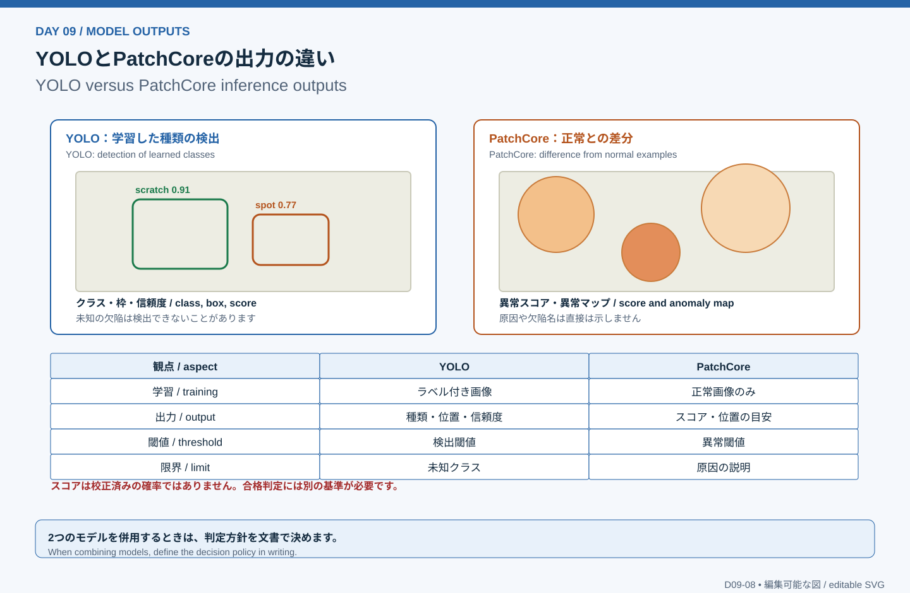
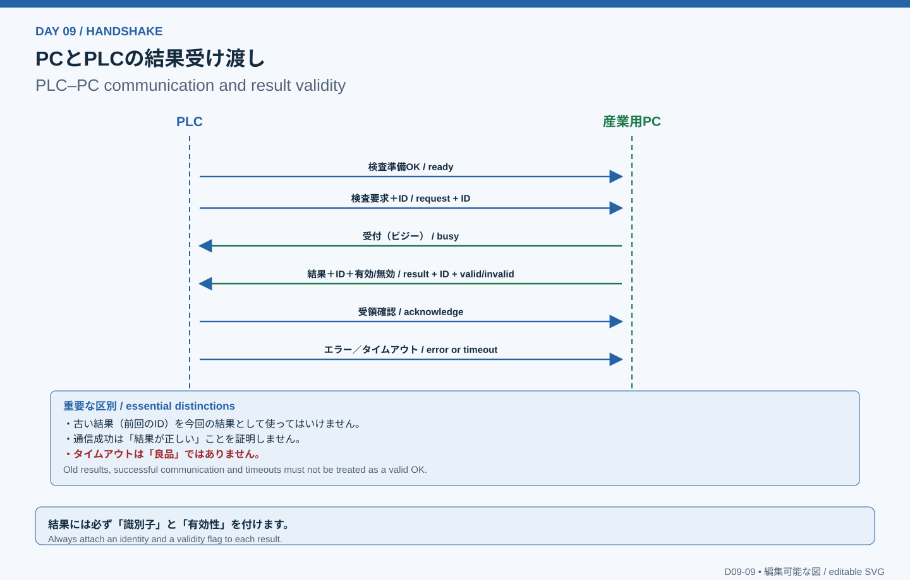

# 第9日 03 自動化提案と最終レビュー / Day 9-03 Automation Proposal and Final Review

> 所要時間 / Duration: **135分 / 135 minutes**
> 元資料 / Source pages: 9, 44–46, 51
> 共通題材 / Running example: 自部署の自動化テーマ / an automation topic from your own department

## 1. 概要 / Overview

このノートブックは、Day 7〜9の集大成です。自部署の製造課題を1つ選び、要求仕様、機械構想、機器選定、電気・I/O、PLCシーケンス、通信、試験計画、リスク、費用対効果を1つの提案書にまとめます。

This notebook integrates Days 7–9. Choose one manufacturing problem from your department and combine requirements, mechanical concept, component selection, electrical/I/O, PLC sequence, communication, test plan, risk and cost-benefit into one proposal.

**最終的に説明できること / what you must be able to explain**

**何を改善するか → どんな機械で解くか → どう動くか → どう検知するか → PLCがどう制御するか → どう通信するか → どう試験するか → 実装前に何が残るか**

**What needs improvement → what machine could solve it → how it moves → how it senses → how the PLC controls it → how it communicates → how it is tested → what remains before implementation**



*図 D09-08：課題から提案までの流れ。各段階の成果物が、次の段階の入力になります。 / Figure D09-08: the path from problem to proposal. Each stage's output becomes the next stage's input.*

**安全に関する前提 / Safety boundary**

この提案は**予備的な教育用提案**です。実機の設計、製作、配線、通電、空圧動作、安全機能の妥当性を証明するものではありません。提案に含まれる保護方策は、リスクアセスメントと有資格者のレビューを受ける前の「方向性」です。学生は実際の産業機械を完成させる必要はありません。

This is a **preliminary training proposal**. It does not prove the design, build, wiring, energisation, pneumatic behaviour or safety functions of a real machine. Protective measures in the proposal are directions that still require risk assessment and qualified review. Students are not required to build a working industrial machine.

## 2. 学習目標 / Learning objectives

1. 自部署の課題を、測定可能な改善目標に変換できる。
2. 要求仕様、機械構想、機器選定を一貫させる。
3. 電気機器、I/O、PLCシーケンスを説明できる。
4. 通信要件を整理できる。
5. 危険源と保護方策の方向性を書ける。
6. 試運転・受入試験を計画できる。
7. 投資、運用費、効果、回収を試算できる。
8. 机上効果と実現する効果を区別できる。
9. 技術リスクと未確定仕様を明示できる。
10. 次のステップを具体的に書ける。
11. 10分で提案を説明できる。
12. 提案の弱点を自分で指摘できる。

By the end of this notebook you can:

1. Convert a department problem into a measurable target.
2. Keep requirements, mechanical concept and component selection consistent.
3. Explain electrical equipment, I/O and the PLC sequence.
4. Define communication requirements.
5. Write hazards and the direction of protective measures.
6. Plan commissioning and acceptance tests.
7. Estimate investment, operating cost, benefit and payback.
8. Distinguish a paper benefit from a realised benefit.
9. State technical risks and open specifications.
10. Write concrete next steps.
11. Present the proposal in ten minutes.
12. Identify the weaknesses in your own proposal.

## 3. 前提知識 / Prerequisites

Day 7〜9のノートブックを終えていること。自部署の作業を1つ選び、回数・時間・困りごとの一次情報を持っていることが望ましいです。数値が不明な場合は「要測定」と明記します。

Complete the Day 7–9 notebooks. Choose one task from your department; first-hand data on frequency, time and problems is desirable. Mark unknown values as "to be measured".

### 実行環境 / executable environment

このノートのコードは、リポジトリ内の `day07_09_support/examples/automation_models.py` を使います。最初のセルを実行してから、後のセルを順に実行してください。インターネット接続は不要です。

The code uses `day07_09_support/examples/automation_models.py` in this repository. Run the first cell, then the following cells in order. No internet connection is required.

```python exec id="setup"
import sys, pathlib
import matplotlib.pyplot as plt

plt.rcParams["font.family"] = ["Meiryo", "Yu Gothic", "DejaVu Sans"]
plt.rcParams["axes.unicode_minus"] = False

def find_support(start):
    for base in [start, *start.parents]:
        if (base / "day07_09_support" / "examples" / "automation_models.py").is_file():
            return base / "day07_09_support"
    raise FileNotFoundError("Open this notebook inside the Training_Automation repository.")

SUPPORT = find_support(pathlib.Path.cwd())
sys.path.insert(0, str(SUPPORT / "examples"))
import automation_models as am
print("automation_models loaded from", SUPPORT.name)
print("No internet, hardware, PLC software or compressed air is used.")
```

**期待される出力 / Expected output**

```text
automation_models loaded from day07_09_support
No internet, hardware, PLC software or compressed air is used.
```

## 4. 全体の振り返り / Course recap

| 日 / Day | 学んだこと / What you learned | 提案書での使い方 / Use in the proposal |
|---|---|---|
| 7 | 要求、ECRS、能力、方式比較、機械、空圧、シリンダ、モーター、BOM | 課題、目標、機構、機器 / problem, target, mechanism, components |
| 8 | 電気、電源、センサー、NPN/PNP、I/O、PLC、ラダー、シーケンス、異常処理 | 電気構成、I/O、制御、試験 / electrical, I/O, control, test |
| 9 | ネットワーク、通信、試運転、試験記録、提案、費用対効果 | 通信、試験計画、リスク、費用 / network, test plan, risk, cost |

**一貫性の確認 / consistency check**

提案書の中で、次の値が一致している必要があります。

The following values must agree across the proposal.

- 要求能力と、機械のサイクル・稼働率・良品率 / required capacity and machine cycle, availability, yield
- シリンダ推力と、ワーク質量・摩擦・ガイド / cylinder force and workpiece mass, friction, guide
- センサー数と、I/O表の入力数 / number of sensors and inputs in the I/O table
- 電磁弁数と、I/O表の出力数 / number of valves and outputs in the I/O table
- シーケンスの状態と、試験項目 / sequence states and test items
- 通信要件と、IP・プロトコル・ポート / communication requirements and IP, protocol, port

## 5. 提案書の構成 / Proposal structure

次の24項目を、A4で2〜3ページにまとめます。すべてを埋める必要はありませんが、空欄には理由を書きます。

Summarise the following 24 items in two to three A4 pages. Not every item must be complete, but every blank needs a reason.

| # | 項目 / Item | 書くこと / What to write |
|---|---|---|
| 1 | 現状の製造課題 / current problem | 作業、頻度、時間、不良、危険 / task, frequency, time, defects, hazards |
| 2 | 現在の手作業 / present manual operation | 手順、人数、道具、判断 / steps, people, tools, decisions |
| 3 | 測定可能な改善目標 / measurable target | 何を、いつまでに、どの値へ / what, by when, to what value |
| 4 | 生産能力の要求 / capacity requirement | タクト、必要数、稼働時間 / takt, quantity, available time |
| 5 | 自動化方式の候補 / concept candidates | 手動・空圧・電動など / manual, pneumatic, electric |
| 6 | 機械システムの配置 / mechanical layout | フレーム、ガイド、駆動、ワーク / frame, guide, drive, workpiece |
| 7 | アクチュエータ選定 / actuator selection | 推力、ストローク、速度、候補 / force, stroke, speed, candidate |
| 8 | センサー選定 / sensor selection | 対象、方式、信号、取付 / target, type, signal, mounting |
| 9 | 電気機器 / electrical equipment | 電源、保護、リレー、端子 / supply, protection, relay, terminals |
| 10 | PLC I/O仕様 / PLC I/O specification | 統一I/O表に基づく / based on the canonical table |
| 11 | 制御シーケンス / control sequence | 状態、遷移、タイムアウト、異常 / states, transitions, timeout, faults |
| 12 | 通信要件 / communication requirements | 相手、プロトコル、周期、喪失時 / peer, protocol, period, loss behaviour |
| 13 | 危険源の識別 / hazard identification | 挟まれ、飛出し、感電、残圧、再起動 / pinch, ejection, shock, pressure, restart |
| 14 | 保護方策（専門レビュー前提）/ protective measures (expert review required) | なくす、離す、守る、知らせる / eliminate, separate, guard, inform |
| 15 | 試運転計画 / commissioning plan | ゲート、担当、承認 / gates, roles, approval |
| 16 | 受入試験計画 / acceptance test plan | 試験ID、要求ID、合否 / test ID, requirement ID, pass/fail |
| 17 | 概算投資 / estimated investment | 部品、工数、安全、立上げ / parts, labour, safety, start-up |
| 18 | 運用費 / operating cost | 電気、エア、保守、消耗品 / power, air, maintenance, consumables |
| 19 | 期待効果 / expected benefit | 時間、品質、安全、省力 / time, quality, safety, labour |
| 20 | 回収期間 / payback | 計算式と仮定 / formula and assumptions |
| 21 | 技術リスク / technical risks | 未検証、依存、納期 / unverified, dependencies, lead time |
| 22 | 未確定仕様 / open specifications | 何が決まっていないか / what is undecided |
| 23 | 次のステップ / next steps | 実測、試作、見積、承認 / measurement, prototype, quote, approval |
| 24 | 最終発表 / final presentation | 10分の構成 / ten-minute structure |

## 6. 要求と能力の再確認 / Reconfirm requirements and capacity

提案書の能力は、少なくとも次の3つを分けて書きます。

Write at least three separate capacity values.

| 値 / Value | 意味 / Meaning | 例 / Example |
|---|---|---|
| タクトタイム / takt time | 必要数量をこなす目標ペース / target pace | 42秒/個 |
| 設備サイクル / machine cycle | 1個を処理する実時間 / actual time per piece | 15秒/個 |
| 実力能力 / effective capacity | 停止・不良を含む出力 / output after downtime and defects | 199.92個/時 |

要求能力が、実力能力を下回ることを確認します。下回らない場合、サイクル短縮、稼働率向上、方式変更、要求の見直しを行います。

Confirm that the required rate is below the effective capacity. If not, shorten the cycle, improve availability, change the concept or revisit the requirement.

## 7. 機械・電気・制御・通信の一貫性 / Mechanical, electrical, control and network consistency

**機械 / mechanical**

- ワーク質量と摩擦力 / workpiece mass and friction
- シリンダの理論推力と候補 / theoretical cylinder force and candidate
- ガイドと側荷重 / guide and side load
- ストローク、取付、センサー / stroke, mounting, sensors

**電気 / electrical**

- 負荷電流の合計 / total load current
- 電源の余裕と突入電流 / supply margin and inrush
- 入力方式（NPN/PNP、シンク/ソース）/ input type
- 出力方式（リレー/トランジスタ）/ output type
- 保護、接地、絶縁 / protection, earthing, insulation

**制御 / control**

- 統一I/O表 / canonical I/O table
- 自己保持と停止優先 / self-holding and stop priority
- 状態遷移と位置確認 / state transitions and position confirmation
- タイムアウト、矛盾検出、リセット、再起動防止 / timeout, conflict, reset, restart prevention

**通信 / network**

- 通信する相手とデータ / peer and data
- プロトコルとポート / protocol and port
- IPアドレス、マスク、ゲートウェイ / IP, mask, gateway
- 更新周期、タイムアウト、通信喪失時の動作 / period, timeout, loss behaviour

## 8. 費用対効果 / Cost and benefit



*図 D09-09：投資、年間効果、運用費、回収期間の関係。単純回収期間は、効果と費用の仮定に強く依存します。 / Figure D09-09: the relation between investment, annual benefit, operating cost and payback. Simple payback is highly sensitive to the assumed benefit and cost.*

**PDFの例 / the source PDF example**

- 改善で1回12秒の作業を、1日180回減らせる。
- 年間稼働220日。
- 労務費換算2,400円/時。
- 削減時間 = 12 × 180 ÷ 60 = **36分/日**。
- 年間の労務費換算 = 0.6時間/日 × 220日 × 2,400円 = **316,800円/年**。
- 設備総費用 = **450,000円**。
- 単純回収期間 = 450,000 ÷ 316,800 ≒ **1.42年**。

- The improvement removes 12 seconds of work 180 times a day.
- 220 working days per year.
- Labour value 2,400 JPY/hour.
- Time saved = 12 × 180 ÷ 60 = **36 min/day**.
- Annual labour value = 0.6 h/day × 220 days × 2,400 JPY = **316,800 JPY/year**.
- Equipment cost = **450,000 JPY**.
- Simple payback = 450,000 ÷ 316,800 ≈ **1.42 years**.

**この数字の限界 / limits of this number**

- 316,800円は、**削減時間を労務費に換算した仮の値**です。人員再配置や残業削減が実現しなければ、そのまま利益にはなりません。
- 電気・エア・保守・消耗品・段取り・停止損失などの運用費を含んでいません。
- 故障時の停止損失、品質不良、教育時間を含んでいません。
- 設備費には、部品だけでなく、設計、組立、配線、試運転、ガード、検査、搬入、予備品、教育を含めます。
- 税金、減価償却、資金コストは含みません。
- 単純回収期間は、投資判断の出発点であり、完全な評価ではありません。

- 316,800 JPY is a **hypothetical conversion of saved time into labour value**. It becomes a real benefit only if staff are redeployed or overtime is reduced.
- It excludes operating costs such as power, air, maintenance, consumables, changeover and downtime.
- It excludes downtime loss, quality loss and training time.
- Equipment cost includes design, assembly, wiring, commissioning, guards, inspection, transport, spares and training, not only parts.
- It excludes tax, depreciation and cost of capital.
- Simple payback is a starting point, not a complete investment appraisal.

```python exec id="payback-calculator"
# 自由に変更してください / edit these values
seconds_saved = 12.0
occurrences_per_day = 180.0
days_per_year = 220.0
hourly_rate_jpy = 2400.0
investment_jpy = 450_000.0
annual_operating_cost_jpy = 0.0

report = am.payback_report(
    seconds_saved=seconds_saved,
    occurrences_per_day=occurrences_per_day,
    days_per_year=days_per_year,
    hourly_rate_jpy=hourly_rate_jpy,
    investment_jpy=investment_jpy,
    annual_operating_cost_jpy=annual_operating_cost_jpy,
)
print(f"time saved per day   : {report['minutes_per_day']:.1f} min/day")
print(f"hours per year       : {report['hours_per_year']:.1f} h/year")
print(f"annual labour value  : {report['annual_value_jpy']:,.0f} JPY/year")
print(f"annual operating cost: {report['annual_operating_cost_jpy']:,.0f} JPY/year")
print(f"annual net value     : {report['annual_net_value_jpy']:,.0f} JPY/year")
print(f"investment           : {report['investment_jpy']:,.0f} JPY")
print(f"simple payback       : {report['payback_years']:.2f} years")
print("Hypothetical labour-time value, not realised cash. Operating cost is user-supplied.")
```

**期待される出力 / Expected output**

```text
time saved per day   : 36.0 min/day
hours per year       : 132.0 h/year
annual labour value  : 316,800 JPY/year
annual operating cost: 0 JPY/year
annual net value     : 316,800 JPY/year
investment           : 450,000 JPY
simple payback       : 1.42 years
Hypothetical labour-time value, not realised cash. Operating cost is user-supplied.
```

### 8.1 感度を見る / sensitivity

```python exec id="payback-sensitivity"
print(f"{'investment [JPY]':>18} {'net saving [JPY/y]':>20} {'payback [years]':>16}")
for investment in (300_000, 450_000, 600_000, 900_000):
    for operating in (0, 50_000, 100_000):
        report = am.payback_report(investment_jpy=investment, annual_operating_cost_jpy=operating)
        payback = report["payback_years"]
        print(f"{investment:>18,} {report['annual_net_value_jpy']:>20,.0f} {payback:>16.2f}")
    print()
print("If net value is zero or negative, payback is infinite: the investment does not pay back.")
```

**読み取り方 / how to read it**

- 投資が増えると、回収期間は長くなる。
- 運用費が増えると、純効果が減り、回収期間が長くなる。
- 効果が実現しない場合、回収期間は無限になる。
- 数字を良く見せるために、効果を過大に見積もらない。

- Higher investment lengthens payback.
- Higher operating cost reduces net benefit and lengthens payback.
- If the benefit is not realised, payback is infinite.
- Do not overstate the benefit to make the number look good.

## 9. リスクと未確定仕様 / Risks and open specifications

| リスク / Risk | 影響 / Impact | 確認・対策 / Check or action | 残る不確実性 / Remaining uncertainty |
|---|---|---|---|
| ワーク質量・摩擦の推定 / estimated mass and friction | 推力不足 / insufficient force | 実測、最悪条件 / measure, worst case | 実機の汚れ・摩耗 / contamination, wear |
| 圧力損失 / pressure loss | 速度・推力不足 / low speed or force | 実機で圧力測定 / measure pressure | 配管・弁のばらつき / piping and valve variation |
| センサー検出の不安定 / unreliable sensing | 誤停止・誤動作 / false stop or motion | 実物テスト / test with real target | 色・反射・汚れ / colour, reflection, dirt |
| 通信の遅延・喪失 / communication delay or loss | データ欠落、誤動作 / missing data, wrong action | タイムアウト設計 / timeout design | ネットワーク負荷 / network load |
| 安全機能の未検証 / unverified safety | 人身リスク / personal risk | リスクアセスメント、専門レビュー / risk assessment, expert review | 規格適合の確認 / compliance verification |
| 納期・部品入手 / lead time and availability | 立上げ遅延 / delayed start-up | 代替品、在庫 / alternatives, stock | 供給変動 / supply variation |

**未確定仕様の書き方 / writing open specifications**

「未確定」とだけ書かず、**誰が、いつまでに、何を確認するか**を書きます。

Do not write only "undecided". State **who will confirm what, by when**.

```text
未確定: シリンダの実圧力
確認者: 設備担当
期限: 試作前
方法: 圧力計で3条件を測定
判断: 設計力39.24 Nに対して余裕があるか
```

## 10. 試運転・受入計画 / Commissioning and acceptance plan

| ゲート / Gate | この提案での項目 / Item in this proposal | 完了条件 / Done when |
|---|---|---|
| G0 文書 / documentation | 要求、図面、BOM、I/O、ラダー、試験計画 / requirements, drawings, BOM, I/O, ladder, test plan | レビュー済み / reviewed |
| G1 機械 / mechanical | 取付、ガイド、ストローク、カバー / mounting, guide, stroke, cover | 検査記録 / inspection record |
| G2 電気（隔離）/ electrical | 配線、極性、保護、接地、無電圧 / wiring, polarity, protection, earth, zero energy | 有資格者承認 / qualified approval |
| G3 オフライン / offline | 自己保持、タイマー、シーケンス、異常 / self-holding, timer, sequence, faults | シミュレーションPASS / simulation PASS |
| G4 準備 / readiness | ガード、隔離、残留エネルギー、復旧 / guard, isolation, stored energy, recovery | 監督者承認 / supervisor approval |
| G5 通電（該当時）/ energised | 承認された試験のみ / approved tests only | 立会い記録 / witnessed record |
| G6 受入 / acceptance | 要求との照合 / verification against requirements | 受入記録 / acceptance record |

**受入試験の例 / example acceptance tests**

| ID | 要求 / Requirement | 試験 / Test | 合否 / Pass condition |
|---|---|---|---|
| AT-01 | R-01 自動再起動しない / no auto-restart | 復電時にSTART保持 / restore with START held | 動作しない / no motion |
| AT-02 | R-02 押出し位置 / push position | 10回測定 / ten cycles | ±2 mm以内 / within ±2 mm |
| AT-03 | R-03 能力 / capacity | 連続サイクル / consecutive cycles | 85個/時以上 / at least 85/h |
| AT-04 | R-04 停止 / stop | タイマー中にSTOP / STOP during timer | 全出力OFF / all outputs OFF |

## 11. 最終発表 / Final presentation

10分の発表構成の例です。

An example ten-minute structure.

| 時間 / Time | 内容 / Content |
|---|---|
| 0–2分 / 0–2 min | 現場の困りごと、現状の数値 / problem and current numbers |
| 2–5分 / 2–5 min | 改善方式、機械・機器選定、採用理由 / concept, machine and components, reasons |
| 5–7分 / 5–7 min | 動作フロー、I/O、通信 / sequence, I/O, communication |
| 7–9分 / 7–9 min | 費用、安全、リスク、未確定 / cost, safety, risk, open items |
| 9–10分 / 9–10 min | 次のステップ、質問 / next steps and questions |

**発表で問われること / what the audience will ask**

- なぜその方式を選んだか。他の案はなぜ却下したか。
- その能力は、どの仮定で成り立つか。
- 危険源は何か。誰が安全を確認するのか。
- 試験は何を、どの順で行うのか。
- まだ分かっていないことは何か。

- Why this concept? Why were the others rejected?
- Under which assumptions does the capacity hold?
- What are the hazards? Who verifies safety?
- What is tested, in what order?
- What is still unknown?

## 12. 演習 / Final project

### 最終課題 / Final assignment

自部署の自動化テーマを1つ選び、次の成果物を作ってください。

Choose one automation topic from your department and produce the following.

1. 要求仕様書（測定可能な受入基準を含む）/ requirements with measurable acceptance criteria
2. 機械構想図（フレーム、駆動、ガイド、センサー、ガード）/ mechanical concept
3. 機器選定表（候補、理由、仮定、未確認）/ component selection table
4. I/O表（統一表と一致）/ I/O map matching the canonical table
5. シーケンス説明（状態、遷移、タイムアウト、異常）/ sequence description
6. ネットワーク仕様（IP、マスク、プロトコル、ポート、喪失時）/ network specification
7. 試験計画（ゲート、試験ID、要求ID、合否）/ test plan
8. リスクと費用の要約 / risk and cost summary
9. 10分の発表 / ten-minute presentation

```python exec id="proposal-check"
proposal = {
    "current_problem": "manual pushing, 180 times/day, 12 s each",
    "present_operation": "operator positions and pushes the workpiece by hand",
    "measurable_target": "reduce 12 s to 2 s per cycle; hold position within +/-2 mm",
    "capacity_requirement": "600 pieces/day over 420 min; takt 42 s",
    "concept_candidates": "manual fixture, pneumatic semi-auto, electric full-auto",
    "mechanical_layout": "frame, guide, pusher, cylinder, position sensors",
    "actuator_selection": "candidate bore 16 mm; theoretical minimum 11.18 mm",
    "sensor_selection": "two magnetic cylinder switches; PNP (training config)",
    "electrical_equipment": "DC24V supply, breakers, terminals, relay",
    "plc_io": "X0-X3, M0, Y0, Y1, Y2, T0",
    "control_sequence": "IDLE to COMPLETE; F001/F002/F003 fault handling",
    "communication": "fictional 192.168.10.0/24; Modbus TCP port 502 to be confirmed",
    "hazards": "pinch at pusher, ejection, residual air, unexpected restart",
    "protective_measures": "fix guard, interlock direction, isolation and bleed; expert review required",
    "commissioning_plan": "gates G0-G4; G5 not performed in this course",
    "acceptance_tests": "AT-01 to AT-04",
    "investment": "450000 JPY (hypothetical)",
    "operating_cost": "to be estimated",
    "expected_benefit": "316800 JPY/year labour-time value (hypothetical)",
    "payback": "about 1.42 years before operating cost",
    "technical_risks": "actual pressure, friction, sensor reliability",
    "open_specifications": "cylinder pressure, valve type, safety validation",
    "next_steps": "measure, prototype, quote, risk review, approval",
    "final_presentation": "10-minute structure prepared",
}

required = list(proposal)
empty = [key for key in required if not str(proposal.get(key, "")).strip()]
print("required fields :", len(required))
print("empty fields    :", empty if empty else "none")
print("completeness    : {:.0f}%".format(100 * (len(required) - len(empty)) / len(required)))
print("\nA complete form is not a complete engineering proposal. Review the quality of each entry.")
```

**期待される出力 / Expected output**

```text
required fields : 24
empty fields    : none
completeness    : 100%

A complete form is not a complete engineering proposal. Review the quality of each entry.
```

### 発表の自己レビュー / self-review of the presentation

次の問いに答えてください。

Answer the following.

1. 自分の提案で、最も不確かな数値は何か。
2. その数値を確認する方法は何か。
3. 安全上の主張のうち、専門家のレビューが必要なものは何か。
4. 回収期間の計算から抜けている費用は何か。
5. 実装前に残る最大のリスクは何か。

1. Which number in your proposal is most uncertain?
2. How will you verify it?
3. Which safety claims require expert review?
4. Which costs are missing from the payback?
5. What is the largest remaining risk before implementation?

**提出物 / Deliverables**

1. 要求仕様書 / requirements sheet
2. 機械構想図 / mechanical concept diagram
3. 機器選定表 / component selection sheet
4. I/O表 / I/O map
5. シーケンス制御の説明 / sequence description
6. ネットワーク仕様 / network specification
7. 試験計画 / test plan
8. リスクと費用の要約 / risk and cost summary
9. 最終発表資料 / final presentation

## 13. 期待される結果 / Expected result

- 課題、要求、方式、機械、電気、制御、通信、試験、費用が一貫している。
- タクト、サイクル、実力能力を分けて説明できる。
- シリンダとモーターの計算を、仮定と単位付きで説明できる。
- I/O表が統一表と一致し、Y1を電磁弁に使っていない。
- 自己保持、停止優先、位置確認、タイムアウト、復電時の再起動防止を説明できる。
- 通信のIP、マスク、プロトコル、ポート、喪失時の動作を説明できる。
- 費用対効果の仮定と限界を説明できる。
- 危険源と、専門レビューが必要な保護方策を説明できる。
- 次のステップが具体的である。

- Problem, requirements, concept, mechanics, electrical, control, communication, test and cost are consistent.
- Takt, cycle and effective capacity are explained separately.
- Cylinder and motor calculations are explained with assumptions and units.
- The I/O map matches the canonical table and does not use Y1 for the solenoid.
- Self-holding, stop priority, position confirmation, timeout and restart prevention are explained.
- IP, mask, protocol, port and loss behaviour are explained.
- Cost-benefit assumptions and limits are explained.
- Hazards and protective measures requiring expert review are explained.
- Next steps are concrete.

## 14. トラブルシューティング / Troubleshooting

| 症状 / Symptom | 確認すること / Check | よくある原因 / Typical cause |
|---|---|---|
| 提案の数値が一致しない / numbers do not agree | 要求、能力、I/O、BOM / requirements, capacity, I/O, BOM | 版の混在、仮定の未共有 / mixed revisions, unshared assumptions |
| 回収期間が良すぎる / payback looks too good | 運用費、実現性、削減時間 / operating cost, realisation, time saved | 効果の過大評価 / overstated benefit |
| 安全の説明が弱い / weak safety explanation | 危険源、保護方策、レビュー / hazards, measures, review | 通常制御と安全の混同 / control versus safety |
| 発表で質問に答えられない / cannot answer questions | 仮定、根拠、未確定 / assumptions, evidence, open items | 根拠の記録不足 / insufficient evidence |
| 次のステップが曖昧 / vague next steps | 誰が、いつ、何を / who, when, what | 責任と期限の未設定 / no owner or date |

## 15. まとめ / Summary

- 提案は、課題 → 要求 → 方式 → 機械 → 電気 → 制御 → 通信 → 試験 → 費用の一貫した流れ。
- タクト、サイクル、実力能力を分ける。
- 機械・電気・I/O・シーケンス・通信の値を一致させる。
- 費用対効果は、仮定と限界を明示する。1.42年は単純回収の例。
- 316,800円/年は、労務時間の仮換算であり、実現する利益とは限らない。
- 危険源と保護方策を書き、専門レビューを前提とする。
- 未確定仕様と次のステップを、責任者・期限付きで書く。
- 10分で、課題から次のステップまで説明する。

- A proposal is a consistent chain: problem → requirements → concept → mechanics → electrical → control → communication → test → cost.
- Separate takt, cycle and effective capacity.
- Keep mechanical, electrical, I/O, sequence and network values consistent.
- State cost-benefit assumptions and limits. 1.42 years is a simple-payback example.
- 316,800 JPY/year is a hypothetical labour-time conversion, not guaranteed profit.
- Write hazards and protective measures, with expert review as a precondition.
- Write open specifications and next steps with owners and dates.
- Explain problem to next steps in ten minutes.

## 16. 完了チェックリスト / Completion checklist

- [ ] 自部署の課題を1つ選んだ / selected one department problem
- [ ] 測定可能な改善目標を書いた / wrote a measurable target
- [ ] タクト、サイクル、実力能力を計算した / calculated takt, cycle and effective capacity
- [ ] 機械構想とアクチュエータ候補を書いた / wrote the mechanical concept and actuator candidates
- [ ] センサーと電気機器を選んだ / selected sensors and electrical equipment
- [ ] I/O表を統一表と一致させた / matched the I/O map to the canonical table
- [ ] シーケンスと異常処理を書いた / wrote the sequence and fault handling
- [ ] 通信仕様を書いた / wrote the network specification
- [ ] 危険源と保護方策を書いた / wrote hazards and protective measures
- [ ] 試運転・受入試験を計画した / planned commissioning and acceptance tests
- [ ] 投資、運用費、効果、回収を試算した / estimated investment, operating cost, benefit and payback
- [ ] 1.42年の例と限界を説明した / explained the 1.42-year example and its limits
- [ ] 技術リスクと未確定仕様を書いた / wrote technical risks and open specifications
- [ ] 次のステップを責任者・期限付きで書いた / wrote next steps with owners and dates
- [ ] 10分の発表を準備した / prepared a ten-minute presentation
