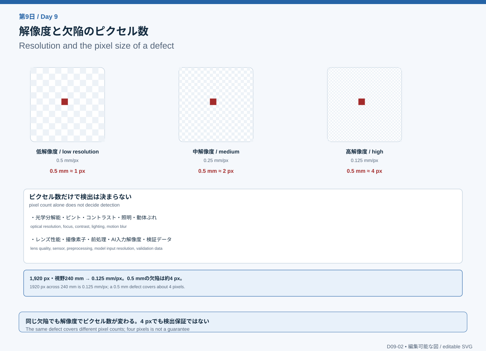
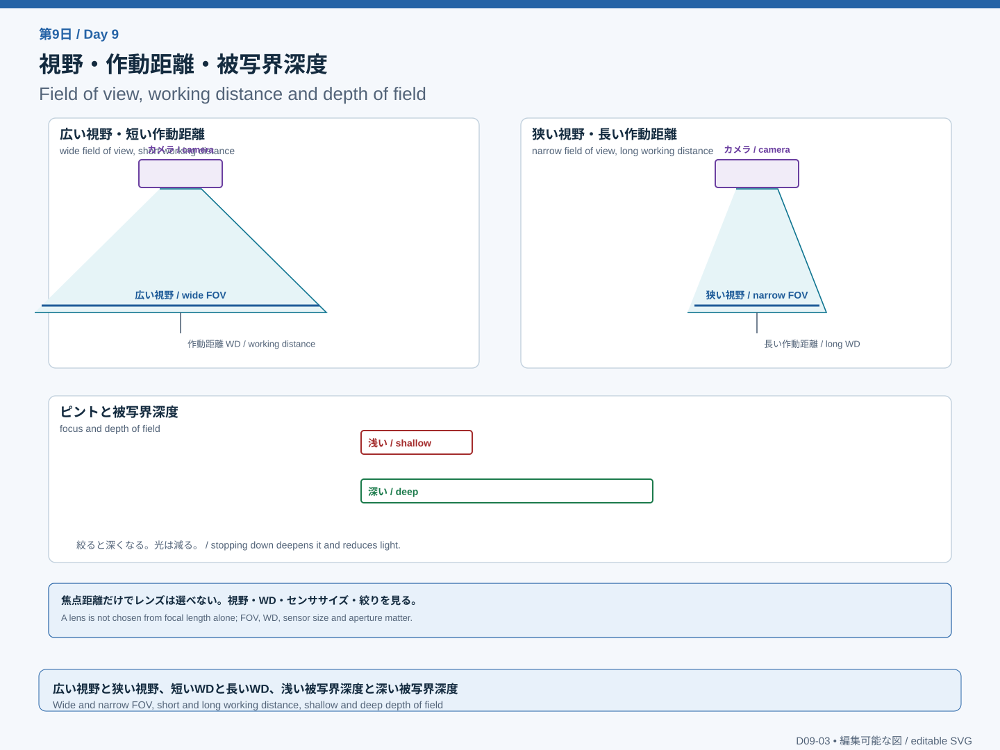
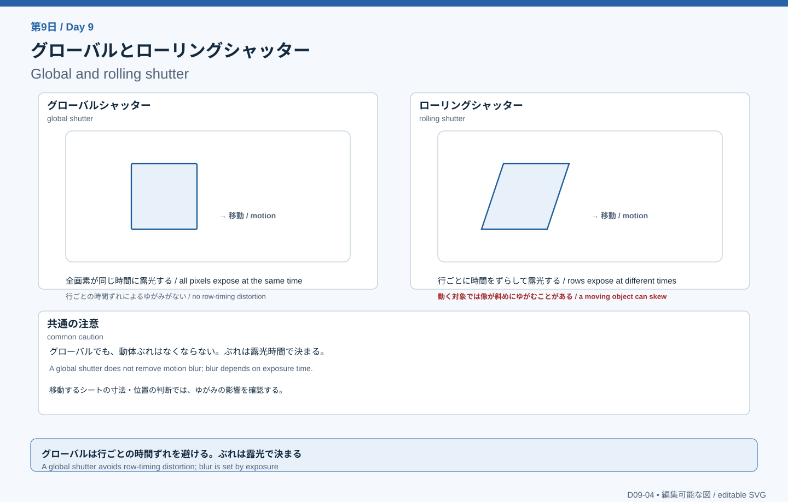
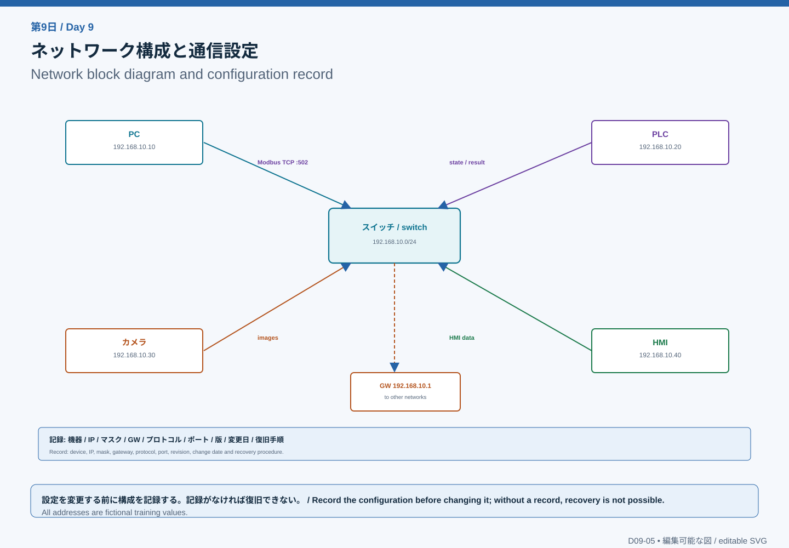
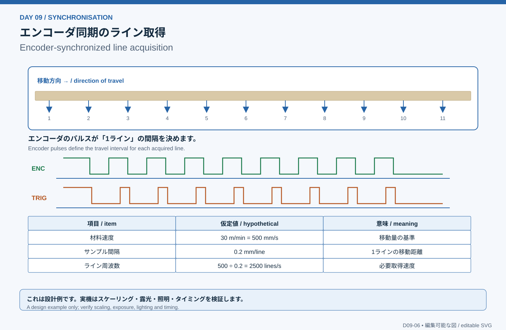

# 第9日 01：視覚ハードウェア / Day 9 01: Vision Hardware

**所要時間：80分 / Duration: 80 minutes.** [第7〜9日 時間割 / Day 7–9 syllabus](../../COURSE_SYLLABUS_DAY07_09.md)

AI検査の品質は、モデルの前に「どんな画像を撮れたか」で大きく決まります。この教材では、カメラ・レンズ・照明・動き・同期を、計算と図で理解します。中心事例は架空の連続シート検査機で、数値はすべて**仮定値**です。
AI inspection quality is largely decided before the model, by the image you can capture. This lesson covers camera, lens, lighting, motion and synchronisation with calculations and diagrams. The case is a fictional continuous-sheet machine and all numbers are **hypothetical**.

**到達目標 / Objectives:** エリアスキャンとラインスキャンの違い、画素スケール、モーションブラー、ライン取得速度を計算し、照明と同期が検査に与える影響を説明できる。
Explain area versus line scan, calculate pixel scale, motion blur and line rate, and explain how lighting and synchronisation affect inspection.

## 1. 産業用カメラ / Industrial cameras

産業用カメラは、**イメージセンサ**で光を電気信号に変えます。**画素（pixel）**は画像の最小単位、**解像度**は画素数、**フレームレート**は1秒あたりの画像数です。**露光（exposure）**は光をためる時間、**ゲイン**は信号の増幅、**レンズ**は光を集め、**トリガ**は撮影のきっかけ、**画像インタフェース**はデータの出口です。

An industrial camera converts light to signals with an **image sensor**. A **pixel** is the smallest image unit, **resolution** is the pixel count and **frame rate** is images per second. **Exposure** is the light-collection time, **gain** amplifies the signal, the **lens** gathers light, the **trigger** starts acquisition and the **image interface** carries data out.

## 2. エリアスキャンとラインスキャン / Area scan versus line scan

**エリアスキャン**は1回の露光で2次元の画像を撮ります。**ラインスキャン**は1本の線を撮り、材料の移動に合わせて連結して2次元画像を作ります。連続シートではラインスキャンが候補になりますが、**常に優れているわけではありません**。照明、速度、取付、同期の難しさを比較して選びます。

An **area-scan** camera captures a 2-D image per exposure. A **line-scan** camera captures one line and assembles lines using relative motion. Line scan is a candidate for continuous webs but is **not always superior**; compare lighting, speed, mounting and synchronisation difficulty.

**図 D09-02 / Figure D09-02 — 確認 / check:** ラインスキャンで「移動」が止まったら、画像はどうなりますか？ / What happens to a line-scan image if the material stops moving?

## 3. レンズと光学の基礎 / Lens and optics fundamentals

**視野（FOV）**はカメラが写せる範囲、**作動距離（WD）**はレンズから対象までの距離、**焦点**は最もよく合う位置です。**被写界深度**はピントが合って見える前後の範囲、**レンズ歪み**は直線が曲がる現象です。**画素スケール**は「1画素が何 mm に相当するか」を表します。

**Field of view (FOV)** is the observable area, **working distance (WD)** is lens-to-target distance and **focus** is the sharpest position. **Depth of field** is the range that appears in focus, and **lens distortion** bends straight lines. **Pixel scale** states how many millimetres one pixel represents.

**図 D09-03 / Figure D09-03 — 確認 / check:** FOVを変えずに画素数を増やすと、画素スケールはどうなりますか？ / With the same FOV, what happens to pixel scale when pixel count increases?

**仮定例 / Hypothetical example:** FOV = 600 mm、横画素数 = 4,096 とすると、画素スケールは 600 ÷ 4,096 ≈ **0.146484 mm/px** です。1画素より小さい欠陥が必ず検出できる、という意味では**ありません**。検出はコントラスト、光学、ノイズ、動き、モデルの能力に依存します。

With FOV = 600 mm and 4,096 horizontal pixels, the scale is 600 ÷ 4,096 ≈ **0.146484 mm/px**. This does **not** mean defects smaller than one pixel are reliably detectable. Detection depends on contrast, optics, noise, motion and model capability.

## 4. 照明 / Lighting

**拡散照明**は反射を抑え、表面の色むらを見ます。**直接照明**は影を強調しますが、光沢面では反射（グレア）が問題になります。**バックライト**は輪郭や穴を silhouette として見せます。**暗視野照明**は微細な凹凸や傷を明るく見せます。

**Diffuse** lighting suppresses reflection to show surface tones. **Direct** lighting emphasises shadows but creates glare on glossy surfaces. **Backlighting** shows edges and holes as a silhouette. **Dark-field** lighting makes fine texture and scratches bright.

**図 D09-04 / Figure D09-04 — 確認 / check:** 同じ欠陥でも照明で見え方が変わるのはなぜですか？ / Why does the same defect look different under different lighting?

**照明の安定性**は、長期の検査信頼性に直結します。光源の経時変化、汚れ、取付の緩み、外乱光は、モデルが学習した「見え方」を変えます。照明を変更したら、**モデルの再評価**が必要です。
**Lighting stability** drives long-term reliability. Light-source aging, contamination, loose mounts and ambient light change the appearance the model learned. Any lighting change requires **model re-evaluation**.

## 5. モーションブラー / Motion blur

露光の間に材料が動くと、画像上でぶれます。移動距離は **距離 = 速度 × 露光時間** です。速度が速い、または露光が長いほど、ぶれが大きくなります。ぶれは欠陥のコントラストを下げ、検出を難しくします。

If the material moves during exposure, the image blurs. Distance moved is **distance = velocity × exposure time**. Higher speed or longer exposure increases blur. Blur lowers defect contrast and makes detection harder.

**図 D09-05 / Figure D09-05 — 確認 / check:** 露光を短くすると、別に何を調整する必要がありますか？ / If exposure is shortened, what else must be adjusted?

**仮定例 / Hypothetical example:** 速度 0.5 m/s、露光 1.0 ms なら、移動は 0.5 × 0.001 = **0.5 mm** です。露光を短くすると暗くなるため、**光量を増やす**か**ゲインを上げる**必要がありますが、ゲインはノイズも増やします。
At 0.5 m/s and 1.0 ms exposure, travel is 0.5 × 0.001 = **0.5 mm**. Shortening exposure darkens the image, so you must add light or raise gain, and gain also adds noise.

## 6. エンコーダ同期 / Encoder synchronisation

ラインスキャンでは、材料の移動に合わせて1本ずつ撮る必要があります。エンコーダのパルスをトリガにすると、速度が変わっても**移動量あたりのサンプル間隔**を保ちやすくなります。ここで重要なのは、**カメラのフレームレート（fps）とライン周波数（lines/s）は別物**だという点です。

Line scan must acquire one line per unit of material travel. Triggering from encoder pulses helps keep a **constant sample interval per distance** even when speed varies. Crucially, **camera frame rate (fps) and line rate (lines/s) are different things**.

**図 D09-06 / Figure D09-06 — 確認 / check:** 速度が2倍になったとき、ライン周波数はどう変える必要がありますか？ / If speed doubles, what must happen to line rate?

**仮定例 / Hypothetical example:** 材料速度 30 m/min = 500 mm/s、移動方向のサンプル間隔 0.2 mm/line とすると、必要なライン周波数は 500 ÷ 0.2 = **2,500 lines/s** です。これは公称の設計例であり、最終的なカメラ仕様ではありません。実際は、エンコーダのスケーリング、カメラのタイミング、露光限界、照明、動きを考慮します。

At 30 m/min = 500 mm/s with 0.2 mm/line travel sampling, the required line rate is 500 ÷ 0.2 = **2,500 lines/s**. This is a nominal design example, not a final camera specification. Real design must consider encoder scaling, camera timing, exposure limits, lighting and motion.

## 7. カメラインタフェース / Camera interfaces

**USB3 Vision**、**GigE Vision**、**CoaXPress** は、物理的・電気的な転送の規格です。**GenICam** は、カメラを共通の方法で設定・制御するためのソフトウェア的な枠組みです。**これらは同じ種類の規格ではありません。**すべてのカメラがすべてのインタフェースに対応するわけでもありません。

**USB3 Vision**, **GigE Vision** and **CoaXPress** are physical and electrical transport standards. **GenICam** is a software framework for configuring and controlling cameras in a common way. **They are not the same kind of standard**, and no camera supports every interface.

## 8. シミュレーション：カメラのタイミング / Simulation: camera timing

`day07_09_support/simulations/sim_camera_timing.html` では、材料速度・検査幅・画素数・サンプル間隔・露光時間を動かし、**公称 mm/px・必要ライン周波数・露光中の移動量**を確認できます。値はすべて仮定です。

`day07_09_support/simulations/sim_camera_timing.html` lets you vary material speed, inspection width, pixel count, sampling interval and exposure to read **nominal mm/px, required line rate and travel during exposure**. All values are hypothetical.

## 9. 演習 / Exercises

1. エリアスキャンとラインスキャンの長所と短所を一つずつ書いてください。 / Give one strength and one weakness each for area scan and line scan.
2. FOV 400 mm、横画素 2,048 のとき、画素スケールを求めてください。 / Calculate pixel scale for FOV 400 mm and 2,048 horizontal pixels.
3. 速度 1.0 m/s、露光 0.2 ms のとき、露光中の移動量を求めてください。 / At 1.0 m/s and 0.2 ms exposure, find the travel during exposure.
4. 速度 60 m/min、サンプル間隔 0.1 mm/line のとき、必要なライン周波数を求めてください。 / At 60 m/min with 0.1 mm/line, find the required line rate.
5. 検査画像が全体的に暗く、ノイズが多いとき、照明と露光の観点で確認することを三つ挙げてください。 / An image is dark and noisy; name three lighting/exposure checks.

### 解答例 / Worked answers

1. 例：エリア＝取付と同期が簡単／高速連続には不向き。ライン＝連続材料に強い／同期と照明が難しい。 / Area: simple mounting and sync, but less suited to fast continuous webs. Line: strong for continuous material, but harder synchronisation and lighting.
2. 400 ÷ 2,048 ≈ **0.195313 mm/px**。 / ≈ **0.195313 mm/px**.
3. 1.0 × 0.0002 = **0.2 mm**。 / **0.2 mm**.
4. 60 m/min = 1,000 mm/s。1,000 ÷ 0.1 = **10,000 lines/s**。 / 60 m/min = 1,000 mm/s; 1,000 ÷ 0.1 = **10,000 lines/s**.
5. 例：光源の出力と汚れ、露光時間、絞り・光量、外乱光、ゲインの設定。 / Examples: light output and contamination, exposure time, aperture and light level, ambient light, gain setting.

## 9. まとめ / Summary

画像の品質は、カメラ・レンズ・照明・動き・同期の積み重ねで決まります。画素スケール、ライン周波数、モーションブラーは計算できますが、計算値は仮定に依存します。照明を変えれば見え方が変わり、モデルの再評価が必要です。

Image quality is built from camera, lens, lighting, motion and synchronisation. Pixel scale, line rate and motion blur can be calculated, but results depend on assumptions. Changing lighting changes appearance and requires model re-evaluation.

**完了条件 / Completion criteria:** 5つの演習に答え、画素スケールとライン周波数を単位付きで説明できること。
**Completion criteria:** answer the five exercises and explain pixel scale and line rate with units.

**安全に関する注意 / Safety note:** カメラ・照明の取付は、機械停止と現地手順のもとで行います。高輝度光源の直接視は避けます。
**Safety note:** Mount cameras and lights with the machine stopped and per site procedure. Never look directly into high-intensity light sources.
