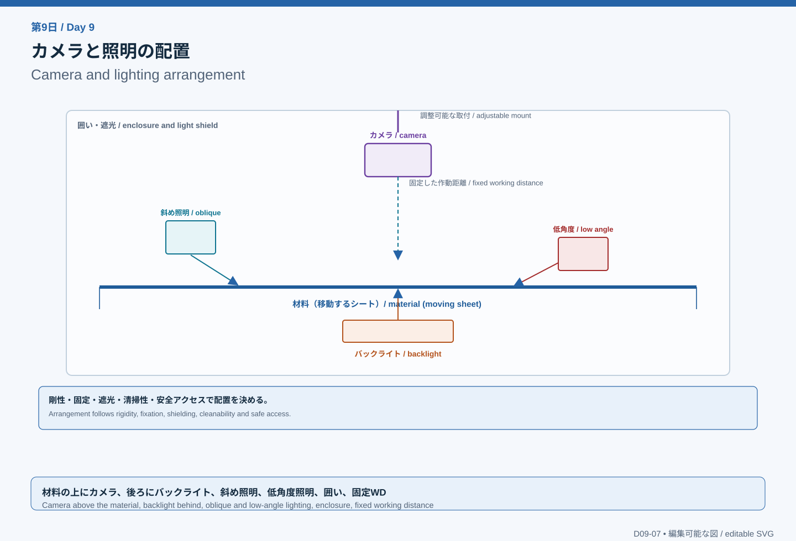
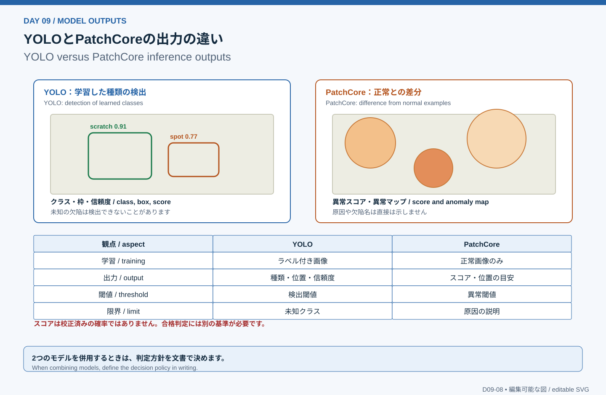

# 第9日 02：産業用PCとAI処理 / Day 9 02: Industrial PC and AI Processing

**所要時間：85分 / Duration: 85 minutes.** [第7〜9日 時間割 / Day 7–9 syllabus](../../COURSE_SYLLABUS_DAY07_09.md)

画像は、取得・転送・前処理・推論・後処理を経て「結果」になります。この教材では、産業用PCの役割、YOLOとPatchCoreの出力の違い、そして**結果の有効性**を学びます。
An image becomes a result through acquisition, transfer, preprocessing, inference and postprocessing. This lesson covers the industrial PC, the different outputs of YOLO and PatchCore, and **result validity**.

**到達目標 / Objectives:** 取得から結果までの各段階を説明し、YOLOとPatchCoreの出力を区別し、無効な結果を良品にしない判定論理を設計できる。
Explain each stage from acquisition to result, distinguish YOLO and PatchCore outputs, and design decision logic that never turns an invalid result into OK.

## 1. 産業用PCの構成 / Industrial PC architecture

産業用PCは、**CPU**、**GPU**（推論の高速化に使う場合がある）、**RAM**、**ストレージ**、**カメラインタフェース**、**ネットワーク**、**OS**、**ソフトウェアプロセス**で構成されます。**産業用PCとPatchCoreは別の概念**です。PCは実行環境、PatchCoreは手法です。

An industrial PC has a **CPU**, optionally a **GPU** for faster inference, **RAM**, **storage**, **camera interfaces**, **network**, an **OS** and **software processes**. **An industrial PC and PatchCore are different concepts:** the PC is a platform, PatchCore is a method.

## 2. 画像取得の流れ / Image acquisition flow

流れは **カメラ → 転送 → 画像バッファ → 前処理 → AIモデル → 後処理 → 結果** です。各段階に時間がかかり、その合計が「結果が出るまでの時間」になります。バッファがいっぱいになると、画像を取りこぼす可能性があります。

The path is **camera → transfer → image buffer → preprocessing → AI model → postprocessing → result**. Each stage takes time, and the sum is the time until a result exists. A full buffer can drop images.

**図 D09-07 / Figure D09-07 — 確認 / check:** 推論が速くても、全体が速いとは限らないのはなぜですか？ / Why can a fast inference still give a slow overall result?

## 3. 前処理 / Preprocessing

前処理には、**トリミング**、**リサイズ**、**正規化**、**色変換**、**関心領域（ROI）**、**校正**、**座標変換**があります。前処理は「常に良くなる」ものではありません。モデルと検査要求に合っている必要があります。学習時と推論時で前処理が違えば、結果も変わります。

Preprocessing includes **cropping**, **resizing**, **normalisation**, **colour conversion**, **region of interest (ROI)**, **calibration** and **coordinate mapping**. Preprocessing does not always improve results; it must match the model and the inspection requirement. If training and inference preprocessing differ, results differ.

## 4. YOLO / YOLO

**YOLO**は物体検出の手法です。学習したクラスについて、**バウンディングボックス**、**クラスラベル**、**信頼度（confidence）**を出力します。**検出閾値**を下げると見逃しは減りますが、誤検出（false positive）が増えます。逆に上げると見逃し（false negative）が増えます。

**YOLO** is an object-detection method. For learned classes it outputs **bounding boxes**, **class labels** and **confidence** scores. Lowering the **detection threshold** reduces misses but increases false positives; raising it increases false negatives.

**YOLOの信頼度は、校正された「合格確率」ではありません。**「学習したクラスにどれくらい似ているか」の指標であり、製品の合否確率としてそのまま使えません。
**A YOLO confidence is not a calibrated probability of acceptance.** It indicates similarity to a learned class and cannot be used directly as the probability that a product is acceptable.

## 5. PatchCore / PatchCore

**PatchCore**は異常検知の手法です。**正常画像**から特徴を学び、**正常特徴のメモリバンク**と比較して、**異常スコア**と**異常マップ**を出します。**閾値**は検証データで決め、運用でも見直します。

**PatchCore** is an anomaly-detection method. It learns features from **normal images**, compares against a **memory bank of normal features** and returns an **anomaly score** and an **anomaly map**. The **threshold** is set from validation data and reviewed in operation.

**PatchCoreは欠陥の種類を直接は示しません。**異常スコアは「校正された欠陥確率」ではありません。原因の説明や分類には、別の処理や人の確認が必要です。
**PatchCore does not directly identify a defect type.** The anomaly score is not a calibrated defect probability; cause and class need additional processing or human review.

## 6. YOLOとPatchCoreの比較 / YOLO versus PatchCore

**図 D09-08 / Figure D09-08 — 確認 / check:** 未知の欠陥に対して、どちらの手法が「気づく」可能性がありますか？ / Which method might notice an unknown defect?

| 観点 / aspect | YOLO | PatchCore |
|---|---|---|
| 学習データ / training data | ラベル付き画像 / labelled images | 正常画像 / normal images only |
| 入力 / input | 画像 / image | 画像 / image |
| 出力 / output | 種類・位置・信頼度 / class, box, score | スコア・位置の目安 / score, indicative region |
| 強み / strength | 既知の種類の検出 / known classes | 未知の外観変化 / unknown appearance change |
| 限界 / limitation | 未知クラスに弱い / weak on unseen classes | 原因を説明しない / no cause explanation |
| 失敗の型 / typical failure | 見逃し・誤検出 / misses, false positives | 正常変動への過敏 / sensitivity to normal variation |
| 閾値 / threshold | 検出閾値 / detection threshold | 異常閾値 / anomaly threshold |
| 検証 / validation | クラス別の評価 / per-class evaluation | 正常・異常の分布 / normal/abnormal distribution |

**二つを併用するときは、判定方針を文書で決めます。**例：「YOLOが欠陥を検出、またはPatchCoreのスコアが閾値超ならNG候補。どちらも無効なら保留」。方針なしの併用は、説明できない判定を生みます。
**When combining them, define the decision policy in writing**, for example: “NG candidate if YOLO detects a defect or PatchCore exceeds its threshold; hold if either result is invalid.” Combining without a policy produces decisions nobody can explain.

## 7. 検査の判定論理 / Inspection decision logic

結果は「OK／NG」の二つだけではありません。**有効なOK**、**有効なNG**、**無効な結果**、**処理タイムアウト**、**画像なし**、**通信失敗**を区別します。

A result is not only OK/NG. Distinguish **valid OK**, **valid NG**, **invalid result**, **processing timeout**, **no image** and **communication failure**.

**必須の教訓 / Mandatory lesson:** 有効なAI結果がないまま、製品を自動的に「良品」にしてはいけません。
Without a valid AI result, never automatically make the product “OK”.

| 状態 / state | 意味 / meaning | 自動でOKにしてよいか / auto OK? |
|---|---|---|
| 有効OK / valid OK | 有効な結果で基準内 / valid and within criteria | はい（方針による） / yes, per policy |
| 有効NG / valid NG | 有効な結果で基準外 / valid and outside criteria | いいえ / no |
| 無効 / invalid | 結果はあるが信頼できない / unreliable | いいえ / no |
| タイムアウト / timeout | 時間内に結果なし / no result in time | いいえ / no |
| 画像なし / no image | 取得失敗 / acquisition failed | いいえ / no |
| 通信失敗 / comms failure | 結果が届かない / result not delivered | いいえ / no |

## 8. データの保存 / Data storage

記録する項目の例：**画像ID**、**タイムスタンプ**、**ロットID**、**シート位置**、**モデル版**、**設定版**、**結果**、**結果の有効性**、**欠陥座標（任意）**、**作業者確認**。これらは**架空のデータ項目**であり、実際の項目は要求で決めます。

Record, for example: **image ID**, **timestamp**, **lot ID**, **sheet position**, **model version**, **configuration version**, **result**, **result validity**, **defect coordinates (optional)** and **operator review**. These are **fictional fields**; real fields come from requirements.

**トレーサビリティ**のために、結果と「どのモデル・どの設定・どの画像」を結び付けます。モデルを更新したら版を記録し、過去の結果と混ざらないようにします。
For **traceability**, link each result to the model, the configuration and the image. Record model versions so updated models do not mix with historical results.

## 9. 処理性能 / Processing performance

時間の内訳は、**取得時間**、**転送時間**、**待ち時間（キュー）**、**前処理時間**、**推論時間**、**後処理時間**、**通信時間**です。**モデルの推論速度と、機械全体の応答時間は別物**です。

Time splits into **acquisition**, **transfer**, **queue**, **preprocessing**, **inference**, **postprocessing** and **communication** time. **Model inference speed is not the whole machine response time.**

平均値だけで判断しません。**最大値（ワーストケース）**と**ばらつき（ジッタ）**を測ります。遅い結果が後から届くと、古い位置に対応付ける危険があります。
Do not judge by averages. Measure **worst cases** and **jitter**. A late result can be matched to the wrong position.

## 10. 画像データ量 / Image data volume

**仮定例 / Hypothetical example:** 1ライン 4,096 画素、毎秒 2,500 ライン、1画素 8 ビット（1 バイト）とすると、生データは 4,096 × 2,500 × 1 = **10,240,000 バイト/秒**、つまり **約 10.24 MB/s** です（10進の MB）。

With 4,096 pixels per line, 2,500 lines per second and 8 bits (1 byte) per pixel, raw data is 4,096 × 2,500 × 1 = **10,240,000 bytes/s**, about **10.24 MB/s** (decimal MB).

**MB/s と Mb/s を混同しません。**1 バイト = 8 ビットなので、10.24 MB/s は約 81.92 Mb/s に相当します。さらに、プロトコルのオーバーヘッド、バッファ、処理、保存が加わります。
**Do not confuse MB/s with Mb/s.** One byte is eight bits, so 10.24 MB/s is about 81.92 Mb/s. Protocol overhead, buffering, processing and storage add further requirements.

## 11. 演習 / Exercises

1. 取得から結果までの段階を順に書き、それぞれ遅くなったときの影響を一言ずつ添えてください。 / List the stages from acquisition to result with one effect of each becoming slow.
2. YOLOとPatchCoreの出力の違いを、表を使わずに説明してください。 / Explain the output difference between YOLO and PatchCore without a table.
3. 「有効なOK・有効なNG・無効・タイムアウト」の4状態で、自動OKにしてよいのはどれですか？ / Of valid OK, valid NG, invalid and timeout, which may be auto-OK?
4. 1ライン 2,048 画素、毎秒 5,000 ライン、8 ビット/画素の生データ量を MB/s で求めてください。 / Compute MB/s for 2,048 pixels/line, 5,000 lines/s, 8 bits/pixel.
5. 推論時間が平均 20 ms でも、機械の応答時間を保証できない理由を説明してください。 / Why does a 20 ms average inference not guarantee machine response time?

### 解答例 / Worked answers

1. 例：取得（露出不足）、転送（遅延）、待ち（取りこぼし）、前処理（遅延）、推論（遅延）、後処理（遅延）、通信（結果遅れ）。 / Examples: acquisition (under-exposure), transfer (delay), queue (drops), preprocessing (delay), inference (delay), postprocessing (delay), communication (late results).
2. YOLOは学習したクラスの種類・位置・信頼度を出し、PatchCoreは正常との差分のスコアと位置の目安を出す。 / YOLO outputs learned class, location and confidence; PatchCore outputs an anomaly score and indicative region.
3. **有効なOKのみ**。他は保留・人による確認。 / **Only valid OK**; the others are held for review.
4. 2,048 × 5,000 × 1 = 10,240,000 バイト/秒 ≈ **10.24 MB/s**。 / ≈ **10.24 MB/s**.
5. 取得・転送・待ち・後処理・通信の時間、および最大値とジッタが加わるため。 / Acquisition, transfer, queue, postprocessing and communication add time, plus worst-case values and jitter.

## 12. まとめ / Summary

画像処理は段階の連なりです。YOLOは既知クラスの検出、PatchCoreは正常との差分です。どちらのスコアも校正された確率ではありません。結果には有効性が必要で、無効・タイムアウト・通信失敗をOKにしてはいけません。推論時間は全体の応答時間ではありません。

Image processing is a chain of stages. YOLO detects known classes; PatchCore measures difference from normal. Neither score is a calibrated probability. Results need validity, and invalid, timed-out or failed communications must never become OK. Inference time is not total response time.

**完了条件 / Completion criteria:** 5つの演習に答え、判定の6状態を説明できること。
**Completion criteria:** answer the five exercises and explain the six decision states.

**安全に関する注意 / Safety note:** AIの判定は品質判断の材料であり、安全機能ではありません。安全は独立した安全系で確保します。
**Safety note:** AI decisions support quality judgement and are not safety functions. Safety is provided by independent safety systems.
