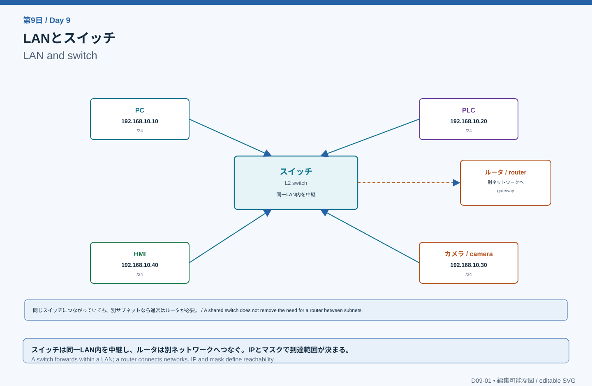
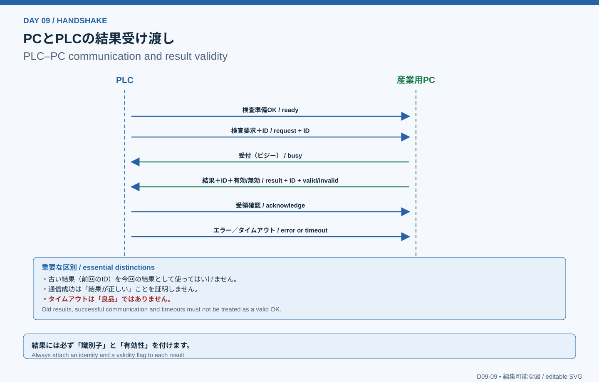
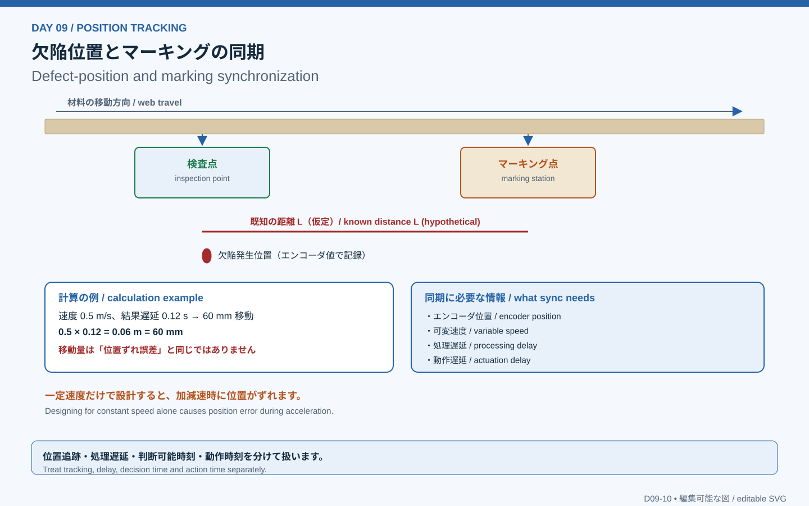
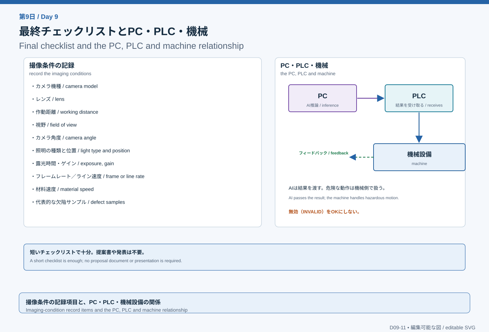
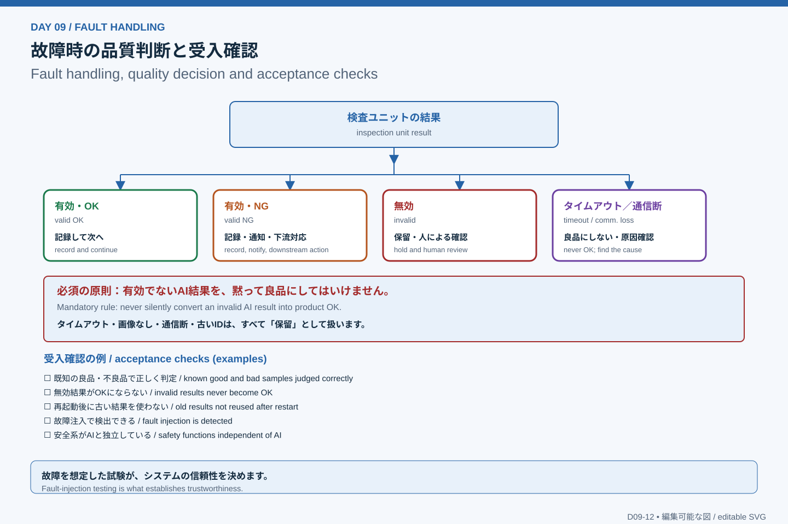
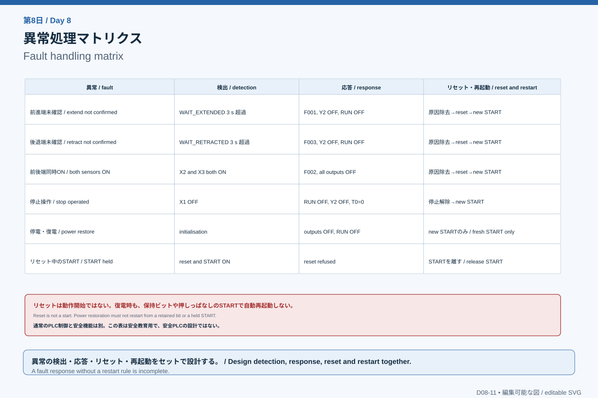

# 第9日 03：システム統合 / Day 9 03: Complete System Integration

**所要時間：135分 / Duration: 135 minutes.** [第7〜9日 時間割 / Day 7–9 syllabus](../../COURSE_SYLLABUS_DAY07_09.md)

最終日は、機械・センサ・PLC・カメラ・PC・AI・人・安全を一つの検査システムとしてまとめます。中心事例は、これまでと同じ**架空の連続塩ビシート検査機**です。
The final lesson combines mechanics, sensors, PLC, camera, PC, AI, people and safety into one inspection system. The case remains the same **fictional continuous PVC sheet inspection machine**.

**到達目標 / Objectives:** 全体アーキテクチャを層で説明し、PC–PLCの結果受け渡し、欠陥位置追跡、遅延、故障対応、安全境界を一つの設計として整理できる。
Explain the layered architecture and organise PC–PLC result exchange, defect tracking, latency, fault handling and safety boundaries into one design.

## 1. 全体アーキテクチャ / Full architecture

層に分けて考えます。**機械（搬送）**、**センサ**、**制御（PLC・HMI・安全系）**、**画像（カメラ・照明・トリガ）**、**AI（産業用PC・モデル・有効性）**、**記録と人（保存・警報・確認）**です。それぞれが運ぶ情報の種類が違うため、**すべてを同じ線で描くと誤解を生みます**。

Think in layers: **mechanics (transport)**, **sensors**, **control (PLC, HMI, safety)**, **imaging (camera, lighting, trigger)**, **AI (industrial PC, models, validity)** and **records and people (storage, alerts, review)**. Each carries a different kind of information, so **drawing them all as one line causes misunderstanding**.

**図 D09-01 / Figure D09-01 — 確認 / check:** 画像データと制御コマンドは、同じ種類の情報ですか？ / Are image data and control commands the same kind of information?

## 2. PCとPLCの通信 / PC-to-PLC communications

代表的な方法は、**デジタルI/O**、**Ethernet通信**、**Modbus TCP**、**OPC UA**、**コントローラ固有の産業インタフェース**です。どれを選ぶかは、実際の機器・要求・保守体制で決まります。**本教材ではプロトコルを実装しません。**実プラントの通信設定も断定しません。

Typical options are **digital I/O**, **Ethernet**, **Modbus TCP**, **OPC UA** and **controller-specific industrial interfaces**. The choice depends on actual equipment, requirements and maintenance capability. **This course does not implement protocols** and makes no claim about a real plant's configuration.

**重要な区別 / Key distinction:** 通信が成功しても、それは「結果が正しい」ことを意味しません。また、デジタルI/Oのビットは、**どの結果に対するビットか**という識別子を持ちません。だからこそ、結果には**識別子と有効性**が必要です。
Successful communication does not prove the result is correct. A digital-I/O bit carries no identity of which result it refers to, which is why every result needs an **identifier and a validity flag**.

## 3. 結果の有効性とハンドシェイク / Result validity and handshaking

やり取りの例：**準備OK（ready）**、**検査要求＋ID（request + ID）**、**受付・ビジー（busy）**、**結果＋ID＋有効/無効（result + ID + valid/invalid）**、**受領確認（acknowledge）**、**エラー／タイムアウト**。

Example exchange: **ready**, **request + ID**, **busy**, **result + ID + valid/invalid**, **acknowledge**, **error or timeout**.

**図 D09-09 / Figure D09-09 — 確認 / check:** 「新しい結果」と「前回の結果が残っている状態」を、どう見分けますか？ / How do you tell a new result from a stale one?

**古い結果（前回のID）を今回の結果として使ってはいけません。**通信成功は正しさの証明ではありません。**タイムアウトは良品ではありません。**連続材料では、結果の識別子を「フレーム」「画像ライン区間」「エンコーダ位置」など、追跡可能な単位に結び付けます。

**Never use an old result (previous ID) as the current one.** Communication success is not proof of correctness, and **a timeout is not OK**. For continuous material, tie the result identity to a traceable unit such as a frame, an image-line interval or an encoder position.

**単一のハンドシェイク方式が万能ではありません。**要求・機器・速度に合わせて設計します。
**No single handshake protocol is universally applicable**; design it for the requirement, devices and speed.

## 4. 欠陥位置の追跡 / Defect position tracking

**検査点**で見つかった欠陥は、**エンコーダのカウント**と結び付けて記録します。材料は下流の**マーキング点**へ移動するため、**移動距離**と**速度**を考慮します。**速度が変わる**ラインでは、一定時間ではなく**位置（エンコーダ）**で追跡します。

A defect found at the **inspection point** is recorded with an **encoder count**. The material travels to a downstream **marking station**, so **travel distance** and **speed** matter. On a **variable-speed** line, track by **position (encoder)** rather than by fixed time.

**図 D09-10 / Figure D09-10 — 確認 / check:** 検査点とマーキング点の距離が分かっていれば、速度変動は無視できますか？ / If the distance between stations is known, may speed variation be ignored?

## 5. 遅延の計算 / Latency calculations

**仮定例 / Hypothetical example:** 材料速度 0.5 m/s、AI結果の遅延 0.12 s とします。遅延中の移動は 0.5 × 0.12 = 0.06 m = **60 mm** です。

Material speed 0.5 m/s with 0.12 s AI result latency gives travel of 0.5 × 0.12 = 0.06 m = **60 mm**.

**60 mm の移動は、必ずしも 60 mm のマーキング誤差ではありません。**位置追跡とスケジューリングが正しく設計されていれば、遅延は補正できます。区別すべきは、**位置追跡**、**処理遅延**、**判断可能時刻**、**物理動作の時刻**です。

**A 60 mm movement is not necessarily a 60 mm marking error.** With correct tracking and scheduling the delay can be compensated. Separate **position tracking**, **processing delay**, **decision availability** and **physical action timing**.

**検査点からマーキング点までの距離**が既知なら、利用可能な時間を見積もれます。ただし、処理遅延・動作遅延・安全余裕を、**明示した仮定**で計算します。一定速度だけの計算は、加減速のある実ラインには不十分です。
If the distance from inspection to marking is known, available time can be estimated — but account for processing delay, actuation delay and a safety margin with **stated assumptions**. Constant-speed timing alone is insufficient on a line that accelerates.

## 6. リアルタイム性能 / Real-time performance

考慮するのは、**PLCの応答**、**カメラの取得**、**AI推論の処理能力**、**バッファ容量**、**通信**、**最悪遅延**、**ジッタ**、**画像の欠落**、**滞留（バックログ）**、**遅れて届く結果**です。**平均の推論時間だけでは、リアルタイム適性を証明できません。**

Consider **PLC response**, **camera acquisition**, **AI throughput**, **buffer capacity**, **communications**, **worst-case latency**, **jitter**, **dropped images**, **backlog** and **delayed results**. **Average inference time alone does not prove real-time suitability.**

**図 D09-11 / Figure D09-11 — 確認 / check:** バッファを増やすと、何が改善し、何が悪化しますか？ / What improves and what worsens when buffer size increases?

## 7. 故障対応 / Failure handling

次の14の故障を、症状・原因候補・検出方法・記録・品質対応・人による確認・自動で仮定してはいけないこと、で整理します。

Organise these 14 failures by symptom, candidate cause, detection, logging, quality response, human review and what must not be assumed.

| # | 故障 / failure | 症状 / symptom | 検出の例 / detection | 自動で仮定しないこと / must not be assumed |
|---|---|---|---|---|
| 1 | カメラ断 / camera disconnect | 画像が来ない / no images | 状態監視 / status monitoring | 材料は正常 / material is good |
| 2 | 画像欠落 / missed image | 連番の抜け / sequence gap | 連番・位置照合 / index check | 欠陥なし / no defect |
| 3 | 照明故障 / lighting failure | 暗い・不均一 / dark or uneven | 明るさ監視 / brightness check | 検出能力が同じ / same capability |
| 4 | エンコーダ断 / encoder lost | 位置が進まない / no position progress | パルス監視 / pulse monitoring | 位置が正しい / position is correct |
| 5 | PCプロセス停止 / PC crash | 応答なし / no response | ハートビート / heartbeat | 結果なし＝OK / no result = OK |
| 6 | モデル読込失敗 / model load failure | 推論不可 / inference unavailable | 起動診断 / start-up diagnostics | 別モデルで代用可 / any model will do |
| 7 | 結果遅延 / late result | 期限超過 / past deadline | タイムスタンプ / timestamps | そのまま使える / usable as is |
| 8 | 結果無効 / invalid result | 有効フラグ0 / validity 0 | フラグ確認 / flag check | 良品 / OK |
| 9 | PLC通信断 / PLC comms lost | 更新停止 / updates stop | タイムアウト / timeout | 最新値が有効 / last value valid |
| 10 | ID重複 / duplicate ID | 同じID / repeated ID | ID照合 / ID comparison | 新しい結果 / a new result |
| 11 | 古い結果の再利用 / stale result reuse | 前回値 / previous value | シーケンス確認 / sequence check | 今回の結果 / current result |
| 12 | 位置追跡の破綻 / tracking unreliable | 位置のずれ / position drift | 位置照合 / position comparison | マーキング正確 / marking accurate |
| 13 | 警報の安易な確認 / alarm acknowledged without cause | 再発 / recurrence | 履歴確認 / history review | 原因が消えた / cause removed |
| 14 | 故障後の再起動 / restart after fault | 再発・危険 / recurrence, danger | 起動条件確認 / restart checks | 自動再起動してよい / auto restart is safe |

**停止や自動再起動を、工程とリスクアセスメントなしに規定しません。**「タイムアウト＝良品」「無効＝良品」は禁止です。
**Never prescribe a production stop or automatic restart without process and risk assessment.** “Timeout = OK” and “invalid = OK” are forbidden.

**図 D09-12 / Figure D09-12 — 確認 / check:** 4つの分岐のうち、自動で先へ進めてよいのはどれですか？ / Of the four branches, which may proceed automatically?

## 8. ヒューマンマシンインタフェース / Human-machine interface

有用な画面は、**全体概要**、**カメラ状態**、**AI状態**、**現在の検査結果**、**欠陥履歴**、**警報一覧**、**機械状態**、**設定概要**、**作業者への指示**です。日本語の画面に英語の説明ラベルを添えた例を、第8日の図で確認できます。

Useful screens: **overview**, **camera status**, **AI status**, **current results**, **defect history**, **alarm list**, **machine state**, **configuration summary** and **operator instructions**. A Japanese screen with English explanatory labels appears in the Day 8 figure.

**図 D08-11（再掲） / Figure D08-11 (revisited) — 確認 / check:** 警報画面から、原因の確認へ進める情報がありますか？ / Does the alarm screen lead to the cause?

HMIは**安全条件を無効にする画面ではありません**。操作権限、記録、監査を設計に含めます。
The HMI is **not a screen that disables safety conditions**. Include permissions, records and audit in the design.

## 9. 機械安全の境界 / Machine safety boundaries

再度確認します。**機械的ガード**、**非常停止機能**、**安全関連インターロック**、**リスクアセスメント**、**安全な保守**、**電気の危険**、**予期しない再起動**、**AI推論からの独立性**。安全機能は、通常の品質検査ロジックとは**独立**して設計・検証されます。

Revisit **mechanical guarding**, **emergency-stop functions**, **safety-related interlocks**, **risk assessment**, **safe maintenance**, **electrical hazards**, **unexpected restart** and **independence from AI inference**. Safety functions are designed and validated **independently** of ordinary quality-inspection logic.

**AIアプリケーションが、PLCのレジスタに指令を書くだけで、検証された非常停止を実現することはできません。**
An AI application cannot perform a validated emergency stop merely by writing a command to a PLC register.

## 10. AI結果通信のシミュレーション / AI result protocol simulation

`day07_09_support/simulations/sim_ai_result_protocol.html` は、**有効なOK・有効なNG・無効・タイムアウト・重複ID・古い結果**を切り替えて、PLC側がどう扱うべきかを確認する**完全オフライン**の教材です。**欠落した結果をOKとして扱いません。**

`day07_09_support/simulations/sim_ai_result_protocol.html` is a **fully offline** teaching tool for switching between **valid OK, valid NG, invalid, timeout, duplicate ID and stale result** and checking what the PLC side must do. **It never treats a missing result as OK.**

## 11. 最終設計演習 / Final system design exercise

次の15項目を、**架空の検査機**として一つの設計書にまとめます。数値は仮定と明記します。
Write the following 15 items as one design document for a **fictional machine**, stating assumptions explicitly.

1. 機械レイアウト / mechanical layout
2. センサ / sensors
3. アクチュエータ / actuators
4. PLC / PLC
5. カメラと照明 / camera and lighting
6. 産業用PC / industrial PC
7. AIモデル / AI model
8. データの流れ / data flow
9. 制御の流れ / control flow
10. 結果の有効性 / result validity
11. タイミング / timing
12. エラー処理 / error handling
13. HMI
14. 安全境界 / safety boundaries
15. 受入試験 / acceptance tests

**受入試験の例 / Acceptance test examples:** 既知の良品・不良品で正しく判定できる。無効結果がOKにならない。再起動後に古い結果を使わない。故障注入で検出できる。安全系がAIと独立している。
Known good and bad samples judged correctly; invalid results never become OK; old results not reused after restart; fault injection detected; safety functions independent of AI.

## 12. 演習 / Exercises

1. 全体アーキテクチャの6層を書き、各層が運ぶ情報を一言で説明してください。 / List the six layers and say what each carries.
2. 新しい結果と古い結果を区別するために必要な情報は何ですか？ / What information distinguishes a new result from a stale one?
3. 速度 0.4 m/s、遅延 0.15 s のとき、遅延中の移動量を求めてください。 / At 0.4 m/s and 0.15 s latency, find the travel.
4. 故障対応表から三つ選び、「自動で仮定してはいけないこと」を説明してください。 / Choose three failures and explain what must not be assumed.
5. 安全機能がAIから独立していなければならない理由を説明してください。 / Why must safety functions be independent of AI?

### 解答例 / Worked answers

1. 機械（動き）、センサ（状態）、制御（指令）、画像（画像データ）、AI（判定と有効性）、記録・人（結果と確認）。 / Mechanics (motion), sensors (state), control (commands), imaging (image data), AI (decision and validity), records and people (results and review).
2. 結果ID、シーケンス番号またはエンコーダ位置、タイムスタンプ、有効性フラグ。 / Result ID, sequence number or encoder position, timestamp and validity flag.
3. 0.4 × 0.15 = **0.06 m = 60 mm**。 / **0.06 m = 60 mm**.
4. 例：タイムアウト→良品と仮定しない、古いID→今回の結果と仮定しない、警報確認→原因除去と仮定しない。 / Examples: timeout is not OK; a stale ID is not the current result; acknowledging an alarm is not removing the cause.
5. AIは確率的・統計的で、故障や誤りがあり得るため。安全は検証された独立の安全系で確保する。 / AI is probabilistic and can fail; safety is provided by a validated independent system.

## 13. まとめ / Summary

検査システムは、機械・センサ・制御・画像・AI・記録・人・安全の層からなります。結果には識別子と有効性が必要で、古い結果・タイムアウト・通信断をOKにしてはいけません。遅延は位置追跡で補正できますが、平均値だけでは不十分です。安全はAIと独立した設計分野です。

An inspection system is layered: mechanics, sensors, control, imaging, AI, records, people and safety. Results need identity and validity; stale results, timeouts and communication loss must never be OK. Latency can be compensated by tracking, but averages are insufficient. Safety is an independent design discipline, separate from AI.

**完了条件 / Completion criteria:** 5つの演習に答え、「AI検査装置の基本設計書 / AI Inspection Machine Conceptual Design Sheet」を15項目そろえて作成できること。
**Completion criteria:** answer the five exercises and produce the **AI Inspection Machine Conceptual Design Sheet** with all 15 items.

**安全に関する注意 / Safety note:** 本教材の設計は概念検討用です。実機の設計・製作・運転は、有資格の機械・電気・安全・ソフトウェア技術者によるレビューと、現地の法規・規格・手順に従います。
**Safety note:** This design work is conceptual. Real design, build and operation require review by qualified mechanical, electrical, safety and software engineers and compliance with local regulations, standards and procedures.
